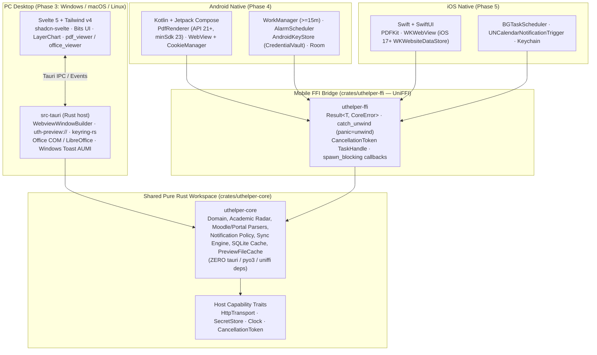

# UTHelper Gradual Migration Roadmap (Rust Core + Tauri v2 + Kotlin + Swift)

- **Decision Record**: [ADR 0006: Gradual Migration to Shared Rust Core, Tauri v2 Desktop, and Native Mobile via UniFFI](../adr/0006-rust-core-tauri-native-migration.md)
- **Baseline Commit**: `5714b64` (`origin/develop`, post-Milestone 4)
- **Date**: 2026-11-23
- **Status**: Active Roadmap (Phases 0–5; zero-downtime strangler-fig execution)

---

## 1. Post-M4 Baseline & Architectural Inventory (`5714b64`)

### 1.1 Codebase & Verification Baseline

| Surface | Files | Lines | Key Observations |
|---|---:|---:|---|
| `src/` (all Python) | **170** | **85,669** | `uthelper` `2.5.1`, `requires-python = ">=3.11"`, `flet==0.86.5` (`pyproject.toml:6-18`) |
| `src/core/` | **68** | **29,843** | `0` imports from `gui`; **13** files import `config` (`[CFG]`), **4** import `platform_utils` (`[PLAT]`) |
| `src/gui/` | **70** | **44,170** | `AppController` (`5,535L`), `document_reader_view.py` (`3,272L`), `settings_view.py` (`3,201L`), `detail_view.py` (`2,863L`) |
| `src/notifiers/` | **8** | **2,284** | `NotificationManager` + Windows/Mobile/Email/Telegram/Discord channels |
| `src/platform_utils/` | **9** | **3,712** | Windows update/single-instance/autostart/bootstrap, Android update/background-sync bridges |
| `src/diagnostics/` | **10** | **4,505** | Crash spool, redaction, runtime diagnostics, Windows evidence |
| `tests/` | **180** | **84,682** | Full suite **`3,003 passed, 26 skipped`** (`pytest`), `ruff check` **0 errors**, `test_architecture_boundaries.py` **5/5 passed** |
| `src/assets/` | **26** | — | `icon.ico`, `icon.png` + **24** viewer files across `pdf_viewer/` (7 files, `pdfjs-dist@4.10.38`, ~`1.85 MB`) and `office_viewer/` (17 files incl. `.gitkeep` / 16 non-hidden, `docx-preview@0.4.1`, `@office-kit/pptx@0.28.0`, ~`879 KB`) |
| `extensions/` | — | — | `flet_uth_quiz` (Flutter `flutter_inappwebview: 6.1.5`, **37/37** Dart tests) & `flet_uth_background_sync` (Android Kotlin Room/WorkManager/AlarmManager/AndroidKeyStore + iOS `UthBackgroundSyncPlugin.swift`) |

### 1.2 Boundary Debt & Packaging Ceiling

- **`tests/test_architecture_boundaries.py`** (`5/5` passing):
  - `core -> gui`: **0 violations** (enforced).
  - `gui -> core.ws_functions`: **0 violations** (enforced; strictly behind `core.moodle_service`).
  - Remaining allowlisted debt to pay down in **Phase 0**:
    1. `src/models.py:5` (`from config import settings` for `Assignment.urgency` lines 50–56).
    2. Four demo `__main__` imports `gui.components.{calendar_view,detail_view,grade_overview_view,settings_view} -> gui.app_controller`.
    3. **13 `[CFG]`** and **4 `[PLAT]`** couplings inside `src/core/` (listed in Section 4).
- **Shipped Package Sizes & Build Friction**:
  - CH Play `.aab`: **110.7 MB** (`docs/architecture/refactoring-log.md:83`); requires `jni = "1.2.1"` override (`pyproject.toml:68-75`) and `scripts/prepare_android_flutter_project.py` permission stripping.
  - MS Store `.msix`: **65.09 MB** (`docs/architecture/refactoring-log.md:83`); requires `/D_SILENCE_EXPERIMENTAL_COROUTINE_DEPRECATION_WARNINGS` (`STL1011`), NuGet v7.3.1 shim (`quiz_client_bootstrap.py`), and `WindowsWebView2Dock` STA/HWND polling.
  - **Unused/Narrow Dep Note**: `httpx>=0.28.1` is declared in `pyproject.toml:16` but used **only** in `src/notifiers/{telegram,discord}.py`; all Moodle/Portal/Update traffic runs over stdlib `urllib.request` (`src/core/client.py:415-430`).

---

## 2. Target Cargo Workspace & Transitional Boundary Architecture

### 2.1 Target End-State Architecture (Phase 5)



### 2.2 Transitional Coexistence Bridge (Phases 1–3)

During Phases 1–3, Flet (`src/gui/`) remains the production UI on Mobile (and on PC until Phase 3 ships) while Python services are gradually swapped out behind a `BackendPort` protocol:

```mermaid
flowchart LR
    FLET["Flet 0.86.5 UI (src/gui/)"] --> PORT["Python BackendPort Protocol (src/core/)"]
    PORT -->|Desktop & CI (default)| PYO3["uthelper-py (PyO3 >=0.27 abi3-py311, native Py 3.14)<br/>Python::detach / Python::attach · Coarse DTOs"]
    PORT -->|Android Flet fallback (Phases 1-3)| PYFALLBACK["Pure-Python Fallback Adapters<br/>(avoids premature boring-sys/serious_python wheel risk)"]
    PYO3 --> RUST["crates/uthelper-core"]
```

### 2.3 Workspace Directory Layout

```text
Cargo.toml                          # Workspace root (resolver = "2", workspace.package)
crates/
  uthelper-core/                    # 100% pure Rust; ZERO tauri, pyo3, uniffi deps
  uthelper-py/                      # PyO3 >=0.27 + maturin (abi3-py311, native Py 3.14) transitional bridge
  uthelper-ffi/                     # UniFFI bindings crate (cdylib + staticlib)
  uth-http-spike/                   # Phase 0 live Cloudflare TLS/JA3/JA4 diagnostic CLI (dev-only)
src-tauri/                          # Phase 3: Tauri v2 host + Svelte 5 + Tailwind v4 frontend
mobile/
  android/                          # Phase 4: Kotlin + Jetpack Compose Gradle project (reusing CredentialVault/WorkManager)
  ios/                              # Phase 5: Swift + SwiftUI Xcode/SPM project consuming uthelper-ffi XCFramework
```

---

## 3. Preserved Post-M1–M4 Invariants Checklist

Every phase **must** keep these verified behaviors green in automated parity and integration suites:

| ID | Origin | Invariant & Source Anchor | Target Owner |
|---|---|---|---|
| **INV-1** | M1 `F1–F4` | Instant tab switching (zero synchronous teardown/rebuild or dual transition lag), zero-edit Settings exit never snaps back (`SettingsFormSnapshot`), `tab_switcher.content.visible` always `True` | Svelte 5 Router (P3), Compose NavHost (P4), SwiftUI TabView (P5) |
| **INV-2** | M1 `F5–F9` | Zero 2-line bottom nav wrapping, non-clipped semester chips, non-clipped Academic Radar labels (`"Giữ Nhịp"`, `"So sánh kỳ trước"`), responsive GPA dialogs on `360dp`–`390dp` viewports | Svelte 5 + LayerChart (P3), Compose (P4), SwiftUI (P5) |
| **INV-3** | M2 `F10` | Portal `tongKetDot` summary stays authoritative; weighted fallback `gpa_10`, `gpa_4` (`course_point4`), and `credits_earned` computed per absent field from graded academic `semester.courses` (`calculator.py:455-509`), returning `None` when no valid graded course exists | `uthelper-core::radar::calculator` (P1) |
| **INV-4** | M2 `F11` | `SemesterNormalizer` preserves `0.0`, `isDat: None`, `subject_code`, `class_code`, `pass_status`, and unmapped fields in `extra_portal_fields` (`normalizer.py:123-254`); course popup renders 2 distinct tabs (`Portal` \| `Course`) using Moodle `CourseCacheStore`/`CourseCatalogService` lookup without importing `AppController` or raw WS | `uthelper-core::radar::normalizer` (P1) + UI popup (P3–P5) |
| **INV-5** | M2 `F12` | Closing course/metric/GPA dialogs preserves exact vertical scroll offset (`autofocus=False` / no scroll-to-top jump) | Svelte 5 / Compose / SwiftUI modal state (P3–P5) |
| **INV-6** | M3 `F13–F14` | Never degrade PDF viewing to plain-text cards when native raster is absent (`document_reader_view.py:2763`); Windows Office COM (`$owned` PID check) / isolated LibreOffice (`-env:UserInstallation`) -> SHA-256 `PreviewFileCache` PDFs, falling back to `office_viewer/` (`docx-preview 0.4.1`, `@office-kit/pptx 0.28.0`) | `uthelper-core::preview` + `src-tauri` `uth-preview://` (P2–P3) + native `PdfRenderer`/`PDFKit` + local `office_viewer` (P4–P5) |
| **INV-7** | M3 `F15` | **"Hướng A" Cookie Persistence**: General WebView persists cookies across opens for **all** sites (Moodle, Portal, Microsoft, Google) per active UTHelper account (`acct_<sha256[:24]>`). Purge/switch profiles **ONLY** on UTHelper logout or account switch (`app_controller.py:490-515`, `embedded_webview_host.py:100-126`: `clear_all_browsing_data()` before closing or close + bounded async retry/backoff `acct_*` delete + startup sweep) | Tauri `data_directory` (P3), Android `CookieManager` (P4), iOS `>= 17.0` `WKWebsiteDataStore(forIdentifier:)` (P5) |
| **INV-8** | M3 `F16` | Lock-free `stage_and_commit` disk cache, `Content-Length` + `gzip` EOF truncation checks, `ZIP_STORED` O(1) validation with streaming decompression cap for non-XML entries, parallel catalog+THNN+Portal sync, HTTP Keep-Alive / custom-scheme asset serving | `uthelper-core::net` & `uthelper-core::cache` (P2) |
| **INV-9** | M4 `F17–F19` | No forced OS fullscreen on Quiz (even when `secure_window=True`), reuse authenticated `MoodleClient` cookies with `login_session(force=True)` fallback + `sesskey` extraction from login POST HTML, keep HTTP/V8 disk cache warm across quiz opens while purging only Moodle quiz origin cookies on close, respect upstream `Set-Cookie` (`no-store`) | `uthelper-core::quiz` (P2) + host WebView managers (P3–P5) |
| **INV-10** | ADR 0003/0004 | Strict isolation of `chplay` (`.aab`, 16 KB aligned, zero self-updater code/permissions) and `msstore` (`.msix`, runtime `distribution-channel.json` suppression) from the 7-asset fail-closed GitHub LTS release | `uthelper-core::distribution` (P2) + CI release pipelines (P3–P5) |

---

## 4. Complete Module-by-Module Migration Map

### 4.1 `src/core/` (All 68 Modules)

Coupling tags tracked for Phase 0–2 cleanup: **`[CFG]`** = 13 modules importing `config`; **`[PLAT]`** = 4 modules importing `platform_utils`.

| Python Module | LOC | Couplings | Target Phase | Target Rust Module / Host Adapter | Migration Strategy & Notes |
|---|---:|---|---|---|
| `core/__init__.py` | 0 | — | P0 | — | Package marker; kept until Python retirement |
| `core/academic_radar/__init__.py` | 29 | — | P1 | `uthelper_core::radar` | Re-export facade |
| `core/academic_radar/config.py` | 20 | — | P1 | `uthelper_core::radar::config` | Pure struct `RadarConfig` |
| `core/academic_radar/models.py` | 105 | — | P1 | `uthelper_core::radar::models` | Pure `serde` structs (`CourseGradeItem`, `RadarProfile`, `SemesterGradeData`, `extra_portal_fields`) |
| `core/academic_radar/color_scale.py` | 98 | — | P1 | `uthelper_core::radar::color_scale` | Pure thresholds & hex color mapping |
| `core/academic_radar/eligibility_resolver.py` | 79 | — | P1 | `uthelper_core::radar::eligibility` | Pure `CourseEligibilityResolver` (preserve `bool`/`nan`/`inf`/comma parity) |
| `core/academic_radar/normalizer.py` | 254 | — | P1 | `uthelper_core::radar::normalizer` | Port `SemesterNormalizer`; keep `subject_code`, `class_code`, `pass_status`, `extra_portal_fields` |
| `core/academic_radar/calculator.py` | 533 | — | P1 | `uthelper_core::radar::calculator` | Port 6 metrics + M2 F10 `gpa_10`/`gpa_4`/`credits_earned` fallback |
| `core/academic_radar/gpa_planner.py` | 307 | — | P1 | `uthelper_core::radar::gpa_planner` | Port `score10_to_point4`, `course_point4`, `calculate_gpa_target`, `calculate_graduation_target` |
| `core/academic_radar/overall.py` | 86 | — | P1 | `uthelper_core::radar::overall` | Pure `calculate_overall_gpa`, `required_average` |
| `core/academic_radar/service.py` | 233 | **`[CFG]`** | P2 | `uthelper_core::radar::service` + SQLite | Decouple `settings`/`get_data_dir` in P0; wire `PortalClient` + `rusqlite` cache in P2 |
| `core/activity_status.py` | 68 | — | P1 | `uthelper_core::domain::activity_status` | Pure normalization |
| `core/activity_time_policy.py` | 97 | — | P1 | `uthelper_core::domain::time_policy` | Inject `Clock` timestamp rather than `datetime.now()` |
| `core/autostart.py` | 21 | **`[PLAT]`** | P3 | Host `AutostartService` (`src-tauri`) | Desktop-only OS startup registration; retire Python shim in P3 |
| `core/class_schedule_notifications.py` | 240 | — | P1 | `uthelper_core::notifications::class_schedule` | Pure `unicodedata`/NFKC + SHA-256 reminder builder |
| `core/client.py` | 1,837 | **`[CFG]`** | P2 | `uthelper_core::net::moodle_client` + `HttpTransport` | Gated by Phase 0 Cloudflare spike; preserve `_session_generation`, `Set-Cookie` tracking, bounded gzip stream checks |
| `core/course_grade_monitor.py` | 190 | **`[CFG]`** | P2 | `uthelper_core::grades::monitor` + SQLite | Replace JSON file diffing with SQLite grade snapshot table |
| `core/course_grade_scraper.py` | 103 | — | P1 | `uthelper_core::parsers::course_grades` | Replace `bs4` with `scraper` / `tl` HTML parser |
| `core/course_grades_service.py` | 133 | — | P2 | `uthelper_core::grades::service` | Async Tokio fan-out via `MoodleService` |
| `core/courses/__init__.py` | 25 | — | P1 | `uthelper_core::courses` | Re-export facade |
| `core/courses/models.py` | 141 | — | P1 | `uthelper_core::courses::models` | Pure `serde` structs (`CourseSummary`, `CourseSection`, `CourseAttachment`, etc.) |
| `core/courses/shortname_parser.py` | 280 | — | P1 | `uthelper_core::courses::shortname_parser` | Pure regex/string + HTML teacher extraction |
| `core/courses/providers.py` | 918 | — | P2 | `uthelper_core::courses::providers` | Port `CoursesWsProvider`, `ThnnCourseProvider`, `classify_preview_kind`, `is_synthetic_moodle_attachment` |
| `core/courses/cache_store.py` | 524 | **`[CFG]`** | P2 | `uthelper_core::cache::course_store` (SQLite) | Migrate `courses_catalog_<digest>` & `course_tree_*` to `rusqlite` tables keyed by `account_namespace` |
| `core/courses/catalog_service.py` | 1,127 | — | P2 | `uthelper_core::courses::catalog_service` | Async 3-stream sync (Moodle + THNN + Portal) + `SingleFlight` inflight download dedup |
| `core/courses/activity_service.py` | 1,968 | — | P2 | `uthelper_core::courses::activity_service` | Port Quiz review GIFT/HTML parser, Attendance, Forum, RichPage parsers |
| `core/courses/archive_service.py` | 1,203 | — | P2–P3 | `uthelper_core::courses::archive` + Host 7z/RAR adapter | `zip`/`tar`/`flate2` in pure Rust; Windows `7z.exe`/`unrar.exe` optional CLI remains desktop host adapter in P3 |
| `core/courses/document_converter.py` | 4,852 | — | P2–P3 | **Retire** most OOXML text fallback; keep lightweight CSV/HTML/text sanitizer in `uthelper_core::preview::text` | Replaced by `src/assets/office_viewer/` (`docx-preview`, `@office-kit/pptx`) + ADR 0005 Office/LibreOffice PDF cache + native PDF (`WebView2`/`PdfRenderer`/`PDFKit`) |
| `core/courses/local_preview_server.py` | 1,248 | — | P3 | **Retire** (`uth-preview://` in `src-tauri`, `WebViewAssetLoader` Android, `WKURLSchemeHandler` iOS) | Eliminates `127.0.0.1` loopback HTTP server on desktop (P3) and mobile (P4–P5) |
| `core/courses/office_viewer_service.py` | 239 | — | P1–P2 | `uthelper_core::preview::package_inspector` | Port `zip`-based `is_supported_office_package` (O(1) `ZIP_STORED` + streaming cap for compressed non-XML entries) |
| `core/courses/pdf_renderer.py` | 652 | — | P3–P5 | **Retire** `pypdfium2`/`fitz` desktop dependency; optional `hayro` helper | Replaced by WebView2 native PDF + `pdf.js` fallback (P3), `android.graphics.pdf.PdfRenderer` (API 21+, P4), `PDFKit` (P5) |
| `core/courses/preview_cache.py` | 259 | **`[CFG]`** | P2 | `uthelper_core::cache::preview_cache` | Atomic `stage_and_commit` disk blob cache + SHA-256 `office-pdf:v1` index in SQLite |
| `core/courses/windows_office_bridge.py` | 313 | — | P3 | `src-tauri::office_bridge` (Windows host adapter) | Keep PowerShell COM `$owned` PID logic & isolated LibreOffice `-env:UserInstallation` in `src-tauri` |
| `core/data_cache.py` | 220 | **`[CFG]`** | P2 | `uthelper_core::cache::activity_cache` (SQLite) | Consolidate into `rusqlite` DB |
| `core/data_orchestrator.py` | 1,417 | **`[CFG]`** | P2 | `uthelper_core::sync::orchestrator` | Async Tokio merge + `MoodleService` + `ActivityMerger`/`ActivityMapper` split |
| `core/display_utils.py` | 84 | — | P1 | `uthelper_core::domain::display` | Pure formatting helpers |
| `core/distribution.py` | 291 | **`[PLAT]`** | P2 | `uthelper_core::distribution` | Port `DistributionChannel` (`chplay`, `apk_lts`, `msstore`, `exe_lts`, `source`) + fail-closed MSIX identity guard |
| `core/filter_service.py` | 138 | — | P1 | `uthelper_core::domain::filters` | Pure search, urgency, type, status filtering & sorting |
| `core/grade_monitor.py` | 171 | **`[CFG]`** | P2 | `uthelper_core::grades::diff_monitor` | Diff persisted SQLite grade hashes |
| `core/html_compat.py` | 14 | — | P1 | **Retire** | Python `lxml`/`bs4` shim obsolete in Rust (`scraper`) |
| `core/html_scrapers.py` | 123 | — | P1 | `uthelper_core::parsers::assignments` | Port assignment/THNN upcoming HTML scrapers |
| `core/moodle_service.py` | 344 | — | P2 | `uthelper_core::moodle::service` | High-level typed Moodle facade |
| `core/moodle_sites.py` | 72 | — | P1 | `uthelper_core::moodle::sites` | Pure `TRUSTED_MOODLE_SITES` & origin matching |
| `core/network_utils.py` | 54 | — | P2 | `uthelper_core::net::retry` | Async Tokio backoff with `CancellationToken` |
| `core/notification_history.py` | 76 | **`[CFG]`** | P2 | `uthelper_core::cache::notification_history` (SQLite) | Migrate JSON history to SQLite table |
| `core/notification_policy.py` | 174 | — | P1 | `uthelper_core::notifications::policy` | Pure milestone/DND/`stable_notification_id` engine |
| `core/notification_types.py` | 170 | — | P1 | `uthelper_core::notifications::types` | Pure `serde` DTOs |
| `core/portal_client.py` | 560 | — | P2 | `uthelper_core::net::portal_client` | Async `PortalClient` via `HttpTransport`, token generation counter, 8 MiB cap |
| `core/quiz_entry.py` | 683 | — | P2 | `uthelper_core::quiz::entry` | Port `prepare_quiz_entry` (SEB/closed detection, `sesskey` scraping, `existing_client` cookie clone) |
| `core/quiz_player.py` | 274 | — | P2 | `uthelper_core::quiz::player` | Port `QuizLaunchTarget`, `QuizSessionLease`, `quiz_session_key` |
| `core/quiz_web_session.py` | 379 | **`[CFG]`** | P2 | `uthelper_core::quiz::web_session` | Port cookie cloning & warm-back logic |
| `core/safe_file_io.py` | 194 | — | P2 | `uthelper_core::fs::atomic` | Tempfile + `fsync` + atomic rename + lock helper |
| `core/security.py` | 107 | — | P1 | `uthelper_core::security::html_sanitizer` | Pure Rust HTML sanitizer (`ammonia` crate) |
| `core/submission_models.py` | 162 | — | P1 | `uthelper_core::submission::models` | Pure DTOs (`SubmissionSnapshot`, `FileMutationIntent`, etc.) |
| `core/submission_snapshot.py` | 296 | — | P1 | `uthelper_core::submission::snapshot` | Pure `parse_submission_snapshot` & `validate_desired_files` |
| `core/sync_coordinator.py` | 161 | — | P2 | `uthelper_core::sync::coordinator` | Async `ActivitySyncCoordinator` + `next_sync_at` |
| `core/time_utils.py` | 84 | — | P1 | `uthelper_core::domain::time_utils` | `chrono` / `jiff` ISO + relative Vietnamese formatting |
| `core/today_schedule.py` | 625 | **`[CFG]`** | P2 | `uthelper_core::schedule::today` | Port `parse_portal_day`/`week`, `TodayScheduleCoordinator`, SQLite snapshot |
| `core/update_checker.py` | 881 | **`[PLAT]`** | P2–P3 | `uthelper_core::updater::checker` | GitHub manifest client + SHA-256 verified downloader (suppressed on `chplay`/`msstore`) |
| `core/update_coordinator.py` | 716 | **`[PLAT]`** | P2–P3 | `uthelper_core::updater::coordinator` | Update state machine (`UpdateEvent`); host installer launch stays platform-specific |
| `core/update_manifest.py` | 491 | — | P1 | `uthelper_core::updater::manifest` | Pure Schema 3 parser, `select_candidate`, `semver` matching |
| `core/update_models.py` | 70 | — | P1 | `uthelper_core::updater::models` | Pure `RuntimeTarget`, `ReleaseManifest`, `UpdateCandidate` |
| `core/url_validation.py` | 189 | **`[CFG]`** | P1 | `uthelper_core::security::url` | Pure IP/HTTPS/trusted-LMS origin validation (decouple `settings` origin list in P0) |
| `core/use_cases/__init__.py` | 2 | — | P2 | `uthelper_core::use_cases` | Re-export |
| `core/use_cases/grade_refresh.py` | 27 | — | P2 | `uthelper_core::use_cases::grade_refresh` | Async grade refresh + diff |
| `core/use_cases/submission_workflow.py` | 1,157 | — | P2 | `uthelper_core::use_cases::submission` | Upload, overwrite, delete, metadata update use cases |
| `core/version.py` | 80 | — | P0–P1 | `CARGO_PKG_VERSION` / `uthelper_core::version` | Unified version synced with release metadata |
| `core/ws_functions.py` | 1,175 | **`[CFG]`** | P2 | `uthelper_core::moodle::ws_api` | Eliminate module-level global caches; inject instance state into `MoodleService` |

### 4.2 Non-`core/` Python Modules, UI, Assets & Native Extensions

| Package / Path | Files / LOC | Target Phase | Target Destination & Plan |
|---|---|---|---|
| `src/models.py` | 1 / 56L | P0 -> P1 | Remove `from config import settings` in P0 (`UrgencyPolicy`); port `Assignment`, `ActivityDetail`, `UrgencyLevel` to `uthelper_core::domain::models` in P1 |
| `src/config.py` | 1 / 594L | P0 -> P2–P5 | Extract `AppSettingsSnapshot` + `SecretStore` protocol in P0; migrate non-secret prefs to SQLite/TOML + `SecretStore` trait (`keyring-rs`, `AndroidKeyStore`, `Keychain`) in P2–P5 |
| `src/main.py` & `src/main_test.py` | 2 / 505L | P3 -> P5 | Replaced on PC by `src-tauri/src/main.rs` (P3), on Android by `MainActivity.kt` (P4), on iOS by `UTHelperApp.swift` (P5) |
| `src/notifiers/` (8 files) | 8 / 2,284L | P2–P5 | Notification dispatch policy (`manager.py`) -> `uthelper_core::notifications`; Webhook senders (`telegram.py`, `discord.py`, `email.py`) -> `uthelper_core::notifiers`; OS toasts -> `src-tauri` (`windows-rs` AUMI) / `NotificationDispatcher.kt` / `UNUserNotificationCenter` |
| `src/platform_utils/` (9 files) | 9 / 3,712L | P3–P5 | `autostart`, `single_instance`, `windows_update` -> `src-tauri` Rust crates (`single-instance`, `auto-launch`, Win32 MSI/EXE runner); `quiz_client_bootstrap.py` retired in P3; `background_sync` & `android_updates` absorbed natively in P4 |
| `src/diagnostics/` (10 files) | 10 / 4,505L | P2–P5 | Redaction (`redaction.py`), bounded spool (`spool.py`), Sentry/diagnostic transport -> `uthelper_core::diagnostics`; OS evidence (`windows_evidence.py`, `device_profile.py`) in platform hosts |
| `src/gui/` (70 files) | 70 / 44,170L | P3–P5 | PC retired in P3 (`Svelte 5 + Tailwind v4`); Android retired in P4 (`Jetpack Compose`); iOS retired in P5 (`SwiftUI`). Until P3–P5, Flet UI continues shipping via `BackendPort` |
| `src/assets/pdf_viewer/` & `office_viewer/` | 24 files (7 + 17 incl. `.gitkeep`; 23 non-hidden) | P3–P5 | Reused in `src-tauri` via `uth-preview://` (P3); `office_viewer/` reused via `WebViewAssetLoader` (Android P4) & `WKURLSchemeHandler` (iOS P5), while PDF uses `PdfRenderer` (P4) & `PDFKit` (P5) |
| `extensions/flet_uth_quiz/` | Dart + Py | P3–P5 | Retired per platform: Desktop Windows WebView2 replaced by Tauri `WebviewWindow` (P3); Android replaced by native `WebView` + `CookieManager` (P4); iOS replaced by `WKWebView` + `WKWebsiteDataStore` (P5) |
| `extensions/flet_uth_background_sync/` | Kotlin + Swift | P4–P5 | **Reused & promoted**: Android Kotlin (`CredentialVault.kt`, `BackgroundSyncScheduler.kt`, `MoodleSyncWorker.kt`, `AlarmScheduler.kt`, `UthDatabase.kt`, `variants/{chplay,apk_lts}`) moves directly into `mobile/android/`, calling `uthelper-ffi` instead of `MoodleWsClient.kt`; `UthBackgroundSyncPlugin.swift` evolves into `BGTaskScheduler` + `UserNotifications` in `mobile/ios/` (P5) |

---

## 5. Detailed Phase 0 -> Phase 5 Execution Plans

### Phase 0 — Python Boundary Paydown, Cloudflare Live Spike & Cargo/Maturin Scaffold

- **Objectives**: Eliminate remaining Python architecture debt (`models -> config`, 13 `core -> config`, 4 `core -> platform_utils`, 4 `gui.components -> app_controller`), prove Rust HTTP compatibility against UTH Cloudflare WAF live, and stand up the Cargo + `maturin` CI build without changing any shipped app behavior.
- **Files / Crates Touched**:
  - Python: `src/models.py`, `src/config.py`, `src/core/{academic_radar/service,client,course_grade_monitor,data_cache,data_orchestrator,grade_monitor,notification_history,quiz_web_session,today_schedule,url_validation,ws_functions}.py`, `src/core/courses/{cache_store,preview_cache}.py`, `src/gui/components/{calendar_view,detail_view,grade_overview_view,settings_view}.py`, `tests/test_architecture_boundaries.py`.
  - Rust: `Cargo.toml`, `crates/uthelper-core/`, `crates/uthelper-py/`, `crates/uth-http-spike/`.
  - CI: `.github/workflows/ci.yml` (add non-blocking/gated `rust-check` & `maturin` wheel job).
- **Interface Contracts**:
  - Introduce `AppSettingsSnapshot` + `BackendPort` protocol in Python (`src/core/`).
  - Define `uthelper-core` core traits:
    ```rust
    #[async_trait::async_trait]
    pub trait HttpTransport: Send + Sync {
        async fn send(&self, req: HttpRequest, cancel: &CancellationToken) -> Result<HttpResponse, CoreError>;
        async fn stream_to_file(&self, req: HttpRequest, dest: &Path, max_bytes: u64, cancel: &CancellationToken) -> Result<StreamMeta, CoreError>;
    }

    pub trait SecretStore: Send + Sync {
        fn get(&self, key: &str) -> Result<Option<String>, CoreError>;
        fn set(&self, key: &str, value: &str) -> Result<(), CoreError>;
        fn delete(&self, key: &str) -> Result<(), CoreError>;
    }
    ```
  - **Phase 0 Cloudflare Spike (`crates/uth-http-spike`)**: Benchmark 4 modes (`reqwest` `rustls` HTTP/2, `reqwest` `native-tls` + `http1_only`, `wreq` `Emulation::Chrome147`, `wreq` `Emulation::OkHttp4_13`) across `courses.ut.edu.vn`, `thnn.ut.edu.vn`, and `portal.ut.edu.vn` (`GET /login/index.php`, `POST /webservice/rest/server.php`, `POST /login/token.php`, `POST /api/v1/user/login`) over 50 consecutive requests from residential & mobile IPs.
- **Coexistence & Rollback**: Shipped Flet app does not import `uthelper-py` yet; Cargo workspace compiles independently. Rollback = revert Cargo scaffold or keep `BackendPort` pure Python.
- **Measurable KPIs & Exit Gates**:
  - `tests/test_architecture_boundaries.py` passes with **0 allowlist debt** (`models -> config == {}` and `gui.components -> app_controller == {}`).
  - `13 [CFG]` + `4 [PLAT]` couplings in `src/core/` replaced by injected snapshots/ports.
  - Cloudflare spike records **100% HTTP 200 / expected auth response (`0` HTTP 403 WAF blocks)** across 50 live requests for the chosen `HttpTransport` implementation (or locks host-transport fallback decision).
  - `cargo test --workspace` passes and `maturin build --release` produces a valid `abi3-py311` wheel on Windows + Linux CI.

---

### Phase 1 — Pure Domain, Parsing, Academic Radar & Policy Engine (`uthelper-core` + `uthelper-py`)

- **Objectives**: Port all zero-IO pure domain logic, parsers, Academic Radar, filters, notification policies, and manifest selection into `uthelper-core`, wired into Desktop/CI Python via `uthelper-py` (`PyO3 >=0.27`, retaining `PyO3 0.26`'s `Python::detach`/`Python::attach` while natively supporting CI's Python 3.14 matrix and shipped CPython 3.14 runtime without unsafe forward-compatibility overrides).
- **Files / Crates Touched**:
  - `crates/uthelper-core/src/{domain,radar,parsers,notifications,submission,updater,security}/` (22+ pure modules from Section 4.1).
  - `crates/uthelper-py/src/` exposing coarse batch wrappers (`Python::detach` around parsing/calculation, `Python::attach` for DTO conversion).
  - `src/core/` Python adapters routing via `BackendPort` (`uthelper-py` default on Desktop/CI; pure-Python fallback preserved for Android Flet).
- **Parity & Benchmark Strategy**:
  - Export sanitized JSON golden fixtures from the existing Python `tests/` suite (Academic Radar edge cases incl. M2 `isDat: None`, GIFT quiz HTML, Portal day/week HTML, OOXML ZIP validation, Schema 3 manifests).
  - Run dual-implementation parity tests in `pytest`: every Python test assertion runs identically against `uthelper-py` and pure-Python fallback.
  - Add `criterion` benchmarks comparing Rust vs Python parsing/radar latency.
- **Build & CI Changes**: `.github/workflows/ci.yml` installs `uthelper-py` (`maturin develop --release`) before `pytest` so all 3,003+ tests validate the Rust core on Python 3.12–3.14; `scripts/build_android.ps1` continues using pure-Python `BackendPort` unless a dedicated PEP 738 `cargo-ndk` + `verify_android_release.py` spike passes.
- **Coexistence & Rollback**: Toggle `UTHELPER_BACKEND=python` (or `BackendPort` fallback) instantly restores pure-Python execution with zero data-format changes.
- **Measurable KPIs & Exit Gates**:
  - **100% golden fixture parity** (`3,003+` `pytest` passing on both `uthelper-py` and pure-Python backends).
  - **>= 3x speedup** on HTML/OOXML/Academic Radar Criterion benchmarks vs Python `5714b64` baseline.
  - **0 FFI panics** (`cargo test` + fuzz/property tests on malformed HTML/ZIP inputs).

---

### Phase 2 — Networking, Unified SQLite Cache, Sync Engine & Credentials (`uthelper-core`)

- **Objectives**: Move stateful networking (`MoodleClient`, `PortalClient`, `MoodleService`), `DataOrchestrator`, `CourseCatalogService`, `CourseActivityService`, `SubmissionWorkflow`, `QuizEntry` prep, `TodaySchedule`, and `UpdateChecker` into async Tokio `uthelper-core`, consolidating scattered JSON caches into a single SQLite DB (`rusqlite` / `libsqlite3-sys` — plain `rusqlite` does not pull `openssl-sys` unless SQLCipher features such as `bundled-sqlcipher-vendored-openssl` are enabled; the real `boring-sys` (`wreq`) symbol-collision hazard is `reqwest`/`native-tls` or transitive Tauri crates pulling `openssl-sys`) + `PreviewFileCache`.
- **Files / Crates Touched**:
  - `crates/uthelper-core/src/{net,moodle,sync,courses,quiz,cache,use_cases,diagnostics}/`.
  - `crates/uthelper-py/` async Tokio runtime bridge (explicit `CancellationToken`, `Python::detach` across `.await`).
  - `src/core/` stateful Python modules delegated behind `BackendPort`.
- **Interface & Cache Contracts**:
  - Single SQLite database (`uthelper_v2.db`, WAL mode, `PRAGMA foreign_keys = ON`, schema migrations) replacing `courses_catalog_*.json`, `course_tree_*.json`, `data_cache`, `notification_history`, `grade_monitor`, and `today_schedule` JSON files—namespaced by `account_key` (`sha256(base_url | username)`).
  - One-time idempotent JSON -> SQLite importer on first Phase 2 launch (preserving existing cached data on upgrade without forcing re-login).
  - `PreviewFileCache` retains SHA-256 `stage_and_commit` disk blob storage for downloaded PDFs/Office files + converted PDFs.
  - `MoodleClient` preserves `_session_generation`, `Content-Length`/`gzip` truncation checks, `sesskey` extraction from login POST HTML (skipping `GET /my/`), and `Set-Cookie` observation (`no-store` signal).
- **Coexistence & Rollback**: Retain legacy JSON read fallback behind `UTHELPER_BACKEND=python` during canary testing; verify Android Flet build (`build-android.yml`) stays untouched or passes `verify_android_release.py` 12/12 if `uthelper-py` Android wheel is opted in.
- **Measurable KPIs & Exit Gates**:
  - Full `pytest` suite (`3,003+` tests) green using `uthelper-py` network/cache mocks and live integration smoke.
  - **>= 30% faster cold startup sync** (parallel Tokio HTTP + SQLite batch writes vs Python baseline).
  - **0 Cloudflare HTTP 403 regressions** on live Moodle/THNN/Portal endpoints across Windows & Linux.
  - **0 data loss** verified across JSON -> SQLite migration tests & account-switch cleanup tests.

---

### Phase 3 — Desktop Native Shell: Tauri v2 + Svelte 5 + Tailwind v4 (`src-tauri`)

- **Objectives**: Replace the entire Desktop Flet runtime (`src/gui/`, `WindowsWebView2Dock`, `LocalPreviewServer`, `flet_uth_quiz` Windows plugin, `platform_utils/{windows_update,single_instance,autostart}.py`) with a **Tauri v2 + Svelte 5 + Tailwind CSS v4** app calling `uthelper-core` directly in-process.
- **UI & Asset Stack**:
  - **Frontend**: Svelte 5 (Runes) + Tailwind CSS v4 + `shadcn-svelte` + `Bits UI` + `LayerChart` (Academic Radar 6-axis chart + tooltips) + all 9 existing theme presets (`docs/design/theme-system.md`).
  - **Document & WebView Parity**:
    - Custom protocol `uth-preview://` (`register_asynchronous_uri_scheme_protocol`) with `Seek`/`Read` HTTP **`206 Partial Content`** byte-range slicing (avoiding main-thread stalls and full-file `Vec<u8>` RAM spikes on large PDFs) serves `src/assets/pdf_viewer/` (`pdf.js 4.10.38`) and `src/assets/office_viewer/` (`docx-preview`, `@office-kit/pptx`) + `PreviewFileCache` disk files with strict CSP (including `worker-src 'self' blob:` for `pdf.worker.min.mjs` under Windows `http://uth-preview.localhost`) and `Accept-Ranges`—**retiring `LocalPreviewServer`**.
    - Windows PDF opens WebView2 native PDF (configured via `HiddenPdfToolbarItems`) or `pdf.js`; Office files convert via `src-tauri::office_bridge` (`$owned` PowerPoint/Word COM or isolated LibreOffice `-env:UserInstallation` -> SHA-256 `PreviewFileCache`) with `office_viewer/` fallback (ADR 0005).
    - **WebView ("Hướng A", M3 F15 & M4 F17–F19)**: Dedicated `WebviewWindowBuilder` (or `Window::add_child` only if DPI/resize verified; `WebviewWindowBuilder` is the zero-risk default) with `.data_directory(<app_data_dir>/webview2_profile/acct_<sha256[:24]>)` and `.on_navigation(...)` allowlists. On logout or account switch ONLY: either invoke `clear_all_browsing_data()` *before* closing the live `Webview`/`WebviewWindow` handle, OR close all active WebViews first and delete old `acct_*` directories via bounded async retry/backoff (matching `embedded_webview_host.py:100-126` against `msedgewebview2.exe` file locks) plus a startup sweep of stale `acct_*` directories. Quiz WebView runs in a non-fullscreen resizable window and MUST NOT call `clear_all_browsing_data()` on a shared `acct_<sha256[:24]>` directory (which wipes all origins and destroys Microsoft/Portal/Google cookies); instead, use `webview.cookies_for_url(quiz_origin)` + `webview.delete_cookie(...)` (or `ICoreWebView2CookieManager`, or an isolated `quiz_cache_<acct>` `data_directory` if separate browser args are needed) so ONLY Moodle quiz origin cookies are purged on close while warm HTTP/V8 disk cache and M3 F15 "Hướng A" logins stay intact.
  - **OS Integrations**:
    - `SecretStore` via `keyring-rs` (Windows Credential Manager, macOS Keychain, Linux Secret Service).
    - Linux startup guard: set `WEBKIT_DISABLE_DMABUF_RENDERER=1` before `tauri::Builder` when unset.
    - Windows MSIX (`msstore`) & MSI/Burn (`exe_lts`): resolve paths via `app.path().app_data_dir()`, register AUMI for `windows-rs` interactive toasts, preserve `distribution-channel.json` runtime suppression (`ADR 0004`) and 7-asset `.github/workflows/release.yml` contract (`ADR 0003`).
- **CI & Verification**: Add `tauri-action` + Svelte `vitest`/Playwright UI smoke tests + `cargo test` in `.github/workflows/ci.yml`; update `build-msstore.yml` and `release.yml` Windows jobs while keeping Flet Android/iOS build jobs running on `uthelper-core`/Python until Phases 4–5.
- **Coexistence & Rollback**: Keep Flet Desktop build tagged as fallback (`legacy-flet-desktop`) for one minor release cycle; migrate existing Windows Credential Manager entries and SQLite DB transparently on first launch.
- **Measurable KPIs & Exit Gates**:
  - Windows `.msix` / `.msi` size **`<= 25 MB`** (down from **65.09 MB**, `>= 60%` reduction).
  - Idle RAM **`<= 65 MB`** (down from ~150+ MB); cold startup **`<= 0.6s`**; tab switch **`< 50 ms`**; warm Quiz WebView open **`< 800 ms`**.
  - `verify_msix_release.ps1` + WACK pass; M1–M4 UX checklist (scroll preservation, 2-tab grade popup, "Hướng A" cookies, no forced quiz fullscreen) passes Playwright/WebView2 E2E.

---

### Phase 4 — Android Native: Kotlin + Jetpack Compose + `uthelper-ffi` (`mobile/android/`)

- **Objectives**: Replace Python/Flet Android (`serious_python`, `flet_uth_quiz`, `flet_uth_background_sync` Python/Dart wrappers) with a 100% native **Kotlin + Jetpack Compose** app backed by `crates/uthelper-ffi` (`UniFFI`), reusing and upgrading UTHelper's proven Kotlin services.
- **Reuse & Architecture**:
  - **FFI (`uthelper-ffi` + `cargo-ndk`)**: Build `arm64-v8a` + `armeabi-v7a` (+ `x86_64` for emulator CI) with **NDK `>= r28`** (16 KB ELF alignment `0x4000`) and AGP `>= 8.5.1` (`useLegacyPackaging = false`). Enforce `CancellationToken` mapped to `viewModelScope` / `suspendCancellableCoroutine`, `spawn_blocking` for foreign callbacks, and `panic = "unwind"` + `catch_unwind`.
  - **Existing Kotlin Assets Promoted Directly from `extensions/flet_uth_background_sync/`**:
    - `CredentialVault.kt` (`CredentialVault` and `AppSecretVault` classes, **`AndroidKeyStore` AES/GCM/NoPadding**) implement `uthelper-ffi`'s `SecretStore` callback—**zero** deprecated `EncryptedSharedPreferences`.
    - `BackgroundSyncScheduler.kt` (`WorkManager`, `>= 15 min`), `MoodleSyncWorker.kt`, `AlarmScheduler.kt` / `ClassScheduleAlarmScheduler.kt`, `NotificationDispatcher.kt`, `UthDatabase.kt` (Room), and `variants/{chplay,apk_lts}` (`ApkUpdateDownloadManager.kt` / `ApkUpdateInstaller.kt` strictly excluded from `chplay`).
    - Retire `MoodleWsClient.kt` (duplicate Kotlin Moodle HTTP client) in favor of `uthelper-ffi`.
  - **Native Viewers & WebView ("Hướng A")**:
    - PDF: Standardize on framework **`android.graphics.pdf.PdfRenderer`** (API 21+, 0 MB native engine overhead, preserving `extensions/flet_uth_background_sync/.../android/build.gradle:32` `minSdk 23`). Jetpack `androidx.pdf` (`PdfViewerFragment`) requires `minSdk 28` (+ `SdkExtensions` 13 checks on API 31–34) and is deferred/optional only if Phase 4 explicitly bumps `minSdk` to `28+`.
    - DOCX/PPTX: `android.webkit.WebView` loading `src/assets/office_viewer/` offline via `androidx.webkit.WebViewAssetLoader` (zero `127.0.0.1` loopback server).
    - General & Quiz WebView: Native `WebView` with `CookieManager.getInstance()` (`setAcceptCookie(true)`, `.flush()` on background/close); inject `MoodleSession` cookies directly from `uthelper-core` (retiring `/session/...` loopback proxy). Because Android's `CookieManager` is process-global unless using AndroidX WebKit `Profile`, Quiz close MUST expire/delete ONLY Moodle quiz origin cookies (preserving "Hướng A" Microsoft/Portal/Google sessions), reserving `removeAllCookies(null)` + `WebStorage.getInstance().deleteAllData()` strictly for logout/account switch.
- **Data Migration**: Migrate existing Android `AndroidKeyStore` secrets (`uth_app_secrets.json` / `uth_ws_credential.json`) and preferences seamlessly at startup without forcing re-login.
- **Measurable KPIs & Exit Gates**:
  - CH Play `.aab` size **`<= 22 MB`** (down from **110.7 MB**, `>= 80%` reduction); `apk_lts` ARM64 `.apk` **`<= 20 MB`**.
  - Cold startup **`<= 0.8s`** on mid-range Android; idle RAM **`<= 90 MB`**; 60/120 Hz Compose LazyColumn scroll with zero tab-switch lag.
  - `scripts/verify_android_release.py` passes **12/12** (`0` `ApkUpdate*` symbols in `chplay` DEX, 16 KB `llvm-readelf` `0x4000` alignment verified, `0` `EncryptedSharedPreferences`).
  - Instrumentation/UI tests verify M2 2-tab popup, M3 "Hướng A" cookie persistence, M3 PDF/PPTX accuracy, and M4 Quiz speed without fullscreen.

---

### Phase 5 — iOS Native: Swift + SwiftUI + `uthelper-ffi` (`mobile/ios/`)

- **Objectives**: Retire the final Flet/CPython runtime on iOS by shipping a native **Swift + SwiftUI** app backed by `crates/uthelper-ffi` packaged as an `XCFramework`, while maintaining unsigned sideload `.ipa` continuity per ADR 0003/0004 (and ready for App Store when developer membership is funded).
- **Build & Packaging**:
  - Compile `crates/uthelper-ffi` (`staticlib`) for `aarch64-apple-ios` and `aarch64-apple-ios-sim`.
  - Generate Swift bindings via `uniffi-bindgen`, rename `uthelper_ffiFFI.modulemap` -> `module.modulemap`, package `UTHelperCore.xcframework` via `xcodebuild -create-xcframework`, and link via Swift Package Manager `.binaryTarget`.
  - Wrap async UniFFI `TaskHandle` calls in `withTaskCancellationHandler` so SwiftUI `.task` cancellation invokes `handle.cancel()`.
- **Native OS Integrations**:
  - `SecretStore`: Native **iOS Keychain** (`Security.framework`).
  - Background & Reminders: Evolve `UthBackgroundSyncPlugin.swift` (`UNCalendarNotificationTrigger` for deterministic deadline/class reminders + `BGTaskScheduler` `BGAppRefreshTask` opportunistic sync—explicitly avoiding promises of guaranteed background intervals).
  - PDF & Office: Native **`PDFKit`** (`PDFView`, 0 MB overhead) for PDFs; `WKWebView` (`WKURLSchemeHandler` / `loadFileURL`) serving `src/assets/office_viewer/` or `QLPreviewController` for DOCX/PPTX.
  - **WebView ("Hướng A")**: Set Phase 5 minimum deployment target to **`>= iOS 17.0`** (recommended over `flet_uth_background_sync.podspec:14`'s `'13.0'`) so `WKWebView` uses clean per-account **`WKWebsiteDataStore(forIdentifier: accountUuid)`** isolation, removing the identifier store ONLY on logout/account switch. (If an iOS 15–16 `WKWebsiteDataStore.default()` fallback is kept, mandate `WKWebsiteDataStore.default().removeData(ofTypes: WKWebsiteDataStore.allWebsiteDataTypes(), modifiedSince: .distantPast)` on logout/account switch and `WKHTTPCookieStore` origin-filtered purge on Quiz close.) Inject `MoodleSession` cookies directly into `WKHTTPCookieStore` and purge only Moodle quiz origin cookies on quiz close.
- **Decommission Legacy Python/Flet**: Once Phase 5 ships on CI and passes release verification (`scripts/package_unsigned_ipa.py` / `verify_ipa_release.sh`), archive `src/`, `extensions/flet_uth_*`, and Flet Python packaging into historical tag/release branches and switch CI to pure Rust + Tauri + Gradle + Xcode.
- **Measurable KPIs & Exit Gates**:
  - Unsigned device `.ipa` **`<= 18 MB`**; idle RAM **`<= 60 MB`**; cold startup **`<= 0.6s`**; 120 Hz ProMotion scroll with 0 dropped frames.
  - XCTest + XCUITest verify `CancellationToken` cancellation, Keychain persistence, `PDFKit` rendering, and `WKWebsiteDataStore` logout isolation.
  - 7-asset `.github/workflows/release.yml` contract (`ADR 0003`) passes end-to-end with Rust/Tauri/Android/iOS artifacts.

---

## 6. Risk Register & Explicit Decision Triggers

| Risk | Severity | Trigger / Detection Signal | Mitigation & Fallback Path |
|---|---|---|---|
| **UTH Cloudflare WAF blocks Rust TLS (`HTTP 403`)** | **Critical** | Phase 0 `uth-http-spike` sees any HTTP 403 or challenge page on `courses`/`thnn`/`portal` | First test `wreq` BoringSSL profiles (`Chrome`/`OkHttp`). If `wreq` fails or WAF shifts later, inject host `HttpTransport` (`urllib` via `uthelper-py`, WinHTTP, `OkHttp`, `URLSession`) with zero changes to `uthelper-core` domain/sync code |
| **`boring-sys` (`wreq`) cross-compile or `openssl-sys` linker clash** | High | MSVC/NDK/Xcode build failure or duplicate symbol linker error | Ban `openssl-sys` from Cargo workspace (`cargo deny` / `cargo tree` check in CI against `reqwest`/`native-tls`, SQLCipher, or transitive Tauri crates; plain `rusqlite`/`libsqlite3-sys` does not pull `openssl-sys`); use `rustls`/`ring` or host `HttpTransport` (`OkHttp`/`URLSession`) on mobile if `boring-sys` breaks NDK/Xcode |
| **UniFFI orphaned async tasks / callback deadlocks / `SIGABRT`** | High | Cancelled Compose/SwiftUI screen keeps downloading, Tokio stalls, or native crash in `catch_unwind` | Enforce `CancellationToken` on every async export, `spawn_blocking` for all foreign callbacks, `panic = "unwind"` in `Cargo.toml`, and automated cancel/panic stress tests in Phase 4 CI |
| **`uthelper-py` Android Flet wheel breaks 16 KB `.aab` (`serious_python`)** | Medium | Phase 1/2 `build_android.ps1` or `verify_android_release.py` fails with Rust `.so` in `.aab` | `BackendPort` keeps Android Flet on pure-Python adapters during Phases 1–3; Android adopts Rust only in Phase 4 via native `cargo-ndk` + UniFFI |
| **Tauri `Window::add_child` DPI/focus bugs on Windows 10/11** | Medium | Embedded Pane-3 WebView exhibits resize lag, focus trap, or blurry DPI | Fallback immediately to `WebviewWindowBuilder` (borderless/owned or dedicated preview/reader window); never ship `unstable` `add_child` if Win11/10 resize tests fail |
| **Windows MSIX `AppData` virtualization & silent toast failures** | Medium | `msstore` build loses WebView2 profile or fails to display Windows Toasts | Resolve all paths via `app.path().app_data_dir()`, declare AUMI in MSIX manifest, and run `verify_msix_release.ps1 -RunWack` in Phase 3 |
| **Linux WebKitGTK blank screen on NVIDIA/Wayland** | Medium | White window or `Protocol error 71` on Linux desktop smoke test | Inject `WEBKIT_DISABLE_DMABUF_RENDERER=1` (when unset) at startup before `tauri::Builder` |
| **Svelte 5 contributor bandwidth vs React 19** | Low | Team velocity bottlenecks on Svelte 5 tooling in early Phase 3 | Swap only `src-tauri` frontend template to React 19 + `shadcn/ui` (~+15 MB RAM); `uthelper-core`, `uthelper-ffi`, and Phases 0–2 / 4–5 remain 100% unchanged |
