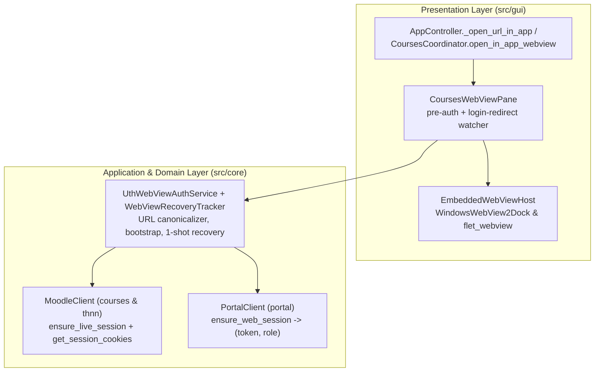

# UTH WebView Auto-Login & Session Recovery Implementation Plan

> **For agentic workers:** REQUIRED SUB-SKILL: Use superpowers:subagent-driven-development (recommended) or superpowers:executing-plans to implement this plan task-by-task. Steps use checkbox (`- [ ]`) syntax for tracking.

**Goal:** Automatically authenticate and self-heal in-app WebView sessions across `courses.ut.edu.vn` (including `elearning.ut.edu.vn` alias and Portal schedule SSO links), `thnn.ut.edu.vn`, and `portal.ut.edu.vn` so users with saved UTH credentials never hit a session-timeout or login screen.

**Architecture:** Introduce a pure core service `UthWebViewAuthService` (`src/core/webview_auth.py`) backed by live-verified Moodle cookies (`MoodleClient.ensure_live_session` + fixed `get_session_cookies`) and Portal JWT/role bootstrap (`PortalClient.ensure_web_session`). Wire `CoursesWebViewPane` and `EmbeddedWebViewHost` (`WindowsWebView2Dock` + `flet_webview`) to perform pre-navigation auth bootstrap (cookies for Moodle, origin-gated `localStorage["account"]`/`localStorage["role"]` for Portal) and bounded 1-shot reactive recovery whenever any navigation lands on a UTH login URL.

**Architecture Diagram:**



**Tech Stack:** Python 3.12–3.14 (`urllib.request`, `http.cookiejar`, `base64`, `json`), Flet 0.86.5, Windows Edge WebView2 (`webview2.microsoft.web.webview2.core`), `flet_webview`, `pytest`, `ruff`.

**Spec:** Self-contained in this plan (user opted directly into Approach 1 — Hybrid Pre-Auth + Reactive Auto-Relogin — during brainstorming).

## Global Constraints

- `core` modules MUST NOT import `gui`; `gui` modules MUST NOT import `core.ws_functions` or bare `core` (`tests/test_architecture_boundaries.py` must pass).
- `gui.components` MUST NOT add any import of `gui.app_controller`.
- Keep stdlib `urllib.request` in `MoodleClient` and `PortalClient` (Cloudflare TLS compatibility).
- Never inject plaintext `UTH_PASSWORD` into WebView DOM or JavaScript; authenticate Moodle via Python `MoodleClient` `MoodleSession` cookies and Portal via `PortalClient` JWT (`localStorage["account"]` + `localStorage["role"]`) strictly gated to `window.location.origin === "https://portal.ut.edu.vn"`.
- Preserve Milestone 3 "Hướng A" per-account persistent WebView2 profile (`acct_<sha256>`) and active `QuizSessionLease` isolation (`_begin_quiz_session_login` must never destroy an in-progress quiz's cookies).
- Run tests and lint via `.venv\Scripts\python.exe -m pytest` and `.venv\Scripts\ruff.exe check src tests`.
- Never commit directly to `main` or `develop`; work on a dedicated `fix/*` topic branch branched from `develop` (`docs/guides/gitflow.md`).

## Review Focus

- **Server-side password mismatch / revoked account**: When `UTH_PASSWORD` is rejected by Moodle or Portal (or the server redirects back to `/login/index.php` / `/` even after recovery), `WebViewRecoveryTracker` stops after 1 recovery attempt per site so the WebView never enters an infinite reload loop.
- **Active quiz lease (`quiz_session_active`) during WebView open**: Opening a course page in `CoursesWebViewPane` while `QuizPlayerView` holds a `QuizSessionLease` must not wipe `MoodleClient._cookie_jar` or return empty cookies when a `MoodleSession` cookie already exists.
- **Expired Portal SSO link (`?token=...&wantsurl=...`) and `elearning.ut.edu.vn` alias from `Lịch`**: Unwrap same-origin `wantsurl` (blocking off-origin open-redirect `wantsurl` values) and canonicalize `https://elearning.ut.edu.vn/...` to `https://courses.ut.edu.vn/...` before attaching `courses` cookies.
- **Cross-origin isolation of Portal JWT script**: Navigating from `https://portal.ut.edu.vn/dashboard` to an external origin (e.g. `https://docs.example.com`) must never write `localStorage["account"]` on the external origin, and `WindowsWebView2Dock` removes the document-created script registration once Portal navigation completes or leaves `portal.ut.edu.vn`.
- **Cross-Moodle navigation inside a single WebView (`courses.ut.edu.vn` -> `thnn.ut.edu.vn`)**: Clicking a `thnn.ut.edu.vn` link inside a WebView originally opened for `courses.ut.edu.vn` resolves `thnn_client`, authenticates `thnn`, injects `thnn` cookies, and lands on the target `thnn` course URL.

---

### Task 1: `MoodleClient` Live Session Verification & Accurate Cookie Export

**Files:**
- Modify: [client.py](file:///e:/Projects/UTH-Elearning-Alert/src/core/client.py#L442-L485)
- Modify: [client.py](file:///e:/Projects/UTH-Elearning-Alert/src/core/client.py#L569-L595)
- Modify: [client.py](file:///e:/Projects/UTH-Elearning-Alert/src/core/client.py#L845-L953)
- Modify: [quiz_web_session.py](file:///e:/Projects/UTH-Elearning-Alert/src/core/quiz_web_session.py#L309-L317)
- Create: [test_webview_moodle_session_cookies.py](file:///e:/Projects/UTH-Elearning-Alert/tests/test_webview_moodle_session_cookies.py)

**Interfaces:**
- Consumes: `core.quiz_player._begin_quiz_session_login`, `MoodleClient.login_session`, `MoodleClient.call_ajax_api`, `MoodleClient._open_html`
- Produces:
  - `MoodleClient._session_authenticated_at: float`
  - `MoodleClient.ensure_live_session(self, *, max_idle_seconds: float = 900.0) -> bool`
  - `MoodleClient.get_session_cookies(self, *, ensure_login: bool = True, verify_live: bool = False, force_relogin: bool = False) -> list[dict[str, Any]]` (each dict has `name`, `value`, `domain`, `domain_specified`, `path`, `secure`, `expires`, `httpOnly`, `sameSite`)

- [ ] **Step 1: Write the failing tests in `tests/test_webview_moodle_session_cookies.py`**

```python
import time
from http.cookiejar import Cookie
from config import settings
from core.client import MoodleClient
from core.moodle_sites import COURSES_MOODLE_SITE
from core.quiz_player import acquire_quiz_session_lease, quiz_session_key


def _make_cookie(
    name: str,
    value: str,
    domain: str = "courses.ut.edu.vn",
    *,
    domain_specified: bool = False,
    http_only: bool = True,
    same_site: str | None = "Lax",
) -> Cookie:
    rest: dict[str, str | None] = {}
    if http_only:
        rest["HttpOnly"] = None
    if same_site is not None:
        rest["SameSite"] = same_site
    return Cookie(
        version=0,
        name=name,
        value=value,
        port=None,
        port_specified=False,
        domain=domain,
        domain_specified=domain_specified,
        domain_initial_dot=domain.startswith("."),
        path="/",
        path_specified=True,
        secure=True,
        expires=None,
        discard=True,
        comment=None,
        comment_url=None,
        rest=rest,
        rfc2109=False,
    )


def test_get_session_cookies_preserves_httponly_none_flag_and_host_only_domain():
    client = MoodleClient("https://courses.ut.edu.vn")
    client._sesskey = "sk1"
    client._session_owner = settings.UTH_USERNAME
    client._session_authenticated_at = time.monotonic()
    client._cookie_jar.set_cookie(_make_cookie("MoodleSession", "fresh123", http_only=True))

    exported = client.get_session_cookies(ensure_login=False)
    assert len(exported) == 1
    assert exported[0]["name"] == "MoodleSession"
    assert exported[0]["value"] == "fresh123"
    assert exported[0]["httpOnly"] is True
    assert exported[0]["domain"] == "courses.ut.edu.vn"
    assert exported[0]["domain_specified"] is False
    assert exported[0]["sameSite"] == "Lax"


def test_get_session_cookies_verify_live_skips_network_when_fresh(monkeypatch):
    monkeypatch.setattr(settings, "UTH_USERNAME", "2251120001")
    monkeypatch.setattr(settings, "UTH_PASSWORD", "secret")
    client = MoodleClient("https://courses.ut.edu.vn")
    client._sesskey = "sk_fresh"
    client._session_owner = "2251120001"
    client._session_authenticated_at = time.monotonic()
    client._cookie_jar.set_cookie(_make_cookie("MoodleSession", "alive_cookie"))

    ajax_calls = []
    monkeypatch.setattr(client, "call_ajax_api", lambda *a, **k: ajax_calls.append(a))
    cookies = client.get_session_cookies(ensure_login=True, verify_live=True)

    assert [c["value"] for c in cookies] == ["alive_cookie"]
    assert ajax_calls == []


def test_get_session_cookies_verify_live_relogins_when_stale_session_expired(monkeypatch):
    monkeypatch.setattr(settings, "UTH_USERNAME", "2251120001")
    monkeypatch.setattr(settings, "UTH_PASSWORD", "secret")
    client = MoodleClient("https://courses.ut.edu.vn")
    client._sesskey = "sk_old"
    client._session_owner = "2251120001"
    client._session_authenticated_at = time.monotonic() - 3600.0
    client._cookie_jar.set_cookie(_make_cookie("MoodleSession", "dead_cookie"))

    monkeypatch.setattr(
        client,
        "call_ajax_api",
        lambda fn, **_kw: {"error": True, "errorcode": "requireloginerror", "message": "Session timed out"},
    )

    def _fake_login(username=None, password=None, force=False, **_kw):
        assert force is True
        client._cookie_jar.clear()
        client._cookie_jar.set_cookie(_make_cookie("MoodleSession", "renewed_cookie"))
        client._sesskey = "sk_new"
        client._session_owner = "2251120001"
        client._session_authenticated_at = time.monotonic()
        return True

    monkeypatch.setattr(client, "login_session", _fake_login)
    cookies = client.get_session_cookies(ensure_login=True, verify_live=True)

    assert [c["value"] for c in cookies] == ["renewed_cookie"]


def test_get_session_cookies_verify_live_falls_back_to_html_probe_and_preserves_quiz_lease(monkeypatch):
    monkeypatch.setattr(settings, "UTH_USERNAME", "2251120001")
    monkeypatch.setattr(settings, "UTH_PASSWORD", "secret")
    client = MoodleClient("https://courses.ut.edu.vn")
    client._sesskey = "sk_quiz"
    client._session_owner = "2251120001"
    client._session_authenticated_at = 0.0
    client._cookie_jar.set_cookie(_make_cookie("MoodleSession", "quiz_active_cookie"))

    skey = quiz_session_key(COURSES_MOODLE_SITE, "2251120001")
    lease = acquire_quiz_session_lease(skey)
    try:
        monkeypatch.setattr(client, "call_ajax_api", lambda *_a, **_kw: None)
        monkeypatch.setattr(
            client,
            "_open_html",
            lambda _path, **_kw: ("https://courses.ut.edu.vn/login/index.php", "<form/>"),
        )
        cookies = client.get_session_cookies(ensure_login=True, verify_live=True)
        # Active quiz lease prevents destructive cookie wipe; existing cookie remains intact
        assert [c["value"] for c in cookies] == ["quiz_active_cookie"]
    finally:
        lease.release()
```

- [ ] **Step 2: Run test to verify it fails**

Run: `.\.venv\Scripts\python.exe -m pytest tests/test_webview_moodle_session_cookies.py -v`
Expected: FAIL (`httpOnly` is `False`, `TypeError: get_session_cookies() got an unexpected keyword argument 'verify_live'`)

- [ ] **Step 3: Implement `_session_authenticated_at`, `ensure_live_session`, and updated `get_session_cookies` in `src/core/client.py` and `src/core/quiz_web_session.py`**

In `src/core/client.py`:
- Initialize `self._session_authenticated_at: float = 0.0` in `MoodleClient.__init__`; reset it to `0.0` in `clear_session()`, `_reset_session_if_account_changed()`, and when clearing `_cookie_jar` inside `login_session()`; set `self._session_authenticated_at = time.monotonic()` whenever `login_session()` succeeds and whenever `open_session_url`, `open_session_raw`, `submit_session_form`, `fetch_grade_report_html`, or `_download_session_stream` completes a non-`/login/index.php` response.
- In `src/core/quiz_web_session.py:warm_existing_client_from_quiz_login`, set `existing_client._session_authenticated_at = time.monotonic()`.
- Implement `MoodleClient.ensure_live_session(self, *, max_idle_seconds: float = 900.0) -> bool`:
  - Under `self._session_lock`, call `self._reset_session_if_account_changed()`.
  - If `not self._sesskey` or `not self._has_moodle_session_cookie()`: return `bool(self.login_session())`.
  - Define `auth_at = float(getattr(self, "_session_authenticated_at", 0.0) or 0.0)`; if `auth_at > 0.0 and (time.monotonic() - auth_at) < max_idle_seconds`: return `True`.
  - Probe via `resp = self.call_ajax_api("core_session_time_remaining")`:
    - If `isinstance(resp, dict)` and `not resp.get("error")`: extract `data = resp.get("data")`; if `isinstance(data, dict) and int(data.get("userid") or 0) > 0 and int(data.get("timeremaining") or 0) > 60`: update `self._session_authenticated_at = time.monotonic()` and return `True`; if `isinstance(data, dict) and int(data.get("userid") or 0) == 0`: return `bool(self.login_session(force=True))`.
    - If `isinstance(resp, dict)` and `resp.get("error")`: if `"requirelogin"` or `"invalidsesskey"` or `"sesskey"` appears in `(str(resp.get("errorcode") or "") + " " + str(resp.get("message") or "")).lower()`, return `bool(self.login_session(force=True))`.
  - Fallback HTML probe when AJAX returned `None` or non-auth error (e.g., disabled WS function): call `final_url, _ = self._open_html("/my/")` inside `try/except`:
    - If `urllib.parse.urlsplit(final_url).path.endswith("/login/index.php")`: return `bool(self.login_session(force=True))`.
    - Otherwise update `self._session_authenticated_at = time.monotonic()` and return `True`.
    - On network exception during fallback probe: return `self._has_moodle_session_cookie()`.
- Update `MoodleClient.get_session_cookies(self, *, ensure_login: bool = True, verify_live: bool = False, force_relogin: bool = False) -> list[dict[str, Any]]`:
  - Under `self._session_lock`, call `self._reset_session_if_account_changed()`.
  - If `force_relogin`: if `not self.login_session(force=True)` and `self._last_login_error != "quiz_session_active"`: return `[]`.
  - Else if `ensure_login and verify_live`: if `not self.ensure_live_session()` and `not self._has_moodle_session_cookie()`: return `[]`.
  - Else if `ensure_login and (not self._sesskey or not self._has_moodle_session_cookie())`: if `not self.login_session()` and `not self._has_moodle_session_cookie()`: return `[]`.
  - Export each cookie with case-insensitive `_rest` lookup:
    - `httpOnly`: `any(str(k).casefold() == "httponly" for k in getattr(cookie, "_rest", {}).keys())`
    - `sameSite`: matching `_rest` value (or `None`)
    - `domain`: `(cookie.domain or "").lstrip(".")` when `not getattr(cookie, "domain_specified", False)` else `cookie.domain or ""` (falling back to `urllib.parse.urlsplit(self.moodle_site_origin).hostname or ""`)
    - `domain_specified`: `bool(getattr(cookie, "domain_specified", False))`

- [ ] **Step 4: Run tests to verify they pass**

Run: `.\.venv\Scripts\python.exe -m pytest tests/test_webview_moodle_session_cookies.py tests/test_quiz_web_session.py tests/test_quiz_entry.py -q --tb=short`
Expected: PASS

- [ ] **Step 5: Commit**

```bash
git add src/core/client.py src/core/quiz_web_session.py tests/test_webview_moodle_session_cookies.py
git commit -m "fix(core): verify Moodle session liveness and preserve HttpOnly in cookie export"
```

---

### Task 2: `PortalClient` Web Session Token, Role & Expiry Validation

**Files:**
- Modify: [portal_client.py](file:///e:/Projects/UTH-Elearning-Alert/src/core/portal_client.py#L164-L318)
- Modify: [test_portal_client.py](file:///e:/Projects/UTH-Elearning-Alert/tests/test_portal_client.py)

**Interfaces:**
- Consumes: `PortalClient._request_json`, `PortalAuthenticationError`
- Produces:
  - `PortalClient.ensure_web_session(self, username: str, password: str, *, force: bool = False) -> tuple[str, str]` returning `(jwt_token, role)`

- [ ] **Step 1: Write the failing tests in `tests/test_portal_client.py`**

```python
import base64
import json
import time


def _build_fake_jwt(*, exp: int, role: str = "sv") -> str:
    header = base64.urlsafe_b64encode(b'{"alg":"HS256"}').rstrip(b"=").decode("ascii")
    payload = base64.urlsafe_b64encode(
        json.dumps({"sub": "2251120001", "exp": exp, "data": {"role": role}}).encode("utf-8")
    ).rstrip(b"=").decode("ascii")
    return f"{header}.{payload}.sig"


def test_ensure_web_session_replaces_expired_jwt_and_reuses_valid_token():
    expired_jwt = _build_fake_jwt(exp=int(time.time()) - 10, role="sv")
    fresh_jwt = _build_fake_jwt(exp=int(time.time()) + 86400, role="sv")
    forced_jwt = _build_fake_jwt(exp=int(time.time()) + 90000, role="sv")
    issued = [fresh_jwt, forced_jwt]
    login_calls = 0

    def opener(request, timeout):
        nonlocal login_calls
        del timeout
        assert request.full_url.endswith("/user/login")
        tok = issued[login_calls]
        login_calls += 1
        return _Response({"success": True, "body": "sv", "token": tok})

    client = PortalClient("https://portal-publicapp.ut.edu.vn/api/v1", opener=opener)
    client._store_token(expired_jwt, "2251120001", role="sv")

    tok1, role1 = client.ensure_web_session("2251120001", "pass123")
    assert (tok1, role1) == (fresh_jwt, "sv")
    assert login_calls == 1

    tok2, role2 = client.ensure_web_session("2251120001", "pass123")
    assert (tok2, role2) == (fresh_jwt, "sv")
    assert login_calls == 1

    tok3, role3 = client.ensure_web_session("2251120001", "pass123", force=True)
    assert (tok3, role3) == (forced_jwt, "sv")
    assert login_calls == 2
```

- [ ] **Step 2: Run test to verify it fails**

Run: `.\.venv\Scripts\python.exe -m pytest tests/test_portal_client.py -k ensure_web_session -v`
Expected: FAIL (`AttributeError: 'PortalClient' object has no attribute 'ensure_web_session'`)

- [ ] **Step 3: Implement JWT claim helper and `ensure_web_session` in `src/core/portal_client.py`**

- Add module helper `_decode_jwt_payload(token: str) -> dict[str, Any]` (splits `token` into 3 `.` parts; base64url-decodes part 1 with padding `"=" * (-len(seg) % 4)`; returns `{}` on any error) and `_is_jwt_expired(token: str, *, skew_seconds: int = 300) -> bool` (returns `False` if no numeric `exp` claim so opaque test tokens like `"tok"` remain valid; returns `int(exp) <= time.time() + skew_seconds` when `exp` is numeric).
- Track `self._token_role: str = ""` in `PortalClient.__init__`, clear in `_discard_token`, update `_store_token(self, token: str, username: str, generation: int | None = None, *, role: str = "") -> None`, and in `_login` extract `raw_role = payload.get("body") if isinstance(payload.get("body"), str) and payload.get("body").strip() else (_decode_jwt_payload(token).get("data", {}) or {}).get("role") or "sv"`.
- Implement `ensure_web_session(self, username: str, password: str, *, force: bool = False) -> tuple[str, str]`:
  - Validates `username` and `password` (raises `PortalAuthenticationError` if missing).
  - Checks cached `(token, role)` for `username` when `not force` and `not _is_jwt_expired(token)`.
  - Otherwise calls `self._login(username, password, generation)` and returns `(token, role)`.

- [ ] **Step 4: Run tests to verify they pass**

Run: `.\.venv\Scripts\python.exe -m pytest tests/test_portal_client.py -q --tb=short`
Expected: PASS

- [ ] **Step 5: Commit**

```bash
git add src/core/portal_client.py tests/test_portal_client.py
git commit -m "feat(portal): add ensure_web_session with JWT expiry check and student role"
```

---

### Task 3: `UthWebViewAuthService` — Multi-Site Bootstrap, URL Canonicalization & Bounded Recovery

**Files:**
- Create: [webview_auth.py](file:///e:/Projects/UTH-Elearning-Alert/src/core/webview_auth.py)
- Create: [test_webview_auth_service.py](file:///e:/Projects/UTH-Elearning-Alert/tests/test_webview_auth_service.py)

**Interfaces:**
- Consumes: `MoodleClient.get_session_cookies` (Task 1), `PortalClient.ensure_web_session` (Task 2), `core.url_validation.validate_https_url`
- Produces:
  - `UthWebSite = Literal["courses", "thnn", "portal", "external"]`
  - `WebViewAuthBootstrap` frozen dataclass: `(target_url: str, site: UthWebSite, cookies: tuple[dict[str, Any], ...], portal_init_script: str = "")`
  - `classify_uth_webview_url(url: str) -> UthWebSite`
  - `is_uth_login_url(url: str) -> Optional[Literal["courses", "thnn", "portal"]]`
  - `normalize_uth_webview_target_url(url: str, *, has_credentials: bool = True) -> str`
  - `build_portal_local_storage_script(token: str, role: str = "sv") -> str`
  - `WebViewRecoveryTracker` class:
    - `record_navigation(self, url: str) -> None`
    - `note_authenticated_landing(self, url: str) -> None`
    - `can_attempt_recovery(self, site: str) -> bool`
    - `consume_recovery_attempt(self, site: str) -> bool`
    - `intended_url_for(self, site: str) -> str`
  - `UthWebViewAuthService`:
    - `__init__(self, *, courses_client: Any = None, thnn_client: Any = None, portal_client: Any = None, credentials_provider: Optional[Callable[[], tuple[str, str]]] = None)`
    - `client_for_site(self, site: str) -> Any`
    - `prepare_initial_auth(self, url: str) -> WebViewAuthBootstrap`
    - `recover_from_login_redirect(self, login_url: str, tracker: WebViewRecoveryTracker) -> Optional[WebViewAuthBootstrap]`

- [ ] **Step 1: Write the failing tests in `tests/test_webview_auth_service.py`**

Cover all core behaviors AND Review Focus items #1, #3, #4, #5:
1. `test_normalize_unwraps_same_origin_wantsurl_and_canonicalizes_elearning_alias`:
   - `https://elearning.ut.edu.vn/course/view.php?id=121` -> `https://courses.ut.edu.vn/course/view.php?id=121` (`classify_uth_webview_url` == `"courses"`).
   - `https://courses.ut.edu.vn/login/index.php?token=expired&wantsurl=https%3A%2F%2Fcourses.ut.edu.vn%2Fcourse%2Fview.php%3Fid%3D121` -> `https://courses.ut.edu.vn/course/view.php?id=121`.
   - Off-origin `wantsurl=https%3A%2F%2Fevil.example%2Fphish` is REJECTED and falls back to `https://courses.ut.edu.vn/my/`.
   - `https://portal.ut.edu.vn/` with `has_credentials=True` -> `https://portal.ut.edu.vn/dashboard`.
2. `test_prepare_initial_auth_builds_origin_gated_portal_script_and_moodle_live_cookies`:
   - For `https://portal.ut.edu.vn/tuition`, calls `portal_client.ensure_web_session("2251120001", "pw")`, returns `portal_init_script` containing `window.location.origin === "https://portal.ut.edu.vn"` and JSON-escaped token + role `"sv"`.
   - For `https://courses.ut.edu.vn/course/view.php?id=99`, calls `courses_client.get_session_cookies(ensure_login=True, verify_live=True)` and warms in already-cached `thnn_client` cookies without triggering network login on `thnn_client`.
3. `test_recover_from_login_redirect_cross_site_thnn_and_anti_loop_budget`:
   - Pane starts on `courses.ut.edu.vn`, user clicks `https://thnn.ut.edu.vn/course/view.php?id=55` (`tracker.record_navigation(...)`), THNN redirects to `https://thnn.ut.edu.vn/login/index.php` -> first `recover_from_login_redirect` calls `thnn_client.get_session_cookies(force_relogin=True)` and returns `target_url == "https://thnn.ut.edu.vn/course/view.php?id=55"`.
   - If THNN immediately redirects to `https://thnn.ut.edu.vn/login/index.php` a second time (wrong password on server), `recover_from_login_redirect` returns `None` (no infinite loop!).
   - Once `tracker.note_authenticated_landing("https://thnn.ut.edu.vn/course/view.php?id=55")` is called, a later expiry hours later gets a fresh 1-attempt budget.

- [ ] **Step 2: Run test to verify it fails**

Run: `.\.venv\Scripts\python.exe -m pytest tests/test_webview_auth_service.py -v`
Expected: FAIL (`ModuleNotFoundError: No module named 'core.webview_auth'`)

- [ ] **Step 3: Implement `src/core/webview_auth.py`**

Implement the exact public symbols in `Interfaces` above using stdlib `json`, `urllib.parse`, and `core.url_validation.validate_https_url` (zero `gui` imports):
- Canonicalize `https://elearning.ut.edu.vn/...` (when port is `None`) to `https://courses.ut.edu.vn/...`.
- `is_uth_login_url(url)`:
  - `courses.ut.edu.vn` / `elearning.ut.edu.vn` with path in `("/login/index.php", "/login", "/login/")` -> `"courses"`
  - `thnn.ut.edu.vn` with path in `("/login/index.php", "/login", "/login/")` -> `"thnn"`
  - `portal.ut.edu.vn` with path in `("", "/", "/login", "/login/")` -> `"portal"`
- `build_portal_local_storage_script(token, role)`:
  - Uses `json.dumps(token)` and `json.dumps(role or "sv")` inside `if (window.location && window.location.origin === "https://portal.ut.edu.vn") { ... }`.
- `UthWebViewAuthService._invoke_cookies(client, *, verify_live: bool, force_relogin: bool)`:
  - Inspects `client.get_session_cookies` parameters so legacy test doubles (`lambda **_k:` or narrow fakes) work seamlessly alongside real `MoodleClient`.

- [ ] **Step 4: Run tests to verify they pass**

Run: `.\.venv\Scripts\python.exe -m pytest tests/test_webview_auth_service.py tests/test_architecture_boundaries.py -q --tb=short`
Expected: PASS

- [ ] **Step 5: Commit**

```bash
git add src/core/webview_auth.py tests/test_webview_auth_service.py
git commit -m "feat(core): add UthWebViewAuthService for multi-site bootstrap and bounded login recovery"
```

---

### Task 4: WebView2 / `flet_webview` Dynamic Auth, Reactive Auto-Relogin & App Wiring

**Files:**
- Modify: [embedded_webview_host.py](file:///e:/Projects/UTH-Elearning-Alert/src/gui/components/courses/embedded_webview_host.py#L216-L276)
- Modify: [embedded_webview_host.py](file:///e:/Projects/UTH-Elearning-Alert/src/gui/components/courses/embedded_webview_host.py#L690-L855)
- Modify: [embedded_webview_host.py](file:///e:/Projects/UTH-Elearning-Alert/src/gui/components/courses/embedded_webview_host.py#L1455-L1755)
- Modify: [webview_pane.py](file:///e:/Projects/UTH-Elearning-Alert/src/gui/components/courses/webview_pane.py#L122-L530)
- Modify: [courses_coordinator.py](file:///e:/Projects/UTH-Elearning-Alert/src/gui/controllers/courses_coordinator.py#L163-L210)
- Modify: [courses_coordinator.py](file:///e:/Projects/UTH-Elearning-Alert/src/gui/controllers/courses_coordinator.py#L420-L475)
- Modify: [app_controller.py](file:///e:/Projects/UTH-Elearning-Alert/src/gui/app_controller.py#L1700-L1730)
- Modify: [app_controller.py](file:///e:/Projects/UTH-Elearning-Alert/src/gui/app_controller.py#L2289-L2374)
- Modify: [refactoring-log.md](file:///e:/Projects/UTH-Elearning-Alert/docs/architecture/refactoring-log.md)
- Create: [test_webview_auto_login_integration.py](file:///e:/Projects/UTH-Elearning-Alert/tests/test_webview_auto_login_integration.py)

**Interfaces:**
- Consumes: `UthWebViewAuthService`, `WebViewAuthBootstrap`, `WebViewRecoveryTracker`, `classify_uth_webview_url`, `is_uth_login_url`, `normalize_uth_webview_target_url` from `core.webview_auth` (Task 3)
- Produces:
  - `WindowsWebView2Dock(..., init_script: str = "", init_script_provider: Optional[Callable[[], str]] = None)` + `apply_auth_and_navigate(self, cookies: list[dict[str, Any]], url: str, *, init_script: str = "") -> None`
  - `EmbeddedWebViewHost.apply_auth_and_navigate(self, cookies: list[dict[str, Any]], url: str, *, init_script: str = "") -> None`
  - `CoursesWebViewPane(..., webview_auth_service: Any = None)` with pre-auth bootstrap + async reactive login-redirect recovery + cross-site bridge resolution
  - `CoursesCoordinator(..., webview_auth_service: Any = None)` and `AppController._webview_auth_service` wired across all WebView entry points

- [ ] **Step 1: Write the failing integration tests in `tests/test_webview_auto_login_integration.py`**

Write deterministic tests covering:
1. `test_windows_webview2_dock_awaits_document_created_script_before_navigate_and_removes_after_load`:
   - Fake `core` with `cookie_manager`, `add_script_to_execute_on_document_created_async`, `remove_script_to_execute_on_document_created`, and `navigate`.
   - Verify `add_script_to_execute_on_document_created_async` completes **before** `core.navigate("https://portal.ut.edu.vn/dashboard")` is called, and `remove_script_to_execute_on_document_created("script-1")` is called once navigation completes (Review Focus #4).
2. `test_courses_webview_pane_recovers_once_when_redirected_to_moodle_login_then_stops_on_repeat`:
   - Mount `CoursesWebViewPane` with a fake `EmbeddedWebViewHost` and real `UthWebViewAuthService`.
   - Simulate host firing `on_url_changed("https://courses.ut.edu.vn/login/index.php")` -> verify background recovery runs `force_relogin=True` and calls `host.apply_auth_and_navigate(fresh_cookies, "https://courses.ut.edu.vn/course/view.php?id=121137", init_script="")`.
   - Simulate a second immediate `on_url_changed("https://courses.ut.edu.vn/login/index.php")` without an intervening authenticated landing -> verify `apply_auth_and_navigate` is NOT called a second time (Review Focus #1).
3. `test_app_controller_open_url_in_app_authenticates_courses_alias_thnn_and_portal`:
   - Calling `controller._open_url_in_app("https://elearning.ut.edu.vn/course/view.php?id=10", "LMS")` normalizes to `https://courses.ut.edu.vn/course/view.php?id=10`, attaches `webview_auth_service`, and passes `courses` `session_client` + `preview_server`.
   - Calling `controller._open_url_in_app("https://portal.ut.edu.vn/", "Portal")` normalizes to `https://portal.ut.edu.vn/dashboard` and passes `webview_auth_service`.
4. `test_flet_webview_mobile_portal_injects_local_storage_and_courses_bridge_switches_site`:
   - On `ft.PagePlatform.ANDROID`, navigating from a `courses.ut.edu.vn` link to `https://thnn.ut.edu.vn/course/view.php?id=9` builds a `thnn` session bridge URL (`.../session/<tok>/thnn/course/view.php?id=9`), and opening `https://portal.ut.edu.vn/dashboard` injects Portal `localStorage` via `eval_js` on page load.

- [ ] **Step 2: Run test to verify it fails**

Run: `.\.venv\Scripts\python.exe -m pytest tests/test_webview_auto_login_integration.py -v`
Expected: FAIL (`TypeError` on `init_script_provider` / `webview_auth_service` / missing `apply_auth_and_navigate`)

- [ ] **Step 3: Implement host, pane, coordinator, and controller integration**

1. **`src/gui/components/courses/embedded_webview_host.py`**:
   - Add `init_script: str = ""` and `init_script_provider: Optional[Callable[[], str]] = None` to `WindowsWebView2Dock` and `build_embedded_webview_host`.
   - In `WindowsWebView2Dock._inject_cookies(core)`: support both `httpOnly` and `http_only`; before `cm.add_or_update_cookie(cookie_obj)`, if `name.casefold() == "moodlesession"` and `hasattr(cm, "delete_cookies_with_domain_and_path")`, best-effort delete stale host/domain duplicates on `domain.lstrip(".")` and `f".{domain.lstrip('.')}"` so expired `acct_*` cookies never shadow fresh ones.
   - Add helper `self._navigate_with_optional_init_script(core, url, init_script)`:
     - Removes any previous `self._active_init_script_id` via `core.remove_script_to_execute_on_document_created(...)` before registering a new one.
     - When `init_script` is non-empty and `hasattr(core, "add_script_to_execute_on_document_created_async")`: calls `op = core.add_script_to_execute_on_document_created_async(init_script)` and chains `op.completed = lambda s_op, _st: self._enqueue("_init_script_done", (s_op, url))` so `core.navigate(url)` runs **strictly after** script registration completes.
     - In `_on_nav_completed` (and when navigating to a non-Portal origin), removes `self._active_init_script_id` via `core.remove_script_to_execute_on_document_created` so the token script does not persist across later navigations.
   - Implement `apply_auth_and_navigate(self, cookies: list[dict[str, Any]], url: str, *, init_script: str = "") -> None` on both `WindowsWebView2Dock` (via `"auth_navigate"` queue action) and `EmbeddedWebViewHost` (on `flet_webview`, stores pending `init_script` to execute via `run_javascript` and calls `self.navigate(url)`).

2. **`src/gui/components/courses/webview_pane.py`**:
   - Accept optional `webview_auth_service: Any = None` in `CoursesWebViewPane.__init__`; initialize `self._recovery_tracker = WebViewRecoveryTracker()` and normalize `self._url = normalize_uth_webview_target_url(url, has_credentials=...)` when targeting UTH sites (preserving loopback URLs untouched).
   - Update `_build_bridge_or_target_url(self, target_url: Optional[str] = None)` to resolve `bridge_source` from `classify_uth_webview_url(target)` (`"thnn"` if `thnn`, `"courses"` if `courses`, else `self._source`) so cross-site Moodle links on `flet_webview` route to the right session provider.
   - In `_mount_engine`:
     - On `webview2`: pass a `cookie_provider` + `init_script_provider` backed by a single shared lazy `WebViewAuthBootstrap` call (`self._webview_auth_service.prepare_initial_auth(self._url)` on the STA worker thread — zero main-thread blocking!), or when only `self._session_client` is provided (legacy callers/tests), call `get_session_cookies(ensure_login=True, verify_live=True)` (falling back to `ensure_login=True` if `verify_live` is unsupported by a test fake).
     - On `flet_webview` when `classify_uth_webview_url(self._url) == "portal"`: fetch `prepare_initial_auth` in background / `on_ready` and apply one-shot `eval_js` checking `localStorage.getItem("account") !== token` -> set `account` + `role` and `window.location.replace(target_url)`.
   - In `_on_native_url_or_bridge(self, url: str)`:
     - When `is_uth_login_url(url)` is non-None: trigger `self._attempt_login_recovery(url)` on a daemon background thread (guarded by `self._recovery_in_flight` lock so duplicate `source_changed` / `url_change` events don't double-fire).
     - When `classify_uth_webview_url(url) in {"courses", "thnn", "portal"}` and `is_uth_login_url(url)` is `None`: call `self._recovery_tracker.note_authenticated_landing(url)` and `self._recovery_tracker.record_navigation(url)`.
     - `_attempt_login_recovery(self, login_url: str)` calls `auth_service.recover_from_login_redirect(login_url, self._recovery_tracker)` (or synthesizes one via `self._session_client` when `auth_service` is None); if a `WebViewAuthBootstrap` is returned and `not self._disposed`, marshals `self._apply_recovery_bootstrap(bootstrap)` to call `self._host.apply_auth_and_navigate(...)` (using bridge URL on `flet_webview` for Moodle sites).

3. **`src/gui/controllers/courses_coordinator.py` & `src/gui/app_controller.py`**:
   - Add `webview_auth_service: Any = None` to `CoursesCoordinator.__init__` and forward it into `CoursesWebViewPane(...)` inside `open_in_app_webview`.
   - In `CoursesCoordinator._handle_course_url_action`, map `elearning.ut.edu.vn` to `"courses"`, `thnn.ut.edu.vn` to `"thnn"`, and normalize target URL before opening.
   - In `AppController.__init__`, instantiate `self._webview_auth_service = UthWebViewAuthService(courses_client=self.orchestrator.client, thnn_client=self.orchestrator.thnn_client, portal_client=self._portal_client, credentials_provider=lambda: (settings.UTH_USERNAME, settings.UTH_PASSWORD))` and pass it to `CoursesCoordinator`.
   - In `AppController._open_url_in_app`, resolve `site_kind = classify_uth_webview_url(validated)`:
     - Canonicalize `validated = normalize_uth_webview_target_url(validated, has_credentials=bool(settings.UTH_USERNAME and settings.UTH_PASSWORD))` when `site_kind in {"courses", "thnn", "portal"}`.
     - Attach `preview_server` and `session_client` whenever `site_kind in {"courses", "thnn"}` (fixing `elearning.ut.edu.vn`), and pass `webview_auth_service` into `CoursesWebViewPane` for all URLs!
   - Append a concise entry to `docs/architecture/refactoring-log.md` documenting date, branch, touched files, and test/lint status per `.agents/AGENTS.md`.

- [ ] **Step 4: Run focused and full test suites + lint**

Run:
```powershell
.\.venv\Scripts\ruff.exe check src tests
.\.venv\Scripts\python.exe -m pytest tests/test_webview_auto_login_integration.py tests/test_webview_auth_service.py tests/test_webview_moodle_session_cookies.py tests/test_courses_activities_and_webview.py tests/test_embedded_webview_session_isolation.py tests/test_schedule_week_view.py tests/test_m3_doc_viewer_cookies_speed.py tests/test_architecture_boundaries.py -q --tb=short
.\.venv\Scripts\python.exe -m pytest tests -q --tb=short
```
Expected: Ruff `All checks passed!` and full `pytest` suite green with 0 regressions.

- [ ] **Step 5: Commit**

```bash
git add src/gui/components/courses/embedded_webview_host.py src/gui/components/courses/webview_pane.py src/gui/controllers/courses_coordinator.py src/gui/app_controller.py docs/architecture/refactoring-log.md tests/test_webview_auto_login_integration.py
git commit -m "fix(webview): auto-authenticate and self-heal WebView sessions across Courses, THNN, and Portal"
```
