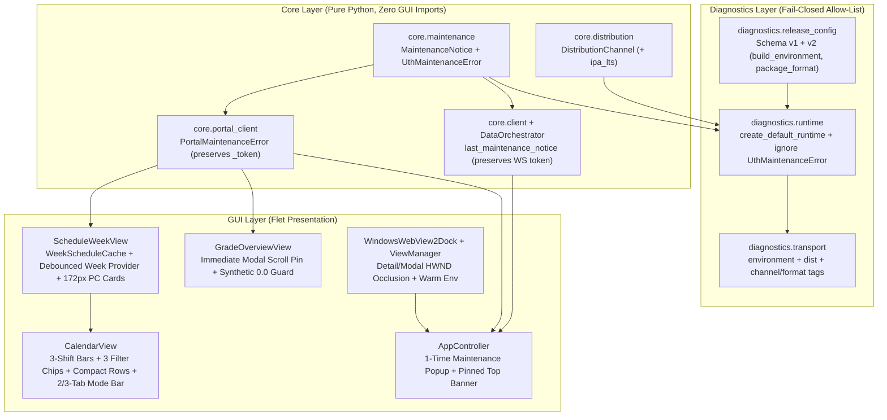

# UTHelper v2.7.0 Unified Calendar, Maintenance UX, Multi-Channel Sentry, Grades Scroll Lock, and Desktop WebView Implementation Plan

> **For agentic workers:** REQUIRED SUB-SKILL: Use superpowers:subagent-driven-development (recommended) or superpowers:executing-plans to implement this plan task-by-task. Steps use checkbox (`- [ ]`) syntax for tracking.

**Goal:** Deliver UTHelper `v2.7.0` (`build_number = 2007000`) combining the verified Desktop WebView occlusion/speed fixes, unified `Tháng` and `Tuần` class schedule + LMS deadline view across Mobile and PC (keeping the 7-column `Lịch học` tab on PC with equal card heights), immediate scroll-position pinning on `Bảng điểm` modals, UTH `01h00 - 04h00` maintenance detection with 1-time Popup + pinned Banner + offline cache preservation, and multi-channel Sentry telemetry across `release` and `develop`.

**Architecture:** We first merge the critic-verified Desktop WebView commits (`c6fbdf8` + deterministic test `95f1382`) onto the `develop`-based integration branch so all downstream UI work builds on the updated `AppController`, `ViewManager`, and `MoodleClient`. Next, `ScheduleWeekView` exposes a debounced cache-first week provider consumed by `CalendarView` for both `Tháng` and `Tuần` modes, while `GradeOverviewView` pins scroll offsets immediately on modal open. Finally, a pure `src/core/maintenance.py` detector shields `PortalClient` and `MoodleClient` tokens/caches and drives `AppController`'s maintenance UX, while `src/diagnostics/` and CI workflows emit exact `environment`, `distribution_channel`, and `package_format` metadata to Sentry (excluding `UthMaintenanceError`).

**Architecture Diagram:**



**Tech Stack:** Python 3.12-3.14, Flet `0.86.5`, Pydantic v2, `urllib.request`, `sentry-sdk`, Pytest, Ruff, GitHub Actions, PowerShell (`pwsh`).

**Spec:**
- [2026-11-28-mobile-unified-calendar-schedule-design.md](file:///e:/Projects/UTH-Elearning-Alert/docs/archive/designs/2026-11-28-mobile-unified-calendar-schedule-design.md)
- [2026-11-28-grades-scroll-maintenance-sentry-design.md](file:///e:/Projects/UTH-Elearning-Alert/docs/archive/designs/2026-11-28-grades-scroll-maintenance-sentry-design.md)

## Global Constraints

- **Clean Architecture Boundary ([test_architecture_boundaries.py](file:///e:/Projects/UTH-Elearning-Alert/tests/test_architecture_boundaries.py)):** `core` MUST NEVER import `gui`. New `core` modules (including `src/core/maintenance.py`) MUST NOT import `config` or `platform_utils` (`allowed_core_to_config` stays `<= 13`, `allowed_core_to_platform_utils` stays `<= 4`). `gui/components` MUST NOT add new imports of `gui.app_controller` or `core.ws_functions`.
- **HTTP Transport Rule:** Keep `urllib` in `MoodleClient` and `PortalClient`; do not introduce `requests`/`httpx` in `core`.
- **Repository Governance ([test_repository_governance.py](file:///e:/Projects/UTH-Elearning-Alert/tests/test_repository_governance.py)):** `docs/superpowers/` MUST NEVER exist. Design docs live in `docs/archive/designs/` and implementation plans live in `docs/archive/implementation-plans/`.
- **Calendar Backwards Compatibility:** Keep `_period_pager` / `_desktop_period_host` heights (`316` for `Tháng`, `88` for `Tuần`) and keep `wd_label`, `day_text`, `dots_row`, and `count_text` keys in `CalendarView._week_cells` so existing unit tests remain green.
- **Diagnostics Fail-Closed & Workflow Single-Line Contract ([test_diagnostic_release_config.py](file:///e:/Projects/UTH-Elearning-Alert/tests/test_diagnostic_release_config.py), [test_release_hardening.py](file:///e:/Projects/UTH-Elearning-Alert/tests/test_release_hardening.py)):** Calling `generate_public_config(output, dsn)` with no v2 metadata must continue emitting schema `1` (`{"schema_version": 1, "sentry_dsn": dsn}`), incomplete schema `2` payloads must fail closed (`None`), `SENTRY_AUTH_TOKEN` must never enter `diagnostics-config.json`, and every `python scripts/generate_public_runtime_config.py ...` call across `.github/workflows/*.yml` and `scripts/build_android.ps1` MUST remain on a **single line**.
- **Release Notes Copy Hygiene:** `docs/releases/2.7.0.md` must contain zero `&` characters and zero em/en dashes (`—`, `–`), using plain hyphens `-` and Vietnamese prose.

## Review Focus

1. **Cancelled-only vs mixed shifts and long campus room strings in Calendar:** A morning/afternoon/evening shift where every session is `cancelled=True` must render its mini shift bar in muted `C.CRITICAL` (`opacity=0.45`), whereas a shift containing at least one active session renders `C.ACCENT`, and compact timeline rows shorten `"F502 - CS1 (P.Thạnh Mỹ Tây, TP.HCM)"` to `"F502 · CS1"` while keeping the full string in `open_session_details` (pinned in Task 2).
2. **Rapid month-swipe Portal request storm:** Swiping across multiple months in `< 250ms` must cancel pending uncached Portal week fetches via `debounce_ms=250` while still hydrating `WeekScheduleCache` (`±4` weeks) synchronously in `0ms` (pinned in Task 2).
3. **Stacked modals and synthetic `pixels = 0.0` focus jumps on `Bảng điểm`:** Opening a course modal (or nested `ExpectedGradeDialog` inside `Planner`) when scrolled down (`e.g. offset = 640.0`) must immediately restore `640.0` on open, counter-pin any synthetic `pixels = 0.0` scroll event while `_open_dialog_tokens` is non-empty without recursive loop, and keep `_open_dialog_tokens` pinned until the last nested dialog closes (pinned in Task 3).
4. **Gzip-compressed UTH `HTTP 403` maintenance HTML vs Cloudflare `403` challenge and midnight `UTC+7` date math:** `detect_uth_maintenance` and `PortalClient._request_json` must decompress gzip `403` maintenance bodies, compute the right `DD/MM/YYYY` reopen date from `OPEN_HOUR = 4` / `TZ_OFFSET = 7` both at `02:05 +07:00` (same day) and `23:55 +07:00` (next day), preserve `PortalClient._token`, and NEVER classify a Cloudflare `Just a moment...` / `_cf_chl_opt` `403` page as maintenance (pinned in Task 4).
5. **Legacy schema-1 `diagnostics-config.json`, Windows `exe` vs `msi` refinement, and `UthMaintenanceError` Sentry exclusion:** Legacy schema-1 assets and legacy `DiagnosticReport` fixtures without `distribution_channel`/`package_format` must keep exact existing JSON/event keys, Windows `"exe_msi"` must refine to `"exe"` (`bootstrapper`) or `"msi"` (`msi`) via `read_install_channel()`, and `DiagnosticRuntime.record_exception(UthMaintenanceError(...))` must return `None` with `0` spooled reports (pinned in Task 5).

---

### Task 1: Integrate Verified Desktop WebView Occlusion and Speed Fixes

**Files:**
- Modify (via git merge `c6fbdf8` + test checkout `95f1382`):
  - [app_controller.py](file:///e:/Projects/UTH-Elearning-Alert/src/gui/app_controller.py)
  - [view_manager.py](file:///e:/Projects/UTH-Elearning-Alert/src/gui/view_manager.py)
  - [client.py](file:///e:/Projects/UTH-Elearning-Alert/src/core/client.py)
  - [embedded_webview_host.py](file:///e:/Projects/UTH-Elearning-Alert/src/gui/components/courses/embedded_webview_host.py)
  - [webview_pane.py](file:///e:/Projects/UTH-Elearning-Alert/src/gui/components/courses/webview_pane.py)
- Test:
  - [test_hotfix_webview_detail_occlusion.py](file:///e:/Projects/UTH-Elearning-Alert/tests/test_hotfix_webview_detail_occlusion.py)
  - [test_hotfix_webview_desktop_speed.py](file:///e:/Projects/UTH-Elearning-Alert/tests/test_hotfix_webview_desktop_speed.py)

**Interfaces:**
- Consumes: Existing local commits `c6fbdf8` (`hotfix/2.6.4` code merge of `swarm/wv-occlusion-fixer` + `swarm/wv-speed-engine`) and `95f1382` (`tests/test_hotfix_webview_desktop_speed.py` deterministic warm-environment assertion).
- Produces:
  - `ViewManager.dismiss_detail_layer_immediately() -> None` in [view_manager.py](file:///e:/Projects/UTH-Elearning-Alert/src/gui/view_manager.py)
  - `AppController` modal/detail occlusion synchronization for `WindowsWebView2Dock` in [app_controller.py](file:///e:/Projects/UTH-Elearning-Alert/src/gui/app_controller.py)
  - Warm `CoreWebView2Environment` cache + non-blocking cookie push in [embedded_webview_host.py](file:///e:/Projects/UTH-Elearning-Alert/src/gui/components/courses/embedded_webview_host.py) and fast SSO redirect handling in [client.py](file:///e:/Projects/UTH-Elearning-Alert/src/core/client.py)

> [!IMPORTANT]
> Merge `c6fbdf8` (NOT `95f1382` as a whole) so we do NOT bring in the discarded `2.6.4` version bump on `pyproject.toml` or `docs/releases/2.6.4.md`. Then checkout ONLY `tests/test_hotfix_webview_desktop_speed.py` from `95f1382`.

- [ ] **Step 1: Merge `c6fbdf8` onto the current integration branch without fast-forward**

```powershell
git merge --no-ff c6fbdf8 -m "Merge verified Desktop WebView occlusion and speed fixes into v2.7.0 branch"
```

- [ ] **Step 2: Apply the deterministic warm-environment test assertion from `95f1382` and commit if changed**

```powershell
git checkout 95f1382 -- tests/test_hotfix_webview_desktop_speed.py
git status --short
```
If `tests/test_hotfix_webview_desktop_speed.py` has staged changes, commit with `git commit -m "test(webview): use deterministic CoreWebView2Environment reuse assertion"`. Confirm `pyproject.toml` version is still `2.6.3` (not `2.6.4`) and `docs/releases/2.6.4.md` does not exist.

- [ ] **Step 3: Run WebView, boundary, and governance test suites**

Run: `python -m pytest tests/test_hotfix_webview_detail_occlusion.py tests/test_hotfix_webview_desktop_speed.py tests/test_architecture_boundaries.py tests/test_repository_governance.py -q --tb=short`
Expected: PASS (`0 failed`), and `ruff check src tests/test_hotfix_webview_detail_occlusion.py tests/test_hotfix_webview_desktop_speed.py` passes cleanly.

---

### Task 2: Unified `Tháng` & `Tuần` Schedule + Calendar Redesign (Mobile & PC) and Desktop Calendar Bug Fixes

**Files:**
- Modify: [schedule_week_view.py](file:///e:/Projects/UTH-Elearning-Alert/src/gui/components/schedule_week_view.py)
- Modify: [calendar_view.py](file:///e:/Projects/UTH-Elearning-Alert/src/gui/components/calendar_view.py)
- Test: [test_schedule_week_view.py](file:///e:/Projects/UTH-Elearning-Alert/tests/test_schedule_week_view.py), [test_calendar_week_view.py](file:///e:/Projects/UTH-Elearning-Alert/tests/test_calendar_week_view.py), [test_view_manager_calendar.py](file:///e:/Projects/UTH-Elearning-Alert/tests/test_view_manager_calendar.py)

**Interfaces:**
- Consumes: `ClassSession`, `WeekSchedule`, `WeekScheduleCache`, `monday_of` from [today_schedule.py](file:///e:/Projects/UTH-Elearning-Alert/src/core/today_schedule.py).
- Produces:
  - On `ScheduleWeekView` ([schedule_week_view.py](file:///e:/Projects/UTH-Elearning-Alert/src/gui/components/schedule_week_view.py)):
    - `on_weeks_changed: Callable[[], None] | None = None` (constructor kwarg + attribute, fired whenever `_hydrate`, `_load_async`, or `reset` mutates `_weeks` / `_loading` / `_errors`)
    - `hydrate_and_ensure_weeks(mondays: Sequence[date], *, start_prefetch: bool = False, debounce_ms: int = 0) -> None`
    - `reload_week(monday: date) -> None`
    - `sessions_for_day(day: date) -> tuple[ClassSession, ...]`
    - `sessions_for_week(monday: date) -> dict[date, tuple[ClassSession, ...]]`
    - `week_status(monday: date) -> tuple[bool, str]`
    - `open_session_details(session: ClassSession, *, return_focus: ft.Control | None = None) -> None`
    - Equal-height Desktop session cards (`height = 172` when `narrow=False`, `alignment=ft.MainAxisAlignment.SPACE_BETWEEN`, `"Tạm ngưng"` badge inline on the time header row, `title.max_lines=2`, `class_label.max_lines=1`, `room_label.max_lines=2`)
  - Pure helpers (module-level in `calendar_view.py` or `schedule_week_view.py` and imported by tests):
    - `classify_session_shift(session: ClassSession) -> Literal["morning", "afternoon", "evening"]` (`< 12:00` -> `"morning"`, `12:00..17:29` -> `"afternoon"`, `>= 17:30` -> `"evening"`)
    - `compact_room_badge_text(session: ClassSession) -> str` (strips parenthetical street address like `"(P.Thạnh Mỹ Tây, TP.HCM)"` and normalizes `"F502 - CS1"` -> `"F502 · CS1"`, returning `"E-Learning"` when online/e-learning)
  - On `CalendarView` ([calendar_view.py](file:///e:/Projects/UTH-Elearning-Alert/src/gui/components/calendar_view.py)):
    - `_COMPACT_SHELL_BREAKPOINT = 600`
    - `_should_hide_separate_schedule_tab() -> bool` (`True` when `platform_utils.UI_IS_MOBILE` or `0 < page_width < 600`; hides `_mode_schedule_btn`, and on resize into compact while `_view_mode == "schedule"` transitions cleanly to `"week"` with `_selected_date = self._schedule_view._selected`)
    - `_detail_filter_mode: Literal["day", "week_classes", "tasks"] = "day"`
    - `shift_bars` key added to each entry in `self._week_cells` (preserving `wd_label`, `day_text`, `dots_row`, `count_text`)

- [ ] **Step 1: Write failing unit tests in `tests/test_schedule_week_view.py` and `tests/test_calendar_week_view.py`**

Add tests pinning every spec requirement and Review Focus RF-1 & RF-2:
1. `test_desktop_session_summary_cards_enforce_equal_172px_height_across_room_lengths`: verifies `_session_summary_card(s_elearning, narrow=False).height == 172` and `_session_summary_card(s_long_cs1_address, narrow=False).height == 172`, with `"Tạm ngưng"` rendered on the time row for cancelled sessions so card height never overflows.
2. `test_hydrate_and_ensure_weeks_hydrates_cache_immediately_and_debounces_rapid_month_swipes` (RF-2): calls `hydrate_and_ensure_weeks(month1_mondays, debounce_ms=250)` then immediately `hydrate_and_ensure_weeks(month2_mondays, debounce_ms=250)` within `50ms`; asserts cached `±4` weeks load in `0ms` and `fetch_week` is NEVER called for `month1_mondays`.
3. `test_toggle_view_mode_clears_schedule_button_highlight_immediately_when_switching_to_week_or_month`: switches `CalendarView` `"month" -> "schedule" -> "week"` and asserts `_mode_schedule_btn.bgcolor == "transparent"` and `_mode_week_btn.bgcolor == C.ACCENT_LIGHT` on the very first update.
4. `test_adaptive_mode_bar_hides_schedule_tab_on_mobile_and_falls_back_to_week_on_compact_resize`: verifies `_mode_schedule_btn.visible is False` when `UI_IS_MOBILE=True` or `page.width = 420`, `True` on desktop `page.width = 1120`, and resizing `1120 -> 480` while in `"schedule"` switches `_view_mode` to `"week"` preserving `_schedule_view._selected`.
5. `test_shift_bars_and_compact_room_badge_handle_cancelled_only_vs_mixed_shifts` (RF-1): verifies `classify_session_shift` boundaries (`11:59`, `12:00`, `17:29`, `17:30`), `shift_bars` colors (`C.ACCENT` for active/mixed, `C.CRITICAL` with `opacity=0.45` for cancelled-only, `C.BORDER` with `opacity=0.25` for empty), month cell subtle class bar, and `compact_room_badge_text` turning `"F502 - CS1 (P.Thạnh Mỹ Tây, TP.HCM)"` into `"F502 · CS1"`.
6. `test_week_navigation_advances_selected_weekday_and_filter_chips_switch_cleanly`: verifies `<` / `>` in `"week"` shifts `_selected_date` by `-7` / `+7` days; tapping a day cell in `"week"` while `_detail_filter_mode` is `"week_classes"` or `"tasks"` resets filter to `"day"`; tapping a day cell in `"month"` while `_detail_filter_mode == "week_classes"` keeps `"week_classes"` and updates the displayed week to `monday_of(tapped_day)`.

- [ ] **Step 2: Run the new tests to verify they fail**

Run: `python -m pytest tests/test_schedule_week_view.py tests/test_calendar_week_view.py -q --tb=short`
Expected: FAIL on missing methods/attributes (`hydrate_and_ensure_weeks`, `classify_session_shift`, `shift_bars`, height `172`, etc.).

- [ ] **Step 3: Implement `ScheduleWeekView` provider methods and equal-height PC cards in `src/gui/components/schedule_week_view.py`**

Implement:
- `on_weeks_changed` callback notification (guarded safely against exceptions) when `_weeks`, `_loading`, or `_errors` change in `_hydrate()`, `_load_async()`, or `reset()`.
- `sessions_for_day`, `sessions_for_week`, `week_status`, `reload_week`, and public `open_session_details` delegating to `_open_details`.
- `hydrate_and_ensure_weeks(mondays, *, start_prefetch=False, debounce_ms=0)`: synchronously calls `_hydrate()` once if not yet hydrated, optionally triggers `_start_prefetch()` once, cancels any prior pending debounce `asyncio.Task` (`self._ensure_weeks_task`), sleeps `debounce_ms / 1000.0` when `debounce_ms > 0`, and sequentially awaits `_load_async(m, force=False)` for any Monday in `mondays` that is missing or expired (`not self._is_fresh(m)`).
- In `_session_summary_card(..., narrow=False)`: place cancelled pill beside `time_range` in a top `ft.Row`, cap `max_lines` (`title=2`, `class_label=1`, `room=2` with `ELLIPSIS`), wrap `[summary, details_button]` in `ft.Column(..., alignment=ft.MainAxisAlignment.SPACE_BETWEEN, spacing=4)`, and set `height=172` on the card `ft.Container` when `not narrow` (keep `height=None` when `narrow=True`).

- [ ] **Step 4: Implement Unified `Tháng` & `Tuần` UI, 3-shift bars, 3 filter chips, compact session rows, adaptive 2/3-tab mode bar, and `_toggle_view_mode` fix in `src/gui/components/calendar_view.py`**

Implement:
- Wire `self._schedule_view.on_weeks_changed = self._on_schedule_weeks_changed` so `CalendarView` refreshes cell indicators and `_detail_panel` when visible in `"month"` or `"week"`.
- In `_toggle_view_mode(mode)`: remove the partial 2-button color assignment block and call `self._style_mode_buttons()` BEFORE `_render_month()` / `_render_week()` / `_schedule_view.activate()`.
- Add `_should_hide_separate_schedule_tab()` and update `handle_viewport_resize` (and initial `_build_ui`) to toggle `_mode_schedule_btn.visible` and fall back from `"schedule"` to `"week"` when entering `< 600px` or `UI_IS_MOBILE`.
- Add `shift_bars` (`3` stacked `ft.Container(width=16, height=1.8, border_radius=1)` in a tight `spacing=1` column) to `_make_week_cell` and `_populate_week_strip`, and add a subtle `width=10, height=2.5` `C.ACCENT` class indicator bar to `_make_day_cell` when `sessions_for_day(cell_date)` is non-empty (preserving `3+` assignment count badges).
- Update `_navigate_period` / swipe commit in `"week"` mode so `_selected_date` shifts by `timedelta(days=7 * delta)` (or `today` / `week_start` if previously `None`), and update `_month_summary` in `"week"` mode to summarize both classes and assignments (e.g. `"6 ca học · 2 bài tập · 1 đã nộp"` when classes exist, keeping existing assignment-only text when `0` classes are loaded so legacy tests stay compatible).
- Trigger `hydrate_and_ensure_weeks` in `_render_week` (`debounce_ms=0` for `[self._week_start]`) and `_render_month` (`debounce_ms=250` for the 4-6 Mondays overlapping the visible month).
- Enhance `_update_detail_panel` (and month/week empty selection state) with the 3 filter chips (`Theo ngày`, `Cả tuần ({n} ca)`, `Bài tập ({m})`), compact refresh icon button (`reload_week`), Portal loading/error status banner (with `Thử lại`), and 1-tap `_make_compact_session_row(session)` (`min_height=46`, start/end time column `width=44`, `3px` vertical accent/critical bar, `max_lines=1` subject + `compact_room_badge_text`, right chevron -> `self._schedule_view.open_session_details(session)`).

- [ ] **Step 5: Run Calendar, Schedule, and ViewManager test suites + Ruff**

Run: `python -m pytest tests/test_schedule_week_view.py tests/test_calendar_week_view.py tests/test_view_manager_calendar.py tests/test_architecture_boundaries.py -q --tb=short && ruff check src/gui/components/schedule_week_view.py src/gui/components/calendar_view.py tests/test_schedule_week_view.py tests/test_calendar_week_view.py`
Expected: PASS (`0 failed`, `0` lint issues).

- [ ] **Step 6: Commit Task 2**

```powershell
git add src/gui/components/schedule_week_view.py src/gui/components/calendar_view.py tests/test_schedule_week_view.py tests/test_calendar_week_view.py tests/test_view_manager_calendar.py
git commit -m "feat(calendar): unify month/week class schedule on mobile and PC and fix PC schedule cards"
```

---

### Task 3: Immediate Scroll Position Lock on `Bảng điểm` Modal Open (`GradeOverviewView`)

**Files:**
- Modify: [grade_overview_view.py](file:///e:/Projects/UTH-Elearning-Alert/src/gui/components/grade_overview_view.py)
- Test: [test_grade_overview_view.py](file:///e:/Projects/UTH-Elearning-Alert/tests/test_grade_overview_view.py)

**Interfaces:**
- Consumes: `GradeOverviewView._begin_modal_scroll_guard()`, `_end_modal_scroll_guard(token)`, `_schedule_scroll_restore(target_offset)`, `_on_content_scroll(event)` in [grade_overview_view.py](file:///e:/Projects/UTH-Elearning-Alert/src/gui/components/grade_overview_view.py#L567-L664).
- Produces:
  - `self._scrollable_content.scroll_interval = 10` (reduced from `32`)
  - `GradeOverviewView._pin_scroll_while_modal_open(token: int) -> None`: immediately schedules `_schedule_scroll_restore(pinned_offset)` right after `page.show_dialog(...)` / `overlay` open when `pinned_offset > 0.0` across all 4 modal entry points (`_on_course_clicked`, `_show_planner_dialog`, `AcademicRadarCard` metric sheet, and `AcademicRadarCard` radar info dialog).
  - Counter-pinning inside `_on_content_scroll(event)` whenever `self._open_dialog_tokens` is non-empty and `not self._is_restoring_scroll`: ignores overwriting `_saved_scroll_offset` AND immediately triggers `_schedule_scroll_restore(pinned_offset)` if `abs(current_pixels - pinned_offset) > 2.0`.

- [ ] **Step 1: Write failing tests in `tests/test_grade_overview_view.py`**

Add tests covering immediate open-time scroll lock and Review Focus RF-3:
1. `test_opening_course_modal_immediately_pins_scroll_offset_before_close`: sets `_saved_scroll_offset = 580.0`, clicks a course row to open `CourseComponentsDialog`, and asserts `_schedule_scroll_restore` / `scroll_to(offset=580.0, duration=0)` was already scheduled while the dialog is STILL open (before `close_dialog` is ever called).
2. `test_synthetic_zero_scroll_event_while_modal_open_is_counter_pinned_across_nested_dialogs` (RF-3): opens outer modal (`token1` at `640.0`), opens nested modal (`token2`), fires synthetic `_on_content_scroll(SimpleNamespace(pixels=0.0))` from Flutter route focus change, verifies `_saved_scroll_offset` stays `640.0` and `_schedule_scroll_restore(640.0)` fires immediately without recursion when `_is_restoring_scroll` is `True`, closes `token2` (still open -> stays `640.0`), and closes `token1` (restores `640.0` cleanly).

- [ ] **Step 2: Run the new tests to verify they fail**

Run: `python -m pytest tests/test_grade_overview_view.py -k "immediately_pins_scroll or counter_pinned_across_nested" -v`
Expected: FAIL (`scroll_to` not called on modal open, synthetic `0.0` event not counter-pinned while open).

- [ ] **Step 3: Implement `_pin_scroll_while_modal_open` and synthetic `0.0` counter-pinning in `src/gui/components/grade_overview_view.py`**

Update [grade_overview_view.py](file:///e:/Projects/UTH-Elearning-Alert/src/gui/components/grade_overview_view.py):
- Set `scroll_interval=10` on `self._scrollable_content`.
- Add `_pinned_modal_offset() -> float | None` returning the outer dialog's captured offset (`next(iter(self._open_dialog_tokens.values()))`) when `self._open_dialog_tokens` is non-empty.
- Add `_pin_scroll_while_modal_open(self, token: int) -> None` and call it right after `show_dialog` / overlay mount in `_on_course_clicked`, `_show_planner_dialog`, and the `AcademicRadarCard` modal openers (check `radar_card.py` callback wiring if `on_modal_open` returns `token` — invoke `_pin_scroll_while_modal_open` via `page.run_task` or post-open hook so it runs right after `page.show_dialog`).
- Update `_on_content_scroll(event)` so when `pinned = self._pinned_modal_offset()` is not `None` and `not self._is_restoring_scroll`, any event with `abs(pixels - pinned) > 2.0` calls `self._schedule_scroll_restore(pinned)` instead of mutating `_saved_scroll_offset`.

- [ ] **Step 4: Run `tests/test_grade_overview_view.py` and Ruff**

Run: `python -m pytest tests/test_grade_overview_view.py -q --tb=short && ruff check src/gui/components/grade_overview_view.py src/gui/components/academic_radar tests/test_grade_overview_view.py`
Expected: PASS (`0 failed`, `0` lint issues).

- [ ] **Step 5: Commit Task 3**

```powershell
git add src/gui/components/grade_overview_view.py src/gui/components/academic_radar tests/test_grade_overview_view.py
git commit -m "fix(grades): pin background scroll offset immediately when opening modals"
```

---

### Task 4: UTH Maintenance Detection (`01h00 - 04h00`), Offline Cache Preservation, and 1-Time Popup + Top Banner

**Files:**
- Create: [maintenance.py](file:///e:/Projects/UTH-Elearning-Alert/src/core/maintenance.py)
- Modify: [portal_client.py](file:///e:/Projects/UTH-Elearning-Alert/src/core/portal_client.py)
- Modify: [client.py](file:///e:/Projects/UTH-Elearning-Alert/src/core/client.py)
- Modify: [data_orchestrator.py](file:///e:/Projects/UTH-Elearning-Alert/src/core/data_orchestrator.py)
- Modify: [today_schedule.py](file:///e:/Projects/UTH-Elearning-Alert/src/core/today_schedule.py)
- Modify: [schedule_week_view.py](file:///e:/Projects/UTH-Elearning-Alert/src/gui/components/schedule_week_view.py)
- Modify: [grade_overview_view.py](file:///e:/Projects/UTH-Elearning-Alert/src/gui/components/grade_overview_view.py)
- Modify: [app_controller.py](file:///e:/Projects/UTH-Elearning-Alert/src/gui/app_controller.py)
- Create Test: [test_uth_maintenance.py](file:///e:/Projects/UTH-Elearning-Alert/tests/test_uth_maintenance.py)

**Interfaces:**
- Consumes: Pure stdlib (`dataclasses`, `datetime`, `gzip`, `html`, `json`, `re`, `typing`) in `src/core/maintenance.py` — **ZERO imports from `gui`, `config`, or `platform_utils`**.
- Produces:
  - In [maintenance.py](file:///e:/Projects/UTH-Elearning-Alert/src/core/maintenance.py):
    - `MaintenanceSource = Literal["courses", "thnn", "portal", "uth"]`
    - `@dataclass(frozen=True, slots=True) class MaintenanceNotice`:
      - `source: MaintenanceSource`
      - `window_text: str` (normalized plain hyphen `-`, e.g. `"01h00 - 04h00 (giờ Việt Nam)"`)
      - `reopen_text: str` (e.g. `"04h00 ngày 28/11/2026"`, or `""` when unknown)
      - `raw_title: str = "Hệ thống UTH đang tạm ngưng bảo trì"`
      - `dedupe_key: str` (e.g. `"2026-11-28|01h00-04h00|04h00"`)
    - `class UthMaintenanceError(RuntimeError)`: stores `self.notice: MaintenanceNotice`
    - `read_bounded_error_body(error_or_bytes: object, *, max_bytes: int = 65536) -> tuple[bytes, str]`: safely reads up to `64 KB` from `HTTPError.fp` / bytes and decompresses `Content-Encoding: gzip` with bounded output (`<= 256 KB`) so gzip bombs cannot exhaust RAM.
    - `detect_uth_maintenance(*, status: int | None, body: bytes | str | None, content_type: str = "", source: str = "uth", now_utc: datetime | None = None) -> MaintenanceNotice | None`
  - In [portal_client.py](file:///e:/Projects/UTH-Elearning-Alert/src/core/portal_client.py):
    - `class PortalMaintenanceError(PortalError, UthMaintenanceError)` (NOT a subclass of `PortalAuthenticationError` or `ScheduleAuthenticationError`!)
  - In [client.py](file:///e:/Projects/UTH-Elearning-Alert/src/core/client.py):
    - `self.last_maintenance_notice: MaintenanceNotice | None = None` on `MoodleClient` (cleared to `None` on successful responses; `_last_login_error = "maintenance"` without wiping `MOODLE_WS_TOKEN`)
  - In [app_controller.py](file:///e:/Projects/UTH-Elearning-Alert/src/gui/app_controller.py):
    - `_handle_uth_maintenance(notice: MaintenanceNotice, *, user_initiated: bool = False) -> None`
    - `_clear_uth_maintenance_banner() -> None`
    - `_show_maintenance_dialog(notice: MaintenanceNotice, *, force: bool = False) -> None`

- [ ] **Step 1: Write failing tests in `tests/test_uth_maintenance.py`**

Include tests for all maintenance layers and Review Focus RF-4:
1. `test_detect_uth_maintenance_parses_live_403_html_and_computes_utc7_reopen_date_across_midnight` (RF-4): feeds the exact UTH `HTTP 403` HTML (`<title>Hệ thống tạm ngưng</title>`, `Thời gian tạm ngưng: <b>01h00 – 04h00</b> (giờ Việt Nam)`, `<b id="openAt">04h00</b>`, `var OPEN_HOUR = 4; var TZ_OFFSET = 7;`) both plain and `gzip.compress(...)`ed; verifies at `2026-11-27T19:05:00Z` (`02:05` `28/11/2026` VN) `window_text == "01h00 - 04h00 (giờ Việt Nam)"` and `reopen_text == "04h00 ngày 28/11/2026"`, and at `2026-11-27T16:55:00Z` (`23:55` `27/11/2026` VN) `reopen_text == "04h00 ngày 28/11/2026"`.
2. `test_detect_uth_maintenance_detects_moodle_sitemaintenance_and_rejects_cloudflare_challenge` (RF-4): verifies Moodle JSON `{"exception": "moodle_exception", "errorcode": "sitemaintenance", "message": "The site is undergoing maintenance"}` returns a `MaintenanceNotice`, while Cloudflare `HTTP 403` `<title>Just a moment...</title><script>window._cf_chl_opt={};</script>` returns `None`.
3. `test_portal_client_403_maintenance_raises_portal_maintenance_error_and_preserves_token` (RF-4): mocks `_open` raising `HTTPError(403)` with UTH maintenance HTML on `fetch_week`; asserts `PortalMaintenanceError` (an instance of `UthMaintenanceError`, NOT `PortalAuthenticationError`) is raised AND `portal_client._token` remains intact! Also verifies genuine non-maintenance `403` JSON still raises `PortalAuthenticationError` and clears `_token`.
4. `test_moodle_client_and_orchestrator_surface_uth_maintenance_without_clearing_ws_token`: mocks `courses.ut.edu.vn` returning `HTTP 403` maintenance HTML; verifies `client.last_maintenance_notice` is populated, `MOODLE_WS_TOKEN` is untouched, and `DataOrchestrator` raises `UthMaintenanceError`.
5. `test_schedule_week_view_and_today_schedule_keep_cached_weeks_on_maintenance`: verifies `ScheduleWeekView._load_async` catching `UthMaintenanceError` preserves existing `self._weeks[monday]` data, records friendly maintenance status text, and invokes `on_maintenance_detected(notice)` callback if wired.
6. `test_app_controller_shows_popup_once_per_dedupe_key_on_auto_sync_and_forces_on_manual_refresh_then_clears_banner_on_recovery`: verifies `_handle_uth_maintenance(notice, user_initiated=False)` shows popup + `_maintenance_banner` once, a second auto-sync with the same `dedupe_key` keeps banner visible without re-popping the modal, `user_initiated=True` re-opens the modal immediately, and `_clear_uth_maintenance_banner()` hides the banner once sync succeeds.

- [ ] **Step 2: Run `tests/test_uth_maintenance.py` to verify it fails**

Run: `python -m pytest tests/test_uth_maintenance.py -v`
Expected: FAIL with `ModuleNotFoundError: No module named 'core.maintenance'`.

- [ ] **Step 3: Implement `src/core/maintenance.py` and wire `PortalClient`, `MoodleClient`, `DataOrchestrator`, and `TodayScheduleCoordinator`**

Implement:
- [maintenance.py](file:///e:/Projects/UTH-Elearning-Alert/src/core/maintenance.py): pure stdlib parser normalizing en/em dashes (`–`, `—`) to `-`, excluding `_cf_chl_opt` / `Just a moment...` / `cf-browser-verification`, matching UTH gateway HTML (`<title>Hệ thống tạm ngưng</title>`, `Tạm ngưng hoạt động`, `Hệ thống đang trong thời gian bảo trì`) and Moodle maintenance (`"errorcode": "sitemaintenance"`, `sitemaintenance`, `undergoing maintenance`). When `#openAt` contains only `"04h00"` (no `ngày DD/MM/YYYY`) and `OPEN_HOUR` is present, compute VN local time (`UTC + timedelta(hours=tz_offset)`); if `(vn_now.hour, vn_now.minute) >= (open_hour, 0)` advance `reopen_date = vn_now.date() + timedelta(days=1)` else `vn_now.date()`, formatting `f"{open_hour:02d}h00 ngày {reopen_date:%d/%m/%Y}"`.
- [portal_client.py](file:///e:/Projects/UTH-Elearning-Alert/src/core/portal_client.py): in `authenticate()` and `_request_json()`, inspect `HTTPError` body (and non-JSON `200`/`403`/`503` body) via `detect_uth_maintenance(..., source="portal")` BEFORE treating `401`/`403` as `PortalAuthenticationError`. Raise `PortalMaintenanceError(notice)` without calling `_discard_token`.
- [client.py](file:///e:/Projects/UTH-Elearning-Alert/src/core/client.py) & [data_orchestrator.py](file:///e:/Projects/UTH-Elearning-Alert/src/core/data_orchestrator.py): infer source (`"thnn"` if `"thnn"` in `base_url` else `"courses"`), inspect `HTTPError` (`403`/`502`/`503`) and HTML/JSON responses in `_open_html`, `_get`, `_post`, `_post_json`, `_post_multipart`, `open_session_raw`, `call_ws_api`, and `call_ajax_api`; set `self.last_maintenance_notice = notice` (clearing it on normal 200 responses) and raise `UthMaintenanceError(notice)` from `DataOrchestrator` sync/login flows when maintenance blocked synchronization.
- [today_schedule.py](file:///e:/Projects/UTH-Elearning-Alert/src/core/today_schedule.py): catch `UthMaintenanceError` separately from `ScheduleAuthenticationError` so cached today/week sessions are preserved and status reflects maintenance instead of invalid credentials.

- [ ] **Step 4: Wire `ScheduleWeekView`, `GradeOverviewView`, and `AppController` Maintenance Banner + 1-Time Popup**

Implement:
- Add optional `on_maintenance: Callable[[MaintenanceNotice, bool], None] | None = None` callback to `ScheduleWeekView` and `GradeOverviewView` (or Controller grade refresh handler) so Portal maintenance preserves cached UI data, shows a concise maintenance status message, and notifies `AppController`.
- In [app_controller.py](file:///e:/Projects/UTH-Elearning-Alert/src/gui/app_controller.py):
  - Track `self._seen_maintenance_keys: set[str] = set()` and `self._active_maintenance_notice: MaintenanceNotice | None = None`.
  - Build `self._maintenance_banner` (`visible=False` initially) directly above the main content area with semantic `C.WARNING` tint/border, text `"Hệ thống UTH đang bảo trì ({window_text} · Mở lại: {reopen_text}) · Đang xem dữ liệu đã lưu"`, and `"Chi tiết"` (`_show_maintenance_dialog(notice, force=True)`) + `"Thử lại"` buttons.
  - Wire `_handle_uth_maintenance(notice, user_initiated=...)` in `_load_data_async`, login check, manual refresh, and live LMS actions (opening LMS WebView / Quiz / submission when `client.last_maintenance_notice` is active or `UthMaintenanceError` is raised), and call `_clear_uth_maintenance_banner()` when `_load_data_async` completes live Moodle sync without maintenance. Ensure `_show_maintenance_dialog` uses the same modal occlusion hooks from Task 1 so native `WebView2` never covers the dialog on Windows.

- [ ] **Step 5: Run maintenance + existing Portal/Moodle/Controller tests + boundary checks**

Run: `python -m pytest tests/test_uth_maintenance.py tests/test_today_schedule.py tests/test_schedule_week_view.py tests/test_gui_app_controller.py tests/test_architecture_boundaries.py -q --tb=short && ruff check src/core/maintenance.py src/core/portal_client.py src/core/client.py src/core/data_orchestrator.py src/core/today_schedule.py src/gui/components/schedule_week_view.py src/gui/components/grade_overview_view.py src/gui/app_controller.py tests/test_uth_maintenance.py`
Expected: PASS (`0 failed`, `0` boundary violations, `0` lint issues).

- [ ] **Step 6: Commit Task 4**

```powershell
git add src/core/maintenance.py src/core/portal_client.py src/core/client.py src/core/data_orchestrator.py src/core/today_schedule.py src/gui/components/schedule_week_view.py src/gui/components/grade_overview_view.py src/gui/app_controller.py tests/test_uth_maintenance.py
git commit -m "feat(maintenance): detect UTH 01h-04h maintenance, preserve caches, and show 1-time popup + banner"
```

---

### Task 5: Multi-Channel & Environment Sentry (`release` / `develop`) Across All Platforms and Packaging Workflows

**Files:**
- Modify: [distribution.py](file:///e:/Projects/UTH-Elearning-Alert/src/core/distribution.py)
- Modify: [release_metadata.py](file:///e:/Projects/UTH-Elearning-Alert/scripts/release_metadata.py)
- Modify: [release_config.py](file:///e:/Projects/UTH-Elearning-Alert/src/diagnostics/release_config.py)
- Modify: [generate_public_runtime_config.py](file:///e:/Projects/UTH-Elearning-Alert/scripts/generate_public_runtime_config.py)
- Modify: [models.py](file:///e:/Projects/UTH-Elearning-Alert/src/diagnostics/models.py)
- Modify: [redaction.py](file:///e:/Projects/UTH-Elearning-Alert/src/diagnostics/redaction.py)
- Modify: [runtime.py](file:///e:/Projects/UTH-Elearning-Alert/src/diagnostics/runtime.py)
- Modify: [transport.py](file:///e:/Projects/UTH-Elearning-Alert/src/diagnostics/transport.py)
- Modify: [release.yml](file:///e:/Projects/UTH-Elearning-Alert/.github/workflows/release.yml), [build-android.yml](file:///e:/Projects/UTH-Elearning-Alert/.github/workflows/build-android.yml), [build-ios.yml](file:///e:/Projects/UTH-Elearning-Alert/.github/workflows/build-ios.yml), [build-msstore.yml](file:///e:/Projects/UTH-Elearning-Alert/.github/workflows/build-msstore.yml), [package-benchmark.yml](file:///e:/Projects/UTH-Elearning-Alert/.github/workflows/package-benchmark.yml), [build_android.ps1](file:///e:/Projects/UTH-Elearning-Alert/scripts/build_android.ps1)
- Create Test: [test_sentry_distribution_channels.py](file:///e:/Projects/UTH-Elearning-Alert/tests/test_sentry_distribution_channels.py)

**Interfaces:**
- Consumes: `DistributionChannel`, `resolve_distribution_channel` from [distribution.py](file:///e:/Projects/UTH-Elearning-Alert/src/core/distribution.py); `UthMaintenanceError` from [maintenance.py](file:///e:/Projects/UTH-Elearning-Alert/src/core/maintenance.py); `read_install_channel` from [windows_update.py](file:///e:/Projects/UTH-Elearning-Alert/src/platform_utils/windows_update.py).
- Produces:
  - `DistributionChannel.IPA_LTS = "ipa_lts"` in [distribution.py](file:///e:/Projects/UTH-Elearning-Alert/src/core/distribution.py) and `"ipa_lts"` in `VALID_DISTRIBUTION_CHANNELS` in [release_metadata.py](file:///e:/Projects/UTH-Elearning-Alert/scripts/release_metadata.py).
  - In [release_config.py](file:///e:/Projects/UTH-Elearning-Alert/src/diagnostics/release_config.py):
    - `VALID_BUILD_ENVIRONMENTS = frozenset({"release", "develop", "development"})`
    - `VALID_PACKAGE_FORMATS = frozenset({"aab", "apk", "msix", "exe_msi", "exe", "msi", "ipa", "ios_app", "source"})`
    - `@dataclass(frozen=True, slots=True) class PublicDiagnosticsConfig`: `dsn: str | None`, `build_environment: str`, `package_format: str | None`
    - `generate_public_config(output_path, sentry_dsn, *, build_environment: str | None = None, package_format: str | None = None) -> Path`: writes exact 2-key schema `1` when both `build_environment` and `package_format` are `None` (keeping existing tests 100% unchanged), or exact 4-key sorted schema `2` (`{"build_environment": ..., "package_format": ..., "schema_version": 2, "sentry_dsn": dsn}`) when provided (requiring both to be valid allow-listed strings).
    - `load_public_config(asset_path, *, development: bool, environ: Mapping[str, str] | None = None) -> PublicDiagnosticsConfig` and `load_runtime_public_config(*, development: bool, environ: Mapping[str, str] | None = None) -> PublicDiagnosticsConfig` (while keeping `load_public_dsn` and `load_runtime_public_dsn` returning `.dsn`).
  - Optional fields on `DiagnosticContext` and `DiagnosticReport` in [models.py](file:///e:/Projects/UTH-Elearning-Alert/src/diagnostics/models.py):
    - `distribution_channel: str | None = Field(default=None, pattern=r"^[a-z0-9_-]{1,32}$")`
    - `package_format: str | None = Field(default=None, pattern=r"^[a-z0-9_-]{1,32}$")`
  - Updated `_event_from_report(report)` in [transport.py](file:///e:/Projects/UTH-Elearning-Alert/src/diagnostics/transport.py): when `report.distribution_channel` and `report.package_format` are present, emits `event["dist"] = f"{report.distribution_channel}-{report.package_format}-{report.architecture}"`, `tags["distribution_channel"]`, `tags["package_format"]`, `tags["build_track"] = report.release_channel`, and `contexts["app"]["distribution_channel"]` + `contexts["app"]["package_format"]`.

> [!WARNING]
> In `.github/workflows/{release,build-android,build-ios,build-msstore,package-benchmark}.yml` and `scripts/build_android.ps1`, every `python scripts/generate_public_runtime_config.py ...` invocation MUST stay on **one single line** (no `\` or `` ` `` line-wrapping) because `tests/test_release_hardening.py` inspects `workflow.splitlines()` line-by-line!

- [ ] **Step 1: Write failing tests in `tests/test_sentry_distribution_channels.py`**

Add tests covering every channel/format combination and Review Focus RF-5:
1. `test_distribution_channel_supports_ipa_lts_and_packaged_ios_fallback`: verifies `DistributionChannel.IPA_LTS == "ipa_lts"`, `write_distribution_channel(..., "ipa_lts")`, and `resolve_distribution_channel(is_windows=False, is_android=False, is_ios=True, is_packaged=True)` -> `DistributionChannel.IPA_LTS` (while `is_packaged=False` stays `SOURCE`).
2. `test_public_config_schema_v2_roundtrip_and_legacy_schema_v1_backward_compat` (RF-5): verifies 2-arg `generate_public_config(out, VALID_DSN)` still writes schema `1`, 4-arg `generate_public_config(out, VALID_DSN, build_environment="develop", package_format="apk")` writes schema `2`, `load_public_config` loads both cleanly, and incomplete `{"schema_version": 2, "sentry_dsn": VALID_DSN}` fails closed (`dsn is None`).
3. `test_create_default_runtime_resolves_exact_channel_and_refines_windows_exe_vs_msi` (RF-5): parametrizes across `(chplay/aab/release)`, `(msstore/msix/release)`, `(apk_lts/apk/develop)`, `(exe_lts/exe_msi + bootstrapper -> exe/release)`, `(exe_lts/exe_msi + msi -> msi/release)`, `(ipa_lts/ipa/release)`, `(ipa_lts/ios_app/develop)`, and `(source/source/development)`; verifies `DiagnosticReport` and `_strict_before_send` produce exact `environment`, `dist`, `tags["distribution_channel"]`, `tags["package_format"]`, and `tags["build_track"]`.
4. `test_diagnostic_runtime_ignores_uth_maintenance_error` (RF-5): starts `DiagnosticRuntime` with `CrashConsent.ENABLED`, calls `runtime.record_exception(UthMaintenanceError(notice))` and `PortalMaintenanceError(notice)`, and asserts both return `None` and `spool.pending() == ()`.
5. `test_workflows_pass_explicit_build_environment_channel_and_package_format_on_single_lines`: parses `.github/workflows/{release,build-android,build-ios,build-msstore}.yml` and `scripts/build_android.ps1` and asserts `--build-environment`, `--package-format`, and `environment: release` on `getsentry/action-release` are configured cleanly.

- [ ] **Step 2: Run `tests/test_sentry_distribution_channels.py` to verify it fails**

Run: `python -m pytest tests/test_sentry_distribution_channels.py -v`
Expected: FAIL (`DistributionChannel.IPA_LTS` missing, `build_environment` kwarg missing).

- [ ] **Step 3: Implement `IPA_LTS`, Schema v2 `release_config.py`, `models.py`, `runtime.py`, and `transport.py`**

Implement:
- Add `IPA_LTS = "ipa_lts"` to [distribution.py](file:///e:/Projects/UTH-Elearning-Alert/src/core/distribution.py) (`supports_github_self_update=True`, `store_display_name="GitHub Releases"`, `is_ios` packaged default `IPA_LTS`) and [release_metadata.py](file:///e:/Projects/UTH-Elearning-Alert/scripts/release_metadata.py).
- Extend [release_config.py](file:///e:/Projects/UTH-Elearning-Alert/src/diagnostics/release_config.py) and [generate_public_runtime_config.py](file:///e:/Projects/UTH-Elearning-Alert/scripts/generate_public_runtime_config.py) with `--build-environment` and `--package-format` (when either CLI flag is passed, default the other sensibly or pass both explicitly in workflows).
- Add `distribution_channel` and `package_format` to `DiagnosticContext` and `DiagnosticReport` in [models.py](file:///e:/Projects/UTH-Elearning-Alert/src/diagnostics/models.py) (`context.model_dump(exclude={"source_root"})` in [redaction.py](file:///e:/Projects/UTH-Elearning-Alert/src/diagnostics/redaction.py#L280) automatically forwards both fields into `DiagnosticReport`!).
- Update [runtime.py](file:///e:/Projects/UTH-Elearning-Alert/src/diagnostics/runtime.py):
  - In `_record_exception`: early-return `None` if `isinstance(exc, UthMaintenanceError)` (importing `from core.maintenance import UthMaintenanceError`).
  - Helper `_resolve_runtime_package_format(channel: DistributionChannel, configured_format: str | None, *, development: bool) -> str`: returns `"source"` when `development` or `channel is DistributionChannel.SOURCE`; refines `"exe_msi"` (or `None` on `EXE_LTS`) on Windows via `read_install_channel()` (`"bootstrapper" -> "exe"`, `"msi" -> "msi"`, fallback `"exe_msi"`); maps defaults (`CHPLAY -> "aab"`, `MSSTORE -> "msix"`, `APK_LTS -> "apk"`, `IPA_LTS -> "ipa"`).
  - In `create_default_runtime`: resolve `pub_cfg = load_runtime_public_config(development=development)` and `dist_profile = resolve_distribution_channel(is_packaged=not development)`, setting `release_channel = "development" if development else pub_cfg.build_environment`, `distribution_channel = "source" if development else dist_profile.channel.value`, `package_format = _resolve_runtime_package_format(...)`, and `install_type = distribution_channel`.
- Update [transport.py](file:///e:/Projects/UTH-Elearning-Alert/src/diagnostics/transport.py) `_event_from_report`: add `dist`, `tags` (`distribution_channel`, `package_format`, `build_track`), and `contexts["app"]` keys ONLY when `report.distribution_channel is not None` / `report.package_format is not None` so legacy `_report()` unit tests in `test_diagnostic_transport.py` keep exact `set(event)` parity!

- [ ] **Step 4: Update single-line `generate_public_runtime_config.py` calls across CI workflows and `scripts/build_android.ps1`**

Update each file keeping every `generate_public_runtime_config.py` call on a single line:
- [release.yml](file:///e:/Projects/UTH-Elearning-Alert/.github/workflows/release.yml):
  - Lines 170 & 175 (Android): add `--build-environment release --package-format apk`
  - Line 271 (iOS): add `--build-environment release --package-format ipa --distribution-channel ipa_lts --distribution-output src/assets/distribution-channel.json` (and clean up `src/assets/distribution-channel.json` on exit if needed)
  - Line 378 (Windows): add `--build-environment release --package-format exe_msi --distribution-channel exe_lts --distribution-output src/assets/distribution-channel.json`
  - Line 731 (`getsentry/action-release`): change `environment: stable` to `environment: release`
- [build-android.yml](file:///e:/Projects/UTH-Elearning-Alert/.github/workflows/build-android.yml): compute `BUILD_ENV` (`release` if `GITHUB_REF == refs/heads/main` or `refs/tags/v*`, else `develop`) and `PKG_FORMAT` (`aab` for `chplay`, `apk` for `apk_lts`), then pass `--build-environment "$BUILD_ENV" --package-format "$PKG_FORMAT"` on lines 216 & 232.
- [build-msstore.yml](file:///e:/Projects/UTH-Elearning-Alert/.github/workflows/build-msstore.yml): compute `$buildEnv` (`release` on `main`/`v*`, else `develop`) and pass `--build-environment "$buildEnv" --package-format msix --distribution-channel msstore --distribution-output src/assets/distribution-channel.json` on line 136.
- [build-ios.yml](file:///e:/Projects/UTH-Elearning-Alert/.github/workflows/build-ios.yml): pass `--build-environment develop --package-format ios_app --distribution-channel ipa_lts --distribution-output src/assets/distribution-channel.json` on line 62.
- [package-benchmark.yml](file:///e:/Projects/UTH-Elearning-Alert/.github/workflows/package-benchmark.yml): pass `--build-environment develop` and matching `--package-format` (`apk`, `ipa`, `exe_msi`) on lines 79, 85, 150, 214.
- [build_android.ps1](file:///e:/Projects/UTH-Elearning-Alert/scripts/build_android.ps1): add optional `[ValidateSet("release", "develop", "development")][string]$BuildEnvironment = "release"` parameter and pass `--build-environment $BuildEnvironment --package-format $Target` on both single-line `generate_public_runtime_config.py` calls (lines 239 & 264).

- [ ] **Step 5: Run all Diagnostics, Release Hardening, Store Distribution, and Architecture Boundary tests + Ruff**

Run: `python -m pytest tests/test_sentry_distribution_channels.py tests/test_diagnostic_release_config.py tests/test_diagnostic_redaction.py tests/test_diagnostic_runtime.py tests/test_diagnostic_spool.py tests/test_diagnostic_transport.py tests/test_diagnostics_models.py tests/test_release_hardening.py tests/e2e_store_distribution/test_tier1_distribution_and_store_ui.py tests/test_architecture_boundaries.py -q --tb=short && ruff check src/core/distribution.py src/diagnostics scripts/release_metadata.py scripts/generate_public_runtime_config.py tests/test_sentry_distribution_channels.py`
Expected: PASS (`0 failed`, `0` lint issues).

- [ ] **Step 6: Commit Task 5**

```powershell
git add src/core/distribution.py scripts/release_metadata.py src/diagnostics/release_config.py scripts/generate_public_runtime_config.py src/diagnostics/models.py src/diagnostics/redaction.py src/diagnostics/runtime.py src/diagnostics/transport.py .github/workflows/release.yml .github/workflows/build-android.yml .github/workflows/build-ios.yml .github/workflows/build-msstore.yml .github/workflows/package-benchmark.yml scripts/build_android.ps1 tests/test_sentry_distribution_channels.py
git commit -m "feat(diagnostics): enable multi-channel Sentry across release and develop with package format tags"
```

---

### Task 6: Canonical Version Bump to `2.7.0` (`2007000`), Release Notes, Refactoring Log, and Full Gate Verification

**Files:**
- Modify: [pyproject.toml](file:///e:/Projects/UTH-Elearning-Alert/pyproject.toml)
- Modify: [README.md](file:///e:/Projects/UTH-Elearning-Alert/README.md), [docs/README.md](file:///e:/Projects/UTH-Elearning-Alert/docs/README.md)
- Create: [2.7.0.md](file:///e:/Projects/UTH-Elearning-Alert/docs/releases/2.7.0.md)
- Modify: [refactoring-log.md](file:///e:/Projects/UTH-Elearning-Alert/docs/architecture/refactoring-log.md)
- Modify: [test_release_metadata.py](file:///e:/Projects/UTH-Elearning-Alert/tests/test_release_metadata.py), [test_settings_credits_and_version.py](file:///e:/Projects/UTH-Elearning-Alert/tests/test_settings_credits_and_version.py)

**Interfaces:**
- Consumes: Completed Tasks 1-5 on `feat/mobile-unified-calendar-schedule`.
- Produces: Canonical `version = "2.7.0"` (`build_number = 2007000`), verified release notes `docs/releases/2.7.0.md`, updated `docs/architecture/refactoring-log.md`, and 100% green full test + lint gate ready for `develop -> main` release and CH Play `.aab` packaging.

- [ ] **Step 1: Update canonical version tests in `tests/test_release_metadata.py` and `tests/test_settings_credits_and_version.py` to expect `2.7.0` (`2007000`)**

Update canonical version assertions from `2.6.3` / `2006003` to `2.7.0` / `2007000`, plus add an assertion verifying `docs/releases/2.7.0.md` exists and contains zero `&`, `—`, or `–` characters.

- [ ] **Step 2: Run the version tests to verify they fail before bumping `pyproject.toml`**

Run: `python -m pytest tests/test_release_metadata.py tests/test_settings_credits_and_version.py -q --tb=short`
Expected: FAIL (`2.6.3 != 2.7.0`).

- [ ] **Step 3: Bump `pyproject.toml`, `README.md`, `docs/README.md`, write `docs/releases/2.7.0.md`, and append `docs/architecture/refactoring-log.md`**

- Set `version = "2.7.0"` in [pyproject.toml](file:///e:/Projects/UTH-Elearning-Alert/pyproject.toml).
- Update version badges/links in [README.md](file:///e:/Projects/UTH-Elearning-Alert/README.md) and [docs/README.md](file:///e:/Projects/UTH-Elearning-Alert/docs/README.md) to `2.7.0`.
- Create [2.7.0.md](file:///e:/Projects/UTH-Elearning-Alert/docs/releases/2.7.0.md) summarizing all 5 deliverables in clear Vietnamese (zero `&`, zero `—`/`–`).
- Append the `2026-11-28` milestone entry to [refactoring-log.md](file:///e:/Projects/UTH-Elearning-Alert/docs/architecture/refactoring-log.md) listing scope, touched files, and full test/lint results.

- [ ] **Step 4: Run full repository lint and full test suite**

Run: `ruff check src tests scripts && python -m pytest tests -q --tb=short`
Expected: PASS (`0` Ruff errors, all `3,560+` tests passing with `0` failures, including `test_architecture_boundaries.py` and `test_repository_governance.py`).

- [ ] **Step 5: Commit Task 6**

```powershell
git add pyproject.toml README.md docs/README.md docs/releases/2.7.0.md docs/architecture/refactoring-log.md tests/test_release_metadata.py tests/test_settings_credits_and_version.py
git commit -m "chore(release): bump canonical version to 2.7.0 and document release"
```
