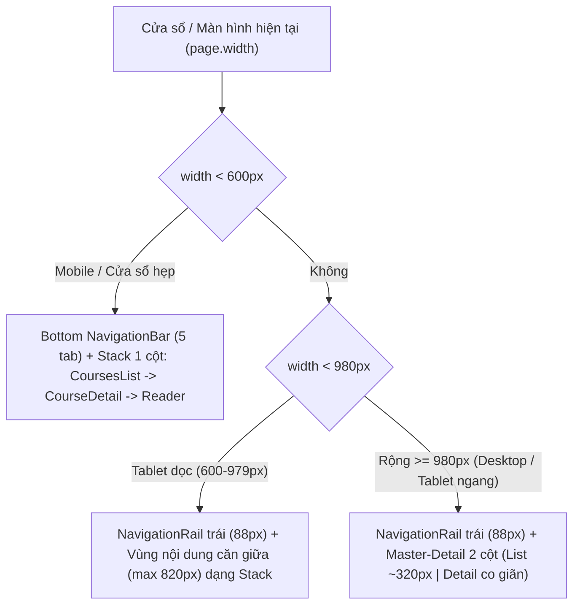
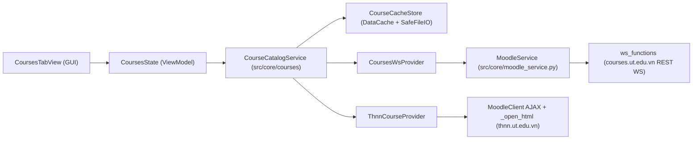

# Thiết kế Tab "Môn học" (Courses & THNN) cho UTHelper

**Ngày:** 2026-11-16  
**Nhánh làm việc:** `feature/courses-tab` (worktree `.worktrees/courses-tab`, nhánh nguồn `origin/develop`)  
**Phạm vi nền tảng:** Windows Desktop, Android, iOS, macOS (Flet `0.86.5` / Flutter + `flutter_inappwebview 6.1.5`)  
**Nguồn dữ liệu:** `courses.ut.edu.vn` (Moodle REST WS + Session) & `thnn.ut.edu.vn` (Moodle AJAX + HTML Session)

---

## 1. Mục tiêu & Nguyên tắc thiết kế

Tab **Môn học** giúp sinh viên UTH học tập, tra cứu tài liệu, xem điểm thành phần, kiểm tra điểm danh và mở bài tập/quiz của cả hai cổng **`courses.ut.edu.vn`** và **`thnn.ut.edu.vn`** trực tiếp bên trong **UTHelper**, không phải quay lại giao diện web Moodle gốc cồng kềnh.

### Các quyết định cốt lõi đã chốt

1. **Giao diện Native tùy biến hoàn toàn (Approach 1 — Adaptive Workspace)**: Không nhúng nguyên trang web Moodle; chỉ mở WebView khi người dùng thực sự chạy hoạt động tương tác đặc thù (`quiz`, `attendance`, `choice`, `groupselect`, `feedback`) hoặc mở tài liệu trong **HTML5 In-App Reader**.
2. **Loại bỏ nhiễu Moodle web**: Không xây dựng Forum đăng bài, Moodle Chat/Messaging, banner chào mừng lớn, hoặc cột Calendar thừa bên phải (do UTHelper đã có Tab Lịch & Spotlight Lịch hôm nay).
3. **"Mở 0ms, Tươi tại lớp"**:
   * Cache toàn bộ danh sách môn + cây mục lục/metadata bằng `DataCache` + `SafeFileIO` để mở app lên thấy ngay (< 16ms render từ bộ nhớ đệm).
   * Tự động đồng bộ nền định kỳ (cấu hình mỗi `X` giờ, mặc định 6 giờ) **kết hợp** kiểm tra delta siêu nhẹ khi bấm mở một môn (`core_course_get_updates_since` trên Courses; TTL ngắn + làm tươi tức thì trên THNN) để **Điểm danh mới mở khóa** hoặc **Quiz vừa tạo trên lớp** xuất hiện ngay lập tức.
4. **"Preview First, Download Optional"**:
   * **Không tải sẵn** file bài giảng về bộ nhớ máy.
   * Chạm trực tiếp vào hàng tài liệu -> Tải nhanh vào bộ nhớ đệm xem trước có giới hạn dung lượng (`preview_cache`, LRU 128 MB) và mở ngay **Trình xem trong app** hỗ trợ PDF, DOCX, XLSX/CSV, PPTX, Ảnh, Markdown/Code/Text.
   * Nút **icon Download nhỏ** bên phải (hoặc thao tác menu `⋮` / giữ lâu trên mobile) lưu bản bền vững ra thư mục tải về của người dùng (`Downloads/UTHelper/<TenMon>/`).
   * File nén **`.zip` / `.tar` / `.tar.gz`** mở thành **cây thư mục tương tác**; chạm bất kỳ file con nào chỉ giải nén đúng 1 entry đó để xem/đọc ngay lập tức. File **`.rar`** duyệt cây & xem từng file tương tự trên Windows Desktop (qua CLI `7z`/`UnRAR`/`WinRAR` nếu có), và trên Android/iOS hỗ trợ lưu + mở 1 chạm sang ứng dụng giải nén hệ thống (`ZArchiver` / `Files`).
5. **Tuân thủ chặt ranh giới kiến trúc dự án** ([`tests/test_architecture_boundaries.py`](../../tests/test_architecture_boundaries.py)):
   * `core.*` tuyệt đối không import `gui.*`.
   * `gui.*` không import `core` hoặc `core.ws_functions` (chỉ `core.moodle_service` được phép import `core.ws_functions`).
   * Component GUI mới trong `src/gui/components/courses/` không import `gui.app_controller` — giao tiếp hoàn toàn qua callback/protocol injection.
   * Không sửa tầng HTTP `urllib` trong `src/core/client.py`; không lưu thông tin mật hay cookie dạng plaintext vào JSON/log.

---

## 2. Kiến trúc UX & Giao diện Responsive (PC / Tablet / Mobile)

### 2.1. Điều hướng cấp cao & Breakpoints

Hệ thống điều hướng thống nhất đúng **5 đích chính** (giới hạn vàng của Material Design 3 & Apple HIG cho Tab Bar):

1. `home` — **Tổng quan** (Dashboard deadline & Lịch hôm nay)
2. `courses` — **Môn học** *(Tab mới — đặt ngay vị trí #2)*
3. `calendar` — **Lịch**
4. `grades` — **Bảng điểm**
5. `settings` — **Cài đặt** *(Thống nhất đúng 5 mục ở cả `NavigationBar` trên Mobile và `NavigationRail` trên Tablet/Desktop để giữ header gọn tuyệt đối và chuyển tab 1 chạm trong vùng ngón cái)*



**Điều chỉnh cần thiết so với nhánh `feat/update-giao-dien-tinh-diem-ky-vong` (`094e6c0`)**:
* Tái sử dụng hệ số layout từ nhánh PC: `_RAIL_WIDTH = 88`, `_WIDE_BREAKPOINT = 980`, `_LIST_MAX_WIDTH = 820`, `_SINGLE_VIEW_MAX_WIDTH = 860`.
* **Gỡ bỏ giới hạn `if not platform_utils.UI_IS_MOBILE` đối với `on_resize`**, để iPad/Tablet Android khi xoay ngang đạt `width >= 980` vẫn kích hoạt được chế độ Master-Detail 2 cột.
* **Preserve Tab State**: Khi người dùng đang mở dở môn *Quản trị DN CNTT (sub-tab Tài liệu)*, chuyển sang `Lịch` rồi quay lại `Môn học`, trạng thái môn đang chọn, sub-tab và vị trí cuộn được giữ nguyên (`keep-state`), không reset về danh sách gốc.
* **Nút Back vật lý (Android / macOS gesture / Desktop `Esc`)**: Móc trực tiếp vào `AppController._navigate_back()` theo thứ tự ưu tiên chặt chẽ:
  `In-App Reader` -> `Cấp thư mục con trong Archive Explorer` -> `CourseDetail (ở chế độ 1 cột)` -> `Danh sách môn học` -> `Tổng quan`.

### 2.2. Màn hình Danh sách Môn học (`CourseListPane`)

1. **Thanh "Tiếp tục nhanh" (Continue Where You Left Off)**: Khi đã từng mở ít nhất 1 tài liệu gần đây, hiển thị 1 thẻ gọn ở đỉnh danh sách: *"Tiếp tục: Buổi 4 · BaiToanDiemHoaVon.pdf"* — 1 chạm mở thẳng lại reader trước giờ vào lớp.
2. **Tìm kiếm & Bộ lọc ngữ cảnh**:
   * Ô tìm kiếm tức thì (khớp tên môn, mã học phần, tên giảng viên). Trên Desktop hỗ trợ phím tắt `Ctrl+K` hoặc `/`.
   * Chip lọc ngang: **`Tất cả`**, **`Đang học (Học kỳ hiện tại)`**, từng học kỳ đã parse (`HKI 2026-2027`, `HKII 2025-2026`, ...), và nguồn **`THNN`**.
3. **Thẻ Môn học (Course Card Hierarchy)**:
   * **Hàng trên**: Chip học kỳ (ví dụ `HKI 2026-2027`) + Chip nguồn (`Courses` / `THNN` nếu từ THNN) + icon **Ghim sao** (Pin lên đầu danh sách) + Chấm thông báo **`Mới`** (`C.UPDATE`, tự mờ đi sau khi sinh viên mở xem môn đó).
   * **Thân thẻ**: Tên môn sạch (đã bóc bỏ `[TT]_HK...` và mã HP trùng) ở `TEXT_PRIMARY` (`W_600`), dòng phụ hiển thị Mã học phần (`012012113707`) + Tên giảng viên tóm tắt nếu có.
   * **Chân thẻ**: Thanh tiến độ nhỏ (`ProgressBar` height 3px) thể hiện tỷ lệ hoàn thành mục học (`completed / total`) hoặc số mục chưa nộp sắp tới nếu có.
4. **Sắp xếp mặc định thông minh**: Môn được Ghim (`pinned=True`) -> Học kỳ mới nhất -> Còn hoạt động/có cập nhật mới gần nhất.

### 2.3. Không gian Chi tiết Môn học (`CourseDetailPane`)

* **Header Môn học gọn & Hữu dụng**:
  * Nút Back (khi ở layout 1 cột `< 980px`).
  * Tên môn đầy đủ + Badge học kỳ + Badge mã HP + Trạng thái cập nhật (`Cập nhật 2 phút trước` + nút **Làm tươi môn này** xoay mượt khi sync delta).
  * Nút **`Mở trên web`** (mở đúng URL course trên trình duyệt ngoài khi cần fallback).
  * **Pinned Teacher & Live Class Strip**: Tách thông tin giảng viên từ Section 0 / `mod_page` / summary thành chip bấm được:
    * Chip tên GV + Email/SĐT -> 1 chạm copy vào clipboard + hiện Snackbar xác nhận.
    * Nếu tìm thấy link **Google Meet** (`meet.google.com/...`) hoặc lớp trực tuyến trong `mod_page` / `mod_googlemeet` / `mod_url`: hiện ngay pill CTA **`Vào lớp trực tuyến`** màu `C.ACCENT` / `C.ON_ACCENT`.
* **3 Sub-tab chuẩn Flet `0.86.5` (`ft.Tabs(length=3)` -> `ft.TabBar` + `ft.TabBarView`)**:
  1. **`Nội dung`**:
     * Hàng chip lọc loại nhanh trong môn: `Tất cả`, `Tài liệu`, `Bài tập & Quiz`, `Điểm danh`, `Link lớp`.
     * Danh sách các `CourseSection` dùng `ft.ExpansionTile` tùy biến theme `C.*` (tự mở mặc định Section 0 hoặc Section có cập nhật mới nhất/buổi gần ngày hôm nay; các Section khác có thể bấm thu/mở, có badge số lượng mục con).
     * Mỗi dòng module hiển thị rõ:
       * Icon phân loại theo ngữ nghĩa (PDF đỏ cam, Word xanh dương, Excel xanh ngọc, PPTX cam, ZIP/RAR vàng hổ phách, Quiz tím, Assign xanh, Attendance cam vàng, URL/Meet xanh lục).
       * Tiêu đề sạch + Dòng phụ metadata (loại file + dung lượng + ngày sửa, hoặc hạn chót + trạng thái nộp với `assign`, hoặc link rút gọn với `url`).
       * Checkbox hoàn thành thủ công (nếu Moodle `completion == 1` cho phép tick) gọi `MoodleService.set_activity_completion_manually` theo kiểu optimistic UI.
       * Trailing: Nút icon **Download** nhỏ (tải bền vững về `Downloads/UTHelper`) hoặc chevron `>` / `Xem cây thư mục` cho gói nén; nút `⋮` mở `BottomSheet` (Mobile) / `PopupMenu` (Desktop) gồm: *Xem trước*, *Tải về máy*, *Mở trang gốc Moodle*, *Đánh dấu hoàn thành*.
     * **Actionable Empty State**: Nếu môn hoàn toàn trống chưa có giảng viên đăng bài (như trường hợp các môn lý luận chính trị đầu kỳ), hiển thị card trạng thái trống rõ ràng kèm 2 nút: **"Kiểm tra lại nội dung"** và **"Mở trang Moodle gốc"**.
  2. **`Tài liệu` (Tổng hợp phẳng toàn môn)**:
     * Gom tất cả file (`resource`, `folder`) và liên kết học liệu (`url`) từ mọi `Section` vào một danh sách duy nhất để ôn thi.
     * Lọc nhanh theo nhóm định dạng: `Tất cả`, `PDF`, `Word / Slide / Bảng tính`, `Gói nén (ZIP/RAR)`, `Link`.
     * Gắn tên buổi học nguồn (ví dụ `Buổi 4 · 240 KB`) ở dòng phụ mỗi tài liệu.
  3. **`Điểm môn`**:
     * Hiển thị các đầu điểm thành phần riêng của môn đó từ `gradereport_user_get_grade_items`: Tên đầu điểm, Điểm đạt, Thang điểm, Phần trăm, Trọng số, và Nhận xét giảng viên (feedback HTML đã làm sạch).
     * Nếu `thnn.ut.edu.vn` không hỗ trợ API điểm thành phần khi session bị hạn chế hoặc môn chưa có điểm, hiển thị trạng thái rõ ràng kèm nút xem trực tiếp trang điểm của môn trên web.

### 2.4. Thiết kế cho cả 9 Theme (Dark / Light) & Micro-interactions

* Toàn bộ UI sử dụng token từ [`src/gui/core/theme.py`](../../src/gui/core/theme.py):
  * Nền danh sách: `C.BG`, bề mặt card: `C.SURFACE`, bề mặt nâng cao/drawer/modal/active tile: `C.SURFACE_ELEVATED`, hover: `C.SURFACE_HOVER`, viền phân tách: `C.BORDER` / `C.BORDER_STRONG`.
  * Văn bản: `C.TEXT_PRIMARY`, `C.TEXT_SECONDARY`.
  * Chip & CTA: ghép cặp chuẩn `C.ACCENT` + `C.ON_ACCENT`, `C.UPDATE` + `C.ON_UPDATE`, `C.WARNING` + `C.ON_WARNING`, `C.SAFE` + `C.ON_SAFE`, `C.CRITICAL` + `C.ON_CRITICAL` (đảm bảo vượt `tests/test_theme_accessibility.py` contrast >= 4.5:1).
* Mọi component mới (`CoursesTabView`, `CourseListPane`, `CourseDetailPane`, `DocumentReaderView`, `ArchiveExplorerView`) **bắt buộc** triển khai phương thức `update_theme()` để `AppController._rebuild_colors()` cập nhật tức thì khi người dùng đổi theme trong Cài đặt.
* **Skeleton Loading**: Khi lần đầu đăng nhập chưa có cache cục bộ, hiển thị Skeleton shimmer khớp cấu trúc thẻ môn & dòng module thay cho vòng xoay `ProgressRing` giữa màn hình trống.
* **Vùng chạm (Touch Targets)**: Trên Mobile, mọi hàng tài liệu/module có chiều cao tối thiểu `52dp`, nút icon phụ (Download / Pin / `⋮`) có hộp padding tối thiểu `44x44dp`.

---

## 3. Kiến trúc dữ liệu thống nhất (`Courses` + `THNN`) & Tầng Core

### 3.1. Mô hình dữ liệu thuần (`src/core/courses/models.py`)

Toàn bộ là `@dataclass(frozen=True)` thuần dữ liệu, **không import `config`**:

```python
CourseSource = Literal["courses", "thnn"]
OpenStrategy = Literal[
    "preview_file",       # resource đơn lẻ / image / pdf / office / text
    "archive_tree",       # .zip / .tar / .tar.gz / .rar
    "folder_files",       # Moodle mod_folder chứa nhiều file
    "assignment_detail",  # Moodle mod_assign -> DetailView sẵn có
    "webview_activity",   # quiz / attendance / choice / feedback / groupselect
    "external_url",       # mod_url / mod_googlemeet / link trực tiếp
    "inline_page",        # mod_page / mod_label đã làm sạch HTML
    "web_fallback",       # module lạ -> mở URL gốc
]
```

Các thực thể chính:
* `CourseSummary`: `id`, `source`, `fullname`, `shortname`, `display_name`, `course_code`, `semester_label`, `semester_sort_key`, `program_tag`, `teacher_name`, `teacher_email`, `teacher_phone`, `meet_url`, `progress`, `completed_count`, `total_trackable`, `summary_text`, `web_url`, `last_synced_at`, `has_unseen_updates`, `is_pinned`.
* `CourseSection`: `id`, `course_id`, `source`, `section_num`, `name`, `summary_html`, `visible`, `modules: tuple[CourseModuleItem, ...]`.
* `CourseModuleItem`: `cmid`, `instance_id`, `modname`, `name`, `section_id`, `url`, `web_url`, `description_html`, `inline_html`, `completion_mode`, `completion_state`, `timemodified`, `attachments: tuple[CourseAttachment, ...]`, `open_strategy`, `is_new`.
* `CourseAttachment`: `file_name`, `file_url`, `file_size`, `mime_type`, `time_modified`, `extension`, `preview_kind` (`pdf` | `docx` | `xlsx` | `csv` | `pptx` | `image` | `text` | `archive` | `unsupported`), `is_archive`.
* `CourseGradeItem`: `id`, `item_name`, `item_module`, `grade_formatted`, `range_formatted`, `percentage`, `weight`, `feedback_html`.
* `RecentMaterialEntry`: `course_key` (`f"{source}:{course_id}"`), `cmid`, `title`, `attachment_url`, `file_name`, `opened_at`.

### 3.2. Bộ phân tích tên & thông tin giảng viên (`src/core/courses/shortname_parser.py`)

Chuẩn hóa dữ liệu thực tế đã xác minh từ `courses.ut.edu.vn` và `thnn.ut.edu.vn`:
* Regex bóc `[TT]_HKI2026-2027_Quản trị doanh nghiệp CNTT_012012113707` hoặc `[HKI2627] - [012012213905] - Đồ án thực tế...`:
  * `program_tag`: `TT` (nếu có)
  * `semester_label`: `HKI 2026-2027` (hoặc `HKII 2025-2026`, `HK Hè 2025-2026`, fallback `"Khác"` nếu course sự kiện chung)
  * `semester_sort_key`: tuple `(year_start, term_order)` để xếp học kỳ mới nhất lên đầu một cách tất định.
  * `course_code`: mã học phần 12 chữ số (`012012113707`).
  * `display_name`: tên môn học sạch đã bỏ mã trùng & tag cơ sở/hệ đào tạo dài dòng.
* Trích xuất từ Section 0 (`mod_forum` / `mod_label` / `mod_page` / `summary`):
  * Tìm tên GV (`Giảng viên: ...`), email (`*@ut.edu.vn`), SĐT Việt Nam (`0\d{9}`), và URL phòng học trực tuyến (`https://meet.google.com/...`, `zoom.us/...`, `teams.microsoft.com/...`).

### 3.3. Kiến trúc Adapter thống nhất (`src/core/courses/providers.py`)



1. **Mở rộng hợp lệ ở `src/core/ws_functions.py` & `src/core/moodle_service.py`**:
   * Thêm `ws_functions.get_pages_by_courses(call_fn, courseid)` -> `MoodleService.get_pages_by_courses(courseid: int)` (gọi `mod_page_get_pages_by_courses`): đã xác minh trên live server trả về `content` HTML đầy đủ của các `mod_page` (giải quyết trường hợp `core_course_get_contents` chỉ trả URL `index.html` mà che mất link Google Meet & thông tin giảng viên).
   * Thêm `ws_functions.update_activity_completion_manually(call_fn, cmid, completed)` -> `MoodleService.set_activity_completion_manually(cmid: int, completed: bool)` (gọi `core_completion_update_activity_completion_status_manually`): cho phép tick/bỏ tick hoàn thành thủ công trực tiếp từ app.
   * Tiếp tục tái sử dụng `get_user_courses`, `get_course_contents`, `get_course_updates_since`, `get_grade_items` sẵn có trong `MoodleService`.
2. **`CoursesWsProvider` (`courses.ut.edu.vn`)**:
   * Luồng chuẩn: `get_user_courses(userid)` -> chuẩn hóa danh sách `CourseSummary`.
   * Khi mở 1 môn: gọi song song (hoặc nối tiếp an toàn trong worker pool) `get_course_contents(courseid)` + `get_pages_by_courses(courseid)` để trộn nội dung HTML thật của `mod_page` vào đúng `cmid` trong Section.
   * Khi mở tab Điểm môn: gọi `get_grade_items(courseid, userid)` (lazy load khi bấm tab Điểm hoặc prefetch nhẹ khi mở môn).
   * Tải/xem file qua `MoodleClient.download_file(url)` (tự ghép token WS hợp lệ cho `pluginfile.php` hoặc dùng session cookie).
3. **`ThnnCourseProvider` (`thnn.ut.edu.vn` — REST WS tắt 403)**:
   * Danh sách môn: `client.call_ajax_api("core_course_get_enrolled_courses_by_timeline_classification", classification="all", limit=50, offset=0, sort="fullname")`.
   * Cây mục lục môn: `client.call_ajax_api("core_courseformat_get_state", courseid=course_id)` -> parse `section[]` và `cm[]` thành `CourseSection` & `CourseModuleItem` chuẩn (có `cmid`, `name`, `modname`, `url`, `completionstate`).
   * **Lazy Detail Resolver qua `_open_html`**: Khi người dùng mở một `mod_url`, `mod_googlemeet`, `mod_page`, hoặc bấm xem/tải `mod_resource` trên THNN, resolver mới mở `_open_html` theo `cm.url` để tách link đích thực (Google Drive, Meet, PDF `pluginfile.php`...) hoặc tải bytes bằng `CookieJar` hiện hành của `thnn_client`.
   * **An toàn phiên THNN (Session Safety)**: Do Moodle trên `thnn.ut.edu.vn` có thể làm vô hiệu hóa phiên cũ nếu `login_session()` chạy liên tục song song, **tuyệt đối không auto-login THNN chạy ngầm quá dày**. Chỉ khôi phục phiên THNN khi vào tab Môn học quá TTL hoặc khi user bấm Làm tươi / mở môn THNN, và dùng lock điều phối khi chuyển cookie sang WebView.

---

## 4. Chiến lược Cache & Đồng bộ thông minh ("Mở 0ms, Tươi tại lớp")

Toàn bộ cache lưu trong `CourseCacheStore` qua `DataCache` + `SafeFileIO` (atomic write, namespaced theo `site + username` digest — không bao giờ lẫn dữ liệu giữa 2 tài khoản):

| Loại cache | File lưu trữ | Nội dung lưu | Quy tắc làm tươi |
| :--- | :--- | :--- | :--- |
| **Tầng 1: Danh mục môn & Pin/Recent** | `courses_catalog_{digest}.json` | Danh sách `CourseSummary`, `pinned_keys`, `recent_items` (tối đa 10 mục gần nhất), `catalog_synced_at` | Mở app nạp 0ms; auto-refresh nền mỗi `COURSES_SYNC_INTERVAL_HOURS` giờ (mặc định `6`, cấu hình ở `Settings` / `config.py`); nút Làm tươi thủ công cập nhật ngay. |
| **Tầng 2: Cây nội dung từng môn** | `course_tree_{source}_{id}_{digest}.json` | `sections[]`, `grades[]`, `last_synced_ts`, `last_seen_cmids` | Khi user bấm mở 1 môn: UI hiện cache ngay 0ms, **đồng thời** chạy Delta Check nền nhẹ. |
| **Tầng 3: Bộ nhớ đệm xem file** | `<user_data>/preview_cache/<sha256(url)>_<timemodified>/` | Bản byte tạm của tài liệu vừa mở & entry con giải nén từ ZIP/TAR | Chỉ tải on-demand khi bấm xem; dọn tự động theo LRU khi vượt **128 MB** hoặc quá **14 ngày**. |

### Cơ chế Delta Check khi mở môn (Tươi tại lớp)

1. Khi user chọn môn `C` thuộc `courses.ut.edu.vn` đã có `last_synced_ts`:
   * UI render dữ liệu cache **ngay lập tức (0ms)**.
   * Nền gọi `MoodleService.get_course_updates_since(C.id, C.last_synced_ts)` (payload cực nhỏ < 1 KB).
   * Nếu `instances` có bất kỳ cập nhật mới nào (hoặc chưa từng sync lần nào): tự động fetch `get_course_contents(C.id)` + `get_pages_by_courses(C.id)`, diff các `cmid` mới/sửa -> cập nhật UI mượt và gắn badge **`Mới`** (`C.UPDATE`) lên đúng module vừa xuất hiện (VD: *Điểm danh buổi hôm nay* hoặc *Quiz kiểm tra tại lớp*).
   * Bảo vệ spam mạng: debounce tối thiểu **15 giây** giữa 2 lần delta check tự động cho cùng 1 môn; nút **"Làm tươi môn này"** trên header bỏ qua debounce để lấy mới tức thì theo ý sinh viên.
2. Khi user chọn môn thuộc `thnn.ut.edu.vn`:
   * Render cache 0ms; nếu `now - last_synced_ts > 300s` (5 phút) hoặc user bấm Làm tươi -> gọi `core_courseformat_get_state`.

---

## 5. Trình xem tài liệu 2 tầng & Trình duyệt cây file nén

### 5.1. Ma trận định dạng hỗ trợ & Hành vi Xem vs Tải

Tất cả xử lý tách & dựng preview nằm trong `src/core/courses/document_converter.py` và `src/core/courses/archive_service.py` (thuần Python, có thể unit test 100% không cần GUI):

| Định dạng | Cách chuyển đổi / Hiển thị (Tầng A: `flutter_inappwebview` / Tầng B: Native Flet fallback) | Tương tác UX nổi bật |
| :--- | :--- | :--- |
| **PDF** (`.pdf`) | **Tầng A**: Local bundled **PDF.js** (hoặc native WebView2 trên Windows + PDF.js cho Android/iOS để không bị WebView Mobile ép download `file://`).<br>**Tầng B** *(dev mode chưa build WebView)*: Thẻ thông tin + nút **"Mở bằng trình đọc PDF trên máy"**. | Chuyển trang, zoom sắc nét theo DPI, tìm chữ trong tài liệu, **nút Đọc ban đêm (Dark/Sepia)** cho học buổi tối. |
| **Word** (`.docx`) | Pure Python `zipfile` + `xml.etree.ElementTree` đọc `word/document.xml` & `word/media/*` -> dựng danh sách block ngữ nghĩa (Heading H1–H6, paragraph, bold/italic/underline/link, bullet/numbered list, table, ảnh nhúng dạng base64/file cục bộ).<br>**Tầng A**: HTML5 Reader có CSS đọc sách.<br>**Tầng B**: `ft.Markdown` + `ft.DataTable`/`ft.Image` theo theme `C.*`. | **Mục lục tự động (Outline)** từ H1–H3 nhảy nhanh tới chương cần ôn; tăng/giảm cỡ chữ `A-`/`A+`; reflow tự động vừa màn hình điện thoại (không kéo ngang). |
| **Excel / CSV** (`.xlsx`, `.csv`, `.tsv`) | Pure Python `zipfile` + `xml.etree` đọc `xl/workbook.xml`, `xl/sharedStrings.xml`, `xl/worksheets/sheet*.xml` (hoặc `csv` stdlib).<br>**Tầng A**: Bảng HTML dùng CSS `position: sticky` **đóng băng hàng tiêu đề đầu + cột đầu tiên**, hỗ trợ cuộn ngang/dọc mượt.<br>**Tầng B**: Bảng `ft.DataTable` có thanh cuộn 2 chiều (phân trang 100 dòng/trang nếu file rất lớn). | Thanh **chọn Sheet** dạng pill ngang; ô tìm lọc nhanh theo từ khóa trong sheet đang mở. |
| **PowerPoint** (`.pptx`) | Pure Python đọc `ppt/slides/slide*.xml` + `ppt/notesSlides/notesSlide*.xml` + ảnh trong `ppt/media/*`.<br>**Tầng A / Tầng B**: Thẻ từng Slide (số trang + tiêu đề + nội dung + ảnh nhúng + phần *Ghi chú giảng viên* có thể mở rộng). | Lướt dọc bằng một ngón tay cái cực nhanh trên mobile + nút "Mở app ngoài" khi cần xem nguyên layout hiệu ứng phức tạp. |
| **Ảnh** (`.png`, `.jpg`, `.jpeg`, `.webp`, `.gif`, `.svg`) | Native `ft.InteractiveViewer` bọc `ft.Image` trên mọi nền tảng. | Pinch-to-zoom, kéo pan, double-tap đặt lại khung hình. |
| **Text / Code / Markdown** (`.md`, `.txt`, `.py`, `.json`, `.sql`, `.xml`, `.html`, `.c`, `.cpp`, `.java`, ...) | Native `ft.Markdown(extension_set=ft.MarkdownExtensionSet.GITHUB_WEB)` cho `.md`, hoặc khung code monospace chọn bôi đen được (`selectable=True`) kèm nút **Sao chép toàn bộ**. | Nhẹ 0ms, giữ nguyên theme tối/sáng của UTHelper. |
| **Định dạng nhị phân cũ / lạ** (`.doc`, `.xls`, `.ppt`, khác) | Hiển thị thẻ tóm tắt tên file, dung lượng và nút **`Lưu & Mở bằng ứng dụng hệ thống`**. | Không treo app, bàn giao sạch sẽ sang Word/WPS/OS. |

> **Kiến trúc WebView & Khả năng chạy độc lập trên `develop`**:
> * **Tầng B (Pure-Flet Native Reader + mở file qua OS)** hoạt động độc lập 100% ngay trên `develop` không cần chờ nhánh phụ.
> * **Tầng A (HTML5 + PDF.js Reader)** bổ sung một control anh em tên **`UthDocumentWebView`** ngay trong gói `extensions/flet_uth_quiz` (nhánh `codex/84-embedded-quiz` đang tích hợp `flutter_inappwebview: 6.1.5` cho Windows WebView2/Android/iOS), phục vụ nội dung từ loopback HTTP server nội bộ `127.0.0.1` gắn token phiên dùng một lần (từ chối mọi kết nối ngoài loopback). Lớp `DocumentReaderView` tự động dò khả dụng của `UthDocumentWebView`: có thì mở Tầng A, không (môi trường dev `flet run` hoặc trước khi merge `flet_uth_quiz`) thì fallback sang Tầng B không gây lỗi.

### 5.2. Trình duyệt cây file nén (`ArchiveService` & `ArchiveExplorerView`)

* **`.zip`, `.tar`, `.tar.gz`, `.tgz`**: Dùng stdlib `zipfile` và `tarfile` — hoạt động 100% đồng nhất trên Windows, Android, iOS, macOS mà không cần cài thêm thư viện C.
  * Đọc danh sách `ZipInfo`/`TarInfo` thành cây thư mục ảo `ArchiveNode(name, full_path, is_dir, size, compressed_size, children)` **mà không giải nén toàn bộ ra đĩa**.
  * **UX Mobile (`< 600px`)**: Dùng **Drill-down Stack + Breadcrumb chạm được** (`Gói nén > Chương 2 > Slides`) để tránh thụt lề bẹp chữ; Back cứng lùi lên 1 cấp thư mục.
  * **UX Desktop / Tablet (`>= 600px`)**: Cây thư mục mở rộng tại chỗ (hoặc 2 khung: cây bên trái, bấm file mở Reader bên phải).
  * **Xem file bên trong**: Khi chạm vào 1 file con (kể cả `.zip` lồng trong `.zip`), `ArchiveService.extract_entry(...)` chỉ bung đúng entry đó vào `preview_cache` và đẩy sang `DocumentReaderView`. Hỗ trợ nút **Tải riêng file này** và **Giải nén toàn bộ ra Downloads**.
* **`.rar`**:
  * **Windows Desktop**: Tự kiểm tra tuần tự `7z.exe` / `UnRAR.exe` / `WinRAR.exe` trong PATH hoặc thư mục cài đặt chuẩn; nếu có -> liệt kê cây và trích xuất từng file với UX hệt `.zip`. Nếu máy chưa cài -> báo rõ và cho bấm lưu file / mở bằng app ngoài.
  * **Android / iOS**: Không gộp binary unrar ngoài làm phình APK/vi phạm bản quyền; khi chạm vào `.rar` hiển thị màn hình thông tin gói nén (tên, dung lượng) + nút **1 chạm "Lưu & Mở bằng ZArchiver / Files"**.

### 5.3. An toàn bảo mật khi đọc file & HTML từ Moodle

* **Chống ZipSlip / TarSlip**: Hàm `sanitize_archive_member_path(path)` chuẩn hóa bằng `posixpath`, từ chối mọi entry rỗng, đường dẫn tuyệt đối (`/`, `\`, `C:`) hoặc chứa `..`. Bảo vệ giải nén cả gói bằng giới hạn tổng dung lượng giải nén tối đa (mặc định 512 MB) và số entry tối đa (5.000 file) để chống Zip Bomb.
* **Chống XSS trong HTML Viewer**:
  * Toàn bộ text bóc từ XML của `.docx`/`.xlsx`/`.pptx` đều đi qua `html.escape(..., quote=True)`.
  * Nội dung HTML từ `mod_page` / `summary` của Moodle được lọc bằng `BeautifulSoup`: loại bỏ toàn bộ `<script>`, `<iframe>`, `<object>`, `<embed>`, và thuộc tính `on*` / `javascript:` URL trước khi hiển thị.

---

## 6. Điều hướng Activity & Xử lý lỗi

### 6.1. Bảng định tuyến khi nhấn vào Module (`CourseModuleItem`)

| Loại `modname` | Hành động mặc định khi chạm | Hành động phụ (`⋮` / nút bên phải) |
| :--- | :--- | :--- |
| `resource` (đơn file không nén) | Tải on-demand vào `preview_cache` -> Mở `DocumentReaderView` | Nút Download lưu ra `Downloads/UTHelper/`; Mở link gốc |
| `resource` (`.zip`/`.tar`/`.rar`) | Tải vào `preview_cache` -> Mở `ArchiveExplorerView` | Lưu file nén gốc ra `Downloads/UTHelper/` |
| `folder` | Mở danh sách/cây file có sẵn trong `module.attachments` (chạm file nào xem file đó) | Tải cả thư mục (nếu < ngưỡng dung lượng) |
| `assign` | Mở **`DetailView` sẵn có** của UTHelper (tái sử dụng 100% luồng xem đề/nộp bài/xóa file) | Mở trên trình duyệt ngoài |
| `quiz`, `attendance`, `choice`, `feedback`, `groupselect` | Mở trong **Embedded WebView** (`UthQuizPlayer` với session cookie tự động đúng site `courses` hoặc `thnn`) | Fallback trình duyệt hệ thống nếu nền tảng thiếu WebView runtime |
| `url`, `googlemeet` | Mở URL đích thực (Meet / Drive / Tài liệu web) trực tiếp qua `page.launch_url` | Sao chép URL |
| `page`, `label` | Mở sheet/pane xem nội dung HTML đã làm sạch (link bên trong bấm mở được) | Mở trên trình duyệt ngoài |

### 6.2. Xử lý lỗi & Ngoại tuyến (Graceful Degradation)

* **Mất mạng / Wi-Fi giảng đường yếu**: Luôn hiển thị cây môn học từ cache với banner nhẹ `"Đang xem bản ngoại tuyến · Dữ liệu lúc HH:MM"` + nút `"Thử lại"`. Các file đã nằm trong `preview_cache` hoặc `Downloads` vẫn mở đọc bình thường không cần mạng!
* **Hết hạn phiên khi tải file / mở Quiz**: Tự động chạy re-auth 1 lần an toàn (dùng credential bảo mật hiện tại) rồi thử lại thao tác đang dở mà không bắt người dùng bấm lại từ đầu; nếu đổi mật khẩu/fail xác thực -> bật `LoginDialog` quen thuộc của UTHelper.
* **File quá lớn hoặc lỗi định dạng**: Thông báo lỗi rõ bằng tiếng Việt dễ hiểu (kèm dung lượng thực tế), luôn có lối thoát **"Mở bằng trình duyệt / app ngoài"**.

---

## 7. Kế hoạch kiểm thử & Xác minh

1. **Unit & Contract Tests (không cần mạng)**:
   * `tests/test_courses_shortname_parser.py`: Parse đa dạng format `shortname`/`fullname` thực tế của UTH & THNN + trích xuất GV/email/SĐT/Meet URL.
   * `tests/test_courses_catalog_service.py`: Trộn `CoursesWsProvider` + `ThnnCourseProvider`, sắp xếp ưu tiên học kỳ + ghim sao, delta merge `core_course_get_updates_since` gắn/gỡ badge `Mới`, debouncing, và giới hạn bảo vệ session THNN.
   * `tests/test_courses_cache_store.py`: Atomic save/load qua `DataCache` theo namespace account, migration schema an toàn, dọn LRU `preview_cache`.
   * `tests/test_courses_archive_and_docs.py`: Xây cây `.zip`/`.tar.gz`, trích xuất 1 file con, chặn path traversal (`../../evil`), chống zip bomb, chuyển đổi fixture thật `.docx` / `.xlsx` / `.csv` / `.pptx` (gồm XSS escaping trong cell & text XML).
   * `tests/test_courses_state_and_navigation.py`: Luồng state ViewModel (preserve tab state, 3 breakpoints `<600` / `600-979` / `>=980`, back stack order cho `_navigate_back()`), và kiểm tra toàn bộ component mới có `update_theme()` qua kiểm thử màu `C.*`.
2. **Kiểm tra ranh giới & Chất lượng code**:
   * `python -m pytest tests/test_architecture_boundaries.py tests/test_theme_accessibility.py tests/test_repository_governance.py`
   * Toàn bộ suite: `python -m pytest tests -q --tb=short`
   * Lint: `ruff check src tests` (trên môi trường có `ruff` CLI / CI).
3. **Smoke test giao diện đa kích thước**:
   * Mở desktop app qua Flet ở cả 3 kích thước cửa sổ (`440x760`, `780x900`, `1200x780`), chuyển đổi qua lại tất cả các theme Sáng/Tối và xác nhận scroll, accordion, preview, back navigation chạy ổn định.
