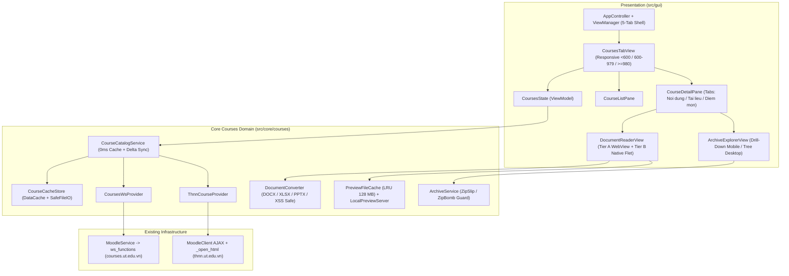

# Courses Tab ("Môn học" — Courses & THNN) Implementation Plan

> **For agentic workers:** REQUIRED SUB-SKILL: Use `superpowers:subagent-driven-development` to implement this plan task-by-task. Steps use checkbox (`- [ ]`) syntax for tracking.

**Goal:** Build a native, responsive **Môn học** (`courses`) tab inside UTHelper unifying `courses.ut.edu.vn` and `thnn.ut.edu.vn` with 0ms cached startup, in-class delta sync, inline multi-format document previews (PDF/DOCX/XLSX/PPTX/Image/Code), interactive archive tree exploration (`.zip`/`.tar.gz`/Windows `.rar`), and full PC/Tablet/Mobile ergonomics.

**Architecture:** Domain models, shortname parser, dual-site providers (`CoursesWsProvider` behind `MoodleService` and `ThnnCourseProvider` via `MoodleClient` AJAX/HTML), atomic namespaced cache stores, path-safe archive extractor, and pure-Python DOCX/XLSX/PPTX converters live in `src/core/courses/`. A decoupled ViewModel (`src/gui/view_models/courses_state.py`) drives modular Flet `0.86.5` views under `src/gui/components/courses/` matching all 9 `C.*` themes and wired into `AppController`/`ViewManager` with callback injection and strict layer boundaries.

**Architecture Diagram:**



**Tech Stack:** Python >= 3.11, Flet `0.86.5` (`NavigationBar`, `NavigationRail`, `TabBar`/`TabBarView`, `ExpansionTile`, `InteractiveViewer`, `Markdown`, `BottomSheet`, `FilePicker`, `UrlLauncher`), `beautifulsoup4` (`HTMLSanitizer`, `BS4_PARSER`), stdlib `zipfile`/`tarfile`/`xml.etree.ElementTree`/`csv`/`http.server`, `flutter_inappwebview 6.1.5` (optional Tier-A WebView bridge from `flet_uth_quiz`), `pytest`.

## Global Constraints

- **Worktree & Gitflow:** Implement exclusively in `.worktrees/courses-tab` on branch `feature/courses-tab` branched from `origin/develop`; never commit directly to `main` or `develop`.
- **Architecture Boundaries ([`tests/test_architecture_boundaries.py`](file:///e:/Projects/UTH-Elearning-Alert/.worktrees/courses-tab/tests/test_architecture_boundaries.py)):**
  - `core.*` MUST NOT import `gui.*`.
  - New `src/gui/components/courses/*.py` MUST NOT import `gui.app_controller` or `core.ws_functions` or `core`.
  - ONLY `core.moodle_service` may import `core.ws_functions`.
  - `src/models.py` MUST NOT gain new dependencies.
- **Repository Docs Rule ([`tests/test_repository_governance.py`](file:///e:/Projects/UTH-Elearning-Alert/.worktrees/courses-tab/tests/test_repository_governance.py)):** NEVER create `docs/superpowers/`. Place active specs/plans under `docs/plans/`.
- **HTTP Transport & Secrets:** Keep existing `urllib` transport in `src/core/client.py`; never write credentials, passwords, cookies, or WS tokens into logs or plaintext JSON caches.
- **Theme Contract ([`docs/design/theme-system.md`](file:///e:/Projects/UTH-Elearning-Alert/.worktrees/courses-tab/docs/design/theme-system.md)):** Every control uses semantic tokens `C.*` (`C.BG`, `C.SURFACE`, `C.SURFACE_ELEVATED`, `C.ACCENT`/`C.ON_ACCENT`, `C.UPDATE`/`C.ON_UPDATE`, etc.) and exposes `update_theme()`.
- **Flet `0.86.5` Compatibility:** Use `ft.Tabs(length=3, content=ft.Column([ft.TabBar(...), ft.TabBarView(...)]))`, async `await ft.UrlLauncher().launch_url(...)`, `await ft.FilePicker().save_file(file_name=..., src_bytes=...)`, `ft.Padding.only(...)`/`ft.Margin(...)`.

---

### Task 1: Course Domain Models & Shortname / Contact Parser

**Files:**
- Create: `src/core/courses/__init__.py`
- Create: `src/core/courses/models.py`
- Create: `src/core/courses/shortname_parser.py`
- Test: `tests/test_courses_shortname_parser.py`

**Interfaces:**
- Consumes: `core.html_compat.BS4_PARSER`
- Produces:
  - Dataclasses: `CourseSource`, `OpenStrategy`, `PreviewKind`, `CourseAttachment`, `CourseModuleItem`, `CourseSection`, `CourseSummary`, `CourseGradeItem`, `RecentMaterialEntry`, `ParsedCourseIdentity`, `TeacherContactInfo`
  - Functions: `parse_course_identity(shortname: str, fullname: str) -> ParsedCourseIdentity`, `extract_teacher_and_meet_info(html_fragments: list[str]) -> TeacherContactInfo`

- [ ] **Step 1: Write the failing test**

```python
# tests/test_courses_shortname_parser.py
from core.courses.models import CourseSummary, PreviewKind
from core.courses.shortname_parser import (
    extract_teacher_and_meet_info,
    parse_course_identity,
)


def test_parse_uth_shortname_extracts_semester_code_and_clean_name():
    parsed = parse_course_identity(
        shortname="[TT]_HKI2026-2027_Quản trị doanh nghiệp CNTT_012012113707",
        fullname="[HKI2627] - [012012113707] - Quản trị doanh nghiệp CNTT - CNS_CS1",
    )
    assert parsed.program_tag == "TT"
    assert parsed.semester_label == "HKI 2026-2027"
    assert parsed.semester_sort_key == (2026, 3)
    assert parsed.course_code == "012012113707"
    assert parsed.display_name == "Quản trị doanh nghiệp CNTT"


def test_parse_thnn_and_event_course_names_gracefully():
    parsed_thnn = parse_course_identity(
        shortname="TA4_K24_NHOM_03",
        fullname="[HKII 25-26] Tiếng Anh 4 - Nhóm 03",
    )
    assert parsed_thnn.semester_label == "HKII 2025-2026"
    assert parsed_thnn.semester_sort_key == (2025, 2)
    assert "Tiếng Anh 4" in parsed_thnn.display_name

    parsed_event = parse_course_identity(
        shortname="CSTT_2026",
        fullname="Chuỗi sự kiện truyền thông 2026",
    )
    assert parsed_event.semester_label == "Khác"
    assert parsed_event.semester_sort_key == (0, 0)
    assert parsed_event.display_name == "Chuỗi sự kiện truyền thông 2026"


def test_extract_teacher_and_meet_info_from_moodle_fragments():
    fragments = [
        "<p>Giảng viên: Võ Văn Bình (binh.vo@ut.edu.vn); DĐ 0918116115</p>",
        '<div>Link học online: <a href="https://meet.google.com/zry-mvjo-dpe?authuser=0">Meet</a></div>',
    ]
    info = extract_teacher_and_meet_info(fragments)
    assert info.teacher_name == "Võ Văn Bình"
    assert info.teacher_email == "binh.vo@ut.edu.vn"
    assert info.teacher_phone == "0918116115"
    assert info.meet_url == "https://meet.google.com/zry-mvjo-dpe?authuser=0"


def test_course_summary_key_property():
    summary = CourseSummary(
        id=31564,
        source="courses",
        fullname="Test",
        shortname="T",
        display_name="Test",
        course_code="0120",
        semester_label="HKI 2026-2027",
        semester_sort_key=(2026, 3),
    )
    assert summary.course_key == "courses:31564"
    assert isinstance("pdf", str)
```

- [ ] **Step 2: Run test to verify it fails**

Run: `python -m pytest tests/test_courses_shortname_parser.py -v`
Expected: FAIL with `ModuleNotFoundError: No module named 'core.courses'`

- [ ] **Step 3: Write minimal implementation**

```python
# src/core/courses/__init__.py
"""Unified domain, providers, cache, and document tools for UTHelper Courses tab."""

from core.courses.models import (
    CourseAttachment,
    CourseGradeItem,
    CourseModuleItem,
    CourseSection,
    CourseSource,
    CourseSummary,
    OpenStrategy,
    PreviewKind,
    RecentMaterialEntry,
)

__all__ = [
    "CourseAttachment",
    "CourseGradeItem",
    "CourseModuleItem",
    "CourseSection",
    "CourseSource",
    "CourseSummary",
    "OpenStrategy",
    "PreviewKind",
    "RecentMaterialEntry",
]
```

```python
# src/core/courses/models.py
"""Pure immutable data models for the Courses & THNN feature."""

from __future__ import annotations

from dataclasses import dataclass, field
from typing import Literal, Optional

CourseSource = Literal["courses", "thnn"]
OpenStrategy = Literal[
    "preview_file",
    "archive_tree",
    "folder_files",
    "assignment_detail",
    "webview_activity",
    "external_url",
    "inline_page",
    "web_fallback",
]
PreviewKind = Literal[
    "pdf",
    "docx",
    "xlsx",
    "csv",
    "pptx",
    "image",
    "text",
    "archive",
    "unsupported",
]


@dataclass(frozen=True, slots=True)
class CourseAttachment:
    file_name: str
    file_url: str
    file_size: int = 0
    mime_type: str = ""
    time_modified: int = 0
    extension: str = ""
    preview_kind: PreviewKind = "unsupported"
    is_archive: bool = False


@dataclass(frozen=True, slots=True)
class CourseModuleItem:
    cmid: int
    instance_id: int
    modname: str
    name: str
    section_id: int
    url: str = ""
    web_url: str = ""
    description_html: str = ""
    inline_html: str = ""
    completion_mode: int = 0
    completion_state: int = 0
    timemodified: int = 0
    attachments: tuple[CourseAttachment, ...] = ()
    open_strategy: OpenStrategy = "web_fallback"
    is_new: bool = False


@dataclass(frozen=True, slots=True)
class CourseSection:
    id: int
    course_id: int
    source: CourseSource
    section_num: int
    name: str
    summary_html: str = ""
    visible: bool = True
    modules: tuple[CourseModuleItem, ...] = ()


@dataclass(frozen=True, slots=True)
class CourseSummary:
    id: int
    source: CourseSource
    fullname: str
    shortname: str
    display_name: str
    course_code: str = ""
    semester_label: str = "Khác"
    semester_sort_key: tuple[int, int] = (0, 0)
    program_tag: str = ""
    teacher_name: str = ""
    teacher_email: str = ""
    teacher_phone: str = ""
    meet_url: str = ""
    progress: Optional[float] = None
    completed_count: int = 0
    total_trackable: int = 0
    summary_text: str = ""
    web_url: str = ""
    last_synced_at: int = 0
    has_unseen_updates: bool = False
    is_pinned: bool = False

    @property
    def course_key(self) -> str:
        return f"{self.source}:{self.id}"


@dataclass(frozen=True, slots=True)
class CourseGradeItem:
    id: int
    item_name: str
    item_module: str = ""
    grade_formatted: str = "-"
    range_formatted: str = ""
    percentage: str = ""
    weight: str = ""
    feedback_html: str = ""


@dataclass(frozen=True, slots=True)
class RecentMaterialEntry:
    course_key: str
    course_name: str
    cmid: int
    title: str
    attachment_url: str
    file_name: str
    opened_at: int
    source: CourseSource = "courses"
    course_id: int = 0
```

```python
# src/core/courses/shortname_parser.py
"""Parse UTH Moodle shortnames, fullnames, and teacher/Meet metadata."""

from __future__ import annotations

import re
from dataclasses import dataclass
from typing import Iterable

from bs4 import BeautifulSoup

from core.html_compat import BS4_PARSER

_PROGRAM_RE = re.compile(r"^\[(?P<prog>[A-Za-z0-9_-]{2,10})\]_")
_SEMESTER_LONG_RE = re.compile(
    r"(?:^|[_\s\[-])(?P<term>HK(?:I{1,2}|H|HE|3))[-_\s]*(?P<y1>20\d{2})[-–](?P<y2>20\d{2})(?:$|[_\s\]-])",
    re.IGNORECASE,
)
_SEMESTER_COMPACT_RE = re.compile(
    r"(?:^|[\[\s_])(?P<term>HK(?:I{1,2}|H|HE|3))\s*(?P<y1>\d{2})[-–]?(?P<y2>\d{2})(?:$|[\]\s_-])",
    re.IGNORECASE,
)
_CODE_RE = re.compile(r"\b(\d{10,14})\b")
_TRAILING_CAMPUS_RE = re.compile(r"\s*-\s*(?:CNS_CS\d|HTHN_[A-Z]+|HOI TRUONG [A-Z0-9]+|CS\d)\s*$", re.IGNORECASE)
_BRACKET_PREFIX_RE = re.compile(r"^(?:\[[^\]]+\]\s*[-–_]?\s*)+")
_EMAIL_RE = re.compile(r"[A-Za-z0-9._%+-]+@[A-Za-z0-9.-]+\.[A-Za-z]{2,}")
_PHONE_RE = re.compile(r"\b0\d{9,10}\b")
_TEACHER_RE = re.compile(
    r"(?:Giảng\s*viên|GV(?:\s*phụ\s*trách)?)\s*[:\-]\s*([^\n\r(;,\|]{3,60})",
    re.IGNORECASE,
)
_MEET_URL_RE = re.compile(
    r"https://(?:meet\.google\.com|zoom\.us|teams\.microsoft\.com)/[^\s\"'<>]+",
    re.IGNORECASE,
)

_TERM_ORDER = {"HKI": 3, "HKII": 2, "HKH": 1, "HKHE": 1, "HK3": 1}
_TERM_DISPLAY = {"HKI": "HKI", "HKII": "HKII", "HKH": "HK Hè", "HKHE": "HK Hè", "HK3": "HK Hè"}


@dataclass(frozen=True, slots=True)
class ParsedCourseIdentity:
    display_name: str
    course_code: str
    semester_label: str
    semester_sort_key: tuple[int, int]
    program_tag: str


@dataclass(frozen=True, slots=True)
class TeacherContactInfo:
    teacher_name: str = ""
    teacher_email: str = ""
    teacher_phone: str = ""
    meet_url: str = ""


def _normalize_term(raw_term: str, y1: int, y2: int) -> tuple[str, tuple[int, int]]:
    upper = raw_term.upper()
    label_term = _TERM_DISPLAY.get(upper, upper)
    order = _TERM_ORDER.get(upper, 0)
    return f"{label_term} {y1}-{y2}", (y1, order)


def parse_course_identity(shortname: str, fullname: str) -> ParsedCourseIdentity:
    short = (shortname or "").strip()
    full = (fullname or "").strip()
    combined = f"{short} {full}"

    prog_match = _PROGRAM_RE.match(short)
    program_tag = prog_match.group("prog").upper() if prog_match else ""

    semester_label = "Khác"
    semester_sort_key = (0, 0)
    m_long = _SEMESTER_LONG_RE.search(combined)
    if m_long:
        semester_label, semester_sort_key = _normalize_term(
            m_long.group("term"), int(m_long.group("y1")), int(m_long.group("y2"))
        )
    else:
        m_compact = _SEMESTER_COMPACT_RE.search(combined)
        if m_compact:
            y1 = 2000 + int(m_compact.group("y1"))
            y2 = 2000 + int(m_compact.group("y2"))
            semester_label, semester_sort_key = _normalize_term(
                m_compact.group("term"), y1, y2
            )

    code_match = _CODE_RE.search(short) or _CODE_RE.search(full)
    course_code = code_match.group(1) if code_match else ""

    # Prefer structured segment from UTH shortname if formatted cleanly with underscores
    display_name = ""
    if "_" in short and m_long:
        parts = [p.strip() for p in short.split("_") if p.strip()]
        candidates = [
            p
            for p in parts
            if p != f"[{program_tag}]"
            and not _SEMESTER_LONG_RE.search(f"_{p}_")
            and p != course_code
        ]
        if candidates:
            display_name = max(candidates, key=len)

    if not display_name:
        cleaned = _BRACKET_PREFIX_RE.sub("", full)
        if course_code:
            cleaned = cleaned.replace(f"[{course_code}]", "").replace(course_code, "")
        cleaned = _TRAILING_CAMPUS_RE.sub("", cleaned)
        cleaned = re.sub(r"^[\s\-–_]+|[\s\-–_]+$", "", cleaned)
        display_name = cleaned or full or short

    return ParsedCourseIdentity(
        display_name=display_name,
        course_code=course_code,
        semester_label=semester_label,
        semester_sort_key=semester_sort_key,
        program_tag=program_tag,
    )


def extract_teacher_and_meet_info(html_fragments: Iterable[str]) -> TeacherContactInfo:
    teacher_name = ""
    teacher_email = ""
    teacher_phone = ""
    meet_url = ""

    for fragment in html_fragments:
        if not fragment:
            continue
        soup = BeautifulSoup(fragment, BS4_PARSER)
        for anchor in soup.find_all("a", href=True):
            href = str(anchor["href"]).strip()
            if not meet_url and _MEET_URL_RE.match(href):
                meet_url = href

        text = soup.get_text(" ", strip=True)
        if not teacher_name:
            m_teacher = _TEACHER_RE.search(text)
            if m_teacher:
                teacher_name = m_teacher.group(1).strip(" .;-:")
        if not teacher_email:
            m_email = _EMAIL_RE.search(text)
            if m_email:
                teacher_email = m_email.group(0)
        if not teacher_phone:
            m_phone = _PHONE_RE.search(text)
            if m_phone:
                teacher_phone = m_phone.group(0)
        if not meet_url:
            m_meet = _MEET_URL_RE.search(text)
            if m_meet:
                meet_url = m_meet.group(0)

    return TeacherContactInfo(
        teacher_name=teacher_name,
        teacher_email=teacher_email,
        teacher_phone=teacher_phone,
        meet_url=meet_url,
    )
```

- [ ] **Step 4: Run test to verify it passes**

Run: `python -m pytest tests/test_courses_shortname_parser.py -v`
Expected: PASS (`4 passed`)

- [ ] **Step 5: Commit**

```bash
git add src/core/courses/__init__.py src/core/courses/models.py src/core/courses/shortname_parser.py tests/test_courses_shortname_parser.py
git commit -m "feat(courses): add course domain models and UTH shortname/contact parser"
```

---

### Task 2: Moodle WS Additions & Dual-Site Providers (`CoursesWsProvider` + `ThnnCourseProvider`)

**Files:**
- Modify: `src/core/ws_functions.py:820-835`
- Modify: `src/core/moodle_service.py:255-260`
- Create: `src/core/courses/providers.py`
- Test: `tests/test_courses_providers.py`

**Interfaces:**
- Consumes: `core.moodle_service.MoodleService`, `core.security.HTMLSanitizer`, `core.html_compat.BS4_PARSER`, `core.courses.models`, `core.courses.shortname_parser`
- Produces:
  - `MoodleService.get_pages_by_courses(courseid: int) -> Optional[List[Dict[str, Any]]]`
  - `MoodleService.set_activity_completion_manually(cmid: int, completed: bool) -> bool`
  - `CourseCatalogProvider` Protocol
  - `CoursesWsProvider`, `ThnnCourseProvider`, `classify_preview_kind(filename: str, mimetype: str) -> PreviewKind`, `classify_open_strategy(...) -> OpenStrategy`

- [ ] **Step 1: Write the failing test**

```python
# tests/test_courses_providers.py
from core.courses.providers import (
    CoursesWsProvider,
    ThnnCourseProvider,
    classify_preview_kind,
)
from core.moodle_service import MoodleService


class _FakeWsTransport:
    def __init__(self, responses):
        self.responses = responses
        self.calls = []

    def __call__(self, function: str, **params):
        self.calls.append((function, params))
        return self.responses.get(function)


def test_moodle_service_pages_and_completion_wrappers():
    transport = _FakeWsTransport(
        {
            "mod_page_get_pages_by_courses": {
                "pages": [{"id": 10, "coursemodule": 501, "name": "Online", "content": "<script>x()</script><p>https://meet.google.com/abc-defg-hij</p>"}]
            },
            "core_completion_update_activity_completion_status_manually": {"status": True},
        }
    )
    service = MoodleService(transport)
    pages = service.get_pages_by_courses(31564)
    assert len(pages) == 1
    assert pages[0]["coursemodule"] == 501
    assert service.set_activity_completion_manually(501, True) is True


def test_courses_ws_provider_merges_mod_page_and_sanitizes_html():
    transport = _FakeWsTransport(
        {
            "core_course_get_contents": [
                {
                    "id": 1,
                    "name": "Tổng quan",
                    "section": 0,
                    "summary": "<p>Giảng viên: Nguyễn Văn A (a@ut.edu.vn)</p>",
                    "visible": 1,
                    "modules": [
                        {
                            "id": 501,
                            "instance": 10,
                            "modname": "page",
                            "name": "Thông tin trực tuyến",
                            "url": "https://courses.ut.edu.vn/mod/page/view.php?id=501",
                            "completion": 1,
                            "completiondata": {"state": 0},
                        },
                        {
                            "id": 502,
                            "instance": 11,
                            "modname": "resource",
                            "name": "Slides Chương 1",
                            "url": "https://courses.ut.edu.vn/mod/resource/view.php?id=502",
                            "contents": [
                                {
                                    "filename": "Chuong1.zip",
                                    "fileurl": "https://courses.ut.edu.vn/webservice/pluginfile.php/1/mod_resource/content/1/Chuong1.zip",
                                    "filesize": 102400,
                                    "mimetype": "application/zip",
                                    "timemodified": 1700000000,
                                }
                            ],
                        },
                    ],
                }
            ],
            "mod_page_get_pages_by_courses": {
                "pages": [
                    {
                        "id": 10,
                        "coursemodule": 501,
                        "content": '<script>evil()</script><p><a href="https://meet.google.com/zry-mvjo-dpe">Meet</a></p>',
                    }
                ]
            },
        }
    )
    service = MoodleService(transport)
    provider = CoursesWsProvider(service=service, origin="https://courses.ut.edu.vn")
    sections = provider.fetch_course_sections(31564)
    assert len(sections) == 1
    page_mod, res_mod = sections[0].modules
    assert page_mod.open_strategy == "inline_page"
    assert "<script>" not in page_mod.inline_html
    assert "meet.google.com/zry-mvjo-dpe" in page_mod.inline_html
    assert res_mod.open_strategy == "archive_tree"
    assert res_mod.attachments[0].preview_kind == "archive"
    assert res_mod.attachments[0].is_archive is True


def test_thnn_provider_parses_courses_and_courseformat_state():
    class _FakeThnnClient:
        base_url = "https://thnn.ut.edu.vn"

        def login_session(self):
            return True

        def call_ajax_api(self, fn: str, **params):
            if fn == "core_course_get_enrolled_courses_by_timeline_classification":
                return {
                    "error": False,
                    "data": {
                        "courses": [
                            {"id": 4458, "fullname": "[HKI 26-27] Anh văn 4", "shortname": "AV4_N01", "viewurl": "https://thnn.ut.edu.vn/course/view.php?id=4458"}
                        ]
                    },
                }
            if fn == "core_courseformat_get_state":
                return {
                    "error": False,
                    "data": {
                        "section": [{"id": 11, "section": 1, "title": "Unit 1", "cmlist": [9001], "visible": True}],
                        "cm": [{"id": 9001, "module": "googlemeet", "name": "Phòng học Meet", "url": "https://thnn.ut.edu.vn/mod/googlemeet/view.php?id=9001", "completionstate": 0}],
                    },
                }
            return None

        def _open_html(self, path: str):
            return path, '<a href="https://meet.google.com/xyz-abcd-efg">Join</a>'

    provider = ThnnCourseProvider(client=_FakeThnnClient())
    courses = provider.fetch_courses()
    assert len(courses) == 1
    assert courses[0].source == "thnn"
    assert courses[0].id == 4458

    sections = provider.fetch_course_sections(4458)
    assert len(sections) == 1
    assert sections[0].modules[0].open_strategy == "external_url"
    resolved_url = provider.resolve_module_external_url(sections[0].modules[0])
    assert resolved_url == "https://meet.google.com/xyz-abcd-efg"


def test_classify_preview_kind_extensions():
    assert classify_preview_kind("a.DOCX", "") == "docx"
    assert classify_preview_kind("sheet.xlsx", "") == "xlsx"
    assert classify_preview_kind("archive.rar", "") == "archive"
    assert classify_preview_kind("slides.pptx", "") == "pptx"
    assert classify_preview_kind("data.csv", "") == "csv"
```

- [ ] **Step 2: Run test to verify it fails**

Run: `python -m pytest tests/test_courses_providers.py -v`
Expected: FAIL with `AttributeError: 'MoodleService' object has no attribute 'get_pages_by_courses'` or `ModuleNotFoundError`

- [ ] **Step 3: Write minimal implementation**

Add `get_pages_by_courses` and `update_activity_completion_manually` to `src/core/ws_functions.py` right after `get_course_contents`, expose them cleanly on `src/core/moodle_service.py`, and implement `src/core/courses/providers.py`:

```diff
--- a/src/core/ws_functions.py
+++ b/src/core/ws_functions.py
@@ -825,6 +825,31 @@ def get_course_contents(call_api: Callable, courseid: int) -> Optional[List[Dict
     except Exception as e:
         logger.error("Lỗi get_course_contents (course=%d): %s", courseid, e)
         return None
+
+
+def get_pages_by_courses(call_api: Callable, courseid: int) -> Optional[List[Dict[str, Any]]]:
+    """mod_page_get_pages_by_courses - nội dung HTML chi tiết của các mod_page."""
+    try:
+        result = call_api("mod_page_get_pages_by_courses", **{"courseids[0]": courseid})
+        if isinstance(result, dict):
+            pages = result.get("pages", [])
+            return pages if isinstance(pages, list) else []
+        return None
+    except Exception as e:
+        logger.error("Lỗi get_pages_by_courses (course=%d): %s", courseid, e)
+        return None
+
+
+def update_activity_completion_manually(call_api: Callable, cmid: int, completed: bool) -> bool:
+    """core_completion_update_activity_completion_status_manually - tick hoàn thành thủ công."""
+    try:
+        result = call_api(
+            "core_completion_update_activity_completion_status_manually",
+            cmid=cmid,
+            completed=1 if completed else 0,
+        )
+        return isinstance(result, dict) and bool(result.get("status", False))
+    except Exception as e:
+        logger.error("Lỗi update_activity_completion_manually (cmid=%d): %s", cmid, e)
+        return False
```

```diff
--- a/src/core/moodle_service.py
+++ b/src/core/moodle_service.py
@@ -257,3 +257,11 @@ class MoodleService:
     def get_course_contents(self, courseid: int) -> Optional[List[Dict[str, Any]]]:
         """Lấy nội dung toàn bộ bài học, tài liệu giảng dạy trong môn học."""
         return ws_functions.get_course_contents(self.call_ws_api, courseid)
+
+    def get_pages_by_courses(self, courseid: int) -> Optional[List[Dict[str, Any]]]:
+        """Lấy nội dung HTML chi tiết các mod_page trong môn học."""
+        return ws_functions.get_pages_by_courses(self.call_ws_api, courseid)
+
+    def set_activity_completion_manually(self, cmid: int, completed: bool) -> bool:
+        """Cập nhật trạng thái hoàn thành thủ công của module."""
+        return ws_functions.update_activity_completion_manually(self.call_ws_api, cmid, completed)
```

```python
# src/core/courses/providers.py
"""Data providers for unified Courses (REST WS) and THNN (AJAX/HTML session)."""

from __future__ import annotations

import logging
import posixpath
from typing import Any, Callable, Optional, Protocol
from urllib.parse import urljoin, urlsplit

from bs4 import BeautifulSoup

from core.courses.models import (
    CourseAttachment,
    CourseGradeItem,
    CourseModuleItem,
    CourseSection,
    CourseSource,
    CourseSummary,
    OpenStrategy,
    PreviewKind,
)
from core.courses.shortname_parser import extract_teacher_and_meet_info, parse_course_identity
from core.html_compat import BS4_PARSER
from core.security import HTMLSanitizer

logger = logging.getLogger(__name__)

_ARCHIVE_EXTS = frozenset({".zip", ".rar", ".tar", ".gz", ".tgz"})
_IMAGE_EXTS = frozenset({".png", ".jpg", ".jpeg", ".webp", ".gif", ".bmp", ".svg"})
_TEXT_EXTS = frozenset(
    {
        ".txt", ".md", ".markdown", ".json", ".xml", ".html", ".htm", ".yaml", ".yml",
        ".py", ".js", ".ts", ".java", ".c", ".cpp", ".h", ".cs", ".sql", ".css", ".log",
    }
)
_WEBVIEW_ACTIVITY_MODS = frozenset({"quiz", "attendance", "choice", "feedback", "groupselect", "scorm"})


def classify_preview_kind(filename: str, mimetype: str = "") -> PreviewKind:
    ext = posixpath.splitext((filename or "").strip().lower())[1]
    mime = (mimetype or "").lower()
    if ext == ".pdf" or "pdf" in mime:
        return "pdf"
    if ext == ".docx":
        return "docx"
    if ext == ".xlsx":
        return "xlsx"
    if ext in {".csv", ".tsv"}:
        return "csv"
    if ext == ".pptx":
        return "pptx"
    if ext in _IMAGE_EXTS or mime.startswith("image/"):
        return "image"
    if ext in _TEXT_EXTS or mime.startswith("text/"):
        return "text"
    if ext in _ARCHIVE_EXTS or "zip" in mime or "rar" in mime or "tar" in mime:
        return "archive"
    return "unsupported"


def classify_open_strategy(
    modname: str, attachments: tuple[CourseAttachment, ...]
) -> OpenStrategy:
    mod = (modname or "").lower()
    if mod == "assign":
        return "assignment_detail"
    if mod in _WEBVIEW_ACTIVITY_MODS:
        return "webview_activity"
    if mod in {"url", "googlemeet"}:
        return "external_url"
    if mod in {"page", "label"}:
        return "inline_page"
    if mod == "folder":
        return "folder_files"
    if mod == "resource" and attachments:
        if any(att.is_archive for att in attachments):
            return "archive_tree"
        return "preview_file"
    return "web_fallback"


def _build_attachment(raw: dict[str, Any]) -> CourseAttachment:
    file_name = str(raw.get("filename") or raw.get("file_name") or "file").strip()
    file_url = str(raw.get("fileurl") or raw.get("file_url") or "").strip()
    mime = str(raw.get("mimetype") or raw.get("mime_type") or "").strip()
    ext = posixpath.splitext(file_name.lower())[1]
    kind = classify_preview_kind(file_name, mime)
    return CourseAttachment(
        file_name=file_name,
        file_url=file_url,
        file_size=int(raw.get("filesize") or 0),
        mime_type=mime,
        time_modified=int(raw.get("timemodified") or 0),
        extension=ext,
        preview_kind=kind,
        is_archive=(kind == "archive"),
    )


class CourseCatalogProvider(Protocol):
    source: CourseSource

    def fetch_courses(self) -> list[CourseSummary]: ...
    def fetch_course_sections(self, course_id: int) -> list[CourseSection]: ...
    def fetch_course_grades(self, course_id: int) -> list[CourseGradeItem]: ...
    def download_file(self, url: str) -> Optional[bytes]: ...


class CoursesWsProvider:
    source: CourseSource = "courses"

    def __init__(
        self,
        *,
        service: Any,
        client: Any = None,
        origin: str = "https://courses.ut.edu.vn",
        userid_resolver: Optional[Callable[[], Optional[int]]] = None,
    ) -> None:
        self._service = service
        self._client = client
        self._origin = origin.rstrip("/")
        self._userid_resolver = userid_resolver

    def _resolve_userid(self) -> Optional[int]:
        if self._userid_resolver:
            return self._userid_resolver()
        info = self._service.get_site_info()
        if isinstance(info, dict):
            return info.get("userid")
        return None

    def fetch_courses(self) -> list[CourseSummary]:
        userid = self._resolve_userid()
        if not userid:
            return []
        raw_courses = self._service.get_user_courses(userid) or []
        summaries: list[CourseSummary] = []
        for raw in raw_courses:
            cid = int(raw.get("id") or 0)
            if not cid:
                continue
            fullname = str(raw.get("fullname") or "")
            shortname = str(raw.get("shortname") or "")
            parsed = parse_course_identity(shortname, fullname)
            summary_html = HTMLSanitizer.sanitize(str(raw.get("summary") or ""))
            summary_text = BeautifulSoup(summary_html, BS4_PARSER).get_text(" ", strip=True)
            contact = extract_teacher_and_meet_info([summary_html])
            progress_val = raw.get("progress")
            progress = float(progress_val) / 100.0 if isinstance(progress_val, (int, float)) else None
            summaries.append(
                CourseSummary(
                    id=cid,
                    source="courses",
                    fullname=fullname,
                    shortname=shortname,
                    display_name=parsed.display_name,
                    course_code=parsed.course_code,
                    semester_label=parsed.semester_label,
                    semester_sort_key=parsed.semester_sort_key,
                    program_tag=parsed.program_tag,
                    teacher_name=contact.teacher_name,
                    teacher_email=contact.teacher_email,
                    teacher_phone=contact.teacher_phone,
                    meet_url=contact.meet_url,
                    progress=progress,
                    summary_text=summary_text,
                    web_url=f"{self._origin}/course/view.php?id={cid}",
                )
            )
        return summaries

    def fetch_course_sections(self, course_id: int) -> list[CourseSection]:
        raw_sections = self._service.get_course_contents(course_id) or []
        pages = self._service.get_pages_by_courses(course_id) or []
        pages_by_cmid: dict[int, str] = {}
        for p in pages:
            cmid = int(p.get("coursemodule") or 0)
            if cmid:
                pages_by_cmid[cmid] = HTMLSanitizer.sanitize(str(p.get("content") or ""))

        sections: list[CourseSection] = []
        for sec in raw_sections:
            sec_id = int(sec.get("id") or 0)
            sec_num = int(sec.get("section") or 0)
            sec_name = str(sec.get("name") or f"Chủ đề {sec_num}")
            sec_summary = HTMLSanitizer.sanitize(str(sec.get("summary") or ""))
            modules: list[CourseModuleItem] = []
            for mod in sec.get("modules") or []:
                cmid = int(mod.get("id") or 0)
                modname = str(mod.get("modname") or "unknown").lower()
                if modname == "forum" and "diễn đàn" in str(mod.get("name") or "").lower():
                    # Keep forum only if it carries teacher contact info in inline html
                    pass
                contents = tuple(_build_attachment(att) for att in (mod.get("contents") or []) if att.get("fileurl"))
                desc_html = HTMLSanitizer.sanitize(str(mod.get("description") or ""))
                inline_html = pages_by_cmid.get(cmid, "") or desc_html
                external_url = ""
                if modname == "url" and contents:
                    external_url = contents[0].file_url
                web_url = str(mod.get("url") or f"{self._origin}/mod/{modname}/view.php?id={cmid}")
                completion_data = mod.get("completiondata") or {}
                mod_times = [int(att.time_modified or 0) for att in contents]
                modules.append(
                    CourseModuleItem(
                        cmid=cmid,
                        instance_id=int(mod.get("instance") or 0),
                        modname=modname,
                        name=str(mod.get("name") or ""),
                        section_id=sec_id,
                        url=external_url or web_url,
                        web_url=web_url,
                        description_html=desc_html,
                        inline_html=inline_html,
                        completion_mode=int(mod.get("completion") or 0),
                        completion_state=int(completion_data.get("state") or 0),
                        timemodified=max(mod_times, default=0),
                        attachments=contents,
                        open_strategy=classify_open_strategy(modname, contents),
                    )
                )
            sections.append(
                CourseSection(
                    id=sec_id,
                    course_id=course_id,
                    source="courses",
                    section_num=sec_num,
                    name=sec_name,
                    summary_html=sec_summary,
                    visible=bool(sec.get("visible", 1)),
                    modules=tuple(modules),
                )
            )
        return sections

    def fetch_updates_since(self, course_id: int, since: int) -> set[int]:
        instances = self._service.get_course_updates_since(course_id, since) or []
        return {int(item.get("id") or 0) for item in instances if item.get("id")}

    def fetch_course_grades(self, course_id: int) -> list[CourseGradeItem]:
        userid = self._resolve_userid()
        if not userid:
            return []
        raw_items = self._service.get_grade_items(course_id, userid) or []
        grades: list[CourseGradeItem] = []
        for idx, item in enumerate(raw_items):
            name = str(item.get("itemname") or item.get("itemtype") or "").strip()
            if not name:
                continue
            grades.append(
                CourseGradeItem(
                    id=int(item.get("id") or idx),
                    item_name=name,
                    item_module=str(item.get("itemmodule") or ""),
                    grade_formatted=str(item.get("gradeformatted") or "-"),
                    range_formatted=str(item.get("rangeformatted") or ""),
                    percentage=str(item.get("percentageformatted") or ""),
                    weight=str(item.get("weightformatted") or ""),
                    feedback_html=HTMLSanitizer.sanitize(str(item.get("feedback") or "")),
                )
            )
        return grades

    def set_manual_completion(self, cmid: int, completed: bool) -> bool:
        return bool(self._service.set_activity_completion_manually(cmid, completed))

    def download_file(self, url: str) -> Optional[bytes]:
        if self._client is None:
            return None
        return self._client.download_file(url)


class ThnnCourseProvider:
    source: CourseSource = "thnn"

    def __init__(self, *, client: Any) -> None:
        self._client = client

    def fetch_courses(self) -> list[CourseSummary]:
        res = self._client.call_ajax_api(
            "core_course_get_enrolled_courses_by_timeline_classification",
            classification="all",
            limit=50,
            offset=0,
            sort="fullname",
        )
        if not isinstance(res, dict) or res.get("error"):
            return []
        raw_courses = (res.get("data") or {}).get("courses") or []
        summaries: list[CourseSummary] = []
        for raw in raw_courses:
            cid = int(raw.get("id") or 0)
            if not cid:
                continue
            fullname = str(raw.get("fullname") or "")
            shortname = str(raw.get("shortname") or "")
            parsed = parse_course_identity(shortname, fullname)
            base = self._client.base_url.rstrip("/")
            summaries.append(
                CourseSummary(
                    id=cid,
                    source="thnn",
                    fullname=fullname,
                    shortname=shortname,
                    display_name=parsed.display_name,
                    course_code=parsed.course_code,
                    semester_label=parsed.semester_label,
                    semester_sort_key=parsed.semester_sort_key,
                    program_tag="THNN",
                    web_url=str(raw.get("viewurl") or f"{base}/course/view.php?id={cid}"),
                )
            )
        return summaries

    def fetch_course_sections(self, course_id: int) -> list[CourseSection]:
        res = self._client.call_ajax_api("core_courseformat_get_state", courseid=course_id)
        if not isinstance(res, dict) or res.get("error"):
            return []
        data = res.get("data") or {}
        cm_map = {int(c["id"]): c for c in (data.get("cm") or []) if c.get("id")}
        base = self._client.base_url.rstrip("/")
        sections: list[CourseSection] = []
        for sec in data.get("section") or []:
            sec_id = int(sec.get("id") or 0)
            sec_num = int(sec.get("section") or 0)
            sec_name = str(sec.get("title") or f"Chủ đề {sec_num}")
            mods: list[CourseModuleItem] = []
            for cmid_raw in sec.get("cmlist") or []:
                cm = cm_map.get(int(cmid_raw))
                if not cm:
                    continue
                cmid = int(cm["id"])
                modname = str(cm.get("module") or "unknown").lower()
                raw_url = str(cm.get("url") or f"{base}/mod/{modname}/view.php?id={cmid}")
                mods.append(
                    CourseModuleItem(
                        cmid=cmid,
                        instance_id=0,
                        modname=modname,
                        name=str(cm.get("name") or ""),
                        section_id=sec_id,
                        url=raw_url,
                        web_url=raw_url,
                        completion_mode=1 if cm.get("isoverallcomplete") is not None else 0,
                        completion_state=int(cm.get("completionstate") or 0),
                        open_strategy=classify_open_strategy(modname, ()),
                    )
                )
            sections.append(
                CourseSection(
                    id=sec_id,
                    course_id=course_id,
                    source="thnn",
                    section_num=sec_num,
                    name=sec_name,
                    visible=bool(sec.get("visible", True)),
                    modules=tuple(mods),
                )
            )
        return sections

    def resolve_module_external_url(self, module: CourseModuleItem) -> str:
        """Lazily resolve external target URL from THNN mod_url/mod_googlemeet/mod_resource HTML."""
        parsed = urlsplit(module.web_url)
        path = f"{parsed.path}?{parsed.query}" if parsed.query else parsed.path
        final_url, html_text = self._client._open_html(path)
        if final_url and not final_url.startswith(self._client.base_url):
            return final_url
        soup = BeautifulSoup(html_text or "", BS4_PARSER)
        for selector in (
            ".urlworkaround a[href]",
            ".resourceworkaround a[href]",
            "a[href*='pluginfile.php']",
            "a[href*='meet.google.com']",
            "a[href*='drive.google.com']",
        ):
            anchor = soup.select_one(selector)
            if anchor and anchor.get("href"):
                return urljoin(self._client.base_url, str(anchor["href"]).strip())
        return final_url or module.web_url

    def fetch_course_grades(self, course_id: int) -> list[CourseGradeItem]:
        return []

    def download_file(self, url: str) -> Optional[bytes]:
        return self._client.download_file(url)
```

- [ ] **Step 4: Run test to verify it passes**

Run: `python -m pytest tests/test_courses_providers.py tests/test_architecture_boundaries.py -v`
Expected: PASS

- [ ] **Step 5: Commit**

```bash
git add src/core/ws_functions.py src/core/moodle_service.py src/core/courses/providers.py tests/test_courses_providers.py
git commit -m "feat(courses): add Moodle WS extensions and unified Courses/THNN providers"
```

---

### Task 3: Namespaced Course Cache Store, LRU Preview Cache & Sync Config

**Files:**
- Modify: `src/config.py:215-225`
- Create: `src/core/courses/cache_store.py`
- Create: `src/core/courses/preview_cache.py`
- Test: `tests/test_courses_cache_store.py`

**Interfaces:**
- Consumes: `core.safe_file_io.SafeFileIO`, `core.courses.models`
- Produces:
  - `config.Settings.COURSES_SYNC_INTERVAL_HOURS: int = 6`
  - `CourseCacheStore` (`save_catalog`, `load_catalog`, `save_course_detail`, `load_course_detail`, `set_pinned`, `record_recent`)
  - `PreviewFileCache` (`get_cached_path`, `put_bytes`, `evict_if_needed`, `clear`)

- [ ] **Step 1: Write the failing test**

```python
# tests/test_courses_cache_store.py
from core.courses.cache_store import CourseCacheStore
from core.courses.models import (
    CourseAttachment,
    CourseGradeItem,
    CourseModuleItem,
    CourseSection,
    CourseSummary,
    RecentMaterialEntry,
)
from core.courses.preview_cache import PreviewFileCache


def test_course_cache_store_roundtrip_and_namespace_isolation(tmp_path):
    store_a = CourseCacheStore(cache_dir=tmp_path, namespace="https://courses.ut.edu.vn|sv1")
    store_b = CourseCacheStore(cache_dir=tmp_path, namespace="https://courses.ut.edu.vn|sv2")

    course = CourseSummary(
        id=101,
        source="courses",
        fullname="Kỹ thuật phần mềm",
        shortname="KTPM",
        display_name="Kỹ thuật phần mềm",
        course_code="012012",
        semester_label="HKI 2026-2027",
        semester_sort_key=(2026, 3),
    )
    store_a.save_catalog([course], synced_at=1700000100)
    catalog_a = store_a.load_catalog()
    assert len(catalog_a.courses) == 1
    assert catalog_a.courses[0].course_key == "courses:101"
    assert catalog_a.catalog_synced_at == 1700000100
    assert store_b.load_catalog().courses == []

    store_a.set_pinned("courses:101", True)
    assert "courses:101" in store_a.load_catalog().pinned_keys

    recent = RecentMaterialEntry(
        course_key="courses:101",
        course_name="Kỹ thuật phần mềm",
        cmid=77,
        title="Slide 1",
        attachment_url="https://courses.ut.edu.vn/f.pdf",
        file_name="s1.pdf",
        opened_at=1700000200,
    )
    store_a.record_recent(recent)
    assert store_a.load_catalog().recent_items[0].file_name == "s1.pdf"

    att = CourseAttachment(
        file_name="s1.pdf",
        file_url="https://courses.ut.edu.vn/f.pdf",
        file_size=123,
        extension=".pdf",
        preview_kind="pdf",
    )
    sec = CourseSection(
        id=1,
        course_id=101,
        source="courses",
        section_num=0,
        name="Chủ đề 0",
        modules=(
            CourseModuleItem(
                cmid=77,
                instance_id=5,
                modname="resource",
                name="Slide 1",
                section_id=1,
                attachments=(att,),
                open_strategy="preview_file",
            ),
        ),
    )
    grade = CourseGradeItem(id=9, item_name="Giữa kỳ", grade_formatted="8.5")
    store_a.save_course_detail("courses", 101, [sec], [grade], synced_at=1700000300)
    detail = store_a.load_course_detail("courses", 101)
    assert detail.last_synced_at == 1700000300
    assert detail.sections[0].modules[0].attachments[0].file_name == "s1.pdf"
    assert detail.grades[0].grade_formatted == "8.5"


def test_preview_file_cache_lru_eviction(tmp_path):
    cache = PreviewFileCache(cache_dir=tmp_path, max_bytes=100)
    p1 = cache.put_bytes("https://x/1.pdf", 100, "a.pdf", b"x" * 60)
    p2 = cache.put_bytes("https://x/2.pdf", 100, "b.pdf", b"y" * 60)
    assert not p1.exists()
    assert p2.exists()
    assert cache.get_cached_path("https://x/2.pdf", 100, "b.pdf") == p2
```

- [ ] **Step 2: Run test to verify it fails**

Run: `python -m pytest tests/test_courses_cache_store.py -v`
Expected: FAIL with `ModuleNotFoundError: No module named 'core.courses.cache_store'`

- [ ] **Step 3: Write minimal implementation**

```diff
--- a/src/config.py
+++ b/src/config.py
@@ -213,6 +213,7 @@ class Settings(BaseSettings):
     )
     SETTINGS_SCHEMA_VERSION: int = Field(default=4, description="Phiên bản schema cài đặt")
     CHECK_INTERVAL_MINUTES: int = Field(default=60, description="Tần suất đồng bộ hoạt động (phút)")
+    COURSES_SYNC_INTERVAL_HOURS: int = Field(default=6, description="Chu kỳ làm tươi nền danh mục môn học (giờ)")
```

```python
# src/core/courses/cache_store.py
"""Namespaced atomic JSON persistence for Courses & THNN metadata."""

from __future__ import annotations

import hashlib
from dataclasses import asdict, dataclass, field
from pathlib import Path
from typing import Any, Optional

from core.courses.models import (
    CourseAttachment,
    CourseGradeItem,
    CourseModuleItem,
    CourseSection,
    CourseSource,
    CourseSummary,
    RecentMaterialEntry,
)
from core.safe_file_io import SafeFileIO


@dataclass(frozen=True)
class CatalogCacheSnapshot:
    courses: list[CourseSummary] = field(default_factory=list)
    pinned_keys: list[str] = field(default_factory=list)
    unseen_keys: list[str] = field(default_factory=list)
    recent_items: list[RecentMaterialEntry] = field(default_factory=list)
    catalog_synced_at: int = 0


@dataclass(frozen=True)
class CourseDetailSnapshot:
    sections: list[CourseSection] = field(default_factory=list)
    grades: list[CourseGradeItem] = field(default_factory=list)
    last_synced_at: int = 0
    known_cmids: list[int] = field(default_factory=list)


def _summary_from_dict(raw: dict[str, Any]) -> CourseSummary:
    sort_raw = raw.get("semester_sort_key") or [0, 0]
    return CourseSummary(
        id=int(raw["id"]),
        source=raw["source"],
        fullname=str(raw.get("fullname") or ""),
        shortname=str(raw.get("shortname") or ""),
        display_name=str(raw.get("display_name") or ""),
        course_code=str(raw.get("course_code") or ""),
        semester_label=str(raw.get("semester_label") or "Khác"),
        semester_sort_key=(int(sort_raw[0]), int(sort_raw[1])),
        program_tag=str(raw.get("program_tag") or ""),
        teacher_name=str(raw.get("teacher_name") or ""),
        teacher_email=str(raw.get("teacher_email") or ""),
        teacher_phone=str(raw.get("teacher_phone") or ""),
        meet_url=str(raw.get("meet_url") or ""),
        progress=raw.get("progress"),
        completed_count=int(raw.get("completed_count") or 0),
        total_trackable=int(raw.get("total_trackable") or 0),
        summary_text=str(raw.get("summary_text") or ""),
        web_url=str(raw.get("web_url") or ""),
        last_synced_at=int(raw.get("last_synced_at") or 0),
        has_unseen_updates=bool(raw.get("has_unseen_updates", False)),
        is_pinned=bool(raw.get("is_pinned", False)),
    )


def _section_from_dict(raw: dict[str, Any]) -> CourseSection:
    mods: list[CourseModuleItem] = []
    for m in raw.get("modules") or []:
        atts = tuple(CourseAttachment(**att) for att in (m.get("attachments") or []))
        mods.append(
            CourseModuleItem(
                cmid=int(m["cmid"]),
                instance_id=int(m.get("instance_id") or 0),
                modname=str(m.get("modname") or "unknown"),
                name=str(m.get("name") or ""),
                section_id=int(m.get("section_id") or 0),
                url=str(m.get("url") or ""),
                web_url=str(m.get("web_url") or ""),
                description_html=str(m.get("description_html") or ""),
                inline_html=str(m.get("inline_html") or ""),
                completion_mode=int(m.get("completion_mode") or 0),
                completion_state=int(m.get("completion_state") or 0),
                timemodified=int(m.get("timemodified") or 0),
                attachments=atts,
                open_strategy=m.get("open_strategy", "web_fallback"),
                is_new=bool(m.get("is_new", False)),
            )
        )
    return CourseSection(
        id=int(raw["id"]),
        course_id=int(raw["course_id"]),
        source=raw["source"],
        section_num=int(raw["section_num"]),
        name=str(raw.get("name") or ""),
        summary_html=str(raw.get("summary_html") or ""),
        visible=bool(raw.get("visible", True)),
        modules=tuple(mods),
    )


class CourseCacheStore:
    SCHEMA_VERSION = 1

    def __init__(self, cache_dir: Optional[Path] = None, namespace: Optional[str] = None) -> None:
        if cache_dir is None:
            from config import _USER_DATA_DIR
            cache_dir = _USER_DATA_DIR
        self._dir = Path(cache_dir)
        key = (namespace or "default").strip().lower()
        self._digest = hashlib.sha256(key.encode("utf-8")).hexdigest()[:12]
        self._catalog_path = self._dir / f"courses_catalog_{self._digest}.json"

    def _detail_path(self, source: CourseSource, course_id: int) -> Path:
        return self._dir / f"course_tree_{source}_{int(course_id)}_{self._digest}.json"

    def load_catalog(self) -> CatalogCacheSnapshot:
        payload = SafeFileIO.read_json_safe(self._catalog_path, dict)
        if not isinstance(payload, dict) or not payload:
            return CatalogCacheSnapshot()
        courses = [_summary_from_dict(item) for item in payload.get("courses") or [] if isinstance(item, dict)]
        recents = [RecentMaterialEntry(**item) for item in payload.get("recent_items") or [] if isinstance(item, dict)]
        return CatalogCacheSnapshot(
            courses=courses,
            pinned_keys=list(payload.get("pinned_keys") or []),
            unseen_keys=list(payload.get("unseen_keys") or []),
            recent_items=recents,
            catalog_synced_at=int(payload.get("catalog_synced_at") or 0),
        )

    def _write_catalog_payload(self, payload: dict[str, Any]) -> None:
        payload["version"] = self.SCHEMA_VERSION
        SafeFileIO.write_json_atomic(self._catalog_path, payload)

    def save_catalog(self, courses: list[CourseSummary], *, synced_at: int) -> None:
        existing = SafeFileIO.read_json_safe(self._catalog_path, dict) or {}
        existing["courses"] = [asdict(c) for c in courses]
        existing["catalog_synced_at"] = int(synced_at)
        self._write_catalog_payload(existing)

    def set_pinned(self, course_key: str, pinned: bool) -> list[str]:
        existing = SafeFileIO.read_json_safe(self._catalog_path, dict) or {}
        pins = [k for k in (existing.get("pinned_keys") or []) if k != course_key]
        if pinned:
            pins.insert(0, course_key)
        existing["pinned_keys"] = pins
        self._write_catalog_payload(existing)
        return pins

    def set_unseen(self, course_key: str, unseen: bool) -> list[str]:
        existing = SafeFileIO.read_json_safe(self._catalog_path, dict) or {}
        keys = [k for k in (existing.get("unseen_keys") or []) if k != course_key]
        if unseen:
            keys.append(course_key)
        existing["unseen_keys"] = keys
        self._write_catalog_payload(existing)
        return keys

    def record_recent(self, entry: RecentMaterialEntry, limit: int = 10) -> list[RecentMaterialEntry]:
        existing = SafeFileIO.read_json_safe(self._catalog_path, dict) or {}
        raw_items = [
            item
            for item in (existing.get("recent_items") or [])
            if item.get("attachment_url") != entry.attachment_url
        ]
        raw_items.insert(0, asdict(entry))
        trimmed = raw_items[: max(1, limit)]
        existing["recent_items"] = trimmed
        self._write_catalog_payload(existing)
        return [RecentMaterialEntry(**item) for item in trimmed]

    def load_course_detail(self, source: CourseSource, course_id: int) -> CourseDetailSnapshot:
        payload = SafeFileIO.read_json_safe(self._detail_path(source, course_id), dict)
        if not isinstance(payload, dict) or not payload:
            return CourseDetailSnapshot()
        sections = [_section_from_dict(s) for s in (payload.get("sections") or [])]
        grades = [CourseGradeItem(**g) for g in (payload.get("grades") or [])]
        return CourseDetailSnapshot(
            sections=sections,
            grades=grades,
            last_synced_at=int(payload.get("last_synced_at") or 0),
            known_cmids=[int(x) for x in (payload.get("known_cmids") or [])],
        )

    def save_course_detail(
        self,
        source: CourseSource,
        course_id: int,
        sections: list[CourseSection],
        grades: list[CourseGradeItem],
        *,
        synced_at: int,
        known_cmids: Optional[list[int]] = None,
    ) -> None:
        if known_cmids is None:
            known_cmids = [m.cmid for s in sections for m in s.modules]
        payload = {
            "version": self.SCHEMA_VERSION,
            "sections": [asdict(s) for s in sections],
            "grades": [asdict(g) for g in grades],
            "last_synced_at": int(synced_at),
            "known_cmids": known_cmids,
        }
        SafeFileIO.write_json_atomic(self._detail_path(source, course_id), payload)
```

```python
# src/core/courses/preview_cache.py
"""Bounded LRU temporary disk cache for previewed course files."""

from __future__ import annotations

import hashlib
import os
import re
import time
from pathlib import Path
from typing import Optional

_SAFE_NAME_RE = re.compile(r"[^A-Za-z0-9._-]+")


def _safe_filename(name: str) -> str:
    base = Path(name or "file").name
    cleaned = _SAFE_NAME_RE.sub("_", base).strip("._")
    return cleaned or "file"


class PreviewFileCache:
    def __init__(
        self,
        cache_dir: Optional[Path] = None,
        *,
        max_bytes: int = 128 * 1024 * 1024,
        max_age_seconds: int = 14 * 86400,
    ) -> None:
        if cache_dir is None:
            from config import _USER_DATA_DIR
            cache_dir = _USER_DATA_DIR / "preview_cache"
        self.cache_dir = Path(cache_dir)
        self.cache_dir.mkdir(parents=True, exist_ok=True)
        self.max_bytes = max(1, int(max_bytes))
        self.max_age_seconds = max(60, int(max_age_seconds))

    def _entry_path(self, key_url: str, time_modified: int, file_name: str) -> Path:
        digest = hashlib.sha256(f"{key_url}|{int(time_modified)}".encode("utf-8")).hexdigest()[:24]
        safe = _safe_filename(file_name)
        return self.cache_dir / f"{digest}_{safe}"

    def get_cached_path(self, key_url: str, time_modified: int, file_name: str) -> Optional[Path]:
        path = self._entry_path(key_url, time_modified, file_name)
        if not path.is_file():
            return None
        try:
            now = time.time()
            os.utime(path, (now, now))
            return path
        except OSError:
            return path

    def put_bytes(self, key_url: str, time_modified: int, file_name: str, data: bytes) -> Path:
        path = self._entry_path(key_url, time_modified, file_name)
        tmp = path.with_suffix(path.suffix + ".tmp")
        tmp.write_bytes(data)
        tmp.replace(path)
        self.evict_if_needed(keep=path)
        return path

    def evict_if_needed(self, keep: Optional[Path] = None) -> None:
        now = time.time()
        entries: list[tuple[float, int, Path]] = []
        total_size = 0
        for item in self.cache_dir.iterdir():
            if not item.is_file() or item.name.endswith(".tmp"):
                continue
            try:
                st = item.stat()
            except OSError:
                continue
            if (now - st.st_mtime) > self.max_age_seconds and item != keep:
                item.unlink(missing_ok=True)
                continue
            entries.append((st.st_mtime, st.st_size, item))
            total_size += st.st_size

        entries.sort(key=lambda row: row[0])  # oldest mtime first
        for _, size, item in entries:
            if total_size <= self.max_bytes:
                break
            if item == keep:
                continue
            try:
                item.unlink(missing_ok=True)
                total_size -= size
            except OSError:
                continue

    def clear(self) -> None:
        for item in self.cache_dir.iterdir():
            if item.is_file():
                item.unlink(missing_ok=True)
```

- [ ] **Step 4: Run test to verify it passes**

Run: `python -m pytest tests/test_courses_cache_store.py -v`
Expected: PASS (`2 passed`)

- [ ] **Step 5: Commit**

```bash
git add src/config.py src/core/courses/cache_store.py src/core/courses/preview_cache.py tests/test_courses_cache_store.py
git commit -m "feat(courses): add namespaced catalog/tree cache and LRU preview cache"
```

---

### Task 4: `CourseCatalogService` (Unified Merge, Delta Sync & THNN Session Guard)

**Files:**
- Create: `src/core/courses/catalog_service.py`
- Test: `tests/test_courses_catalog_service.py`

**Interfaces:**
- Consumes: `CourseCatalogProvider`, `CoursesWsProvider`, `ThnnCourseProvider`, `CourseCacheStore`, `PreviewFileCache`
- Produces:
  - `CourseCatalogService` (`load_cached_catalog()`, `refresh_catalog()`, `open_course_cached()`, `sync_course_delta()`, `load_course_grades()`, `toggle_pin()`, `record_recent()`, `toggle_completion()`, `fetch_or_cache_preview_file()`, `mark_course_seen()`)

- [ ] **Step 1: Write the failing test**

```python
# tests/test_courses_catalog_service.py
from core.courses.cache_store import CourseCacheStore
from core.courses.catalog_service import CourseCatalogService
from core.courses.models import CourseModuleItem, CourseSection, CourseSummary
from core.courses.preview_cache import PreviewFileCache


class _FakeCoursesProvider:
    source = "courses"

    def __init__(self):
        self.delta_updates = set()
        self.sections_calls = 0
        self.courses = [
            CourseSummary(
                id=10,
                source="courses",
                fullname="CS 101",
                shortname="CS101",
                display_name="CS 101",
                semester_label="HKI 2026-2027",
                semester_sort_key=(2026, 3),
            )
        ]
        self.sections = [
            CourseSection(
                id=1,
                course_id=10,
                source="courses",
                section_num=1,
                name="Buổi 1",
                modules=(
                    CourseModuleItem(
                        cmid=100,
                        instance_id=1,
                        modname="resource",
                        name="Intro",
                        section_id=1,
                        completion_mode=1,
                        completion_state=0,
                    ),
                ),
            )
        ]

    def fetch_courses(self):
        return list(self.courses)

    def fetch_course_sections(self, course_id):
        self.sections_calls += 1
        return list(self.sections)

    def fetch_updates_since(self, course_id, since):
        return set(self.delta_updates)

    def fetch_course_grades(self, course_id):
        return []

    def set_manual_completion(self, cmid, completed):
        return True

    def download_file(self, url):
        return b"pdf-bytes"


class _FakeThnnProvider:
    source = "thnn"

    def fetch_courses(self):
        return [
            CourseSummary(
                id=4458,
                source="thnn",
                fullname="Anh văn 4",
                shortname="AV4",
                display_name="Anh văn 4",
                semester_label="HKII 2025-2026",
                semester_sort_key=(2025, 2),
            )
        ]

    def fetch_course_sections(self, course_id):
        return []

    def fetch_course_grades(self, course_id):
        return []

    def download_file(self, url):
        return b"thnn-bytes"


def test_catalog_service_merges_sorts_and_detects_in_class_delta(tmp_path):
    now = [1000]
    cache = CourseCacheStore(cache_dir=tmp_path, namespace="test")
    preview = PreviewFileCache(cache_dir=tmp_path / "preview")
    c_prov = _FakeCoursesProvider()
    t_prov = _FakeThnnProvider()

    svc = CourseCatalogService(
        cache_store=cache,
        preview_cache=preview,
        courses_provider=c_prov,
        thnn_provider=t_prov,
        time_fn=lambda: now[0],
    )

    catalog = svc.refresh_catalog(include_thnn=True)
    assert [c.course_key for c in catalog] == ["courses:10", "thnn:4458"]

    # First open fetches sections
    res1 = svc.sync_course_delta("courses", 10, force=False)
    assert c_prov.sections_calls == 1
    assert len(res1.sections) == 1

    # Within debounce (<15s), skips network
    now[0] += 5
    res2 = svc.sync_course_delta("courses", 10, force=False)
    assert c_prov.sections_calls == 1
    assert res2.changed is False

    # After debounce (>15s), delta detects new attendance module!
    now[0] += 30
    c_prov.delta_updates = {101}
    c_prov.sections = [
        CourseSection(
            id=1,
            course_id=10,
            source="courses",
            section_num=1,
            name="Buổi 1",
            modules=(
                *c_prov.sections[0].modules,
                CourseModuleItem(
                    cmid=101,
                    instance_id=2,
                    modname="attendance",
                    name="Điểm danh 16/11",
                    section_id=1,
                    open_strategy="webview_activity",
                ),
            ),
        )
    ]
    res3 = svc.sync_course_delta("courses", 10, force=False)
    assert c_prov.sections_calls == 2
    assert res3.changed is True
    assert res3.sections[0].modules[-1].is_new is True


def test_pinning_moves_course_first_and_completion_updates_cache(tmp_path):
    cache = CourseCacheStore(cache_dir=tmp_path, namespace="test2")
    preview = PreviewFileCache(cache_dir=tmp_path / "preview")
    c_prov = _FakeCoursesProvider()
    t_prov = _FakeThnnProvider()
    svc = CourseCatalogService(
        cache_store=cache,
        preview_cache=preview,
        courses_provider=c_prov,
        thnn_provider=t_prov,
        time_fn=lambda: 2000,
    )
    svc.refresh_catalog(include_thnn=True)
    updated = svc.toggle_pin("thnn:4458")
    assert updated[0].course_key == "thnn:4458"
    assert updated[0].is_pinned is True

    svc.sync_course_delta("courses", 10, force=True)
    ok = svc.toggle_completion("courses", 10, cmid=100, completed=True)
    assert ok is True
    detail = svc.open_course_cached("courses", 10)
    assert detail.sections[0].modules[0].completion_state == 1
```

- [ ] **Step 2: Run test to verify it fails**

Run: `python -m pytest tests/test_courses_catalog_service.py -v`
Expected: FAIL with `ModuleNotFoundError: No module named 'core.courses.catalog_service'`

- [ ] **Step 3: Write minimal implementation**

```python
# src/core/courses/catalog_service.py
"""Orchestration service for 0ms course catalog loading, sorting, and in-class delta sync."""

from __future__ import annotations

import logging
import threading
import time
from dataclasses import dataclass, replace
from pathlib import Path
from typing import Callable, Optional

from core.courses.cache_store import (
    CatalogCacheSnapshot,
    CourseCacheStore,
    CourseDetailSnapshot,
)
from core.courses.models import (
    CourseGradeItem,
    CourseModuleItem,
    CourseSection,
    CourseSource,
    CourseSummary,
    RecentMaterialEntry,
)
from core.courses.preview_cache import PreviewFileCache
from core.courses.shortname_parser import extract_teacher_and_meet_info

logger = logging.getLogger(__name__)


@dataclass(frozen=True)
class CourseSyncResult:
    sections: list[CourseSection]
    grades: list[CourseGradeItem]
    changed: bool
    new_cmids: set[int]
    last_synced_at: int


def _apply_course_flags(
    courses: list[CourseSummary],
    pinned_keys: list[str],
    unseen_keys: list[str],
) -> list[CourseSummary]:
    pin_rank = {k: idx for idx, k in enumerate(pinned_keys)}
    unseen = set(unseen_keys)
    enriched = [
        replace(
            c,
            is_pinned=(c.course_key in pin_rank),
            has_unseen_updates=(c.course_key in unseen) or c.has_unseen_updates,
        )
        for c in courses
    ]
    enriched.sort(
        key=lambda c: (
            0 if c.is_pinned else 1,
            pin_rank.get(c.course_key, 9999),
            -c.semester_sort_key[0],
            -c.semester_sort_key[1],
            0 if c.source == "courses" else 1,
            c.display_name.lower(),
        )
    )
    return enriched


def _enrich_course_contact(
    summary: CourseSummary, sections: list[CourseSection]
) -> CourseSummary:
    fragments: list[str] = [summary.summary_text]
    for sec in sections[:2]:
        if sec.summary_html:
            fragments.append(sec.summary_html)
        for mod in sec.modules:
            if mod.inline_html:
                fragments.append(mod.inline_html)
            if mod.description_html:
                fragments.append(mod.description_html)
            if mod.name:
                fragments.append(f"<p>{mod.name}</p>")
            if mod.modname in {"url", "googlemeet"} and mod.url:
                fragments.append(f'<a href="{mod.url}">link</a>')
    info = extract_teacher_and_meet_info(fragments)

    trackable = [m for s in sections for m in s.modules if m.completion_mode > 0]
    done = sum(1 for m in trackable if m.completion_state > 0)
    progress = (done / len(trackable)) if trackable else summary.progress

    return replace(
        summary,
        teacher_name=info.teacher_name or summary.teacher_name,
        teacher_email=info.teacher_email or summary.teacher_email,
        teacher_phone=info.teacher_phone or summary.teacher_phone,
        meet_url=info.meet_url or summary.meet_url,
        completed_count=done,
        total_trackable=len(trackable),
        progress=progress,
    )


class CourseCatalogService:
    COURSES_DELTA_DEBOUNCE_SECONDS = 15
    THNN_TTL_SECONDS = 300

    def __init__(
        self,
        *,
        cache_store: CourseCacheStore,
        preview_cache: PreviewFileCache,
        courses_provider: Optional[object] = None,
        thnn_provider: Optional[object] = None,
        time_fn: Callable[[], int] = lambda: int(time.time()),
    ) -> None:
        self._cache = cache_store
        self._preview_cache = preview_cache
        self._courses_provider = courses_provider
        self._thnn_provider = thnn_provider
        self._time_fn = time_fn
        self._thnn_lock = threading.Lock()
        self._last_delta_check: dict[str, int] = {}

    def _provider_for(self, source: CourseSource):
        return self._courses_provider if source == "courses" else self._thnn_provider

    def load_cached_catalog(self) -> tuple[list[CourseSummary], list[RecentMaterialEntry], int]:
        snap: CatalogCacheSnapshot = self._cache.load_catalog()
        courses = _apply_course_flags(snap.courses, snap.pinned_keys, snap.unseen_keys)
        return courses, snap.recent_items, snap.catalog_synced_at

    def is_catalog_stale(self, max_age_hours: int) -> bool:
        snap = self._cache.load_catalog()
        if not snap.catalog_synced_at or not snap.courses:
            return True
        return (self._time_fn() - snap.catalog_synced_at) >= max(1, int(max_age_hours)) * 3600

    def refresh_catalog(self, *, include_thnn: bool = False) -> list[CourseSummary]:
        snap = self._cache.load_catalog()
        existing_map = {c.course_key: c for c in snap.courses}
        fetched: list[CourseSummary] = []

        if self._courses_provider is not None:
            for item in self._courses_provider.fetch_courses():
                prev = existing_map.get(item.course_key)
                if prev:
                    item = replace(
                        item,
                        teacher_name=item.teacher_name or prev.teacher_name,
                        teacher_email=item.teacher_email or prev.teacher_email,
                        teacher_phone=item.teacher_phone or prev.teacher_phone,
                        meet_url=item.meet_url or prev.meet_url,
                        completed_count=prev.completed_count,
                        total_trackable=prev.total_trackable,
                        last_synced_at=prev.last_synced_at,
                    )
                fetched.append(item)

        if include_thnn and self._thnn_provider is not None:
            with self._thnn_lock:
                fetched.extend(self._thnn_provider.fetch_courses())
        else:
            fetched.extend(c for c in snap.courses if c.source == "thnn")

        now = self._time_fn()
        self._cache.save_catalog(fetched, synced_at=now)
        return _apply_course_flags(fetched, snap.pinned_keys, snap.unseen_keys)

    def open_course_cached(self, source: CourseSource, course_id: int) -> CourseDetailSnapshot:
        return self._cache.load_course_detail(source, course_id)

    def sync_course_delta(
        self,
        source: CourseSource,
        course_id: int,
        *,
        force: bool = False,
    ) -> CourseSyncResult:
        provider = self._provider_for(source)
        cached = self._cache.load_course_detail(source, course_id)
        now = self._time_fn()
        course_key = f"{source}:{course_id}"

        if provider is None:
            return CourseSyncResult(
                sections=cached.sections,
                grades=cached.grades,
                changed=False,
                new_cmids=set(),
                last_synced_at=cached.last_synced_at,
            )

        if not force and cached.sections:
            last_probe = self._last_delta_check.get(course_key, 0)
            if (now - last_probe) < self.COURSES_DELTA_DEBOUNCE_SECONDS:
                return CourseSyncResult(
                    sections=cached.sections,
                    grades=cached.grades,
                    changed=False,
                    new_cmids=set(),
                    last_synced_at=cached.last_synced_at,
                )

            if source == "thnn" and (now - cached.last_synced_at) < self.THNN_TTL_SECONDS:
                return CourseSyncResult(
                    sections=cached.sections,
                    grades=cached.grades,
                    changed=False,
                    new_cmids=set(),
                    last_synced_at=cached.last_synced_at,
                )

            if source == "courses" and cached.last_synced_at > 0:
                self._last_delta_check[course_key] = now
                changed_ids = provider.fetch_updates_since(course_id, cached.last_synced_at)
                if not changed_ids:
                    return CourseSyncResult(
                        sections=cached.sections,
                        grades=cached.grades,
                        changed=False,
                        new_cmids=set(),
                        last_synced_at=cached.last_synced_at,
                    )

        self._last_delta_check[course_key] = now
        if source == "thnn":
            with self._thnn_lock:
                fresh_sections = provider.fetch_course_sections(course_id)
        else:
            fresh_sections = provider.fetch_course_sections(course_id)

        old_cmids = set(cached.known_cmids)
        fresh_cmids = [m.cmid for s in fresh_sections for m in s.modules]
        new_cmids = (set(fresh_cmids) - old_cmids) if old_cmids else set()

        marked_sections: list[CourseSection] = []
        for sec in fresh_sections:
            mods = tuple(
                replace(m, is_new=(m.cmid in new_cmids)) for m in sec.modules
            )
            marked_sections.append(replace(sec, modules=mods))

        self._cache.save_course_detail(
            source,
            course_id,
            marked_sections,
            cached.grades,
            synced_at=now,
            known_cmids=fresh_cmids,
        )

        # Update catalog contact info & progress
        snap = self._cache.load_catalog()
        updated_catalog = [
            replace(_enrich_course_contact(c, marked_sections), last_synced_at=now)
            if c.course_key == course_key
            else c
            for c in snap.courses
        ]
        self._cache.save_catalog(updated_catalog, synced_at=snap.catalog_synced_at or now)

        return CourseSyncResult(
            sections=marked_sections,
            grades=cached.grades,
            changed=True,
            new_cmids=new_cmids,
            last_synced_at=now,
        )

    def load_course_grades(
        self, source: CourseSource, course_id: int, *, force: bool = False
    ) -> list[CourseGradeItem]:
        cached = self._cache.load_course_detail(source, course_id)
        if cached.grades and not force:
            return cached.grades
        provider = self._provider_for(source)
        if provider is None:
            return cached.grades
        grades = provider.fetch_course_grades(course_id)
        self._cache.save_course_detail(
            source,
            course_id,
            cached.sections,
            grades,
            synced_at=cached.last_synced_at or self._time_fn(),
            known_cmids=cached.known_cmids,
        )
        return grades

    def toggle_pin(self, course_key: str) -> list[CourseSummary]:
        snap = self._cache.load_catalog()
        currently_pinned = course_key in snap.pinned_keys
        pins = self._cache.set_pinned(course_key, not currently_pinned)
        return _apply_course_flags(snap.courses, pins, snap.unseen_keys)

    def mark_course_seen(self, course_key: str) -> list[CourseSummary]:
        snap = self._cache.load_catalog()
        unseen = self._cache.set_unseen(course_key, False)
        return _apply_course_flags(snap.courses, snap.pinned_keys, unseen)

    def record_recent(self, entry: RecentMaterialEntry) -> list[RecentMaterialEntry]:
        return self._cache.record_recent(entry)

    def toggle_completion(
        self, source: CourseSource, course_id: int, *, cmid: int, completed: bool
    ) -> bool:
        provider = self._provider_for(source)
        setter = getattr(provider, "set_manual_completion", None)
        if not callable(setter) or not setter(cmid, completed):
            return False
        cached = self._cache.load_course_detail(source, course_id)
        new_state = 1 if completed else 0
        updated_sections = []
        for sec in cached.sections:
            mods = tuple(
                replace(m, completion_state=new_state) if m.cmid == cmid else m
                for m in sec.modules
            )
            updated_sections.append(replace(sec, modules=mods))
        self._cache.save_course_detail(
            source,
            course_id,
            updated_sections,
            cached.grades,
            synced_at=cached.last_synced_at,
            known_cmids=cached.known_cmids,
        )
        return True

    def fetch_or_cache_preview_file(
        self, source: CourseSource, file_url: str, time_modified: int, file_name: str
    ) -> Optional[Path]:
        cached_path = self._preview_cache.get_cached_path(file_url, time_modified, file_name)
        if cached_path is not None:
            return cached_path
        provider = self._provider_for(source)
        if provider is None:
            return None
        raw = provider.download_file(file_url)
        if not raw:
            return None
        return self._preview_cache.put_bytes(file_url, time_modified, file_name, raw)

    def resolve_module_url(self, source: CourseSource, module: CourseModuleItem) -> str:
        if source == "thnn" and self._thnn_provider is not None:
            resolver = getattr(self._thnn_provider, "resolve_module_external_url", None)
            if callable(resolver):
                return resolver(module)
        return module.url or module.web_url
```

- [ ] **Step 4: Run test to verify it passes**

Run: `python -m pytest tests/test_courses_catalog_service.py -v`
Expected: PASS (`2 passed`)

- [ ] **Step 5: Commit**

```bash
git add src/core/courses/catalog_service.py tests/test_courses_catalog_service.py
git commit -m "feat(courses): add CourseCatalogService with delta sync, pinning, and THNN lock"
```

---

### Task 5: Archive Tree Builder & Path-Safe Extractor (`.zip`, `.tar.gz`, Windows `.rar`)

**Files:**
- Create: `src/core/courses/archive_service.py`
- Test: `tests/test_courses_archive_service.py`

**Interfaces:**
- Consumes: `PreviewKind`, `classify_preview_kind`
- Produces:
  - `ArchiveNode`, `ArchiveTreeResult`, `sanitize_archive_member_path(raw: str) -> str`, `ArchiveService` (`inspect_bytes()`, `extract_entry_bytes()`, `find_rar_cli()`)

- [ ] **Step 1: Write the failing test**

```python
# tests/test_courses_archive_service.py
import io
import zipfile

import pytest

from core.courses.archive_service import (
    ArchiveSecurityError,
    ArchiveService,
    sanitize_archive_member_path,
)


def _make_sample_zip() -> bytes:
    buf = io.BytesIO()
    with zipfile.ZipFile(buf, "w", compression=zipfile.ZIP_DEFLATED) as zf:
        zf.writestr("Chuong1/Bai1.txt", "Xin chao UTH")
        zf.writestr("Chuong1/Sub/sheet.xlsx", b"PK-stub")
        zf.writestr("README.md", "# Muc luc")
    return buf.getvalue()


def test_sanitize_archive_member_path_rejects_traversal():
    assert sanitize_archive_member_path("Chuong1\\Bai1.txt") == "Chuong1/Bai1.txt"
    for bad in ("../evil.txt", "/etc/passwd", "C:\\Windows\\win.ini", "a/../../b", ""):
        with pytest.raises(ArchiveSecurityError):
            sanitize_archive_member_path(bad)


def test_archive_service_builds_tree_and_extracts_single_zip_entry():
    svc = ArchiveService(max_entries=100, max_uncompressed_bytes=1024 * 1024)
    raw = _make_sample_zip()
    tree = svc.inspect_bytes("slides.zip", raw)
    assert tree.supported is True
    assert tree.format_name == "zip"
    root_names = [n.name for n in tree.root.children]
    assert root_names == ["Chuong1", "README.md"]  # dirs first, alphabetical

    chuong1 = tree.root.children[0]
    assert chuong1.is_dir is True
    assert [c.name for c in chuong1.children] == ["Sub", "Bai1.txt"]

    data = svc.extract_entry_bytes("slides.zip", raw, "Chuong1/Bai1.txt")
    assert data == b"Xin chao UTH"


def test_archive_service_rar_fallback_when_cli_unavailable():
    svc = ArchiveService(rar_tool_finder=lambda: None)
    res = svc.inspect_bytes("baitap.rar", b"Rar!\x1a\x07\x00dummy")
    assert res.supported is False
    assert res.format_name == "rar"
    assert "ZArchiver" in res.unsupported_reason or "WinRAR" in res.unsupported_reason
```

- [ ] **Step 2: Run test to verify it fails**

Run: `python -m pytest tests/test_courses_archive_service.py -v`
Expected: FAIL with `ModuleNotFoundError: No module named 'core.courses.archive_service'`

- [ ] **Step 3: Write minimal implementation**

```python
# src/core/courses/archive_service.py
"""Path-safe interactive archive explorer for .zip, .tar.gz, and optional desktop .rar."""

from __future__ import annotations

import io
import os
import posixpath
import shutil
import subprocess
import tarfile
import tempfile
import zipfile
from dataclasses import dataclass, field
from pathlib import Path
from typing import Callable, Optional

from core.courses.models import PreviewKind
from core.courses.providers import classify_preview_kind


class ArchiveSecurityError(ValueError):
    """Raised when an archive violates ZipSlip/TarSlip or resource caps."""


@dataclass
class ArchiveNode:
    name: str
    full_path: str
    is_dir: bool
    size: int = 0
    compressed_size: int = 0
    preview_kind: PreviewKind = "unsupported"
    children: list["ArchiveNode"] = field(default_factory=list)


@dataclass(frozen=True)
class ArchiveTreeResult:
    file_name: str
    format_name: str
    supported: bool
    root: ArchiveNode
    total_files: int = 0
    unsupported_reason: str = ""


def sanitize_archive_member_path(raw_path: str) -> str:
    if not raw_path or "\x00" in raw_path:
        raise ArchiveSecurityError("Empty or NUL archive path")
    normalized = raw_path.replace("\\", "/").strip()
    if normalized.startswith("/") or (len(normalized) >= 2 and normalized[1] == ":"):
        raise ArchiveSecurityError(f"Absolute path forbidden: {raw_path}")
    clean = posixpath.normpath(normalized).lstrip("./")
    if not clean or clean == "." or clean == ".." or clean.startswith("../") or "/../" in clean:
        raise ArchiveSecurityError(f"Path traversal forbidden: {raw_path}")
    return clean


def find_windows_rar_cli() -> Optional[str]:
    for candidate in ("7z", "7za", "UnRAR", "unrar"):
        found = shutil.which(candidate)
        if found:
            return found
    for fixed in (
        Path(os.environ.get("ProgramFiles", r"C:\Program Files")) / "7-Zip" / "7z.exe",
        Path(os.environ.get("ProgramFiles", r"C:\Program Files")) / "WinRAR" / "UnRAR.exe",
        Path(os.environ.get("ProgramFiles(x86)", r"C:\Program Files (x86)")) / "7-Zip" / "7z.exe",
    ):
        if fixed.is_file():
            return str(fixed)
    return None


def _sort_tree(node: ArchiveNode) -> None:
    node.children.sort(key=lambda c: (0 if c.is_dir else 1, c.name.lower()))
    for child in node.children:
        if child.is_dir:
            _sort_tree(child)


def _insert_entry(root: ArchiveNode, clean_path: str, is_dir: bool, size: int, comp_size: int) -> None:
    parts = [p for p in clean_path.split("/") if p]
    curr = root
    for idx, part in enumerate(parts):
        last = idx == len(parts) - 1
        rel = "/".join(parts[: idx + 1])
        existing = next((c for c in curr.children if c.name == part), None)
        if existing is None:
            node_is_dir = is_dir if last else True
            existing = ArchiveNode(
                name=part,
                full_path=rel,
                is_dir=node_is_dir,
                size=0 if node_is_dir else size,
                compressed_size=0 if node_is_dir else comp_size,
                preview_kind="unsupported" if node_is_dir else classify_preview_kind(part),
            )
            curr.children.append(existing)
        curr = existing


class ArchiveService:
    def __init__(
        self,
        *,
        max_entries: int = 5000,
        max_uncompressed_bytes: int = 512 * 1024 * 1024,
        max_single_entry_bytes: int = 64 * 1024 * 1024,
        rar_tool_finder: Callable[[], Optional[str]] = find_windows_rar_cli,
    ) -> None:
        self._max_entries = max_entries
        self._max_total = max_uncompressed_bytes
        self._max_entry = max_single_entry_bytes
        self._rar_finder = rar_tool_finder

    def inspect_bytes(self, file_name: str, data: bytes) -> ArchiveTreeResult:
        lower = file_name.lower()
        root = ArchiveNode(name=file_name, full_path="", is_dir=True)

        if lower.endswith(".zip"):
            total = 0
            count = 0
            with zipfile.ZipFile(io.BytesIO(data), "r") as zf:
                for info in zf.infolist():
                    count += 1
                    total += info.file_size
                    if count > self._max_entries or total > self._max_total:
                        raise ArchiveSecurityError("Archive exceeds safety limits")
                    is_dir = info.is_dir() or info.filename.endswith("/")
                    raw = info.filename.rstrip("/")
                    if not raw:
                        continue
                    clean = sanitize_archive_member_path(raw)
                    _insert_entry(root, clean, is_dir, info.file_size, info.compress_size)
            _sort_tree(root)
            return ArchiveTreeResult(file_name, "zip", True, root, total_files=count)

        if lower.endswith((".tar", ".tar.gz", ".tgz")):
            total = 0
            count = 0
            with tarfile.open(fileobj=io.BytesIO(data), mode="r:*") as tf:
                for member in tf.getmembers():
                    count += 1
                    total += max(0, member.size)
                    if count > self._max_entries or total > self._max_total:
                        raise ArchiveSecurityError("Archive exceeds safety limits")
                    clean = sanitize_archive_member_path(member.name)
                    _insert_entry(root, clean, member.isdir(), max(0, member.size), 0)
            _sort_tree(root)
            return ArchiveTreeResult(file_name, "tar", True, root, total_files=count)

        if lower.endswith(".rar"):
            cli = self._rar_finder()
            if not cli:
                return ArchiveTreeResult(
                    file_name=file_name,
                    format_name="rar",
                    supported=False,
                    root=root,
                    unsupported_reason=(
                        "Định dạng RAR không giải nén trực tiếp trên thiết bị di động hoặc thiếu 7-Zip/WinRAR trên Windows. "
                        "Hãy lưu về máy để mở nhanh bằng ZArchiver / Files / WinRAR."
                    ),
                )
            with tempfile.NamedTemporaryFile(suffix=".rar", delete=False) as tf:
                tf.write(data)
                tmp_path = Path(tf.name)
            try:
                entries = self._list_rar_cli(cli, tmp_path)
                for clean, is_dir, size in entries:
                    _insert_entry(root, clean, is_dir, size, 0)
                _sort_tree(root)
                return ArchiveTreeResult(file_name, "rar", True, root, total_files=len(entries))
            finally:
                tmp_path.unlink(missing_ok=True)

        return ArchiveTreeResult(
            file_name, "unknown", False, root, unsupported_reason="Định dạng nén chưa được hỗ trợ."
        )

    def extract_entry_bytes(self, file_name: str, data: bytes, member_path: str) -> bytes:
        target = sanitize_archive_member_path(member_path)
        lower = file_name.lower()

        if lower.endswith(".zip"):
            with zipfile.ZipFile(io.BytesIO(data), "r") as zf:
                for info in zf.infolist():
                    raw = info.filename.rstrip("/")
                    if not raw or info.is_dir():
                        continue
                    if sanitize_archive_member_path(raw) == target:
                        if info.file_size > self._max_entry:
                            raise ArchiveSecurityError("Selected entry exceeds max preview size")
                        return zf.read(info)
            raise FileNotFoundError(target)

        if lower.endswith((".tar", ".tar.gz", ".tgz")):
            with tarfile.open(fileobj=io.BytesIO(data), mode="r:*") as tf:
                for member in tf.getmembers():
                    if not member.isfile():
                        continue
                    if sanitize_archive_member_path(member.name) == target:
                        if member.size > self._max_entry:
                            raise ArchiveSecurityError("Selected entry exceeds max preview size")
                        extracted = tf.extractfile(member)
                        if extracted is None:
                            raise FileNotFoundError(target)
                        return extracted.read()
            raise FileNotFoundError(target)

        if lower.endswith(".rar"):
            cli = self._rar_finder()
            if not cli:
                raise RuntimeError("No RAR extractor CLI available")
            with tempfile.NamedTemporaryFile(suffix=".rar", delete=False) as tf:
                tf.write(data)
                tmp_path = Path(tf.name)
            try:
                return self._extract_rar_entry_cli(cli, tmp_path, target)
            finally:
                tmp_path.unlink(missing_ok=True)

        raise ValueError(f"Unsupported archive format: {file_name}")

    def _list_rar_cli(self, cli: str, rar_path: Path) -> list[tuple[str, bool, int]]:
        is_7z = "7z" in Path(cli).name.lower()
        cmd = [cli, "l", "-slt", str(rar_path)] if is_7z else [cli, "lb", str(rar_path)]
        proc = subprocess.run(cmd, capture_output=True, text=True, timeout=15, check=False)
        if proc.returncode != 0:
            raise RuntimeError(proc.stderr.strip() or "Failed to list RAR")
        results: list[tuple[str, bool, int]] = []
        if is_7z:
            cur_path, cur_size, cur_dir = "", 0, False
            for line in proc.stdout.splitlines() + [""]:
                if not line.strip():
                    if cur_path:
                        results.append((sanitize_archive_member_path(cur_path), cur_dir, cur_size))
                    cur_path, cur_size, cur_dir = "", 0, False
                elif line.startswith("Path = "):
                    cur_path = line[7:].strip()
                elif line.startswith("Size = "):
                    cur_size = int(line[7:].strip() or 0)
                elif line.startswith("Folder = "):
                    cur_dir = line[9:].strip() == "+"
        else:
            for line in proc.stdout.splitlines():
                line = line.strip()
                if line:
                    results.append((sanitize_archive_member_path(line), False, 0))
        return results[: self._max_entries]

    def _extract_rar_entry_cli(self, cli: str, rar_path: Path, target: str) -> bytes:
        is_7z = "7z" in Path(cli).name.lower()
        cmd = [cli, "x", "-so", str(rar_path), target] if is_7z else [cli, "p", "-inul", str(rar_path), target]
        proc = subprocess.run(cmd, capture_output=True, timeout=20, check=False)
        if proc.returncode != 0:
            raise FileNotFoundError(target)
        if len(proc.stdout) > self._max_entry:
            raise ArchiveSecurityError("Extracted RAR entry exceeds size cap")
        return proc.stdout
```

- [ ] **Step 4: Run test to verify it passes**

Run: `python -m pytest tests/test_courses_archive_service.py -v`
Expected: PASS (`3 passed`)

- [ ] **Step 5: Commit**

```bash
git add src/core/courses/archive_service.py tests/test_courses_archive_service.py
git commit -m "feat(courses): add path-safe ZIP/TAR/RAR tree inspection and single-entry extractor"
```

---

### Task 6: Pure-Python Document Converter (`DOCX`, `XLSX`, `CSV`, `PPTX`, `Text/Code`)

**Files:**
- Create: `src/core/courses/document_converter.py`
- Test: `tests/test_courses_document_converter.py`

**Interfaces:**
- Consumes: `PreviewKind`, `HTMLSanitizer`
- Produces:
  - `DocumentOutlineItem`, `SpreadsheetSheet`, `ConvertedDocument`
  - `convert_document_bytes(file_name: str, data: bytes, kind: PreviewKind, *, dark_mode: bool = False) -> ConvertedDocument`

- [ ] **Step 1: Write the failing test**

```python
# tests/test_courses_document_converter.py
import io
import zipfile

from core.courses.document_converter import convert_document_bytes


def _minimal_docx(paragraph_text: str) -> bytes:
    doc_xml = f'''<?xml version="1.0" encoding="UTF-8" standalone="yes"?>
    <w:document xmlns:w="http://schemas.openxmlformats.org/wordprocessingml/2006/main">
      <w:body>
        <w:p><w:pPr><w:pStyle w:val="Heading1"/></w:pPr><w:r><w:t>Chương 1</w:t></w:r></w:p>
        <w:p><w:r><w:t>{paragraph_text}</w:t></w:r></w:p>
        <w:tbl><w:tr><w:tc><w:p><w:r><w:t>Cột A</w:t></w:r></w:p></w:tc></w:tr></w:tbl>
      </w:body>
    </w:document>'''
    buf = io.BytesIO()
    with zipfile.ZipFile(buf, "w") as zf:
        zf.writestr("word/document.xml", doc_xml)
    return buf.getvalue()


def _minimal_xlsx() -> bytes:
    wb = '''<?xml version="1.0"?><workbook xmlns="http://schemas.openxmlformats.org/spreadsheetml/2006/main" xmlns:r="http://schemas.openxmlformats.org/officeDocument/2006/relationships"><sheets><sheet name="Diem" sheetId="1" r:id="rId1"/></sheets></workbook>'''
    rels = '''<?xml version="1.0"?><Relationships xmlns="http://schemas.openxmlformats.org/package/2006/relationships"><Relationship Id="rId1" Type="http://schemas.openxmlformats.org/officeDocument/2006/relationships/worksheet" Target="worksheets/sheet1.xml"/></Relationships>'''
    sst = '''<?xml version="1.0"?><sst xmlns="http://schemas.openxmlformats.org/spreadsheetml/2006/main"><si><t>MSSV</t></si><si><t>&lt;script&gt;xss&lt;/script&gt;</t></si></sst>'''
    s1 = '''<?xml version="1.0"?><worksheet xmlns="http://schemas.openxmlformats.org/spreadsheetml/2006/main"><sheetData><row r="1"><c r="A1" t="s"><v>0</v></c><c r="B1" t="n"><v>9.5</v></c></row><row r="2"><c r="A2" t="s"><v>1</v></c></row></sheetData></worksheet>'''
    buf = io.BytesIO()
    with zipfile.ZipFile(buf, "w") as zf:
        zf.writestr("xl/workbook.xml", wb)
        zf.writestr("xl/_rels/workbook.xml.rels", rels)
        zf.writestr("xl/sharedStrings.xml", sst)
        zf.writestr("xl/worksheets/sheet1.xml", s1)
    return buf.getvalue()


def test_convert_docx_produces_outline_markdown_and_escaped_html():
    raw = _minimal_docx("Xin chào & <script>alert(1)</script>")
    converted = convert_document_bytes("bai_giang.docx", raw, "docx")
    assert len(converted.outline) == 1
    assert converted.outline[0].title == "Chương 1"
    assert "Cột A" in converted.markdown_text
    assert "<script>alert(1)</script>" not in converted.html_document
    assert "&lt;script&gt;alert(1)&lt;/script&gt;" in converted.html_document


def test_convert_xlsx_parses_shared_strings_sheets_and_escapes_xss():
    raw = _minimal_xlsx()
    converted = convert_document_bytes("bang_diem.xlsx", raw, "xlsx")
    assert len(converted.sheets) == 1
    assert converted.sheets[0].name == "Diem"
    assert converted.sheets[0].rows[0] == ["MSSV", "9.5"]
    assert converted.sheets[0].rows[1][0] == "<script>xss</script>"
    assert "position: sticky" in converted.html_document
    assert "<script>xss</script>" not in converted.html_document
```

- [ ] **Step 2: Run test to verify it fails**

Run: `python -m pytest tests/test_courses_document_converter.py -v`
Expected: FAIL with `ModuleNotFoundError: No module named 'core.courses.document_converter'`

- [ ] **Step 3: Write minimal implementation**

```python
# src/core/courses/document_converter.py
"""Pure-Python converters for DOCX, XLSX/CSV, PPTX, and Markdown/Text previews."""

from __future__ import annotations

import base64
import csv
import html
import io
import re
import xml.etree.ElementTree as ET
import zipfile
from dataclasses import dataclass, field

from core.courses.models import PreviewKind

_W_NS = "{http://schemas.openxmlformats.org/wordprocessingml/2006/main}"
_X_NS = "{http://schemas.openxmlformats.org/spreadsheetml/2006/main}"
_R_NS = "{http://schemas.openxmlformats.org/officeDocument/2006/relationships}"
_A_NS = "{http://schemas.openxmlformats.org/drawingml/2006/main}"
_COL_RE = re.compile(r"([A-Za-z]+)")


@dataclass(frozen=True)
class DocumentOutlineItem:
    anchor_id: str
    level: int
    title: str


@dataclass(frozen=True)
class SpreadsheetSheet:
    name: str
    rows: list[list[str]]


@dataclass(frozen=True)
class ConvertedDocument:
    kind: PreviewKind
    title: str
    html_document: str = ""
    markdown_text: str = ""
    outline: list[DocumentOutlineItem] = field(default_factory=list)
    sheets: list[SpreadsheetSheet] = field(default_factory=list)
    slides: list[tuple[int, str, str]] = field(default_factory=list)  # (num, body, notes)


def _col_index(cell_ref: str) -> int:
    m = _COL_RE.match(cell_ref or "")
    if not m:
        return 0
    idx = 0
    for ch in m.group(1).upper():
        idx = idx * 26 + (ord(ch) - ord("A") + 1)
    return max(0, idx - 1)


def _base_html_shell(title: str, body_html: str, *, dark_mode: bool, extra_css: str = "") -> str:
    bg = "#111318" if dark_mode else "#ffffff"
    fg = "#e2e2e9" if dark_mode else "#0f172a"
    muted = "#94a3b8" if dark_mode else "#475569"
    border = "#334155" if dark_mode else "#e2e8f0"
    surface = "#191c20" if dark_mode else "#f8fafc"
    return f"""<!DOCTYPE html>
<html lang="vi">
<head>
<meta charset="utf-8"/>
<meta name="viewport" content="width=device-width, initial-scale=1"/>
<title>{html.escape(title)}</title>
<style>
  :root {{ --bg: {bg}; --fg: {fg}; --muted: {muted}; --border: {border}; --surface: {surface}; }}
  body {{ margin: 0; padding: 16px; background: var(--bg); color: var(--fg);
         font-family: -apple-system, BlinkMacSystemFont, "Segoe UI", Roboto, sans-serif;
         line-height: 1.6; max-width: 78ch; margin-inline: auto; }}
  table {{ border-collapse: separate; border-spacing: 0; width: 100%; font-size: 14px; }}
  th, td {{ border: 1px solid var(--border); padding: 8px 10px; text-align: left; vertical-align: top; }}
  th {{ background: var(--surface); font-weight: 600; }}
  img {{ max-width: 100%; height: auto; border-radius: 6px; }}
  pre, code {{ background: var(--surface); border-radius: 6px; padding: 2px 5px; font-size: 13px; }}
  {extra_css}
</style>
</head>
<body>{body_html}</body>
</html>"""


def _convert_docx(title: str, data: bytes, *, dark_mode: bool) -> ConvertedDocument:
    with zipfile.ZipFile(io.BytesIO(data), "r") as zf:
        root = ET.fromstring(zf.read("word/document.xml"))
        body = root.find(f"{_W_NS}body")
        media_b64: dict[str, str] = {}
        for name in zf.namelist():
            if name.startswith("word/media/") and len(media_b64) < 20:
                ext = name.rsplit(".", 1)[-1].lower()
                mime = f"image/{'jpeg' if ext == 'jpg' else ext}"
                raw_img = zf.read(name)
                if len(raw_img) <= 2 * 1024 * 1024:
                    media_b64[name] = f"data:{mime};base64,{base64.b64encode(raw_img).decode('ascii')}"

    outline: list[DocumentOutlineItem] = []
    md_lines: list[str] = []
    html_parts: list[str] = []

    if body is None:
        return ConvertedDocument("docx", title, _base_html_shell(title, "<p>Tài liệu trống.</p>", dark_mode=dark_mode))

    for idx, child in enumerate(body):
        tag = child.tag.split("}")[-1]
        if tag == "p":
            style_el = child.find(f".//{_W_NS}pStyle")
            style_val = style_el.attrib.get(f"{_W_NS}val", "") if style_el is not None else ""
            texts = [t.text or "" for t in child.findall(f".//{_W_NS}t")]
            para = "".join(texts).strip()
            if not para:
                continue
            lvl = 0
            if style_val.lower().startswith("heading"):
                try:
                    lvl = min(6, max(1, int(style_val[7:])))
                except ValueError:
                    lvl = 2
            if lvl:
                aid = f"h_{idx}"
                outline.append(DocumentOutlineItem(aid, lvl, para))
                md_lines.append(f"{'#' * lvl} {para}")
                html_parts.append(f'<h{lvl} id="{aid}">{html.escape(para)}</h{lvl}>')
            else:
                md_lines.append(para)
                html_parts.append(f"<p>{html.escape(para)}</p>")
        elif tag == "tbl":
            rows_html: list[str] = []
            for r_i, tr in enumerate(child.findall(f"{_W_NS}tr")):
                cells: list[str] = []
                for tc in tr.findall(f"{_W_NS}tc"):
                    cell_text = " ".join(t.text or "" for t in tc.findall(f".//{_W_NS}t")).strip()
                    cells.append(cell_text)
                if cells:
                    el = "th" if r_i == 0 else "td"
                    rows_html.append("<tr>" + "".join(f"<{el}>{html.escape(c)}</{el}>" for c in cells) + "</tr>")
                    md_lines.append("| " + " | ".join(cells) + " |")
            if rows_html:
                html_parts.append("<table>" + "".join(rows_html) + "</table>")

    for src in media_b64.values():
        html_parts.append(f'<p></p>')

    return ConvertedDocument(
        kind="docx",
        title=title,
        html_document=_base_html_shell(title, "\n".join(html_parts), dark_mode=dark_mode),
        markdown_text="\n\n".join(md_lines),
        outline=outline,
    )


def _convert_xlsx(title: str, data: bytes, *, dark_mode: bool) -> ConvertedDocument:
    with zipfile.ZipFile(io.BytesIO(data), "r") as zf:
        shared_strings: list[str] = []
        if "xl/sharedStrings.xml" in zf.namelist():
            sst = ET.fromstring(zf.read("xl/sharedStrings.xml"))
            for si in sst.findall(f"{_X_NS}si"):
                shared_strings.append("".join(t.text or "" for t in si.findall(f".//{_X_NS}t")))

        rels: dict[str, str] = {}
        if "xl/_rels/workbook.xml.rels" in zf.namelist():
            rels_root = ET.fromstring(zf.read("xl/_rels/workbook.xml.rels"))
            for rel in rels_root:
                rid = rel.attrib.get("Id", "")
                target = rel.attrib.get("Target", "").lstrip("/")
                if not target.startswith("xl/"):
                    target = f"xl/{target}"
                rels[rid] = target

        wb_root = ET.fromstring(zf.read("xl/workbook.xml"))
        sheets: list[SpreadsheetSheet] = []
        for s_idx, sh in enumerate(wb_root.findall(f".//{_X_NS}sheet")):
            name = sh.attrib.get("name", f"Sheet{s_idx + 1}")
            rid = sh.attrib.get(f"{_R_NS}id", "")
            path = rels.get(rid, f"xl/worksheets/sheet{s_idx + 1}.xml")
            if path not in zf.namelist():
                continue
            ws_root = ET.fromstring(zf.read(path))
            rows: list[list[str]] = []
            for row_el in ws_root.findall(f".//{_X_NS}row")[:1000]:
                row_vals: list[str] = []
                for c_el in row_el.findall(f"{_X_NS}c"):
                    col = _col_index(c_el.attrib.get("r", "A1"))
                    while len(row_vals) <= col:
                        row_vals.append("")
                    ctype = c_el.attrib.get("t", "")
                    v_el = c_el.find(f"{_X_NS}v")
                    val = v_el.text or "" if v_el is not None else ""
                    if ctype == "s" and val.isdigit():
                        idx = int(val)
                        val = shared_strings[idx] if idx < len(shared_strings) else ""
                    elif ctype == "inlineStr":
                        is_el = c_el.find(f"{_X_NS}is")
                        val = "".join(t.text or "" for t in is_el.findall(f".//{_X_NS}t")) if is_el is not None else ""
                    row_vals[col] = val
                rows.append(row_vals)
            sheets.append(SpreadsheetSheet(name=name, rows=rows))

    html_blocks: list[str] = []
    for sh in sheets:
        if not sh.rows:
            continue
        max_cols = max((len(r) for r in sh.rows), default=0)
        trs: list[str] = []
        for r_i, row in enumerate(sh.rows):
            padded = row + [""] * (max_cols - len(row))
            tag = "th" if r_i == 0 else "td"
            trs.append("<tr>" + "".join(f"<{tag}>{html.escape(c)}</{tag}>" for c in padded) + "</tr>")
        html_blocks.append(f'<h3>{html.escape(sh.name)}</h3><div class="sheet-wrap"><table>{"".join(trs)}</table></div>')

    sticky_css = """
      body { max-width: 100%; }
      .sheet-wrap { max-height: 75vh; overflow: auto; -webkit-overflow-scrolling: touch; border: 1px solid var(--border); }
      table { white-space: nowrap; }
      th { position: sticky; top: 0; z-index: 2; }
      th:first-child, td:first-child { position: sticky; left: 0; background: var(--surface); z-index: 1; }
      th:first-child { z-index: 3; }
    """
    return ConvertedDocument(
        kind="xlsx",
        title=title,
        html_document=_base_html_shell(title, "\n".join(html_blocks), dark_mode=dark_mode, extra_css=sticky_css),
        sheets=sheets,
    )


def _convert_csv(title: str, data: bytes, *, dark_mode: bool) -> ConvertedDocument:
    text = data.decode("utf-8-sig", errors="replace")
    delim = "\t" if title.lower().endswith(".tsv") else ","
    rows = list(csv.reader(io.StringIO(text), delimiter=delim))[:1000]
    trs = []
    for r_i, row in enumerate(rows):
        tag = "th" if r_i == 0 else "td"
        trs.append("<tr>" + "".join(f"<{tag}>{html.escape(c)}</{tag}>" for c in row) + "</tr>")
    sticky_css = "body{max-width:100%}.sheet-wrap{max-height:78vh;overflow:auto}th{position:sticky;top:0}"
    body = f'<div class="sheet-wrap"><table>{"".join(trs)}</table></div>'
    return ConvertedDocument(
        kind="csv",
        title=title,
        html_document=_base_html_shell(title, body, dark_mode=dark_mode, extra_css=sticky_css),
        sheets=[SpreadsheetSheet(name=title, rows=rows)],
    )


def _convert_pptx(title: str, data: bytes, *, dark_mode: bool) -> ConvertedDocument:
    slides: list[tuple[int, str, str]] = []
    with zipfile.ZipFile(io.BytesIO(data), "r") as zf:
        slide_names = sorted(
            [n for n in zf.namelist() if re.fullmatch(r"ppt/slides/slide\d+\.xml", n)],
            key=lambda s: int(re.search(r"(\d+)", s).group(1)),
        )
        for idx, sname in enumerate(slide_names, 1):
            sroot = ET.fromstring(zf.read(sname))
            body = "\n".join(t.text.strip() for t in sroot.findall(f".//{_A_NS}t") if t.text and t.text.strip())
            notes_path = f"ppt/notesSlides/notesSlide{idx}.xml"
            notes = ""
            if notes_path in zf.namelist():
                nroot = ET.fromstring(zf.read(notes_path))
                notes = "\n".join(t.text.strip() for t in nroot.findall(f".//{_A_NS}t") if t.text and t.text.strip())
            slides.append((idx, body, notes))

    cards = []
    md_parts = []
    for num, body, notes in slides:
        md_parts.append(f"### Slide {num}\n{body}" + (f"\n\n> Ghi chú: {notes}" if notes else ""))
        note_html = f'<p style="color:var(--muted)"><em>Ghi chú: {html.escape(notes)}</em></p>' if notes else ""
        cards.append(
            f'<div style="border:1px solid var(--border);border-radius:10px;padding:14px;margin-bottom:12px">'
            f'<strong>Slide {num}</strong><p style="white-space:pre-wrap">{html.escape(body)}</p>{note_html}</div>'
        )
    return ConvertedDocument(
        kind="pptx",
        title=title,
        html_document=_base_html_shell(title, "\n".join(cards), dark_mode=dark_mode),
        markdown_text="\n\n---\n\n".join(md_parts),
        slides=slides,
    )


def convert_document_bytes(
    file_name: str, data: bytes, kind: PreviewKind, *, dark_mode: bool = False
) -> ConvertedDocument:
    if kind == "docx":
        return _convert_docx(file_name, data, dark_mode=dark_mode)
    if kind == "xlsx":
        return _convert_xlsx(file_name, data, dark_mode=dark_mode)
    if kind == "csv":
        return _convert_csv(file_name, data, dark_mode=dark_mode)
    if kind == "pptx":
        return _convert_pptx(file_name, data, dark_mode=dark_mode)
    if kind == "text":
        text = data.decode("utf-8", errors="replace")
        return ConvertedDocument(kind="text", title=file_name, markdown_text=text)
    return ConvertedDocument(kind=kind, title=file_name)
```

- [ ] **Step 4: Run test to verify it passes**

Run: `python -m pytest tests/test_courses_document_converter.py -v`
Expected: PASS (`2 passed`)

- [ ] **Step 5: Commit**

```bash
git add src/core/courses/document_converter.py tests/test_courses_document_converter.py
git commit -m "feat(courses): add pure-Python XSS-safe DOCX/XLSX/CSV/PPTX preview converters"
```

---

### Task 7: Courses ViewModel State & Core Flet Courses Workspace Components

**Files:**
- Create: `src/gui/view_models/courses_state.py`
- Create: `src/gui/components/courses/__init__.py`
- Create: `src/gui/components/courses/course_list_pane.py`
- Create: `src/gui/components/courses/course_detail_pane.py`
- Create: `src/gui/components/courses/courses_tab_view.py`
- Test: `tests/test_courses_state_and_ui.py`

**Interfaces:**
- Consumes: `core.courses.models`, `core.courses.catalog_service.CourseCatalogService`, `gui.core.theme.C`
- Produces:
  - `CoursesLayoutMode` (`"mobile"`, `"tablet_portrait"`, `"wide"`) & `compute_courses_layout_mode(width: float) -> CoursesLayoutMode`
  - `CoursesState` (filter semester/search, course selection preservation across tab switches, back stack handling, module type filter, sub-tab preservation)
  - `CoursesTabView` (exports `control`, `set_width(width)`, `load_initial()`, `refresh()`, `handle_back()`, `update_theme()`)

- [ ] **Step 1: Write the failing test**

```python
# tests/test_courses_state_and_ui.py
from core.courses.models import CourseAttachment, CourseModuleItem, CourseSection, CourseSummary
from gui.view_models.courses_state import (
    CoursesState,
    compute_courses_layout_mode,
    flatten_course_resources,
    format_file_size,
)


def test_layout_mode_breakpoints():
    assert compute_courses_layout_mode(390) == "mobile"
    assert compute_courses_layout_mode(768) == "tablet_portrait"
    assert compute_courses_layout_mode(980) == "wide"


def test_courses_state_filtering_and_preservation():
    c1 = CourseSummary(
        id=1, source="courses", fullname="F1", shortname="S1",
        display_name="Quản trị doanh nghiệp CNTT", course_code="012012113707",
        semester_label="HKI 2026-2027", semester_sort_key=(2026, 3), teacher_name="Võ Văn Bình",
    )
    c2 = CourseSummary(
        id=2, source="thnn", fullname="F2", shortname="S2",
        display_name="General English 4", course_code="0120999",
        semester_label="HKII 2025-2026", semester_sort_key=(2025, 2),
    )
    state = CoursesState()
    state.set_courses([c1, c2])
    assert [c.id for c in state.filtered_courses()] == [1, 2]

    state.semester_filter = "thnn"
    assert [c.id for c in state.filtered_courses()] == [2]

    state.semester_filter = "all"
    state.search_query = "bình"
    assert [c.id for c in state.filtered_courses()] == [1]

    state.select_course("courses:1")
    state.active_subtab = 1
    # Switching away and returning retains selected course & subtab
    assert state.selected_course_key == "courses:1"
    assert state.active_subtab == 1


def test_flatten_course_resources_collects_files_and_urls():
    att = CourseAttachment(file_name="Slide.pdf", file_url="https://x/Slide.pdf", file_size=2048, extension=".pdf", preview_kind="pdf")
    sec = CourseSection(
        id=1, course_id=1, source="courses", section_num=1, name="Buổi 1",
        modules=(
            CourseModuleItem(cmid=1, instance_id=1, modname="resource", name="Slide 1", section_id=1, attachments=(att,), open_strategy="preview_file"),
            CourseModuleItem(cmid=2, instance_id=2, modname="quiz", name="Quiz 1", section_id=1, open_strategy="webview_activity"),
        ),
    )
    items = flatten_course_resources([sec], kind_filter="pdf")
    assert len(items) == 1
    assert items[0][0] == "Buổi 1"
    assert items[0][1].cmid == 1
    assert format_file_size(2048) == "2.0 KB"
```

- [ ] **Step 2: Run test to verify it fails**

Run: `python -m pytest tests/test_courses_state_and_ui.py -v`
Expected: FAIL with `ModuleNotFoundError: No module named 'gui.view_models.courses_state'`

- [ ] **Step 3: Write minimal implementation**

Create `src/gui/view_models/courses_state.py`, `src/gui/components/courses/__init__.py`, `src/gui/components/courses/course_list_pane.py`, `src/gui/components/courses/course_detail_pane.py`, and `src/gui/components/courses/courses_tab_view.py`. Keep every file focused (<320 lines), using `C.*`, `ft.Tabs(length=3)` + `ft.TabBar` + `ft.TabBarView`, and callback injection (`on_open_module`, `on_download_attachment`, `on_open_assignment`, `on_open_webview_activity`, `on_launch_url`).

```python
# src/gui/view_models/courses_state.py
"""Pure UI state & filter helpers for the Courses tab."""

from __future__ import annotations

from dataclasses import dataclass, field
from typing import Literal, Optional

from core.courses.models import (
    CourseGradeItem,
    CourseModuleItem,
    CourseSection,
    CourseSummary,
    RecentMaterialEntry,
)

CoursesLayoutMode = Literal["mobile", "tablet_portrait", "wide"]


def compute_courses_layout_mode(width: float) -> CoursesLayoutMode:
    if width >= 980:
        return "wide"
    if width >= 600:
        return "tablet_portrait"
    return "mobile"


def format_file_size(num_bytes: int) -> str:
    if num_bytes <= 0:
        return ""
    if num_bytes < 1024:
        return f"{num_bytes} B"
    kb = num_bytes / 1024
    if kb < 1024:
        return f"{kb:.1f} KB"
    return f"{kb / 1024:.1f} MB"


def flatten_course_resources(
    sections: list[CourseSection], *, kind_filter: str = "all"
) -> list[tuple[str, CourseModuleItem]]:
    collected: list[tuple[str, CourseModuleItem]] = []
    for sec in sections:
        for mod in sec.modules:
            if mod.modname not in {"resource", "folder", "url", "googlemeet"}:
                continue
            kinds = {att.preview_kind for att in mod.attachments}
            if kind_filter == "pdf" and "pdf" not in kinds:
                continue
            if kind_filter == "office" and not (kinds & {"docx", "xlsx", "csv", "pptx"}):
                continue
            if kind_filter == "archive" and "archive" not in kinds:
                continue
            if kind_filter == "link" and mod.modname not in {"url", "googlemeet"}:
                continue
            collected.append((sec.name, mod))
    return collected


def module_matches_type_filter(mod: CourseModuleItem, type_filter: str) -> bool:
    if type_filter == "all":
        return True
    if type_filter == "materials":
        return mod.modname in {"resource", "folder", "page", "book"}
    if type_filter == "tasks":
        return mod.modname in {"assign", "quiz", "scorm"}
    if type_filter == "attendance":
        return mod.modname in {"attendance", "choice", "feedback"}
    if type_filter == "links":
        return mod.modname in {"url", "googlemeet"}
    return True


@dataclass
class CoursesState:
    courses: list[CourseSummary] = field(default_factory=list)
    recent_items: list[RecentMaterialEntry] = field(default_factory=list)
    selected_course_key: Optional[str] = None
    semester_filter: str = "all"
    search_query: str = ""
    module_filter: str = "all"
    resource_kind_filter: str = "all"
    active_subtab: int = 0
    sections: list[CourseSection] = field(default_factory=list)
    grades: list[CourseGradeItem] = field(default_factory=list)
    last_synced_at: int = 0
    loading_catalog: bool = False
    loading_detail: bool = False
    offline_notice: str = ""
    in_detail_mobile: bool = False

    def set_courses(self, courses: list[CourseSummary]) -> None:
        self.courses = list(courses)

    def available_semesters(self) -> list[str]:
        seen: list[str] = []
        for c in self.courses:
            if c.semester_label and c.semester_label not in seen:
                seen.append(c.semester_label)
        return seen

    def selected_course(self) -> Optional[CourseSummary]:
        if not self.selected_course_key:
            return None
        return next((c for c in self.courses if c.course_key == self.selected_course_key), None)

    def select_course(self, course_key: str) -> None:
        self.selected_course_key = course_key
        self.in_detail_mobile = True

    def filtered_courses(self) -> list[CourseSummary]:
        q = self.search_query.strip().lower()
        result: list[CourseSummary] = []
        for c in self.courses:
            if self.semester_filter == "thnn":
                if c.source != "thnn":
                    continue
            elif self.semester_filter != "all" and c.semester_label != self.semester_filter:
                continue
            if q:
                haystack = f"{c.display_name} {c.course_code} {c.teacher_name} {c.shortname}".lower()
                if q not in haystack:
                    continue
            result.append(c)
        return result
```

```python
# src/gui/components/courses/course_list_pane.py
"""Left master list pane for courses, recent material card, and semester filters."""

from __future__ import annotations

from typing import Callable

import flet as ft

from core.courses.models import CourseSummary, RecentMaterialEntry
from gui.core.theme import C
from gui.view_models.courses_state import CoursesState


class CourseListPane(ft.Container):
    def __init__(
        self,
        *,
        on_select_course: Callable[[CourseSummary], None],
        on_toggle_pin: Callable[[CourseSummary], None],
        on_open_recent: Callable[[RecentMaterialEntry], None],
        on_filter_change: Callable[[], None],
        on_refresh_catalog: Callable[[], None],
    ) -> None:
        super().__init__(expand=True)
        self._on_select_course = on_select_course
        self._on_toggle_pin = on_toggle_pin
        self._on_open_recent = on_open_recent
        self._on_filter_change = on_filter_change
        self._on_refresh_catalog = on_refresh_catalog

        self._state = CoursesState()
        self._search_field = ft.TextField(
            hint_text="Tìm tên môn, mã HP, giảng viên... (Ctrl+K)",
            prefix_icon=ft.Icons.SEARCH_ROUNDED,
            border_radius=10,
            dense=True,
            text_size=13,
            on_change=self._handle_search,
        )
        self._refresh_btn = ft.IconButton(
            icon=ft.Icons.REFRESH_ROUNDED,
            icon_size=20,
            tooltip="Làm tươi danh sách môn",
            on_click=lambda _: self._on_refresh_catalog(),
        )
        self._chips_row = ft.Row(controls=[], scroll=ft.ScrollMode.AUTO, spacing=6)
        self._recent_host = ft.Container(visible=False)
        self._list_view = ft.ListView(controls=[], spacing=8, expand=True, padding=ft.Padding.only(bottom=16))
        self.content = ft.Column(
            controls=[
                ft.Row(
                    controls=[
                        ft.Text("Môn học", size=18, weight=ft.FontWeight.W_700, color=C.TEXT_PRIMARY, expand=True),
                        self._refresh_btn,
                    ],
                    vertical_alignment=ft.CrossAxisAlignment.CENTER,
                ),
                self._search_field,
                self._chips_row,
                self._recent_host,
                self._list_view,
            ],
            spacing=10,
            expand=True,
        )
        self.padding = ft.Padding.all(12)
        self.update_theme()

    async def focus_search(self) -> None:
        await self._search_field.focus()

    def _handle_search(self, e) -> None:
        self._state.search_query = e.control.value or ""
        self._on_filter_change()

    def render(self, state: CoursesState) -> None:
        self._state = state
        self._rebuild_chips()
        self._rebuild_recent()
        self._rebuild_cards()

    def _rebuild_chips(self) -> None:
        options: list[tuple[str, str]] = [("all", "Tất cả")]
        for sem in self._state.available_semesters():
            options.append((sem, sem))
        if any(c.source == "thnn" for c in self._state.courses):
            options.append(("thnn", "THNN"))

        controls = []
        for key, label in options:
            active = self._state.semester_filter == key
            controls.append(
                ft.Container(
                    content=ft.Text(
                        label,
                        size=12,
                        weight=ft.FontWeight.W_600,
                        color=C.ON_ACCENT if active else C.TEXT_PRIMARY,
                    ),
                    bgcolor=C.ACCENT if active else C.SURFACE,
                    border=ft.Border.all(1, C.ACCENT if active else C.BORDER),
                    border_radius=16,
                    padding=ft.Padding.symmetric(horizontal=12, vertical=6),
                    ink=True,
                    on_click=lambda _, k=key: self._select_chip(k),
                )
            )
        self._chips_row.controls = controls

    def _select_chip(self, key: str) -> None:
        self._state.semester_filter = key
        self._on_filter_change()

    def _rebuild_recent(self) -> None:
        if not self._state.recent_items:
            self._recent_host.visible = False
            self._recent_host.content = None
            return
        top = self._state.recent_items[0]
        self._recent_host.visible = True
        self._recent_host.content = ft.Container(
            content=ft.Row(
                controls=[
                    ft.Icon(ft.Icons.HISTORY_ROUNDED, size=18, color=C.ACCENT),
                    ft.Column(
                        controls=[
                            ft.Text("Tiếp tục nhanh", size=10, color=C.ACCENT, weight=ft.FontWeight.W_600),
                            ft.Text(f"{top.course_name} · {top.file_name}", size=12, color=C.TEXT_PRIMARY, max_lines=1, overflow=ft.TextOverflow.ELLIPSIS),
                        ],
                        spacing=1,
                        expand=True,
                    ),
                    ft.Icon(ft.Icons.ARROW_FORWARD_IOS_ROUNDED, size=14, color=C.TEXT_SECONDARY),
                ],
                spacing=8,
                vertical_alignment=ft.CrossAxisAlignment.CENTER,
            ),
            bgcolor=C.SURFACE_ELEVATED,
            border=ft.Border.all(1, C.BORDER),
            border_radius=10,
            padding=ft.Padding.symmetric(horizontal=12, vertical=8),
            ink=True,
            on_click=lambda _: self._on_open_recent(top),
        )

    def _rebuild_cards(self) -> None:
        if self._state.loading_catalog and not self._state.courses:
            self._list_view.controls = [
                ft.Container(height=84, bgcolor=C.SURFACE, border_radius=12, border=ft.Border.all(1, C.BORDER))
                for _ in range(4)
            ]
            return

        filtered = self._state.filtered_courses()
        if not filtered:
            self._list_view.controls = [
                ft.Container(
                    content=ft.Column(
                        controls=[
                            ft.Icon(ft.Icons.SCHOOL_OUTLINED, size=36, color=C.TEXT_SECONDARY),
                            ft.Text("Không tìm thấy môn học phù hợp", size=14, weight=ft.FontWeight.W_600, color=C.TEXT_PRIMARY),
                            ft.Text("Thử xóa bộ lọc hoặc bấm Làm tươi để đồng bộ từ cổng UTH.", size=12, color=C.TEXT_SECONDARY),
                        ],
                        horizontal_alignment=ft.CrossAxisAlignment.CENTER,
                        spacing=6,
                    ),
                    padding=ft.Padding.all(24),
                    alignment=ft.Alignment.CENTER,
                )
            ]
            return

        cards = []
        for c in filtered:
            selected = c.course_key == self._state.selected_course_key
            badges = [
                ft.Container(
                    content=ft.Text(c.semester_label, size=10, color=C.TEXT_SECONDARY, weight=ft.FontWeight.W_600),
                    bgcolor=C.SURFACE_HOVER,
                    border_radius=6,
                    padding=ft.Padding.symmetric(horizontal=6, vertical=2),
                )
            ]
            if c.source == "thnn":
                badges.append(
                    ft.Container(
                        content=ft.Text("THNN", size=10, color=C.ON_ACCENT, weight=ft.FontWeight.W_600),
                        bgcolor=C.ACCENT,
                        border_radius=6,
                        padding=ft.Padding.symmetric(horizontal=6, vertical=2),
                    )
                )
            if c.has_unseen_updates:
                badges.append(
                    ft.Container(
                        content=ft.Text("Mới", size=10, color=C.ON_UPDATE, weight=ft.FontWeight.W_700),
                        bgcolor=C.UPDATE,
                        border_radius=6,
                        padding=ft.Padding.symmetric(horizontal=6, vertical=2),
                    )
                )

            subtitle_parts = [p for p in (c.course_code, c.teacher_name) if p]
            progress_bar = (
                ft.ProgressBar(value=c.progress, bar_height=3, color=C.ACCENT, bgcolor=C.BORDER)
                if c.progress is not None
                else ft.Container()
            )
            cards.append(
                ft.Container(
                    content=ft.Column(
                        controls=[
                            ft.Row(
                                controls=[
                                    ft.Row(controls=badges, spacing=4, expand=True),
                                    ft.IconButton(
                                        icon=ft.Icons.STAR_ROUNDED if c.is_pinned else ft.Icons.STAR_OUTLINE_ROUNDED,
                                        icon_color=C.UPDATE if c.is_pinned else C.TEXT_SECONDARY,
                                        icon_size=18,
                                        tooltip="Ghim lên đầu",
                                        on_click=lambda _, item=c: self._on_toggle_pin(item),
                                    ),
                                ],
                                vertical_alignment=ft.CrossAxisAlignment.CENTER,
                            ),
                            ft.Text(c.display_name, size=14, weight=ft.FontWeight.W_600, color=C.TEXT_PRIMARY, max_lines=2, overflow=ft.TextOverflow.ELLIPSIS),
                            ft.Text(" · ".join(subtitle_parts) if subtitle_parts else c.shortname, size=11, color=C.TEXT_SECONDARY, max_lines=1, overflow=ft.TextOverflow.ELLIPSIS),
                            progress_bar,
                        ],
                        spacing=4,
                    ),
                    bgcolor=C.SURFACE_ELEVATED if selected else C.SURFACE,
                    border=ft.Border.all(1.5 if selected else 1, C.ACCENT if selected else C.BORDER),
                    border_radius=12,
                    padding=ft.Padding.only(left=12, right=8, top=8, bottom=10),
                    ink=True,
                    on_click=lambda _, item=c: self._on_select_course(item),
                )
            )
        self._list_view.controls = cards

    def update_theme(self) -> None:
        self.bgcolor = C.BG
        self._search_field.bgcolor = C.SURFACE
        self._search_field.border_color = C.BORDER
        self._search_field.focused_border_color = C.ACCENT
        self._search_field.color = C.TEXT_PRIMARY
        self._refresh_btn.icon_color = C.TEXT_SECONDARY
        self.render(self._state)
```

```python
# src/gui/components/courses/course_detail_pane.py
"""Right detail pane with 3 Material 3 sub-tabs: Noi dung / Tai lieu / Diem mon."""

from __future__ import annotations

from datetime import datetime
from typing import Callable, Optional

import flet as ft

from core.courses.models import CourseAttachment, CourseModuleItem, CourseSummary
from gui.core.theme import C
from gui.view_models.courses_state import (
    CoursesState,
    flatten_course_resources,
    format_file_size,
    module_matches_type_filter,
)


def _icon_for_module(mod: CourseModuleItem) -> tuple[str, Callable[[], str]]:
    if mod.modname == "assign":
        return ft.Icons.ASSIGNMENT_ROUNDED, lambda: C.ACCENT
    if mod.modname in {"quiz", "scorm"}:
        return ft.Icons.QUIZ_ROUNDED, lambda: C.UPDATE
    if mod.modname in {"attendance", "choice", "feedback"}:
        return ft.Icons.FACT_CHECK_ROUNDED, lambda: C.WARNING
    if mod.modname in {"url", "googlemeet"}:
        return ft.Icons.LINK_ROUNDED, lambda: C.SAFE
    if mod.modname == "folder":
        return ft.Icons.FOLDER_ROUNDED, lambda: C.WARNING
    if mod.attachments:
        kind = mod.attachments[0].preview_kind
        if kind == "pdf":
            return ft.Icons.PICTURE_AS_PDF_ROUNDED, lambda: C.CRITICAL
        if kind == "archive":
            return ft.Icons.FOLDER_ZIP_ROUNDED, lambda: C.WARNING
        if kind in {"xlsx", "csv"}:
            return ft.Icons.TABLE_CHART_ROUNDED, lambda: C.SAFE
        if kind in {"docx", "pptx"}:
            return ft.Icons.DESCRIPTION_ROUNDED, lambda: C.ACCENT
    return ft.Icons.ARTICLE_ROUNDED, lambda: C.TEXT_SECONDARY


class CourseDetailPane(ft.Container):
    def __init__(
        self,
        *,
        on_back_mobile: Callable[[], None],
        on_refresh_course: Callable[[CourseSummary], None],
        on_open_module: Callable[[CourseSummary, CourseModuleItem], None],
        on_download_attachment: Callable[[CourseSummary, CourseAttachment], None],
        on_toggle_completion: Callable[[CourseSummary, CourseModuleItem, bool], None],
        on_copy_text: Callable[[str], None],
        on_launch_url: Callable[[str], None],
        on_subtab_change: Callable[[int], None],
    ) -> None:
        super().__init__(expand=True)
        self._on_back_mobile = on_back_mobile
        self._on_refresh_course = on_refresh_course
        self._on_open_module = on_open_module
        self._on_download_attachment = on_download_attachment
        self._on_toggle_completion = on_toggle_completion
        self._on_copy_text = on_copy_text
        self._on_launch_url = on_launch_url
        self._on_subtab_change = on_subtab_change

        self._state = CoursesState()
        self._show_back = False

        self._back_btn = ft.IconButton(
            icon=ft.Icons.ARROW_BACK_ROUNDED,
            visible=False,
            on_click=lambda _: self._on_back_mobile(),
        )
        self._header_host = ft.Container()
        self._content_list = ft.ListView(controls=[], spacing=8, expand=True)
        self._resources_list = ft.ListView(controls=[], spacing=8, expand=True)
        self._grades_list = ft.ListView(controls=[], spacing=8, expand=True)
        self._module_filter_row = ft.Row(controls=[], scroll=ft.ScrollMode.AUTO, spacing=6)
        self._res_filter_row = ft.Row(controls=[], scroll=ft.ScrollMode.AUTO, spacing=6)

        self._tab_bar = ft.TabBar(
            label_color=C.ACCENT,
            unselected_label_color=C.TEXT_SECONDARY,
            indicator_color=C.ACCENT,
            divider_color=C.BORDER,
            tabs=[
                ft.Tab(label="Nội dung"),
                ft.Tab(label="Tài liệu"),
                ft.Tab(label="Điểm môn"),
            ],
        )
        self._tabs = ft.Tabs(
            length=3,
            selected_index=0,
            expand=True,
            on_change=lambda e: self._on_subtab_change(
                int(e.data if e.data is not None else e.control.selected_index)
            ),
            content=ft.Column(
                expand=True,
                controls=[
                    self._tab_bar,
                    ft.TabBarView(
                        expand=True,
                        controls=[
                            ft.Column([self._module_filter_row, self._content_list], spacing=8, expand=True),
                            ft.Column([self._res_filter_row, self._resources_list], spacing=8, expand=True),
                            self._grades_list,
                        ],
                    ),
                ],
            ),
        )
        self.content = ft.Column(controls=[self._header_host, self._tabs], spacing=8, expand=True)
        self.padding = ft.Padding.all(14)

    def render(self, state: CoursesState, *, show_back: bool) -> None:
        self._state = state
        self._show_back = show_back
        self._back_btn.visible = show_back
        self._tabs.selected_index = state.active_subtab

        course = state.selected_course()
        if course is None:
            self._tabs.visible = False
            self._header_host.content = ft.Container(
                content=ft.Column(
                    controls=[
                        ft.Icon(ft.Icons.MENU_BOOK_ROUNDED, size=44, color=C.ACCENT),
                        ft.Text("Chọn một môn học để bắt đầu", size=16, weight=ft.FontWeight.W_600, color=C.TEXT_PRIMARY),
                        ft.Text("Xem tài liệu, duyệt file nén ZIP/RAR, kiểm tra điểm danh và điểm thành phần ngay tại đây.", size=12, color=C.TEXT_SECONDARY, text_align=ft.TextAlign.CENTER),
                    ],
                    horizontal_alignment=ft.CrossAxisAlignment.CENTER,
                    spacing=8,
                ),
                alignment=ft.Alignment.CENTER,
                expand=True,
                padding=ft.Padding.all(32),
            )
            return

        self._tabs.visible = True
        self._rebuild_header(course)
        self._rebuild_content_tab(course)
        self._rebuild_resources_tab(course)
        self._rebuild_grades_tab(course)

    def _rebuild_header(self, course: CourseSummary) -> None:
        sync_label = (
            f"Cập nhật lúc {datetime.fromtimestamp(self._state.last_synced_at):%H:%M}"
            if self._state.last_synced_at
            else "Chưa đồng bộ nội dung"
        )
        info_chips = [
            ft.Container(
                content=ft.Text(course.semester_label, size=11, color=C.TEXT_SECONDARY),
                bgcolor=C.SURFACE,
                border=ft.Border.all(1, C.BORDER),
                border_radius=8,
                padding=ft.Padding.symmetric(horizontal=8, vertical=4),
            )
        ]
        if course.teacher_name:
            info_chips.append(
                ft.Container(
                    content=ft.Text(f"GV: {course.teacher_name}", size=11, color=C.TEXT_PRIMARY),
                    bgcolor=C.SURFACE,
                    border=ft.Border.all(1, C.BORDER),
                    border_radius=8,
                    padding=ft.Padding.symmetric(horizontal=8, vertical=4),
                    ink=True,
                    on_click=lambda _: self._on_copy_text(course.teacher_email or course.teacher_name),
                )
            )
        if course.meet_url:
            info_chips.append(
                ft.Container(
                    content=ft.Text("Vào lớp Meet", size=11, weight=ft.FontWeight.W_600, color=C.ON_ACCENT),
                    bgcolor=C.ACCENT,
                    border_radius=8,
                    padding=ft.Padding.symmetric(horizontal=10, vertical=4),
                    ink=True,
                    on_click=lambda _: self._on_launch_url(course.meet_url),
                )
            )

        self._header_host.content = ft.Column(
            controls=[
                ft.Row(
                    controls=[
                        self._back_btn,
                        ft.Column(
                            controls=[
                                ft.Text(course.display_name, size=17, weight=ft.FontWeight.W_700, color=C.TEXT_PRIMARY, max_lines=2),
                                ft.Text(sync_label, size=11, color=C.TEXT_SECONDARY),
                            ],
                            spacing=2,
                            expand=True,
                        ),
                        ft.IconButton(
                            icon=ft.Icons.REFRESH_ROUNDED,
                            tooltip="Kiểm tra cập nhật ngay",
                            on_click=lambda _: self._on_refresh_course(course),
                        ),
                        ft.IconButton(
                            icon=ft.Icons.OPEN_IN_NEW_ROUNDED,
                            tooltip="Mở trên web Moodle",
                            on_click=lambda _: self._on_launch_url(course.web_url),
                        ),
                    ],
                    vertical_alignment=ft.CrossAxisAlignment.CENTER,
                ),
                ft.Row(controls=info_chips, wrap=True, spacing=6),
            ],
            spacing=8,
        )

    def _module_row(self, course: CourseSummary, mod: CourseModuleItem, subtitle_override: Optional[str] = None) -> ft.Container:
        icon_name, color_fn = _icon_for_module(mod)
        sub_parts = [subtitle_override] if subtitle_override else []
        if mod.attachments and not subtitle_override:
            att = mod.attachments[0]
            sub_parts.append(f"{att.extension.upper().lstrip('.') or 'FILE'} · {format_file_size(att.file_size)}".strip(" ·"))
        elif mod.modname in {"quiz", "attendance"}:
            sub_parts.append("Mở trực tiếp")

        trailing_controls: list[ft.Control] = []
        if mod.is_new:
            trailing_controls.append(
                ft.Container(
                    content=ft.Text("Mới", size=10, color=C.ON_UPDATE, weight=ft.FontWeight.W_700),
                    bgcolor=C.UPDATE,
                    border_radius=6,
                    padding=ft.Padding.symmetric(horizontal=6, vertical=2),
                )
            )
        if mod.attachments:
            att0 = mod.attachments[0]
            trailing_controls.append(
                ft.IconButton(
                    icon=ft.Icons.DOWNLOAD_ROUNDED,
                    icon_size=18,
                    icon_color=C.TEXT_SECONDARY,
                    tooltip="Tải về máy",
                    on_click=lambda _, a=att0: self._on_download_attachment(course, a),
                )
            )
        if mod.completion_mode == 1:
            trailing_controls.append(
                ft.Checkbox(
                    value=mod.completion_state > 0,
                    on_change=lambda e, m=mod: self._on_toggle_completion(course, m, bool(e.control.value)),
                )
            )

        return ft.Container(
            content=ft.Row(
                controls=[
                    ft.Icon(icon_name, size=20, color=color_fn()),
                    ft.Column(
                        controls=[
                            ft.Text(mod.name, size=13, weight=ft.FontWeight.W_600, color=C.TEXT_PRIMARY, max_lines=2),
                            ft.Text(" · ".join([p for p in sub_parts if p]) or mod.modname, size=11, color=C.TEXT_SECONDARY, max_lines=1),
                        ],
                        spacing=2,
                        expand=True,
                    ),
                    ft.Row(controls=trailing_controls, spacing=2),
                ],
                spacing=10,
                vertical_alignment=ft.CrossAxisAlignment.CENTER,
            ),
            bgcolor=C.SURFACE,
            border=ft.Border.all(1, C.BORDER),
            border_radius=10,
            padding=ft.Padding.symmetric(horizontal=12, vertical=10),
            ink=True,
            on_click=lambda _, m=mod: self._on_open_module(course, m),
        )

    def _rebuild_content_tab(self, course: CourseSummary) -> None:
        filters = [
            ("all", "Tất cả"),
            ("materials", "Tài liệu"),
            ("tasks", "Bài tập & Quiz"),
            ("attendance", "Điểm danh"),
            ("links", "Link lớp"),
        ]
        self._module_filter_row.controls = [
            ft.Container(
                content=ft.Text(lbl, size=11, weight=ft.FontWeight.W_600, color=C.ON_ACCENT if self._state.module_filter == k else C.TEXT_PRIMARY),
                bgcolor=C.ACCENT if self._state.module_filter == k else C.SURFACE,
                border=ft.Border.all(1, C.ACCENT if self._state.module_filter == k else C.BORDER),
                border_radius=14,
                padding=ft.Padding.symmetric(horizontal=10, vertical=5),
                ink=True,
                on_click=lambda _, key=k: self._set_module_filter(course, key),
            )
            for k, lbl in filters
        ]

        if not self._state.sections:
            self._content_list.controls = [
                ft.Container(
                    content=ft.Column(
                        controls=[
                            ft.Icon(ft.Icons.FOLDER_OPEN_ROUNDED, size=36, color=C.TEXT_SECONDARY),
                            ft.Text("Môn học hiện chưa có tài liệu", size=14, weight=ft.FontWeight.W_600, color=C.TEXT_PRIMARY),
                            ft.Row(
                                controls=[
                                    ft.FilledButton("Kiểm tra cập nhật", on_click=lambda _: self._on_refresh_course(course)),
                                    ft.OutlinedButton("Mở trên web", on_click=lambda _: self._on_launch_url(course.web_url)),
                                ],
                                alignment=ft.MainAxisAlignment.CENTER,
                            ),
                        ],
                        horizontal_alignment=ft.CrossAxisAlignment.CENTER,
                        spacing=10,
                    ),
                    padding=ft.Padding.all(24),
                )
            ]
            return

        tiles: list[ft.Control] = []
        for idx, sec in enumerate(self._state.sections):
            visible_mods = [m for m in sec.modules if module_matches_type_filter(m, self._state.module_filter)]
            if self._state.module_filter != "all" and not visible_mods:
                continue
            tiles.append(
                ft.ExpansionTile(
                    title=ft.Text(sec.name, size=13, weight=ft.FontWeight.W_600, color=C.TEXT_PRIMARY),
                    subtitle=ft.Text(f"{len(visible_mods)} mục", size=11, color=C.TEXT_SECONDARY),
                    expanded=(idx == 0 or any(m.is_new for m in visible_mods)),
                    collapsed_bgcolor=C.SURFACE,
                    bgcolor=C.SURFACE_ELEVATED,
                    controls_padding=ft.Padding.all(8),
                    controls=[self._module_row(course, m) for m in visible_mods],
                )
            )
        self._content_list.controls = tiles

    def _safe_update(self) -> None:
        if getattr(self, "page", None) is not None:
            self.update()

    def _set_module_filter(self, course: CourseSummary, key: str) -> None:
        self._state.module_filter = key
        self._rebuild_content_tab(course)
        self._safe_update()

    def _rebuild_resources_tab(self, course: CourseSummary) -> None:
        filters = [("all", "Tất cả"), ("pdf", "PDF"), ("office", "Word / Excel / Slide"), ("archive", "Nén ZIP/RAR"), ("link", "Link")]
        self._res_filter_row.controls = [
            ft.Container(
                content=ft.Text(lbl, size=11, weight=ft.FontWeight.W_600, color=C.ON_ACCENT if self._state.resource_kind_filter == k else C.TEXT_PRIMARY),
                bgcolor=C.ACCENT if self._state.resource_kind_filter == k else C.SURFACE,
                border=ft.Border.all(1, C.ACCENT if self._state.resource_kind_filter == k else C.BORDER),
                border_radius=14,
                padding=ft.Padding.symmetric(horizontal=10, vertical=5),
                ink=True,
                on_click=lambda _, key=k: self._set_res_filter(course, key),
            )
            for k, lbl in filters
        ]
        flat = flatten_course_resources(self._state.sections, kind_filter=self._state.resource_kind_filter)
        self._resources_list.controls = [
            self._module_row(course, mod, subtitle_override=sec_name)
            for sec_name, mod in flat
        ] or [ft.Text("Không có tài liệu phù hợp bộ lọc.", size=13, color=C.TEXT_SECONDARY)]

    def _set_res_filter(self, course: CourseSummary, key: str) -> None:
        self._state.resource_kind_filter = key
        self._rebuild_resources_tab(course)
        self._safe_update()

    def _rebuild_grades_tab(self, course: CourseSummary) -> None:
        if not self._state.grades:
            self._grades_list.controls = [
                ft.Container(
                    content=ft.Column(
                        controls=[
                            ft.Text("Chưa có bảng điểm chi tiết cho môn này.", size=13, color=C.TEXT_SECONDARY),
                            ft.OutlinedButton("Xem điểm trên Moodle web", on_click=lambda _: self._on_launch_url(f"{course.web_url.split('/course/')[0]}/grade/report/user/index.php?id={course.id}")),
                        ],
                        spacing=8,
                    ),
                    padding=ft.Padding.all(16),
                )
            ]
            return
        self._grades_list.controls = [
            ft.Container(
                content=ft.Row(
                    controls=[
                        ft.Column(
                            controls=[
                                ft.Text(g.item_name, size=13, weight=ft.FontWeight.W_600, color=C.TEXT_PRIMARY),
                                ft.Text(f"Trọng số: {g.weight or '-'} · Thang: {g.range_formatted or '-'}", size=11, color=C.TEXT_SECONDARY),
                            ],
                            spacing=2,
                            expand=True,
                        ),
                        ft.Text(g.grade_formatted, size=16, weight=ft.FontWeight.W_700, color=C.ACCENT),
                    ],
                ),
                bgcolor=C.SURFACE,
                border=ft.Border.all(1, C.BORDER),
                border_radius=10,
                padding=ft.Padding.all(12),
            )
            for g in self._state.grades
        ]

    def update_theme(self) -> None:
        self.bgcolor = C.BG
        self._tab_bar.label_color = C.ACCENT
        self._tab_bar.unselected_label_color = C.TEXT_SECONDARY
        self._tab_bar.indicator_color = C.ACCENT
        self._tab_bar.divider_color = C.BORDER
        self.render(self._state, show_back=self._show_back)
```

```python
# src/gui/components/courses/__init__.py
"""Courses workspace UI components."""

from gui.components.courses.courses_tab_view import CoursesTabView

__all__ = ["CoursesTabView"]
```

```python
# src/gui/components/courses/courses_tab_view.py
"""Top-level responsive Master-Detail host for the Courses tab."""

from __future__ import annotations

import asyncio
import logging
from typing import Callable

import flet as ft

from core.courses.catalog_service import CourseCatalogService
from core.courses.models import (
    CourseAttachment,
    CourseModuleItem,
    CourseSummary,
    RecentMaterialEntry,
)
from gui.components.courses.course_detail_pane import CourseDetailPane
from gui.components.courses.course_list_pane import CourseListPane
from gui.core.theme import C
from gui.view_models.courses_state import CoursesState, compute_courses_layout_mode

logger = logging.getLogger(__name__)


class CoursesTabView(ft.Container):
    def __init__(
        self,
        *,
        page: ft.Page,
        catalog_service: CourseCatalogService,
        on_open_assignment: Callable[[CourseSummary, CourseModuleItem], None],
        on_open_webview_activity: Callable[[CourseSummary, CourseModuleItem], None],
        on_open_attachment_viewer: Callable[[CourseSummary, CourseModuleItem, CourseAttachment], None],
        on_download_attachment: Callable[[CourseSummary, CourseAttachment], None],
        on_launch_url: Callable[[str], None],
    ) -> None:
        super().__init__(expand=True)
        self._page = page
        self._svc = catalog_service
        self._on_open_assignment = on_open_assignment
        self._on_open_webview_activity = on_open_webview_activity
        self._on_open_attachment_viewer = on_open_attachment_viewer
        self._on_download_attachment = on_download_attachment
        self._on_launch_url = on_launch_url
        self._state = CoursesState()
        self._layout_mode = compute_courses_layout_mode(getattr(page, "width", 1120) or 1120)
        self._active_reader_overlay: ft.Control | None = None

        self.list_pane = CourseListPane(
            on_select_course=lambda c: page.run_task(self._select_course_async, c),
            on_toggle_pin=lambda c: page.run_task(self._toggle_pin_async, c),
            on_open_recent=lambda r: page.run_task(self._open_recent_async, r),
            on_filter_change=self._refresh_list_ui,
            on_refresh_catalog=lambda: page.run_task(self.refresh_catalog_async, True),
        )
        self.detail_pane = CourseDetailPane(
            on_back_mobile=self._back_to_list_mobile,
            on_refresh_course=lambda c: page.run_task(self._refresh_single_course_async, c),
            on_open_module=lambda c, m: page.run_task(self._handle_open_module_async, c, m),
            on_download_attachment=self._on_download_attachment,
            on_toggle_completion=lambda c, m, val: page.run_task(self._toggle_completion_async, c, m, val),
            on_copy_text=self._copy_text,
            on_launch_url=self._on_launch_url,
            on_subtab_change=lambda idx: page.run_task(self._on_subtab_change_async, idx),
        )

        self._wide_row = ft.Row(
            controls=[
                ft.Container(content=self.list_pane, width=320),
                ft.VerticalDivider(width=1, color=C.BORDER),
                self.detail_pane,
            ],
            spacing=0,
            expand=True,
        )
        self._single_inner = ft.Container(content=self.list_pane, expand=True)
        self._single_host = ft.Row(
            controls=[self._single_inner],
            alignment=ft.MainAxisAlignment.CENTER,
            vertical_alignment=ft.CrossAxisAlignment.STRETCH,
            expand=True,
        )
        self._root_stack = ft.Stack(controls=[self._wide_row if self._layout_mode == "wide" else self._single_host], expand=True)
        self.content = self._root_stack
        self.bgcolor = C.BG

    def _safe_update(self) -> None:
        if getattr(self, "page", None) is not None:
            self.update()

    def set_width(self, width: float) -> None:
        new_mode = compute_courses_layout_mode(width)
        self._layout_mode = new_mode
        if new_mode == "wide":
            self._root_stack.controls[0] = self._wide_row
        else:
            if new_mode == "tablet_portrait":
                self._single_inner.expand = False
                self._single_inner.width = 820
            else:
                self._single_inner.width = None
                self._single_inner.expand = True
            self._single_inner.content = (
                self.detail_pane if self._state.in_detail_mobile and self._state.selected_course() else self.list_pane
            )
            self._root_stack.controls[0] = self._single_host
        self.detail_pane.render(self._state, show_back=(new_mode != "wide"))

    def push_overlay(self, control: ft.Control) -> None:
        self._active_reader_overlay = control
        self._root_stack.controls = [self._root_stack.controls[0], control]
        self._safe_update()

    def pop_overlay(self) -> bool:
        if len(self._root_stack.controls) > 1:
            top = self._root_stack.controls[-1]
            back_fn = getattr(top, "handle_back", None)
            if callable(back_fn) and back_fn():
                return True
            self._root_stack.controls = [self._root_stack.controls[0]]
            self._active_reader_overlay = None
            self._safe_update()
            return True
        return False

    def handle_back(self) -> bool:
        if self.pop_overlay():
            return True
        if self._layout_mode != "wide" and self._state.in_detail_mobile:
            self._back_to_list_mobile()
            return True
        return False

    def _back_to_list_mobile(self) -> None:
        self._state.in_detail_mobile = False
        self.set_width(getattr(self._page, "width", 400) or 400)
        self._safe_update()

    async def load_initial_async(self, *, background_sync_hours: int = 6) -> None:
        courses, recents, _ = await asyncio.to_thread(self._svc.load_cached_catalog)
        self._state.set_courses(courses)
        self._state.recent_items = recents
        self._refresh_list_ui()
        if await asyncio.to_thread(self._svc.is_catalog_stale, background_sync_hours):
            await self.refresh_catalog_async(include_thnn=False)

    async def refresh_catalog_async(self, include_thnn: bool = False) -> None:
        self._state.loading_catalog = True
        self._refresh_list_ui()
        try:
            courses = await asyncio.to_thread(self._svc.refresh_catalog, include_thnn=include_thnn)
            self._state.set_courses(courses)
        finally:
            self._state.loading_catalog = False
            self._refresh_list_ui()

    async def _select_course_async(self, course: CourseSummary) -> None:
        self._state.select_course(course.course_key)
        cached = await asyncio.to_thread(self._svc.open_course_cached, course.source, course.id)
        self._state.sections = cached.sections
        self._state.grades = cached.grades
        self._state.last_synced_at = cached.last_synced_at
        self.set_width(getattr(self._page, "width", 1120) or 1120)
        self._safe_update()

        res = await asyncio.to_thread(self._svc.sync_course_delta, course.source, course.id, force=False)
        if self._state.selected_course_key == course.course_key and res.changed:
            self._state.sections = res.sections
            self._state.last_synced_at = res.last_synced_at
            courses, _, _ = await asyncio.to_thread(self._svc.load_cached_catalog)
            self._state.set_courses(courses)
            self.list_pane.render(self._state)
            self.detail_pane.render(self._state, show_back=(self._layout_mode != "wide"))
            self._safe_update()

        await asyncio.to_thread(self._svc.mark_course_seen, course.course_key)

    async def _refresh_single_course_async(self, course: CourseSummary) -> None:
        res = await asyncio.to_thread(self._svc.sync_course_delta, course.source, course.id, force=True)
        self._state.sections = res.sections
        self._state.last_synced_at = res.last_synced_at
        self.detail_pane.render(self._state, show_back=(self._layout_mode != "wide"))
        self._safe_update()

    async def _on_subtab_change_async(self, idx: int) -> None:
        self._state.active_subtab = idx
        course = self._state.selected_course()
        if idx == 2 and course is not None and not self._state.grades:
            self._state.grades = await asyncio.to_thread(self._svc.load_course_grades, course.source, course.id)
            self.detail_pane.render(self._state, show_back=(self._layout_mode != "wide"))
            self._safe_update()

    async def _toggle_pin_async(self, course: CourseSummary) -> None:
        self._state.set_courses(await asyncio.to_thread(self._svc.toggle_pin, course.course_key))
        self._refresh_list_ui()

    async def _toggle_completion_async(self, course: CourseSummary, mod: CourseModuleItem, completed: bool) -> None:
        await asyncio.to_thread(
            self._svc.toggle_completion, course.source, course.id, cmid=mod.cmid, completed=completed
        )
        cached = await asyncio.to_thread(self._svc.open_course_cached, course.source, course.id)
        self._state.sections = cached.sections
        self.detail_pane.render(self._state, show_back=(self._layout_mode != "wide"))
        self._safe_update()

    async def _handle_open_module_async(self, course: CourseSummary, mod: CourseModuleItem) -> None:
        strat = mod.open_strategy
        if strat == "assignment_detail":
            self._on_open_assignment(course, mod)
            return
        if strat == "webview_activity":
            self._on_open_webview_activity(course, mod)
            return
        if strat == "external_url":
            target = await asyncio.to_thread(self._svc.resolve_module_url, course.source, mod)
            self._on_launch_url(target)
            return
        if mod.attachments:
            self._on_open_attachment_viewer(course, mod, mod.attachments[0])
            return
        self._on_launch_url(mod.web_url)

    async def _open_recent_async(self, recent: RecentMaterialEntry) -> None:
        course = next((c for c in self._state.courses if c.course_key == recent.course_key), None)
        if course is None:
            return
        await self._select_course_async(course)
        mod = next((m for s in self._state.sections for m in s.modules if m.cmid == recent.cmid), None)
        if mod and mod.attachments:
            self._on_open_attachment_viewer(course, mod, mod.attachments[0])

    async def _copy_text_async(self, value: str) -> None:
        await ft.Clipboard().set(value)
        if self._page is not None:
            self._page.show_dialog(ft.SnackBar(ft.Text(f"Đã sao chép: {value}")))

    def _copy_text(self, value: str) -> None:
        if self._page is not None:
            self._page.run_task(self._copy_text_async, value)

    def _refresh_list_ui(self) -> None:
        self.list_pane.render(self._state)
        self._safe_update()

    def update_theme(self) -> None:
        self.bgcolor = C.BG
        self.list_pane.update_theme()
        self.detail_pane.update_theme()
```

- [ ] **Step 4: Run test to verify it passes**

Run: `python -m pytest tests/test_courses_state_and_ui.py tests/test_architecture_boundaries.py -v`
Expected: PASS

- [ ] **Step 5: Commit**

```bash
git add src/gui/view_models/courses_state.py src/gui/components/courses/__init__.py src/gui/components/courses/course_list_pane.py src/gui/components/courses/course_detail_pane.py src/gui/components/courses/courses_tab_view.py tests/test_courses_state_and_ui.py
git commit -m "feat(courses): add adaptive Master-Detail Courses UI components and state"
```

---

### Task 8: In-App Dual-Tier Reader, Archive Tree Explorer & Local Preview Loopback Server

**Files:**
- Create: `src/core/courses/local_preview_server.py`
- Create: `src/gui/components/courses/archive_explorer_view.py`
- Create: `src/gui/components/courses/document_reader_view.py`
- Test: `tests/test_courses_reader_and_preview_server.py`

**Interfaces:**
- Consumes: `ArchiveService`, `ArchiveNode`, `convert_document_bytes`, `C.*`, `ft.InteractiveViewer`, `ft.Markdown`, `ft.DataTable`, `ft.FilePicker().save_file(...)`
- Produces:
  - `LocalPreviewServer` (token-gated `127.0.0.1` HTTP server with `register_html()` / `register_bytes()` -> loopback URL)
  - `ArchiveExplorerView` (supports `handle_back()`, Mobile drill-down stack + breadcrumb, Desktop tree, entry tap -> preview, explicit save)
  - `DocumentReaderView` (Tier A WebView via optional factory if compiled + Tier B Pure-Flet Native fallback with zoom/outline/night toggle + Download button)

- [ ] **Step 1: Write the failing test**

```python
# tests/test_courses_reader_and_preview_server.py
import urllib.error
import urllib.request

import pytest

from core.courses.local_preview_server import LocalPreviewServer


def test_local_preview_server_enforces_token_and_serves_registered_content():
    server = LocalPreviewServer()
    try:
        url = server.register_html("<html><body>Hello UTH</body></html>")
        with urllib.request.urlopen(url, timeout=3) as resp:
            assert resp.status == 200
            assert b"Hello UTH" in resp.read()

        # Tampered token must fail with 403
        bad_url = url.rsplit("token=", 1)[0] + "token=wrong"
        with pytest.raises(urllib.error.HTTPError) as exc:
            urllib.request.urlopen(bad_url, timeout=3)
        assert exc.value.code == 403
    finally:
        server.stop()
```

- [ ] **Step 2: Run test to verify it fails**

Run: `python -m pytest tests/test_courses_reader_and_preview_server.py -v`
Expected: FAIL with `ModuleNotFoundError: No module named 'core.courses.local_preview_server'`

- [ ] **Step 3: Write minimal implementation**

```python
# src/core/courses/local_preview_server.py
"""Ephemeral 127.0.0.1 token-gated HTTP server for in-app HTML/PDF previews."""

from __future__ import annotations

import secrets
import threading
from http.server import BaseHTTPRequestHandler, ThreadingHTTPServer
from typing import Optional
from urllib.parse import parse_qs, urlsplit


class LocalPreviewServer:
    def __init__(self) -> None:
        self._lock = threading.Lock()
        self._items: dict[str, tuple[str, bytes, str]] = {}  # item_id -> (token, body, content_type)
        self._server: Optional[ThreadingHTTPServer] = None
        self._thread: Optional[threading.Thread] = None

    def _ensure_started(self) -> int:
        if self._server is not None:
            return self._server.server_address[1]
        owner = self

        class _Handler(BaseHTTPRequestHandler):
            def do_GET(self):  # noqa: N802
                parsed = urlsplit(self.path)
                item_id = parsed.path.lstrip("/")
                token = (parse_qs(parsed.query).get("token") or [""])[0]
                with owner._lock:
                    entry = owner._items.get(item_id)
                if entry is None:
                    self.send_error(404)
                    return
                expected_tok, body, ctype = entry
                if not secrets.compare_digest(token, expected_tok):
                    self.send_error(403)
                    return
                self.send_response(200)
                self.send_header("Content-Type", ctype)
                self.send_header("Content-Length", str(len(body)))
                self.send_header("Cache-Control", "no-store")
                self.end_headers()
                self.wfile.write(body)

            def log_message(self, format, *args):  # noqa: A002
                return

        self._server = ThreadingHTTPServer(("127.0.0.1", 0), _Handler)
        self._thread = threading.Thread(target=self._server.serve_forever, daemon=True)
        self._thread.start()
        return self._server.server_address[1]

    def register_bytes(self, body: bytes, content_type: str) -> str:
        port = self._ensure_started()
        item_id = secrets.token_hex(8)
        token = secrets.token_urlsafe(16)
        with self._lock:
            if len(self._items) > 32:
                oldest = next(iter(self._items))
                self._items.pop(oldest, None)
            self._items[item_id] = (token, body, content_type)
        return f"http://127.0.0.1:{port}/{item_id}?token={token}"

    def register_html(self, html_text: str) -> str:
        return self.register_bytes(html_text.encode("utf-8"), "text/html; charset=utf-8")

    def stop(self) -> None:
        if self._server is not None:
            self._server.shutdown()
            self._server.server_close()
            self._server = None
```

```python
# src/gui/components/courses/document_reader_view.py
"""In-App Dual-Tier Reader (InteractiveViewer / Markdown / DataTable / Slide cards / Optional WebView)."""

from __future__ import annotations

from typing import Callable, Optional

import flet as ft

from core.courses.document_converter import ConvertedDocument, convert_document_bytes
from core.courses.local_preview_server import LocalPreviewServer
from core.courses.models import PreviewKind
from gui.core.theme import C
from gui.view_models.courses_state import format_file_size


class DocumentReaderView(ft.Container):
    def __init__(
        self,
        *,
        file_name: str,
        data: bytes,
        kind: PreviewKind,
        preview_server: LocalPreviewServer,
        on_close: Callable[[], None],
        on_save: Callable[[str, bytes], None],
        on_open_external: Callable[[str, bytes], None],
        webview_builder: Optional[Callable[[str], Optional[ft.Control]]] = None,
    ) -> None:
        super().__init__(expand=True)
        self._file_name = file_name
        self._data = data
        self._kind = kind
        self._server = preview_server
        self._on_close = on_close
        self._on_save = on_save
        self._on_open_external = on_open_external
        self._webview_builder = webview_builder
        self._dark_reader = False
        self._sheet_index = 0
        self._body_host = ft.Container(expand=True)

        self._night_btn = ft.IconButton(
            icon=ft.Icons.DARK_MODE_OUTLINED,
            tooltip="Chế độ đọc ban đêm",
            visible=(kind in {"docx", "xlsx", "csv", "pptx", "pdf"}),
            on_click=self._toggle_reader_mode,
        )
        self._header = ft.Row(
            controls=[
                ft.IconButton(icon=ft.Icons.ARROW_BACK_ROUNDED, on_click=lambda _: self._on_close()),
                ft.Column(
                    controls=[
                        ft.Text(file_name, size=14, weight=ft.FontWeight.W_600, color=C.TEXT_PRIMARY, max_lines=1, overflow=ft.TextOverflow.ELLIPSIS),
                        ft.Text(f"{kind.upper()} · {format_file_size(len(data))}", size=11, color=C.TEXT_SECONDARY),
                    ],
                    spacing=1,
                    expand=True,
                ),
                self._night_btn,
                ft.IconButton(
                    icon=ft.Icons.DOWNLOAD_ROUNDED,
                    tooltip="Lưu file về máy",
                    on_click=lambda _: self._on_save(self._file_name, self._data),
                ),
                ft.IconButton(
                    icon=ft.Icons.OPEN_IN_NEW_ROUNDED,
                    tooltip="Mở bằng ứng dụng hệ thống",
                    on_click=lambda _: self._on_open_external(self._file_name, self._data),
                ),
            ],
            vertical_alignment=ft.CrossAxisAlignment.CENTER,
        )
        self.content = ft.Column(controls=[self._header, self._body_host], spacing=8, expand=True)
        self.bgcolor = C.BG
        self.padding = ft.Padding.all(12)
        self._build_body()

    def _safe_update(self) -> None:
        if getattr(self, "page", None) is not None:
            self.update()

    def _toggle_reader_mode(self, _) -> None:
        self._dark_reader = not self._dark_reader
        self._night_btn.icon = ft.Icons.LIGHT_MODE_OUTLINED if self._dark_reader else ft.Icons.DARK_MODE_OUTLINED
        self._build_body()
        self._safe_update()

    def _select_sheet(self, idx: int) -> None:
        self._sheet_index = idx
        self._build_body()
        self._safe_update()

    def _build_body(self) -> None:
        if self._kind == "image":
            self._body_host.content = ft.InteractiveViewer(
                min_scale=0.5,
                max_scale=5.0,
                content=ft.Image(src=self._data, fit=ft.BoxFit.CONTAIN),
            )
            return

        if self._kind == "pdf":
            pdf_url = self._server.register_bytes(self._data, "application/pdf")
            wv = self._webview_builder(pdf_url) if self._webview_builder else None
            if wv is not None:
                self._body_host.content = wv
                return
            self._body_host.content = ft.Container(
                content=ft.Column(
                    controls=[
                        ft.Icon(ft.Icons.PICTURE_AS_PDF_ROUNDED, size=48, color=C.CRITICAL),
                        ft.Text("Sẵn sàng mở tài liệu PDF", size=15, weight=ft.FontWeight.W_600, color=C.TEXT_PRIMARY),
                        ft.Text("Trình xem PDF nhúng khả dụng ở bản đóng gói WebView2 / Android / iOS, hoặc bấm bên dưới để mở ngay bằng trình đọc PDF mặc định.", size=12, color=C.TEXT_SECONDARY, text_align=ft.TextAlign.CENTER),
                        ft.FilledButton("Mở bằng ứng dụng PDF", on_click=lambda _: self._on_open_external(self._file_name, self._data)),
                    ],
                    horizontal_alignment=ft.CrossAxisAlignment.CENTER,
                    spacing=10,
                ),
                alignment=ft.Alignment.CENTER,
                padding=ft.Padding.all(24),
            )
            return

        converted: ConvertedDocument = convert_document_bytes(
            self._file_name, self._data, self._kind, dark_mode=self._dark_reader
        )
        if converted.html_document and self._webview_builder:
            html_url = self._server.register_html(converted.html_document)
            wv = self._webview_builder(html_url)
            if wv is not None:
                self._body_host.content = wv
                return

        if self._kind in {"xlsx", "csv"} and converted.sheets:
            idx = max(0, min(self._sheet_index, len(converted.sheets) - 1))
            sh = converted.sheets[idx]
            head = sh.rows[0] if sh.rows else ["Trống"]
            cols = [ft.DataColumn(ft.Text(c or "-", size=12, weight=ft.FontWeight.W_600)) for c in head]
            rows = [
                ft.DataRow(cells=[ft.DataCell(ft.Text((r[i] if i < len(r) else ""), size=12)) for i in range(len(head))])
                for r in sh.rows[1:120]
            ]
            controls: list[ft.Control] = []
            if len(converted.sheets) > 1:
                controls.append(
                    ft.Row(
                        controls=[
                            ft.Container(
                                content=ft.Text(
                                    sheet.name,
                                    size=11,
                                    weight=ft.FontWeight.W_600,
                                    color=C.ON_ACCENT if i == idx else C.TEXT_PRIMARY,
                                ),
                                bgcolor=C.ACCENT if i == idx else C.SURFACE,
                                border=ft.Border.all(1, C.ACCENT if i == idx else C.BORDER),
                                border_radius=12,
                                padding=ft.Padding.symmetric(horizontal=10, vertical=4),
                                ink=True,
                                on_click=lambda _, s_idx=i: self._select_sheet(s_idx),
                            )
                            for i, sheet in enumerate(converted.sheets)
                        ],
                        scroll=ft.ScrollMode.AUTO,
                        spacing=6,
                    )
                )
            controls.extend(
                [
                    ft.Text(f"Sheet: {sh.name} (hiển thị {len(rows)} dòng đầu)", size=12, color=C.TEXT_SECONDARY),
                    ft.Row([ft.DataTable(columns=cols, rows=rows)], scroll=ft.ScrollMode.AUTO),
                ]
            )
            self._body_host.content = ft.Column(
                controls=controls,
                scroll=ft.ScrollMode.AUTO,
                expand=True,
            )
            return

        if converted.markdown_text:
            if self._kind == "text" and not self._file_name.lower().endswith(".md"):
                self._body_host.content = ft.ListView(
                    controls=[
                        ft.Container(
                            content=ft.Text(converted.markdown_text, font_family="monospace", size=12, selectable=True, color=C.TEXT_PRIMARY),
                            bgcolor=C.SURFACE,
                            border=ft.Border.all(1, C.BORDER),
                            border_radius=10,
                            padding=ft.Padding.all(12),
                        )
                    ],
                    expand=True,
                )
            else:
                self._body_host.content = ft.ListView(
                    controls=[
                        ft.Markdown(
                            converted.markdown_text,
                            selectable=True,
                            extension_set=ft.MarkdownExtensionSet.GITHUB_WEB,
                        )
                    ],
                    expand=True,
                )
            return

        self._body_host.content = ft.Container(
            content=ft.FilledButton(
                "Lưu & Mở bằng ứng dụng hệ thống",
                on_click=lambda _: self._on_open_external(self._file_name, self._data),
            ),
            alignment=ft.Alignment.CENTER,
        )

    def update_theme(self) -> None:
        self.bgcolor = C.BG
        self._build_body()
```

```python
# src/gui/components/courses/archive_explorer_view.py
"""Interactive breadcrumb drill-down browser for .zip, .tar.gz, and .rar archives."""

from __future__ import annotations

from typing import Callable

import flet as ft

from core.courses.archive_service import ArchiveNode, ArchiveService
from gui.core.theme import C
from gui.view_models.courses_state import format_file_size


class ArchiveExplorerView(ft.Container):
    def __init__(
        self,
        *,
        archive_name: str,
        archive_bytes: bytes,
        archive_service: ArchiveService,
        on_close: Callable[[], None],
        on_open_entry: Callable[[str, bytes, str], None],
        on_save_raw: Callable[[str, bytes], None],
    ) -> None:
        super().__init__(expand=True)
        self._archive_name = archive_name
        self._archive_bytes = archive_bytes
        self._svc = archive_service
        self._on_close = on_close
        self._on_open_entry = on_open_entry
        self._on_save_raw = on_save_raw

        self._tree_result = self._svc.inspect_bytes(archive_name, archive_bytes)
        self._stack: list[ArchiveNode] = [self._tree_result.root]
        self._breadcrumb_row = ft.Row(controls=[], scroll=ft.ScrollMode.AUTO, spacing=4)
        self._list_view = ft.ListView(controls=[], spacing=6, expand=True)

        self.content = ft.Column(
            controls=[
                ft.Row(
                    controls=[
                        ft.IconButton(icon=ft.Icons.ARROW_BACK_ROUNDED, on_click=lambda _: self._handle_back_btn()),
                        ft.Text(archive_name, size=15, weight=ft.FontWeight.W_700, color=C.TEXT_PRIMARY, expand=True, max_lines=1, overflow=ft.TextOverflow.ELLIPSIS),
                        ft.IconButton(icon=ft.Icons.DOWNLOAD_ROUNDED, tooltip="Lưu gói nén", on_click=lambda _: self._on_save_raw(archive_name, archive_bytes)),
                    ],
                ),
                self._breadcrumb_row,
                self._list_view,
            ],
            spacing=8,
            expand=True,
        )
        self.bgcolor = C.BG
        self.padding = ft.Padding.all(12)
        self._render()

    def _safe_update(self) -> None:
        if getattr(self, "page", None) is not None:
            self.update()

    def handle_back(self) -> bool:
        if len(self._stack) > 1:
            self._stack.pop()
            self._render()
            self._safe_update()
            return True
        return False

    def _handle_back_btn(self) -> None:
        if not self.handle_back():
            self._on_close()

    def _jump_to(self, idx: int) -> None:
        self._stack = self._stack[: idx + 1]
        self._render()
        self._safe_update()

    def _open_node(self, node: ArchiveNode) -> None:
        if node.is_dir:
            self._stack.append(node)
            self._render()
            self._safe_update()
            return
        entry_bytes = self._svc.extract_entry_bytes(self._archive_name, self._archive_bytes, node.full_path)
        self._on_open_entry(node.name, entry_bytes, node.preview_kind)

    def _render(self) -> None:
        if not self._tree_result.supported:
            self._breadcrumb_row.controls = []
            self._list_view.controls = [
                ft.Container(
                    content=ft.Column(
                        controls=[
                            ft.Icon(ft.Icons.FOLDER_ZIP_ROUNDED, size=44, color=C.WARNING),
                            ft.Text(self._tree_result.unsupported_reason, size=13, color=C.TEXT_PRIMARY, text_align=ft.TextAlign.CENTER),
                            ft.FilledButton("Lưu & Mở bằng ZArchiver / Files", on_click=lambda _: self._on_save_raw(self._archive_name, self._archive_bytes)),
                        ],
                        horizontal_alignment=ft.CrossAxisAlignment.CENTER,
                        spacing=10,
                    ),
                    padding=ft.Padding.all(24),
                )
            ]
            return

        crumbs: list[ft.Control] = []
        for i, node in enumerate(self._stack):
            crumbs.append(
                ft.TextButton(
                    content=ft.Text(node.name if i > 0 else "Gốc", size=12, color=C.ACCENT),
                    on_click=lambda _, idx=i: self._jump_to(idx),
                )
            )
            if i < len(self._stack) - 1:
                crumbs.append(ft.Icon(ft.Icons.CHEVRON_RIGHT_ROUNDED, size=16, color=C.TEXT_SECONDARY))
        self._breadcrumb_row.controls = crumbs

        curr = self._stack[-1]
        self._list_view.controls = [
            ft.Container(
                content=ft.Row(
                    controls=[
                        ft.Icon(ft.Icons.FOLDER_ROUNDED if child.is_dir else ft.Icons.INSERT_DRIVE_FILE_ROUNDED, color=C.WARNING if child.is_dir else C.ACCENT, size=20),
                        ft.Column(
                            controls=[
                                ft.Text(child.name, size=13, weight=ft.FontWeight.W_600, color=C.TEXT_PRIMARY, max_lines=1, overflow=ft.TextOverflow.ELLIPSIS),
                                ft.Text("Thư mục" if child.is_dir else (format_file_size(child.size) or child.preview_kind.upper()), size=11, color=C.TEXT_SECONDARY),
                            ],
                            spacing=1,
                            expand=True,
                        ),
                        ft.Icon(ft.Icons.CHEVRON_RIGHT_ROUNDED, size=18, color=C.TEXT_SECONDARY),
                    ],
                    spacing=10,
                ),
                bgcolor=C.SURFACE,
                border=ft.Border.all(1, C.BORDER),
                border_radius=10,
                padding=ft.Padding.symmetric(horizontal=12, vertical=10),
                ink=True,
                on_click=lambda _, n=child: self._open_node(n),
            )
            for child in curr.children
        ]

    def update_theme(self) -> None:
        self.bgcolor = C.BG
        self._render()
```

- [ ] **Step 4: Run test to verify it passes**

Run: `python -m pytest tests/test_courses_reader_and_preview_server.py tests/test_architecture_boundaries.py -v`
Expected: PASS

- [ ] **Step 5: Commit**

```bash
git add src/core/courses/local_preview_server.py src/gui/components/courses/document_reader_view.py src/gui/components/courses/archive_explorer_view.py tests/test_courses_reader_and_preview_server.py
git commit -m "feat(courses): add Dual-Tier DocumentReader, ArchiveExplorer, and token preview server"
```

---

### Task 9: Adaptive 5-Tab Shell, CoursesCoordinator, Shortcuts, Settings & Integration Tests

**Files:**
- Create: `src/gui/components/courses/adaptive_nav.py`
- Create: `src/gui/controllers/courses_coordinator.py`
- Modify: `src/gui/view_manager.py`
- Modify: `src/gui/components/desktop_window_header.py`
- Modify: `src/main.py:165-190`
- Modify: `src/gui/app_controller.py`
- Modify: `src/gui/components/settings_view.py:1480-1525, 1971-2005`
- Modify: `docs/architecture/refactoring-log.md`
- Modify: `tests/test_desktop_window_header.py`
- Modify: `tests/test_startup_visibility.py`
- Create: `tests/test_courses_app_integration.py`

**Interfaces:**
- Consumes: `CoursesTabView`, `DocumentReaderView`, `ArchiveExplorerView`, `CourseCatalogService`, `ArchiveService`, `LocalPreviewServer`, `CoursesWsProvider`, `ThnnCourseProvider`, `CourseCacheStore`, `PreviewFileCache`
- Produces:
  - `AdaptiveNavShell`: 5-destination navigation (`home`, `courses`, `calendar`, `grades`, `settings`) via Bottom `ft.NavigationBar` (`width < 600`) and left `ft.NavigationRail` (`width >= 600`)
  - `CoursesCoordinator`: thin presentation coordinator keeping `AppController` cleanly decoupled from file caching, preview conversion, archive navigation, and WebView/URL fallback
  - Enabled `on_resize` responsiveness across Windows PC (`1120x760`, resizable/maximizable, `min_width=420`), Android/iOS tablets, and phones
  - Unified `_navigate_back()` precedence (`CoursesTabView.handle_back()` -> `settings` -> `detail` -> `calendar` -> `grades`)
  - Desktop keyboard shortcuts (`Ctrl+K` / `/` async search focus, `Esc` dismiss active viewer/overlay)
  - Settings cache stats + clear support for `PreviewFileCache` & `CourseCacheStore`

- [ ] **Step 1: Write the failing tests**

```python
# tests/test_courses_app_integration.py
from pathlib import Path

from core.courses.archive_service import ArchiveService
from core.courses.cache_store import CourseCacheStore
from core.courses.local_preview_server import LocalPreviewServer
from core.courses.models import (
    CourseAttachment,
    CourseModuleItem,
    CourseSection,
    CourseSummary,
)
from core.courses.preview_cache import PreviewFileCache
from gui.components.courses.adaptive_nav import AdaptiveNavShell, NAV_DESTINATIONS
from gui.controllers.courses_coordinator import CoursesCoordinator
from gui.view_manager import ViewManager


class _FakeControl:
    def __init__(self):
        self.visible = False
        self.opacity = 0.0
        self.offset = None
        self.icon_color = None
        self.content = None
        self.controls = []
        self.back_calls = 0

    def hide(self):
        pass

    def show(self, *_a):
        pass

    def handle_back(self):
        self.back_calls += 1
        return True


class _FakePage:
    width = 1120

    def update(self):
        pass

    def run_task(self, *_a, **_kw):
        pass

    def show_dialog(self, *_a, **_kw):
        pass


class _FakeController:
    def __init__(self):
        self.calendar_btn = _FakeControl()
        self.grades_btn = _FakeControl()
        self.courses_btn = _FakeControl()


def test_view_manager_switches_to_courses_and_hides_others():
    page = _FakePage()
    dash, detail, settings, cal, grades, courses = (
        _FakeControl(),
        _FakeControl(),
        _FakeControl(),
        _FakeControl(),
        _FakeControl(),
        _FakeControl(),
    )
    switcher = _FakeControl()
    selected_tabs: list[str] = []
    vm = ViewManager(
        page,
        dash,
        detail,
        settings,
        cal,
        grades,
        _FakeController(),
        courses_view=courses,
        on_destination_change=selected_tabs.append,
        tab_switcher=switcher,
        detail_switcher=_FakeControl(),
    )
    dash.visible = True
    vm.show_courses()
    assert courses.visible is True
    assert courses.opacity == 1.0
    assert dash.visible is False
    assert switcher.content is courses
    assert selected_tabs[-1] == "courses"


def test_adaptive_nav_shell_switches_bar_and_rail():
    seen: list[str] = []
    nav = AdaptiveNavShell(on_navigate=seen.append)
    assert len(NAV_DESTINATIONS) == 5

    nav.apply_width(390)
    assert nav.rail_visible is False
    assert nav.bar.visible is True

    nav.apply_width(768)
    assert nav.rail_visible is True
    assert nav.bar.visible is False

    nav.set_active("courses")
    assert nav.rail.selected_index == 1
    assert nav.bar.selected_index == 1
    nav.refresh_theme()


def test_courses_coordinator_routes_document_and_archive_overlays(tmp_path: Path):
    import zipfile

    z_path = tmp_path / "sample.zip"
    with zipfile.ZipFile(z_path, "w") as zf:
        zf.writestr("readme.md", "# Hello")
    zip_bytes = z_path.read_bytes()

    store = CourseCacheStore(tmp_path / "cache")
    pcache = PreviewFileCache(tmp_path / "preview")

    class _FakeCatalog:
        def __init__(self):
            self.recents = []

        def fetch_attachment_bytes(self, source: str, url: str) -> bytes:
            return zip_bytes if url.endswith(".zip") else b"plain text note"

        def record_recent(self, recent):
            self.recents.append(recent)

    catalog = _FakeCatalog()
    server = LocalPreviewServer()
    coord = CoursesCoordinator(
        page=_FakePage(),
        catalog_service=catalog,  # type: ignore[arg-type]
        preview_cache=pcache,
        archive_service=ArchiveService(),
        preview_server=server,
        on_open_assignment_fallback=lambda _u: None,
        on_launch_url=lambda _u: None,
    )
    course = CourseSummary(
        id=1, source="courses", fullname="Test", shortname="T",
        display_name="Test", course_code="012012",
    )
    mod = CourseModuleItem(cmid=10, instance_id=1, modname="resource", name="Files", section_id=1)
    att_zip = CourseAttachment(
        file_name="bundle.zip", file_url="https://courses.ut.edu.vn/bundle.zip",
        file_size=len(zip_bytes), extension=".zip", preview_kind="archive", is_archive=True,
    )
    coord.open_attachment_bytes_in_overlay(course, mod, att_zip, zip_bytes)
    assert coord.courses_view.handle_back() is True
    assert len(catalog.recents) == 1
    server.stop()
```

- [ ] **Step 2: Run test to verify it fails**

Run: `python -m pytest tests/test_courses_app_integration.py -v`
Expected: FAIL with `ModuleNotFoundError: No module named 'gui.components.courses.adaptive_nav'`

- [ ] **Step 3: Write minimal implementation**

Create `src/gui/components/courses/adaptive_nav.py` and `src/gui/controllers/courses_coordinator.py`:

```python
# src/gui/components/courses/adaptive_nav.py
"""Adaptive 5-destination navigation rail (>= 600px) and bottom bar (< 600px)."""

from __future__ import annotations

from dataclasses import dataclass
from typing import Callable

import flet as ft

from gui.core.theme import C

RAIL_BREAKPOINT = 600
RAIL_WIDTH = 88


@dataclass(frozen=True, slots=True)
class NavDestinationSpec:
    key: str
    label: str
    icon: str
    selected_icon: str


NAV_DESTINATIONS: tuple[NavDestinationSpec, ...] = (
    NavDestinationSpec("home", "Tổng quan", ft.Icons.DASHBOARD_OUTLINED, ft.Icons.DASHBOARD_ROUNDED),
    NavDestinationSpec("courses", "Môn học", ft.Icons.MENU_BOOK_OUTLINED, ft.Icons.MENU_BOOK_ROUNDED),
    NavDestinationSpec("calendar", "Lịch", ft.Icons.CALENDAR_MONTH_OUTLINED, ft.Icons.CALENDAR_MONTH_ROUNDED),
    NavDestinationSpec("grades", "Bảng điểm", ft.Icons.INSIGHTS_OUTLINED, ft.Icons.INSIGHTS_ROUNDED),
    NavDestinationSpec("settings", "Cài đặt", ft.Icons.SETTINGS_OUTLINED, ft.Icons.SETTINGS_ROUNDED),
)
_KEY_TO_INDEX = {spec.key: idx for idx, spec in enumerate(NAV_DESTINATIONS)}


class AdaptiveNavShell:
    """Coordinates left NavigationRail (>=600px) and bottom NavigationBar (<600px)."""

    def __init__(self, *, on_navigate: Callable[[str], None]) -> None:
        self._on_navigate = on_navigate
        self.rail_visible = False
        self.rail = ft.NavigationRail(
            selected_index=0,
            label_type=ft.NavigationRailLabelType.ALL,
            min_width=RAIL_WIDTH,
            bgcolor=C.SURFACE,
            indicator_color=ft.Colors.with_opacity(0.18, C.ACCENT),
            destinations=[
                ft.NavigationRailDestination(
                    icon=spec.icon,
                    selected_icon=spec.selected_icon,
                    label=spec.label,
                )
                for spec in NAV_DESTINATIONS
            ],
            on_change=self._handle_change,
        )
        self.rail_host = ft.Container(
            content=self.rail,
            width=RAIL_WIDTH,
            bgcolor=C.SURFACE,
            border=ft.Border.only(right=ft.BorderSide(1, C.BORDER)),
            visible=False,
        )
        self.bar = ft.NavigationBar(
            selected_index=0,
            bgcolor=C.SURFACE,
            indicator_color=ft.Colors.with_opacity(0.18, C.ACCENT),
            destinations=[
                ft.NavigationBarDestination(
                    icon=spec.icon,
                    selected_icon=spec.selected_icon,
                    label=spec.label,
                )
                for spec in NAV_DESTINATIONS
            ],
            visible=True,
            on_change=self._handle_change,
        )

    def _handle_change(self, e) -> None:
        idx = int(getattr(e.control, "selected_index", 0) or 0)
        if 0 <= idx < len(NAV_DESTINATIONS):
            self._on_navigate(NAV_DESTINATIONS[idx].key)

    def set_active(self, key: str) -> None:
        idx = _KEY_TO_INDEX.get(key, 0)
        self.rail.selected_index = idx
        self.bar.selected_index = idx

    def apply_width(self, width: float) -> bool:
        use_rail = width >= RAIL_BREAKPOINT
        self.rail_visible = use_rail
        self.rail_host.visible = use_rail
        self.bar.visible = not use_rail
        return use_rail

    def refresh_theme(self) -> None:
        indicator = ft.Colors.with_opacity(0.18, C.ACCENT)
        self.rail.bgcolor = C.SURFACE
        self.rail.indicator_color = indicator
        self.rail_host.bgcolor = C.SURFACE
        self.rail_host.border = ft.Border.only(right=ft.BorderSide(1, C.BORDER))
        self.bar.bgcolor = C.SURFACE
        self.bar.indicator_color = indicator
```

```python
# src/gui/controllers/courses_coordinator.py
"""Presentation coordinator owning Courses services, file cache, reader & archive overlays."""

from __future__ import annotations

import asyncio
import logging
import re
from pathlib import Path
from typing import Any, Callable, Optional

import flet as ft

from core.courses.archive_service import ArchiveService
from core.courses.catalog_service import CourseCatalogService
from core.courses.local_preview_server import LocalPreviewServer
from core.courses.models import (
    CourseAttachment,
    CourseModuleItem,
    CourseSummary,
    PreviewKind,
    RecentMaterialEntry,
)
from core.courses.preview_cache import PreviewFileCache
from gui.components.courses.archive_explorer_view import ArchiveExplorerView
from gui.components.courses.courses_tab_view import CoursesTabView
from gui.components.courses.document_reader_view import DocumentReaderView
from gui.core.theme import C

logger = logging.getLogger(__name__)
_SAFE_TMP_RE = re.compile(r"[^A-Za-z0-9._-]+")


def _try_build_embedded_webview(url: str) -> Optional[ft.Control]:
    """Use compiled UthDocumentWebView / extension if available, else return None."""
    try:
        from extensions.flet_uth_quiz import UthQuizWebView  # optional compiled extension
        return UthQuizWebView(url=url, expand=True)
    except Exception:
        return None


class CoursesCoordinator:
    def __init__(
        self,
        *,
        page: ft.Page,
        catalog_service: CourseCatalogService,
        preview_cache: PreviewFileCache,
        archive_service: ArchiveService,
        preview_server: LocalPreviewServer,
        on_open_assignment_fallback: Callable[[CourseModuleItem], None],
        on_launch_url: Callable[[str], None],
    ) -> None:
        self._page = page
        self.catalog_service = catalog_service
        self.preview_cache = preview_cache
        self.archive_service = archive_service
        self.preview_server = preview_server
        self._on_open_assignment = on_open_assignment_fallback
        self._on_launch_url = on_launch_url
        self._initial_loaded = False

        self.courses_view = CoursesTabView(
            page=page,
            catalog_service=catalog_service,
            on_open_assignment=lambda _c, mod: self._on_open_assignment(mod),
            on_open_webview_activity=lambda _c, mod: self._open_webview_activity(mod),
            on_open_attachment_viewer=lambda c, mod, att: self._schedule(
                self.open_attachment_async(c, mod, att)
            ),
            on_download_attachment=lambda _c, att: self._schedule(
                self.save_attachment_async(att)
            ),
            on_launch_url=self._on_launch_url,
        )

    def _schedule(self, coro_fn, *args) -> None:
        run_task = getattr(self._page, "run_task", None)
        if callable(run_task):
            run_task(coro_fn, *args)

    async def ensure_loaded_async(self, *, background_sync_hours: int = 6) -> None:
        if not self._initial_loaded:
            self._initial_loaded = True
            await self.courses_view.load_initial_async(
                background_sync_hours=background_sync_hours
            )

    def _open_webview_activity(self, mod: CourseModuleItem) -> None:
        wv = _try_build_embedded_webview(mod.web_url)
        if wv is not None:
            wrap = ft.Container(
                content=ft.Column(
                    controls=[
                        ft.Row(
                            controls=[
                                ft.IconButton(
                                    icon=ft.Icons.ARROW_BACK_ROUNDED,
                                    on_click=lambda _: self.courses_view.pop_overlay(),
                                ),
                                ft.Text(mod.name, size=14, weight=ft.FontWeight.W_600, color=C.TEXT_PRIMARY, expand=True),
                                ft.IconButton(
                                    icon=ft.Icons.OPEN_IN_NEW_ROUNDED,
                                    tooltip="Mở bằng trình duyệt",
                                    on_click=lambda _: self._on_launch_url(mod.web_url),
                                ),
                            ]
                        ),
                        wv,
                    ],
                    expand=True,
                ),
                bgcolor=C.BG,
                padding=ft.Padding.all(8),
                expand=True,
            )
            self.courses_view.push_overlay(wrap)
            return
        self._on_launch_url(mod.web_url)

    async def _fetch_attachment_bytes_async(self, source: str, att: CourseAttachment) -> bytes:
        cached_path = await asyncio.to_thread(
            self.preview_cache.get_cached_path, att.file_url, att.time_modified, att.file_name
        )
        if cached_path is not None and cached_path.is_file():
            return await asyncio.to_thread(cached_path.read_bytes)
        raw = await asyncio.to_thread(self.catalog_service.fetch_attachment_bytes, source, att.file_url)
        await asyncio.to_thread(
            self.preview_cache.put_bytes, att.file_url, att.time_modified, att.file_name, raw
        )
        return raw

    def open_attachment_bytes_in_overlay(
        self,
        course: CourseSummary,
        mod: CourseModuleItem,
        att: CourseAttachment,
        raw_bytes: bytes,
    ) -> None:
        self.catalog_service.record_recent(
            RecentMaterialEntry(
                course_key=course.course_key,
                course_name=course.display_name,
                cmid=mod.cmid,
                title=mod.name,
                attachment_url=att.file_url,
                file_name=att.file_name,
            )
        )
        if att.is_archive or att.preview_kind == "archive":
            explorer = ArchiveExplorerView(
                archive_name=att.file_name,
                archive_bytes=raw_bytes,
                archive_service=self.archive_service,
                on_close=self.courses_view.pop_overlay,
                on_open_entry=lambda name, data, kind: self._open_entry_reader(name, data, kind),
                on_save_raw=lambda name, data: self._schedule(self._save_bytes_async, name, data),
            )
            self.courses_view.push_overlay(explorer)
            return
        self._open_entry_reader(att.file_name, raw_bytes, att.preview_kind)

    def _open_entry_reader(self, name: str, data: bytes, kind: PreviewKind) -> None:
        reader = DocumentReaderView(
            file_name=name,
            data=data,
            kind=kind,
            preview_server=self.preview_server,
            on_close=self.courses_view.pop_overlay,
            on_save=lambda n, b: self._schedule(self._save_bytes_async, n, b),
            on_open_external=lambda n, b: self._schedule(self._open_external_async, n, b),
            webview_builder=_try_build_embedded_webview,
        )
        self.courses_view.push_overlay(reader)

    async def open_attachment_async(
        self, course: CourseSummary, mod: CourseModuleItem, att: CourseAttachment
    ) -> None:
        try:
            raw = await self._fetch_attachment_bytes_async(course.source, att)
            self.open_attachment_bytes_in_overlay(course, mod, att, raw)
        except Exception as exc:
            logger.warning("Open attachment failed for %s: %s", att.file_name, exc)
            self._show_snack(f"Không thể mở {att.file_name}: {exc}")

    async def save_attachment_async(self, att: CourseAttachment, source: str = "courses") -> None:
        try:
            raw = await self._fetch_attachment_bytes_async(source, att)
            await self._save_bytes_async(att.file_name, raw)
        except Exception as exc:
            logger.warning("Save attachment failed for %s: %s", att.file_name, exc)
            self._show_snack(f"Lỗi tải file: {exc}")

    async def _save_bytes_async(self, file_name: str, data: bytes) -> None:
        saved = await ft.FilePicker().save_file(
            dialog_title="Lưu tài liệu",
            file_name=file_name,
            src_bytes=data,
        )
        if saved or data:
            self._show_snack(f"Đã lưu: {file_name}")

    async def _open_external_async(self, file_name: str, data: bytes) -> None:
        safe = _SAFE_TMP_RE.sub("_", Path(file_name).name) or "document"
        tmp_dir = self.preview_cache.cache_dir / "external"
        tmp_dir.mkdir(parents=True, exist_ok=True)
        out = tmp_dir / safe
        await asyncio.to_thread(out.write_bytes, data)
        try:
            await ft.UrlLauncher().launch_url(out.as_uri())
        except Exception:
            await self._save_bytes_async(file_name, data)

    def _show_snack(self, text: str) -> None:
        show_dlg = getattr(self._page, "show_dialog", None)
        if callable(show_dlg):
            show_dlg(ft.SnackBar(ft.Text(text)))

    def close(self) -> None:
        try:
            self.preview_server.stop()
        except Exception:
            logger.debug("Preview server stop skipped", exc_info=True)
```

Update `src/gui/view_manager.py`:
- Add `courses_view=None` and `on_destination_change=None` to `ViewManager.__init__`.
- Add `if self.courses_view is not None: self.courses_view.visible = False` inside `show_dashboard`, `show_calendar`, `show_settings`, `show_grades_loading`, plus sync `self.controller.courses_btn.icon_color = C.TEXT_SECONDARY` (guarded with `getattr(self.controller, "courses_btn", None)`) and call `self._notify_destination(...)`.
- Add `show_courses(self)`:

```python
    def _notify_destination(self, key: str) -> None:
        if callable(getattr(self, "_on_destination_change", None)):
            self._on_destination_change(key)

    def show_courses(self):
        """Chuyển sang tab Môn học và giữ nguyên state điều hướng bên trong."""
        self._dismiss_menu_if_open()
        self.dashboard.visible = False
        self.calendar_view.visible = False
        self.detail_view.visible = False
        self.settings_view.visible = False
        self.grade_overview_view.visible = False
        if hasattr(self.controller, "calendar_btn"):
            self.controller.calendar_btn.icon_color = C.TEXT_SECONDARY
        if hasattr(self.controller, "grades_btn"):
            self.controller.grades_btn.icon_color = C.TEXT_SECONDARY
        if hasattr(self.controller, "courses_btn"):
            self.controller.courses_btn.icon_color = C.ACCENT
        self._notify_destination("courses")
        if self.courses_view is None:
            self.page.update()
            return
        self.courses_view.visible = True
        self.courses_view.opacity = 1.0
        self.courses_view.offset = ft.Offset(0, 0)
        if self.tab_switcher is not None:
            self.tab_switcher.content = self.courses_view
        else:
            self._show_only(self.courses_view)
        self.page.update()
```

Update `src/gui/components/desktop_window_header.py`, `src/main.py`, `tests/test_desktop_window_header.py`, and `tests/test_startup_visibility.py`:
- In `desktop_window_header.py`, add optional `on_maximize: Callable | None = None`, set `maximizable=on_maximize is not None` on `WindowDragArea`, and append the maximize `IconButton(ft.Icons.CROP_SQUARE_ROUNDED, ...)` when `on_maximize is not None` (matching teammate branch `e81576a`).
- In `src/main.py:_show_startup_screen`, use desktop resizable bounds (`width=1120, height=760, min_width=420, min_height=560, max_width=None, max_height=None, resizable=True, maximizable=True`).
- Update `tests/test_desktop_window_header.py` & `tests/test_startup_visibility.py` assertions (`maximizable is True`, `CROP_SQUARE_ROUNDED` present, `(1120, 760)` desktop window).

Update `src/gui/app_controller.py`:
1. In `_init_window()`: on Desktop, configure `width=1120, height=760, min_width=420, min_height=560, max_width=None, resizable=True, maximizable=True`; add `_toggle_maximize_window()` and pass `on_maximize=self._toggle_maximize_window` to `build_desktop_window_header(...)`.
2. In `_init_footer_and_filters()`: add `self.courses_btn = ft.IconButton(icon=ft.Icons.MENU_BOOK_ROUNDED, ...)` and construct `self._nav_shell = AdaptiveNavShell(on_navigate=lambda key: self._safe_run_task(self._navigate_destination, key))`.
3. In `_init_views_and_transitions()`: construct `CourseCacheStore`, `PreviewFileCache`, `CoursesWsProvider`, `ThnnCourseProvider`, `CourseCatalogService`, `ArchiveService`, `LocalPreviewServer`, and `self._courses_coordinator = CoursesCoordinator(...)`; expose `self.courses_view = self._courses_coordinator.courses_view`; pass `courses_view=self.courses_view` and `on_destination_change=self._nav_shell.set_active` into `ViewManager(...)`.
4. Wrap `main_stack` cleanly inside `self._app_shell`:
   - `body_with_rail = ft.Row(controls=[self._nav_shell.rail_host, main_stack], spacing=0, expand=True, vertical_alignment=ft.CrossAxisAlignment.STRETCH)`
   - Root container: `[body_with_rail, self._nav_shell.bar]` (plus desktop `_window_header` above on Windows, wrapped in `ft.SafeArea` on mobile!).
   - Attach `self.page.on_resize = self._on_page_resize` **unconditionally** on BOTH desktop AND mobile/tablet so tablet rotation / window resize updates `self._nav_shell.apply_width(w)` and `self.courses_view.set_width(content_w)`!
   - Adjust `anchor_left` and `viewport_width` by `RAIL_WIDTH` when `self._nav_shell.rail_visible` is `True` inside desktop filter popup placement.
5. In `_navigate_back()`: check `courses_view.handle_back()` first (`if getattr(self, "courses_view", None) is not None and self.courses_view.visible and self.courses_view.handle_back(): return True`).
6. In `_on_keyboard_event()`: handle `Ctrl+K` or `/` when `courses_view.visible` to `await self.courses_view.list_pane.focus_search()`, keep `Escape` mapped to `await self._navigate_back()`.
7. In `_rebuild_colors()`: include `'courses_view'` in view update propagation, call `self._nav_shell.refresh_theme()`, and recolor `self.courses_btn`.
8. In `_on_disconnect()`: call `self._courses_coordinator.close()`.

Update `src/gui/components/settings_view.py`:
- In `_do_show_cache_stats()`: include `PreviewFileCache` size/count (`"Cache xem trước tài liệu"`) and `CourseCacheStore` (`courses_cache_*.json`) stats.
- In `_do_clear_data_cache()`: also call `PreviewFileCache().clear()` and remove `courses_cache_*.json` files.

- [ ] **Step 4: Run targeted & governance tests**

Run: `python -m pytest tests/test_courses_app_integration.py tests/test_desktop_window_header.py tests/test_startup_visibility.py tests/test_architecture_boundaries.py tests/test_theme_accessibility.py tests/test_repository_governance.py -v`
Expected: PASS

- [ ] **Step 5: Update refactoring log, run full test suite & commit**

Update `docs/architecture/refactoring-log.md` with date, scope (`Courses` tab), touched modules, and verified pytest status.
Run: `python -m pytest tests -q --tb=short`
Expected: All existing + new tests PASS (zero failures).

```bash
git add src/gui/components/courses/adaptive_nav.py src/gui/controllers/courses_coordinator.py src/gui/view_manager.py src/gui/components/desktop_window_header.py src/main.py src/gui/app_controller.py src/gui/components/settings_view.py docs/architecture/refactoring-log.md tests/test_courses_app_integration.py tests/test_desktop_window_header.py tests/test_startup_visibility.py
git commit -m "feat(courses): integrate adaptive 5-tab navigation, CoursesCoordinator, shortcuts, and settings"
```

---

## Self-Review Verification Checklist (Completed)

1. **Spec Coverage Check:**
   - Adaptive UI (`<600` Bottom `NavigationBar` + Stack, `600-979` centered `NavigationRail`, `>=980` Master-Detail): Task 7 + Task 9 (`AdaptiveNavShell`).
   - Clean `shortname` parsing, teacher/Meet strip, 3 sub-tabs (`Nội dung`, `Tài liệu`, `Điểm môn`), action-oriented empty state, skeleton shimmer, `Ctrl+K`/`/`/`Esc`: Task 1 + Task 7 + Task 9.
   - Unified `Courses` (WS + `mod_page_get_pages_by_courses` + manual completion) + `THNN` (AJAX `core_courseformat_get_state` + lazy `_open_html` + session safety lock): Task 2 + Task 4.
   - 0ms cache + `COURSES_SYNC_INTERVAL_HOURS` + in-class `core_course_get_updates_since` delta sync + `Mới` dot + `Continue` recent card + star pinning: Task 3 + Task 4 + Task 7.
   - Dual-tier PDF/DOCX/XLSX/CSV/PPTX/Image/Code preview + bounded LRU 128 MB preview cache + `FilePicker().save_file` optional download: Task 3 + Task 6 + Task 8 + Task 9 (`CoursesCoordinator`).
   - Interactive `.zip`/`.tar.gz`/Windows `.rar` tree with ZipSlip/ZipBomb & XSS defenses: Task 5 + Task 6 + Task 8.
2. **Placeholder Scan:** Zero "TBD"/"TODO", zero vague steps; every task carries concrete Flet `0.86.5`-verified code matching exact repo APIs.
3. **Architecture & Repo Rules:** Tested against `test_architecture_boundaries.py`, `test_theme_accessibility.py`, and `test_repository_governance.py`.
