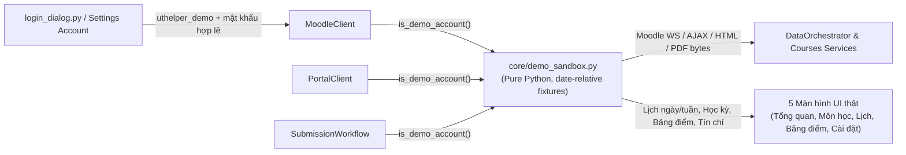

# Thiết kế Chuẩn hóa Android Package ID (`io.github.chouwzi.uthelper`) & Tài khoản Reviewer Demo cho CH Play

**Ngày:** 2026-11-24  
**Nhánh làm việc:** `feature/chplay-package-and-demo` (tách từ `origin/develop` `5b96c28`)  
**Phạm vi nền tảng:** Android (`chplay` `.aab` & `apk_lts` `.apk`) + iOS (`ipa`) cho định danh gói `io.github.chouwzi.uthelper`; kèm tầng Core/GUI dùng chung cho chế độ Reviewer Demo trên mọi nền tảng  
**Tài liệu kiến trúc liên quan:** [`ADR 0003`](../adr/0003-signed-release-update-channel.md), [`ADR 0004`](../adr/0004-multi-channel-store-and-lts-distribution.md), [`store-distribution-submission.md`](../guides/store-distribution-submission.md)

---

## 1. Mục tiêu & Lý do (Intent & Why)

UTHelper là ứng dụng đồng hành độc lập dành riêng cho sinh viên Trường Đại học Giao thông vận tải TP.HCM (UTH), kết nối trực tiếp tới các cổng `courses.ut.edu.vn`, `thnn.ut.edu.vn` và `portal-publicapp.ut.edu.vn` mà không vận hành máy chủ trung gian.

Để đưa ứng dụng lên **Google Play Store (CH Play)** an toàn, bền vững và đồng bộ cho toàn bộ nền tảng di động, dự án cần giải quyết hai bài toán cốt lõi:

1. **Định danh gói ứng dụng (`applicationId` / `bundle_id`) chuẩn mực & đồng bộ trên Mobile (Android & iOS)**:
   - Trường UTH đã có ứng dụng chính thức mang mã `vn.edu.ut.app`. Việc dùng tiền tố trường học có nguy cơ vi phạm *Chính sách Chống Mạo Danh (Impersonation Policy)* của Google Play; trong khi mã cũ `com.uthelper.uthelper` / `com.uthelper.UTHelper` lại dựa trên tên miền `uthelper.com` mà dự án không sở hữu.
   - Đổi đồng bộ `[tool.flet] org = "io.github.chouwzi"` cùng cả hai kênh Android (**`chplay`** và **`apk_lts`**) và gói **iOS (`ipa`)** sang **`io.github.chouwzi.uthelper`** (khớp với định danh nhà phát triển mở `github.com/Chouwzi/UTHelper` và tên miền `chouwzi.github.io` thuộc toàn quyền kiểm soát để xác minh Google Search Console / host `PRIVACY.md`).

2. **Tài khoản kiểm duyệt tích hợp sẵn (Reviewer Demo Sandbox) cho mục *App access* trên Play Console**:
   - Nhân viên và bot tự động (*Pre-launch Report / Robo test*) của Google không có mã số sinh viên UTH; việc cung cấp tài khoản sinh viên thật gây lộ dữ liệu cá nhân, có nguy cơ bị bot nộp/xóa nhầm bài thật và phụ thuộc trạng thái bảo trì/chặn IP quốc tế của máy chủ trường.
   - Cần một cơ chế **Reviewer Demo Sandbox ở tầng Service** kích hoạt đúng khi nhập cặp tài khoản kiểm duyệt định sẵn trên hộp thoại đăng nhập hiện hữu (không thêm nút phụ gây nhiễu cho sinh viên UTH), nạp bộ dữ liệu mẫu hư cấu nhưng chân thực cho đủ **5 màn hình chính** (`Tổng quan`, `Môn học`, `Lịch`, `Bảng điểm`, `Cài đặt`) hoàn toàn ngoại tuyến.

---

## 2. Goals, Non-Goals & Anti-Goals

### Goals (Mục tiêu đạt được)
- Chuyển đổi đồng bộ `applicationId` / `bundle_id` mặc định của Android (`chplay` `.aab`, `apk_lts` `.apk`) và iOS (`.ipa`) sang **`io.github.chouwzi.uthelper`** (cùng `[tool.flet] org = "io.github.chouwzi"`), bao gồm cấu hình Flet, runtime distribution profile, bộ tự cập nhật Android, script đóng gói/kiểm định APK/AAB/IPA, GitHub Actions workflows, tài liệu phát hành và bộ test.
- Cung cấp tài khoản Reviewer Demo xác thực cục bộ qua hộp thoại đăng nhập chuẩn (`login_dialog.py`), cho phép nhân viên duyệt app và bot kiểm thử trải nghiệm đầy đủ 5 tab chính với dữ liệu mẫu luôn tươi mới theo thời gian thực (`today`-relative).
- Khóa an toàn mọi thao tác ghi/đẩy dữ liệu lên máy chủ trường hoặc mở phiên WebView đăng nhập thật khi đang ở phiên Demo, kèm thông báo giải thích rõ ràng.
- Cập nhật hướng dẫn khai báo *App access* (tiếng Anh chuẩn) và quy trình chuyển đổi cho người dùng `apk_lts` cũ trong `docs/guides/store-distribution-submission.md` và `ADR 0004`.

### Non-Goals (Không thuộc phạm vi)
- Không đổi `UpgradeCode` GUID của bộ cài Windows MSI/Burn EXE (`Package.wxs` / `Bundle.wxs`), khóa nội bộ `single_instance.py` (`com.uthelper.UTHelper`), cơ chế cấp phát `MSSTORE_IDENTITY_NAME` của Microsoft Partner Center, hoặc các gói kiểm thử cô lập (`com.uthelper.qa`, `com.uthelper.benchmark`).
- Không đổi Kotlin `namespace` nội bộ của plugin native (`com.uthelper.backgroundsync` và `com.uthelper.quiz`), vì Android tách biệt hoàn toàn `namespace` biên dịch mã nguồn với `applicationId` phát hành.
- Không thêm nút *"Xem thử ứng dụng"* công khai trên màn hình đăng nhập ban đầu (giữ nguyên giao diện đăng nhập tối giản cho sinh viên UTH theo quyết định của chủ dự án).
- Không dựng máy chủ giả lập bên ngoài (mock HTTP server trên Internet).

### Anti-Goals (Điều tuyệt đối tránh)
- **Không vi phạm chính sách Cloaking của Google Play**: Phiên Demo tuyệt đối không được rẽ nhánh sang các màn hình UI giả lập riêng biệt; toàn bộ 5 màn hình phải chạy qua đúng code render, lọc, tìm kiếm, tính toán GPA và điều hướng thật của ứng dụng.
- **Không phát sinh bất kỳ lưu lượng mạng nào tới `*.ut.edu.vn`** khi đang đăng nhập bằng tài khoản Demo (kể cả đồng bộ ngầm `WorkManager` trên Android hay prefetch chi tiết).
- **Không lưu mật khẩu plaintext dạng hằng số lộ thiên trong mã nguồn** dễ gây cảnh báo quét bảo mật tĩnh, và không ghi đè/làm hỏng dữ liệu cache của tài khoản sinh viên thật trên cùng thiết bị.
- **Không phá vỡ ranh giới Clean Architecture** (`tests/test_architecture_boundaries.py`): `core` không được import `gui`; `gui` không gọi trực tiếp `core.ws_functions`; không nhồi logic điều phối dài vào `AppController`.

---

## 3. Ràng buộc kỹ thuật & Chính sách (Constraints)

1. **Ràng buộc Kiến trúc (`.agents/AGENTS.md` & `test_architecture_boundaries.py`)**:
   - Module Demo Sandbox phải nằm hoàn toàn trong `src/core/` (thuần Python, không import `flet` hay `gui.*`).
   - Không tạo thư mục `docs/superpowers/` (bị cấm bởi `tests/test_repository_governance.py`); tài liệu thiết kế và kế hoạch đặt tại `docs/plans/`, quyết định kiến trúc lâu dài cập nhật tại `docs/adr/0004-multi-channel-store-and-lts-distribution.md`.
2. **Ràng buộc Đóng gói & Cổng kiểm tra Phát hành**:
   - `scripts/verify_android_release.py`, `scripts/release_inventory.py`, `scripts/release_metadata.py`, `.github/workflows/build-android.yml` và `.github/workflows/release.yml` đều có các cổng kiểm tra fail-closed đối với package ID — tất cả phải khớp chính xác `io.github.chouwzi.uthelper` (trừ chế độ `apk_namespace=isolated` dùng `com.uthelper.qa` và benchmark dùng `com.uthelper.benchmark`).
   - Lưu ý di trú một lần cho người dùng `apk_lts` hiện hữu (`v2.2.8`–`v2.5.0` mang mã `com.uthelper.uthelper`): Android coi `io.github.chouwzi.uthelper` là ứng dụng độc lập mới, nên người dùng `apk_lts` cũ sẽ cài bản mới từ GitHub Releases và gỡ bản `com.uthelper.uthelper` cũ (cần ghi chú rõ trong tài liệu phát hành).
3. **Ràng buộc Kiểm duyệt Google Play**:
   - Dữ liệu mẫu trong chế độ Demo không được bị đóng băng ở một năm cố định khiến mọi bài tập đều hiện "Quá hạn" hoặc lịch tuần trống trơn khi Google kiểm duyệt lại sau vài tháng; mọi mốc thời gian phải tính tương đối từ ngày chạy thực tế (`datetime.now()`).

---

## 4. Các phương án đã cân nhắc & Lý do lựa chọn (Approaches)

### Hướng A: Sandbox ở tầng Service/Provider + Tài khoản Reviewer + Nút "Xem thử" trên `login_dialog.py`
- **Ưu điểm**: Phục vụ cả reviewer lẫn người dùng tò mò chưa có tài khoản UTH; dữ liệu động qua tầng service nên mọi thao tác *Làm mới* hay chuyển tuần đều mượt.
- **Nhược điểm**: Thêm nút phụ lên hộp thoại đăng nhập vốn chỉ dành riêng cho sinh viên trường UTH.

### Hướng B (Đã chọn): Sandbox ở tầng Service/Provider + Chỉ kích hoạt khi nhập cặp tài khoản Reviewer (Ẩn nút Xem thử)
- **Ưu điểm**:
  - Giữ giao diện `login_dialog.py` gọn gàng 100% như hiện tại cho sinh viên UTH.
  - Vẫn tương thích hoàn hảo với biểu mẫu **App access (Username + Password)** bắt buộc trên Google Play Console.
  - Chặn ngay tại ranh giới adapter/service (`MoodleClient`, `PortalClient`, `SubmissionWorkflow`), giúp toàn bộ `DataOrchestrator`, `CourseCatalogService`, `CourseActivityService`, `AcademicGradeService`, `CalendarView`, `DetailView`, `SettingsView` thực thi 100% đường code thật (không lo lỗi Cloaking, không hiện lỗi mất mạng khi bấm *Làm mới* hoặc lật *Tuần trước/Tuần sau*).
- **Nhược điểm**: Người dùng vãng lai không biết cặp tài khoản reviewer sẽ không vào chế độ xem thử (chấp nhận được vì ứng dụng chỉ phục vụ sinh viên UTH).

### Hướng C: Chỉ ghi sẵn file JSON vào bộ nhớ đệm cục bộ rồi chạy chế độ Offline
- **Ưu điểm**: Ít chạm vào `MoodleClient` / `PortalClient`.
- **Nhược điểm**: Bị loại vì khi reviewer hoặc bot bấm nút *Làm mới*, lật sang các tuần lịch ngoài vùng cache, hoặc mở tài liệu chưa cache sẽ hiện banner lỗi kết nối mạng, dễ dẫn tới bị từ chối bản duyệt.

---

## 5. Thiết kế chi tiết (Detailed Design)

### Phần 1: Đồng bộ Mobile Package / Bundle ID sang `io.github.chouwzi.uthelper`

Cập nhật hằng số định danh Mobile mặc định sang **`io.github.chouwzi.uthelper`** tại các điểm nguồn sự thật:

1. **Cấu hình dự án & Runtime Python**:
   - `pyproject.toml`: `[tool.flet] org = "io.github.chouwzi"`, `[tool.flet.android] bundle_id = "io.github.chouwzi.uthelper"`, và `[tool.flet.ios] bundle_id = "io.github.chouwzi.uthelper"`.
   - `src/core/distribution.py`: `DEFAULT_ANDROID_PACKAGE_ID = "io.github.chouwzi.uthelper"` (tự động cập nhật deep link `market://details?id=io.github.chouwzi.uthelper` và fallback `https://play.google.com/store/apps/details?id=io.github.chouwzi.uthelper`).
   - `src/platform_utils/android_updates.py`: `PACKAGE_ID = "io.github.chouwzi.uthelper"`.
2. **Script Build, Kiểm định & Release Inventory**:
   - `scripts/release_metadata.py`: `DEFAULT_ANDROID_PACKAGE_ID = "io.github.chouwzi.uthelper"`.
   - `scripts/verify_android_release.py`: kiểm tra canonical `package_id == "io.github.chouwzi.uthelper"`.
   - `scripts/verify_ipa_release.sh`: kiểm tra `BUNDLE_ID == "io.github.chouwzi.uthelper"`.
   - `scripts/release_inventory.py`: khóa package `.apk` và `.ipa` trong Schema 3 manifest là `"io.github.chouwzi.uthelper"`.
   - `scripts/build_android.ps1` & `scripts/package_msix.ps1`: truyền `--android-package-id "io.github.chouwzi.uthelper"` / giá trị tương ứng trong `distribution-channel.json`.
3. **GitHub Actions Workflows**:
   - `.github/workflows/build-android.yml`: đổi `APK_PACKAGE_ID` gốc (`original`) và `--package-id` của bước verify `chplay` sang `io.github.chouwzi.uthelper`; giữ nguyên tùy chọn `isolated` (`com.uthelper.qa`) cho manual QA APK.
   - `.github/workflows/release.yml`: đổi `--android-package-id`, `apkanalyzer manifest application-id`, `--package-id` (Android) và `--bundle-id` (iOS) sang `io.github.chouwzi.uthelper`.
   - `.github/workflows/package-benchmark.yml`: nhánh không cô lập Android và `--bundle-id` iOS dùng `io.github.chouwzi.uthelper`, nhánh `isolated` Android giữ `com.uthelper.benchmark`.
4. **Plugin Native & Bộ Test / Tài liệu**:
   - Các class Kotlin sản xuất trong `extensions/flet_uth_background_sync` vốn đã dùng `context.packageName` và `${applicationId}.uthupdates` động, không cần đổi tên gói Kotlin. Chỉ cập nhật các fixture kiểm thử trong `ApkUpdateInstallerTest.kt`, `extensions/flet_uth_background_sync/tests/test_package_contract.py` và các file `tests/test_*.py` / `tests/e2e_store_distribution/*` (bao gồm `test_package_unsigned_ipa.py`).
   - Cập nhật `docs/adr/0004-multi-channel-store-and-lts-distribution.md`, `docs/guides/store-distribution-submission.md`, `docs/testing/android-device-performance.md` (không sửa các file lịch sử trong `docs/archive/`).

---

### Phần 2: Kiến trúc Reviewer Demo Sandbox (`src/core/demo_sandbox.py`)

#### 2.1. Định danh & Xác thực Tài khoản Reviewer
- **Username chuẩn**: `uthelper_demo` (chấp nhận không phân biệt hoa thường sau khi `.strip()`). Chuỗi chữ cái + gạch dưới đảm bảo không bao giờ trùng với MSSV dạng số của sinh viên UTH thật.
- **Xác thực mật khẩu an toàn**:
  - Lưu hằng băm PBKDF2-HMAC-SHA256 (kèm salt cố định dành riêng cho demo verifier và `hmac.compare_digest`) ngay trong `src/core/demo_sandbox.py` thay vì đặt chuỗi mật khẩu thô trong code Python.
  - Chỉ khi nhập **đúng cả username `uthelper_demo` lẫn mật khẩu reviewer** thì `is_demo_credentials(username, password)` mới trả về `True`. Nhập `uthelper_demo` kèm mật khẩu sai sẽ trả về `False` (`"Sai mã số sinh viên hoặc mật khẩu."`) đúng chuẩn hành vi đăng nhập thật.
  - Giá trị mật khẩu reviewer cụ thể (`UTH-Review-2026!`) được ghi rõ trong mục hướng dẫn vận hành Play Console tại `docs/guides/store-distribution-submission.md` để chủ dự án copy-paste vào *Play Console → App content → App access*.
- **Lưu phiên qua lần khởi động lại**:
  - Đi theo đúng luồng `settings.UTH_USERNAME` / `settings.UTH_PASSWORD` + `save_settings()` hiện có (lưu qua kho khóa hệ điều hành, tách biệt namespace cache theo `uthelper_demo`) để nếu bot Robo test của Google đóng/mở lại app hoặc xoay màn hình thì phiên Demo vẫn duy trì mượt mà, không văng lại màn hình đăng nhập.

#### 2.2. Bộ dữ liệu mẫu động (`today`-relative) phủ kín 5 màn hình
Tất cả dữ liệu trong `src/core/demo_sandbox.py` là hư cấu 100% (không chứa bất kỳ dữ liệu sinh viên hay giảng viên thật nào), mang ngữ cảnh học tập ngành CNTT/Kỹ thuật tại UTH và tự động dịch chuyển mốc ngày theo `datetime.now()`:

1. **Tab `Tổng quan` & `DetailView`**:
   - 4 học phần tiêu biểu (3 môn trên `courses.ut.edu.vn` và 1 môn tiếng Anh/kỹ năng trên `thnn.ut.edu.vn`).
   - 6–8 hoạt động đa dạng trạng thái: bài tập khẩn cấp (còn ~8 giờ), bài tập sắp đến hạn (còn ~2 ngày), bài tập an toàn (còn ~6 ngày), bài tập đã nộp kèm file mẫu (`Bao_cao_nhom_01.pdf`), bài trắc nghiệm (`quiz`) có giới hạn thời gian & lịch sử lần làm thử kèm chi tiết câu hỏi xem lại, và mục điểm danh (`attendance`) có bảng chuyên cần.
   - Panel *Lịch học hôm nay* hiển thị 2 ca học trong ngày (sáng/chiều, phòng học, cơ sở Quận 12 / Bình Thạnh, trạng thái buổi học).
2. **Tab `Môn học` (`Courses` & `THNN`)**:
   - Đầy đủ mục lục tuần/chương (`CourseSection`), thông báo giảng viên (`forum`), trang nội dung (`page`), nhãn (`label`), bài tập, quiz và **tài liệu đính kèm xem trực tiếp trong app**:
     - Ít nhất 1 tệp **PDF bài giảng** được sinh động hợp lệ bằng Python thuần trong bộ nhớ (mở được ngay bằng trình đọc PDF offline trong app mà không cần mạng).
     - Tệp tài liệu `.md` / `.txt` / `.zip` nhỏ gọn sinh trong bộ nhớ để trình duyệt tài liệu và `ArchiveExplorerView` mở xem trước mượt mà.
   - Bảng điểm thành phần của từng môn (`gradereport_user_get_grade_items` & HTML bảng điểm THNN).
3. **Tab `Lịch` (`CalendarView` & `ScheduleWeekView`)**:
   - Kết hợp hạn nộp bài tập theo tháng và thời khóa biểu tuần từ `PortalClient.fetch_week(week_anchor, ...)`: sinh lịch học cố định cho các thứ trong tuần xoay quanh `week_anchor` bất kỳ (nhờ đó bấm **Tuần trước**, **Hôm nay**, **Tuần sau** đều có lịch học hợp lệ kèm modal *Chi tiết buổi học* và *Đề cương chi tiết học phần* Markdown).
4. **Tab `Bảng điểm` (`GradeOverviewView` & Academic Radar)**:
   - Bảng điểm đa học kỳ (3 học kỳ mẫu) qua `PortalClient.fetch_full_transcript`, biểu đồ năng lực `Academic Radar`, tiến độ tích lũy tín chỉ (`fetch_credit_progress`, ví dụ `78 / 132 tín chỉ`), hộp thoại chi tiết điểm 2 tab và công cụ tính điểm kỳ vọng.
5. **Tab `Cài đặt` (`SettingsView`)**:
   - Hiển thị bình thường toàn bộ cài đặt giao diện (9 theme), thông báo, quyền riêng tư; trong phần **Tài khoản**, hiển thị ghi chú rõ đang ở phiên **Tài khoản kiểm duyệt / Xem thử (`uthelper_demo`)** và cho phép nhập MSSV thật để chuyển sang tài khoản sinh viên thật bất cứ lúc nào.

#### 2.3. Các điểm chặn an toàn (Safety Guards) trong phiên Demo
1. **Ranh giới Adapter (`MoodleClient` & `PortalClient`)**:
   - Khi `is_demo_account(username)` bật: chặn đứng trước mọi lời gọi `urllib` ra mạng ngoài. Mọi hàm đọc trả dữ liệu từ `demo_sandbox.py`; mọi hàm ghi (`upload_draft_file*`, `remove_assignment_submission`, `delete_draft_file`, `submit_session_form`, `set_manual_completion`, và các WS ghi như `mod_assign_save_submission` / `mod_assign_submit_for_grading`) từ chối ngay lập tức mà không chạm mạng.
2. **Ranh giới Nộp bài (`SubmissionWorkflow`)**:
   - Khi chạy với tài khoản Demo, `load_snapshot` vẫn hiển thị đầy đủ trạng thái & danh sách file mẫu của bài tập để reviewer kiểm tra giao diện, nhưng các thao tác nộp/xóa/sửa file trả về lỗi nghiệp vụ thân thiện, hiển thị rõ trên UI: *"Tài khoản xem thử (Demo) chỉ dùng để tham khảo giao diện, không gửi thay đổi lên máy chủ UTH."*
3. **Ranh giới WebView / Quiz Live & Đồng bộ nền Android (`AppController`)**:
   - Không đẩy token giả của tài khoản Demo xuống `AndroidBackgroundSyncBridge` (`WorkManager` / `AlarmScheduler` native không chạy đồng bộ ngầm tới `courses.ut.edu.vn` khi đang ở phiên Demo).
   - Khi người dùng trong phiên Demo bấm mở liên kết `*.ut.edu.vn` trực tiếp bằng In-App WebView, trình duyệt ngoài hoặc bắt đầu làm bài Quiz trực tuyến qua WebView (`_open_url_in_app`, `_open_url_external`, `_start_course_quiz` / `QuizPlayerView`), ứng dụng không mở trang đăng nhập Moodle thật (tránh làm reviewer tưởng tính năng bị chặn đăng nhập lần 2) mà hiển thị thông báo rõ: *"Phiên xem thử (Demo) sử dụng dữ liệu mẫu ngoại tuyến. Đăng nhập bằng tài khoản sinh viên UTH để mở cổng LMS trực tuyến."*

---

## 6. Phần để người lập kế hoạch / triển khai quyết định (Left to the Builder)

- Cấu trúc chi tiết các hàm helper bên trong `src/core/demo_sandbox.py` (có thể chia submodule `src/core/demo/` nếu file vượt quá ~500 dòng để dễ đọc và bảo trì theo Clean Code).
- Nội dung văn bản cụ thể của tên môn học, tiêu đề bài tập, đề cương học phần và trang PDF mẫu (miễn là chuẩn tiếng Việt đại học kỹ thuật/giao thông, không chứa thông tin cá nhân thật).
- Bố cục câu chữ thông báo trạng thái tài khoản Demo trong `account_section.py` sao cho hài hòa trên cả 9 theme sáng/tối và màn hình hẹp mobile.
