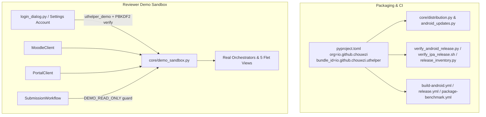

# CH Play Mobile Package Identity & Reviewer Demo Sandbox Implementation Plan

> **For agentic workers:** REQUIRED SUB-SKILL: Use superpowers:subagent-driven-development (recommended) or superpowers:executing-plans to implement this plan task-by-task. Steps use checkbox (`- [ ]`) syntax for tracking.

**Goal:** Align mobile package/bundle identifiers (`chplay`, `apk_lts`, and iOS `ipa`) to `io.github.chouwzi.uthelper` and implement a service-level Reviewer Demo Sandbox (`uthelper_demo`) covering all 5 app screens offline for Google Play Console *App access* review.

**Architecture:** Mobile packaging constants, release verifiers, and CI workflows are unified on `io.github.chouwzi.uthelper` while preserving Windows WiX `UpgradeCode` GUIDs, `single_instance.py` local mutex naming, Partner Center `MSSTORE_IDENTITY_NAME`, and internal Kotlin `com.uthelper.backgroundsync` namespaces. A pure-Python `src/core/demo_sandbox.py` module intercepts `MoodleClient`, `PortalClient`, and `SubmissionWorkflow` mutations when signed in as `uthelper_demo`, feeding date-relative UTH coursework, schedules, grades, and valid in-memory PDF/Markdown/ZIP lecture bytes through 100% real orchestrator/UI code paths with thin GUI guards on live WebView/native background sync.

**Architecture Diagram:**



**Tech Stack:** Python 3.11+, Flet `0.86.5`, `hashlib.pbkdf2_hmac` + `hmac.compare_digest`, `pypdf` / `zipfile`, PowerShell & GitHub Actions CI, `pytest` + `ruff`.

**Spec:** [2026-11-24-chplay-package-and-demo-design.md](file:///e:/Projects/UTH-Elearning-Alert/docs/plans/2026-11-24-chplay-package-and-demo-design.md)

## Global Constraints

- Canonical mobile package/bundle ID for Android (`chplay`, `apk_lts`) and iOS (`ipa`): `io.github.chouwzi.uthelper`; canonical Flet org: `io.github.chouwzi`.
- Preserved non-mobile / isolated identifiers: Windows `single_instance.py` (`com.uthelper.UTHelper`), Windows MSIX local fallback `IdentityName` (`com.uthelper.UTHelper`), QA APK (`com.uthelper.qa`), benchmark APK (`com.uthelper.benchmark`), Kotlin library namespace (`com.uthelper.backgroundsync`), and historical files under `docs/archive/**`.
- Canonical Reviewer Demo username: `uthelper_demo` (matched case-insensitively after `.strip()`, normalized to `"uthelper_demo"` on login). Reviewer password documented only in `docs/guides/store-distribution-submission.md` (`UTH-Review-2026!`) and verified in code via `PBKDF2-HMAC-SHA256` (`200_000` iterations) + `hmac.compare_digest` without storing the plaintext password string in `src/`.
- Clean Architecture invariants (`tests/test_architecture_boundaries.py`): `src/core/**` must never import `gui` or `flet`; `src/gui/**` must never import `core.ws_functions`; `docs/superpowers/` must never exist (`tests/test_repository_governance.py`).
- Zero outbound HTTP/DNS requests to `*.ut.edu.vn` or background `WorkManager` token registration while `is_demo_account(username)` is active.

## Review Focus

1. **Reviewer username casing/whitespace vs wrong password**: `"  UTHelper_Demo  "` with valid password authenticates and normalizes `UTH_USERNAME` to `"uthelper_demo"`, whereas `"uthelper_demo"` with wrong/empty password fails closed (`False` / `PortalAuthError`) and never enables demo data.
2. **Future/past review dates & week navigation across year boundaries**: Calling demo generators with `now` in 2027/2028 or stepping `week_anchor` across December/January always yields active upcoming deadlines and populated weekly class sessions.
3. **Strict offline zero-network guarantee**: With `urllib.request.urlopen` / `MoodleClient._urlopen` patched to raise `AssertionError`, all 5 screen data flows (`DataOrchestrator`, `CourseCatalogService`, `CourseActivityService`, `AcademicGradeService`, `PortalClient.fetch_day`/`fetch_week`, file preview download, and `SubmissionWorkflow` read/mutate) succeed or return `DEMO_READ_ONLY` with zero network calls.
4. **Account switch isolation (`uthelper_demo` <-> real MSSV)**: Switching from `uthelper_demo` to a numeric MSSV updates cache namespaces and restores real network client routing without leaking demo courses/grades into the student's namespace.
5. **In-app lecture file fidelity**: Demo PDF lecture bytes parse cleanly via `pypdf.PdfReader` with >=1 page, and demo `.zip` archive bytes list & extract cleanly through `ArchiveService`.

---

### Task 1: Unified Mobile Package Identity (`io.github.chouwzi.uthelper`) Across Android & iOS

**Files:**
- Modify: [pyproject.toml](file:///e:/Projects/UTH-Elearning-Alert/pyproject.toml#L49-L138)
- Modify: [distribution.py](file:///e:/Projects/UTH-Elearning-Alert/src/core/distribution.py#L19-L21)
- Modify: [android_updates.py](file:///e:/Projects/UTH-Elearning-Alert/src/platform_utils/android_updates.py#L28)
- Modify: [release_metadata.py](file:///e:/Projects/UTH-Elearning-Alert/scripts/release_metadata.py#L16)
- Modify: [verify_android_release.py](file:///e:/Projects/UTH-Elearning-Alert/scripts/verify_android_release.py#L893-L895)
- Modify: [verify_ipa_release.sh](file:///e:/Projects/UTH-Elearning-Alert/scripts/verify_ipa_release.sh#L22)
- Modify: [release_inventory.py](file:///e:/Projects/UTH-Elearning-Alert/scripts/release_inventory.py#L55-L78)
- Modify: [build_android.ps1](file:///e:/Projects/UTH-Elearning-Alert/scripts/build_android.ps1#L172-L198)
- Modify: [package_msix.ps1](file:///e:/Projects/UTH-Elearning-Alert/scripts/package_msix.ps1#L184-L190)
- Modify: [build-android.yml](file:///e:/Projects/UTH-Elearning-Alert/.github/workflows/build-android.yml)
- Modify: [release.yml](file:///e:/Projects/UTH-Elearning-Alert/.github/workflows/release.yml)
- Modify: [package-benchmark.yml](file:///e:/Projects/UTH-Elearning-Alert/.github/workflows/package-benchmark.yml)
- Modify: `extensions/flet_uth_background_sync/tests/test_package_contract.py` & `extensions/flet_uth_background_sync/flutter/flet_uth_background_sync/android/variants/apk_lts/test/kotlin/com/uthelper/backgroundsync/update/ApkUpdateInstallerTest.kt`
- Test: `tests/test_distribution.py`, `tests/test_chplay_packaging.py`, `tests/test_verify_android_release.py`, `tests/test_release_inventory.py`, `tests/test_release_metadata.py`, `tests/test_release_hardening.py`, `tests/test_android_updates.py`, `tests/test_background_sync_bridge.py`, `tests/test_package_unsigned_ipa.py`, `tests/test_msstore_packaging.py`, `tests/test_settings_update_ui.py`, `tests/test_update_packages.py`, `tests/test_gui_app_controller.py`, `tests/test_measure_android_install.py`, `tests/e2e_store_distribution/**`

**Interfaces:**
- Produces:
  - `core.distribution.DEFAULT_ANDROID_PACKAGE_ID == "io.github.chouwzi.uthelper"`
  - `platform_utils.android_updates.PACKAGE_ID == "io.github.chouwzi.uthelper"`
  - `scripts.release_metadata.DEFAULT_ANDROID_PACKAGE_ID == "io.github.chouwzi.uthelper"`

> [!IMPORTANT]
> Keep `com.uthelper.backgroundsync` (Kotlin receiver/plugin class paths), `com.uthelper.qa`, `com.uthelper.benchmark`, `single_instance.py` (`com.uthelper.UTHelper`), MSIX `IdentityName = "com.uthelper.UTHelper"`, and `docs/archive/**` unchanged.

- [ ] **Step 1: Update packaging contract assertions first to pin `io.github.chouwzi.uthelper`**

Update expected mobile package/bundle IDs in `tests/test_distribution.py`, `tests/test_chplay_packaging.py`, `tests/test_release_hardening.py`, `tests/test_release_inventory.py`, `tests/test_package_unsigned_ipa.py`, and related packaging test suites so they assert:
```python
assert DEFAULT_ANDROID_PACKAGE_ID == "io.github.chouwzi.uthelper"
assert config["tool"]["flet"]["org"] == "io.github.chouwzi"
assert config["tool"]["flet"]["android"]["bundle_id"] == "io.github.chouwzi.uthelper"
assert config["tool"]["flet"]["ios"]["bundle_id"] == "io.github.chouwzi.uthelper"
```

- [ ] **Step 2: Run packaging tests to verify they fail against old `com.uthelper.*` values**

Run: `$env:PYTHONPATH = "src;extensions/flet_uth_background_sync/src;."; .\.venv\Scripts\python.exe -m pytest tests/test_distribution.py tests/test_release_metadata.py tests/test_package_unsigned_ipa.py -q --tb=short`
Expected: FAIL on `com.uthelper.uthelper` / `com.uthelper.UTHelper` mismatches.

- [ ] **Step 3: Update `pyproject.toml`, runtime constants, release/build scripts, and GitHub workflows**

Apply the canonical mobile identity changes:
```diff
 [tool.flet]
-org = "com.uthelper"
+org = "io.github.chouwzi"
 ...
 [tool.flet.android]
 legacy_packaging = true
-bundle_id = "com.uthelper.uthelper"
+bundle_id = "io.github.chouwzi.uthelper"
 ...
 [tool.flet.ios]
-bundle_id = "com.uthelper.UTHelper"
+bundle_id = "io.github.chouwzi.uthelper"
```
Update `DEFAULT_ANDROID_PACKAGE_ID`, `PACKAGE_ID`, `verify_android_release.py`, `verify_ipa_release.sh`, `release_inventory.py`, `build_android.ps1`, `package_msix.ps1` (`android_package_id`), `.github/workflows/build-android.yml`, `.github/workflows/release.yml`, `.github/workflows/package-benchmark.yml`, and remaining test fixtures (`ApkUpdateInstallerTest.kt`, `test_package_contract.py`, `tests/e2e_store_distribution/**`, etc.).

- [ ] **Step 4: Run all packaging, release, controller, and E2E store distribution tests**

Run: `$env:PYTHONPATH = "src;extensions/flet_uth_background_sync/src;extensions/flet_uth_quiz/src;."; .\.venv\Scripts\python.exe -m pytest tests/test_distribution.py tests/test_chplay_packaging.py tests/test_verify_android_release.py tests/test_release_inventory.py tests/test_release_metadata.py tests/test_release_hardening.py tests/test_android_updates.py tests/test_background_sync_bridge.py tests/test_package_unsigned_ipa.py tests/test_msstore_packaging.py tests/test_settings_update_ui.py tests/test_update_packages.py tests/test_measure_android_install.py extensions/flet_uth_background_sync/tests tests/e2e_store_distribution -q --tb=short`
Expected: PASS (0 failed).

- [ ] **Step 5: Commit**

```powershell
git add pyproject.toml src/core/distribution.py src/platform_utils/android_updates.py scripts/ .github/workflows/ extensions/flet_uth_background_sync/ tests/
git commit -m "feat(packaging): unify Android and iOS bundle IDs on io.github.chouwzi.uthelper"
```

---

### Task 2: Pure Reviewer Demo Sandbox Module (`src/core/demo_sandbox.py`)

**Files:**
- Create: [demo_sandbox.py](file:///e:/Projects/UTH-Elearning-Alert/src/core/demo_sandbox.py)
- Create: [test_demo_sandbox.py](file:///e:/Projects/UTH-Elearning-Alert/tests/test_demo_sandbox.py)

**Interfaces:**
- Produces (in `core.demo_sandbox`):
  - `DEMO_USERNAME: str = "uthelper_demo"`
  - `DEMO_USER_ID: int = 990_001`
  - `normalize_demo_username(username: str | None) -> str`
  - `is_demo_account(username: str | None) -> bool`
  - `is_demo_credentials(username: str | None, password: str | None) -> bool`
  - `handle_demo_ws_call(function: str, params: Mapping[str, Any], *, site_origin: str = "https://courses.ut.edu.vn", now: datetime | None = None) -> Any`
  - `handle_demo_ajax_call(function: str, params: Mapping[str, Any], *, site_origin: str = "https://thnn.ut.edu.vn", now: datetime | None = None) -> dict[str, Any]`
  - `render_demo_session_html(url: str, *, now: datetime | None = None) -> tuple[str, str, bool]`
  - `render_demo_grade_report_html(course_id: int, *, site_origin: str) -> str`
  - `get_demo_file_bytes(url: str) -> bytes | None`
  - `get_demo_day_schedule(target_date: date) -> DailyScheduleSnapshot`
  - `get_demo_week_schedule(week_anchor: date) -> WeekScheduleSnapshot`
  - `get_demo_credit_progress() -> dict[str, Any]`
  - `get_demo_full_transcript() -> list[dict[str, Any]]`
  - `get_demo_current_semester_courses() -> tuple[str, list[dict[str, Any]]]`

- [ ] **Step 1: Write failing unit tests in `tests/test_demo_sandbox.py` covering auth, date-relative fixtures, and file generation**

Include tests for all Review Focus invariants owned by `demo_sandbox`:
```python
def test_demo_credentials_accept_trimmed_case_insensitive_username_and_reject_wrong_password():
    pw = "UTH-" + "Review-2026!"
    assert is_demo_credentials("  UTHelper_Demo  ", pw) is True
    assert normalize_demo_username("  UTHelper_Demo  ") == "uthelper_demo"
    assert is_demo_credentials("uthelper_demo", "wrong-pass") is False
    assert is_demo_credentials("uthelper_demo", "") is False
    assert is_demo_account("2251120001") is False

def test_demo_ws_and_schedule_remain_fresh_for_future_review_dates():
    future_now = datetime(2028, 1, 2, 9, 0, 0)  # Year-boundary week
    events = handle_demo_ws_call("core_calendar_get_action_events_by_timesort", {}, now=future_now)
    assert any(ev["timestart"] > int(future_now.timestamp()) for ev in events["events"])
    week = get_demo_week_schedule(date(2028, 1, 2))
    assert len(week.sessions) >= 4

def test_demo_lecture_pdf_and_zip_bytes_are_valid_in_memory():
    # Verify PDF parses via pypdf.PdfReader and ZIP extracts via ArchiveService
    ...
```

- [ ] **Step 2: Run `tests/test_demo_sandbox.py` to verify it fails**

Run: `$env:PYTHONPATH = "src;."; .\.venv\Scripts\python.exe -m pytest tests/test_demo_sandbox.py -v`
Expected: FAIL with `ModuleNotFoundError: No module named 'core.demo_sandbox'`.

- [ ] **Step 3: Implement `src/core/demo_sandbox.py`**

- Compute PBKDF2-HMAC-SHA256 (`200_000` rounds, dedicated constant salt bytes, `hmac.compare_digest` against the precomputed hex digest of `"UTH-Review-2026!"`; never store the raw password literal in `src/core/demo_sandbox.py`).
- Build a cohesive fictional UTH dataset (`Nguyễn Minh Khôi`, MSSV hiển thị mẫu `00002026`, ngành Công nghệ thông tin) with 3 `courses.ut.edu.vn` courses (`Lập trình mạng`, `Hệ cơ sở dữ liệu phân tán`, `An toàn thông tin`) + 1 `thnn.ut.edu.vn` course (`Tiếng Anh chuyên ngành CNTT`), covering urgent/warning/safe/submitted assignments (`Bao_cao_nhom_01.pdf`), a timed quiz with reviewable attempt HTML/WS payload, attendance records, `CourseSection` modules (forum announcements, pages, labels, PDF lecture, Markdown summary, `.zip` sample lab code), `DailyScheduleSnapshot` & `WeekScheduleSnapshot` (with Markdown syllabus & campus/room details), 3-semester transcript (`fetch_full_transcript`), and credit progress (`78 / 132` credits).
- Reject write WS calls (`mod_assign_save_submission`, `mod_assign_submit_for_grading`, `core_completion_update_activity_completion_status_manually`, etc.) by returning a Moodle exception dict `{"exception": "moodle_exception", "errorcode": "demo_read_only", "message": "Demo mode is read-only"}`.

- [ ] **Step 4: Run `tests/test_demo_sandbox.py` and architecture boundary checks**

Run: `$env:PYTHONPATH = "src;."; .\.venv\Scripts\python.exe -m pytest tests/test_demo_sandbox.py tests/test_architecture_boundaries.py -q --tb=short`
Expected: PASS.

- [ ] **Step 5: Commit**

```powershell
git add src/core/demo_sandbox.py tests/test_demo_sandbox.py
git commit -m "feat(core): add date-relative reviewer demo sandbox module"
```

---

### Task 3: Wire `MoodleClient`, `PortalClient` & `SubmissionWorkflow` Read-Only Demo Seams

**Files:**
- Modify: [client.py](file:///e:/Projects/UTH-Elearning-Alert/src/core/client.py)
- Modify: [portal_client.py](file:///e:/Projects/UTH-Elearning-Alert/src/core/portal_client.py)
- Modify: [service.py](file:///e:/Projects/UTH-Elearning-Alert/src/core/academic_radar/service.py)
- Modify: [submission_workflow.py](file:///e:/Projects/UTH-Elearning-Alert/src/core/use_cases/submission_workflow.py)
- Modify: [submission_presenter.py](file:///e:/Projects/UTH-Elearning-Alert/src/gui/components/detail/submission_presenter.py)
- Create: [test_demo_service_seams.py](file:///e:/Projects/UTH-Elearning-Alert/tests/test_demo_service_seams.py)

**Interfaces:**
- Consumes: `core.demo_sandbox` functions from Task 2.
- Produces:
  - `SubmissionErrorCode.DEMO_READ_ONLY = "demo_read_only"` in `core.use_cases.submission_workflow`
  - Vietnamese presenter copy in `gui.components.detail.submission_presenter`: `"Tài khoản xem thử (Demo) chỉ hỗ trợ xem dữ liệu mẫu, không gửi bài nộp lên máy chủ UTH."`

- [ ] **Step 1: Write failing integration tests in `tests/test_demo_service_seams.py`**

Patch `core.client._urlopen` and `urllib.request.build_opener` to raise `AssertionError("Outbound network forbidden in demo mode")`, configure `settings.UTH_USERNAME = "uthelper_demo"` and valid password, and assert:
1. `MoodleClient().login("  UTHelper_Demo ", pw, force=True)` returns `True`, keeps `settings.MOODLE_WS_TOKEN == ""`, and rejects wrong passwords with `False`.
2. `DataOrchestrator().fetch_activity_outcome_async()` & `fetch_full_details(url)` return complete activities and details (assignments, quiz, attendance, THNN) with zero network calls.
3. `CourseCatalogService` + `CourseActivityService` load both `courses` and `thnn` courses, sections, grades, and download valid PDF/ZIP preview bytes offline.
4. `PortalClient.fetch_day`, `PortalClient.fetch_week`, `AcademicGradeService.load_academic_data`, and `AcademicGradeService.load_credit_progress` return populated snapshots offline, while wrong demo password raises `PortalAuthError`.
5. `SubmissionWorkflow.load_snapshot` succeeds on demo assignments, while `mutate_files` and `finalize_submission` fail closed with `SubmissionErrorCode.DEMO_READ_ONLY` and zero network calls.
6. Switching `settings.UTH_USERNAME` to `"2251120001"` restores normal non-demo routing.

- [ ] **Step 2: Run `tests/test_demo_service_seams.py` to verify it fails**

Run: `$env:PYTHONPATH = "src;."; .\.venv\Scripts\python.exe -m pytest tests/test_demo_service_seams.py -q --tb=short`
Expected: FAIL because `MoodleClient` / `PortalClient` attempt live network requests.

- [ ] **Step 3: Implement demo routing in `MoodleClient`, `PortalClient`, `AcademicGradeService`, `SubmissionWorkflow`, and `submission_presenter.py`**

- **`MoodleClient` (`src/core/client.py`)**:
  - `has_site_credentials`: return `True` when `is_demo_account(settings.UTH_USERNAME)` and `self._moodle_site is not None`.
  - `login` / `login_session`: if `is_demo_account(username)`, validate via `is_demo_credentials(username, password)`; on success clear `settings.MOODLE_WS_TOKEN = ""` and `settings.MOODLE_WS_TOKEN_ORIGIN = ""`, set `self._last_login_error = ""`, and return `True`; on failure set `self._last_login_error = "invalid_credentials"` and return `False`.
  - `call_ws_api`, `call_ajax_api`, `open_session_url`, `open_session_raw`, `fetch_grade_report_html`, `get_user_id`, `download_file`, `download_file_to_path`, `download_session_file`, `download_session_file_to_path`: route to `core.demo_sandbox` when `is_demo_account(settings.UTH_USERNAME)` is `True` without calling `_urlopen` or `_open_html`.
  - Mutation methods (`upload_draft_file_result`, `remove_assignment_submission`, `delete_draft_file`, `submit_session_form`): fail closed without network calls when `is_demo_account(settings.UTH_USERNAME)` is `True`.
- **`PortalClient` (`src/core/portal_client.py`) & `AcademicGradeService` (`src/core/academic_radar/service.py`)**:
  - In `PortalClient.fetch_day`, `fetch_week`, `fetch_credit_progress`, `fetch_full_transcript`, `fetch_current_semester_courses`: when `is_demo_account(username)` is `True`, verify `is_demo_credentials(username, password)` (raising `PortalAuthError(401)` if invalid) and return the corresponding `core.demo_sandbox` payload (note `AcademicGradeService.load_credit_progress` calls `parse_credit_progress` on `fetch_credit_progress`).
- **`SubmissionWorkflow` & `submission_presenter.py`**:
  - Add `SubmissionErrorCode.DEMO_READ_ONLY = "demo_read_only"` and short-circuit `mutate_files` / `finalize_submission` after `load_snapshot` when `is_demo_account(settings.UTH_USERNAME)` is `True`.

- [ ] **Step 4: Run `tests/test_demo_service_seams.py` and existing Moodle/Portal/Submission test suites**

Run: `$env:PYTHONPATH = "src;."; .\.venv\Scripts\python.exe -m pytest tests/test_demo_service_seams.py tests/test_moodle_service.py tests/test_submission_workflow.py tests/test_portal_client.py tests/test_academic_radar.py -q --tb=short`
Expected: PASS.

- [ ] **Step 5: Commit**

```powershell
git add src/core/client.py src/core/portal_client.py src/core/academic_radar/service.py src/core/use_cases/submission_workflow.py src/gui/components/detail/submission_presenter.py tests/test_demo_service_seams.py
git commit -m "feat(core): wire Moodle, Portal, and submission read-only demo seams"
```

---

### Task 4: GUI Guards (`login_dialog.py`, `AppController`, `SettingsView`) & Store Submission Docs

**Files:**
- Modify: [login_dialog.py](file:///e:/Projects/UTH-Elearning-Alert/src/gui/components/login_dialog.py#L128-L140)
- Modify: [app_controller.py](file:///e:/Projects/UTH-Elearning-Alert/src/gui/app_controller.py)
- Modify: [courses_coordinator.py](file:///e:/Projects/UTH-Elearning-Alert/src/gui/controllers/courses_coordinator.py)
- Modify: [account_section.py](file:///e:/Projects/UTH-Elearning-Alert/src/gui/components/settings/account_section.py)
- Modify: [settings_view.py](file:///e:/Projects/UTH-Elearning-Alert/src/gui/components/settings_view.py)
- Modify: [0004-multi-channel-store-and-lts-distribution.md](file:///e:/Projects/UTH-Elearning-Alert/docs/adr/0004-multi-channel-store-and-lts-distribution.md)
- Modify: [store-distribution-submission.md](file:///e:/Projects/UTH-Elearning-Alert/docs/guides/store-distribution-submission.md)
- Modify: [android-device-performance.md](file:///e:/Projects/UTH-Elearning-Alert/docs/testing/android-device-performance.md)
- Modify: [refactoring-log.md](file:///e:/Projects/UTH-Elearning-Alert/docs/architecture/refactoring-log.md)
- Create: [test_demo_gui_guards.py](file:///e:/Projects/UTH-Elearning-Alert/tests/test_demo_gui_guards.py)

**Interfaces:**
- Consumes: `normalize_demo_username`, `is_demo_account` from `core.demo_sandbox`.
- Produces:
  - Demo live-LMS WebView guard copy: `"Phiên xem thử (Demo) sử dụng dữ liệu mẫu ngoại tuyến. Đăng nhập bằng tài khoản sinh viên UTH để mở cổng LMS trực tuyến."`
  - Demo account banner in `Settings -> Tài khoản`: `"Đang dùng tài khoản xem thử (Demo) với dữ liệu mẫu ngoại tuyến. Nhập MSSV và mật khẩu thật bên dưới để chuyển sang tài khoản sinh viên UTH."`

- [ ] **Step 1: Write failing GUI guard tests in `tests/test_demo_gui_guards.py`**

Test that when `settings.UTH_USERNAME == "uthelper_demo"`:
1. `login_dialog` normalizes `"  UTHelper_Demo  "` to `"uthelper_demo"` on successful login without adding any extra demo button to the login dialog control tree.
2. `AppController._native_background_credentials()` returns `("", "")` so Android `WorkManager` never polls Moodle in Demo Mode.
3. `AppController._open_url_in_app("https://courses.ut.edu.vn/mod/assign/view.php?id=101")`, `_open_url_external("https://courses.ut.edu.vn/...")`, and `_start_course_quiz(...)` show the Demo snackbar and do **not** mount `CoursesWebViewPane`, launch external browser, or start `QuizPlayerView` (while non-UTH external links such as Google Play store links still open normally).
4. `SettingsView` Account section displays the visible Demo banner when `is_demo_account(settings.UTH_USERNAME)` is `True` and hides it for real MSSVs.

- [ ] **Step 2: Run `tests/test_demo_gui_guards.py` to verify it fails**

Run: `$env:PYTHONPATH = "src;."; .\.venv\Scripts\python.exe -m pytest tests/test_demo_gui_guards.py -q --tb=short`
Expected: FAIL.

- [ ] **Step 3: Implement thin GUI guards, Settings Demo notice, and documentation updates**

- **`login_dialog.py` & `settings_view.py` (`_handle_test_login` / save)**: normalize `username_field.value` via `normalize_demo_username(...)` when `is_demo_account(...)` is `True` (keeping `login_dialog.py` visual layout unchanged per Approach B).
- **`app_controller.py` & `courses_coordinator.py` / `detail_view.py` quiz trigger**:
  - `_native_background_credentials()`: return `("", "")` immediately if `is_demo_account(settings.UTH_USERNAME)`.
  - Guard live UTH WebView / external UTH LMS launches (`*.ut.edu.vn` hosts) and live Quiz Player launch when `is_demo_account(settings.UTH_USERNAME)` is `True`, showing the Demo snackbar instead of opening a live Moodle login page (keep local `http://127.0.0.1:...` `LocalPreviewServer` URLs for in-app PDF/DOCX/PPTX preview working!).
- **`account_section.py` & `settings_view.py`**: add a themed info banner (`view._demo_account_banner`) visible iff `is_demo_account(settings.UTH_USERNAME)`, refreshed on theme change and account save.
- **Docs (`ADR 0004`, `store-distribution-submission.md`, `android-device-performance.md`, `refactoring-log.md`)**:
  - Update `com.uthelper.uthelper` references to `io.github.chouwzi.uthelper` and document the one-time reinstall note for legacy `v2.2.8`–`v2.5.0` `apk_lts` users.
  - Add Section **Play Console `App access` (Reviewer Demo Credentials)** in `docs/guides/store-distribution-submission.md` with exact copy-paste English instructions, Username `uthelper_demo`, and Password `UTH-Review-2026!`.

- [ ] **Step 4: Run full verification suite (`pytest` + `ruff` + governance & boundary checks)**

Run:
```powershell
$env:PYTHONPATH = "src;extensions/flet_uth_background_sync/src;extensions/flet_uth_quiz/src;."
.\.venv\Scripts\python.exe -m ruff check src tests scripts extensions/flet_uth_quiz extensions/flet_uth_background_sync
.\.venv\Scripts\python.exe -m pytest tests extensions/flet_uth_quiz/tests extensions/flet_uth_background_sync/tests -q --tb=short
```
Expected: `All checks passed!` and 100% pytest pass (0 failed).

- [ ] **Step 5: Commit**

```powershell
git add src/gui/ docs/ tests/test_demo_gui_guards.py
git commit -m "feat(chplay): add demo GUI guards, reviewer App Access guide, and ADR updates"
```
